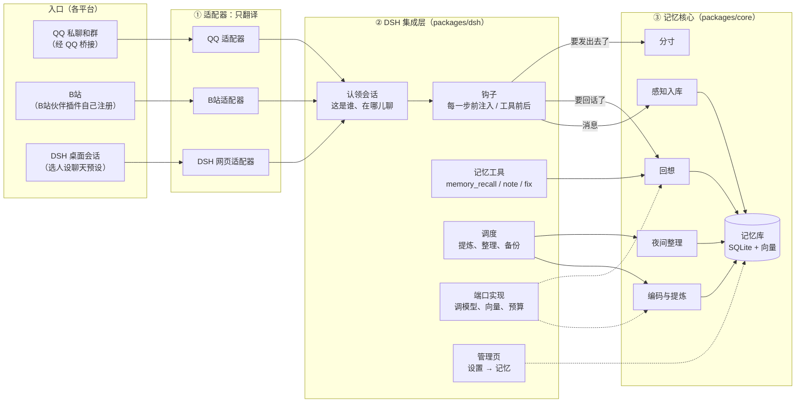
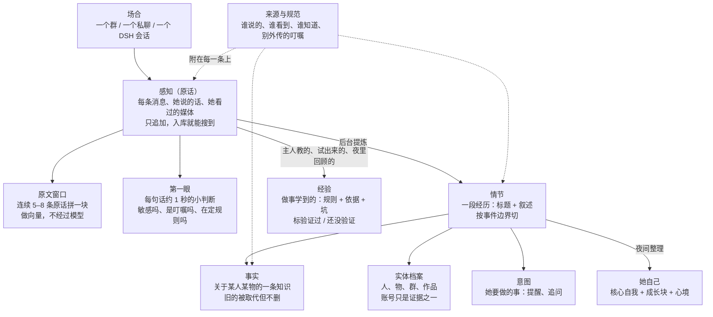
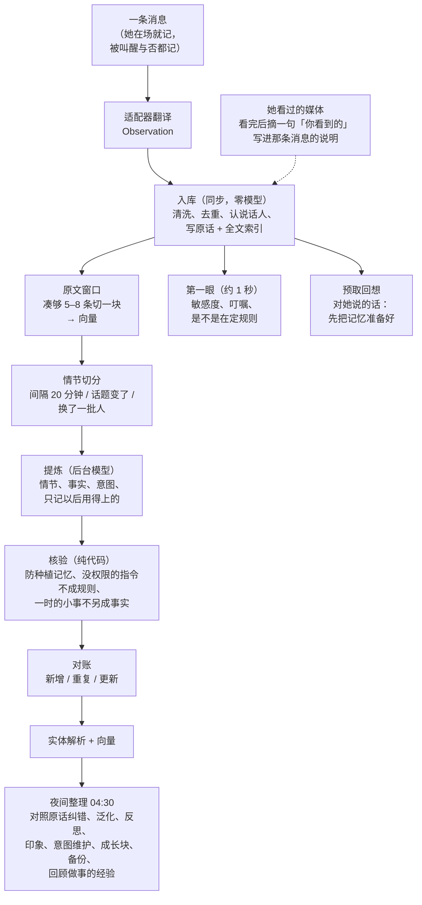
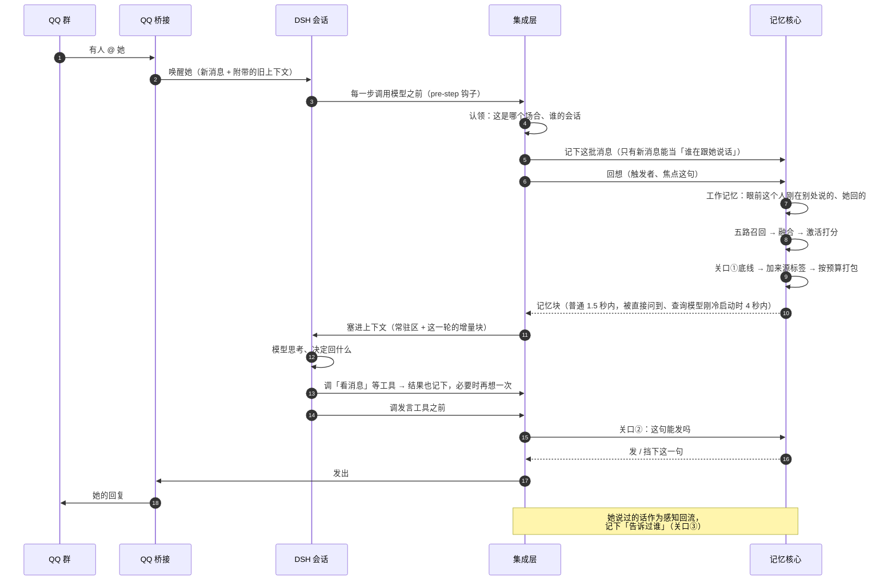
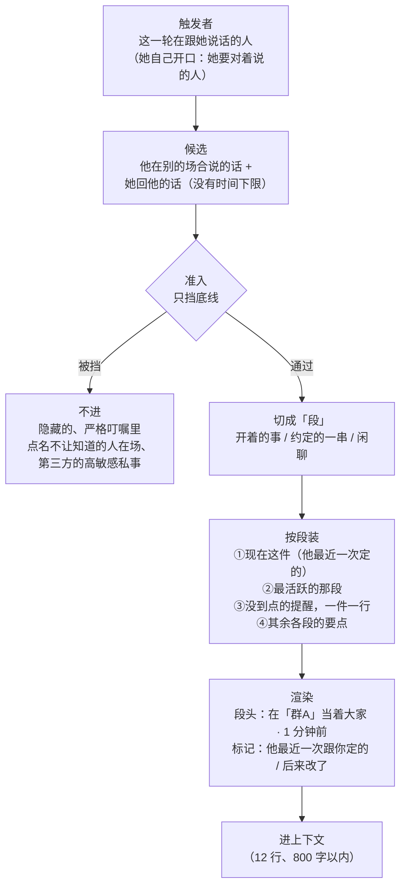
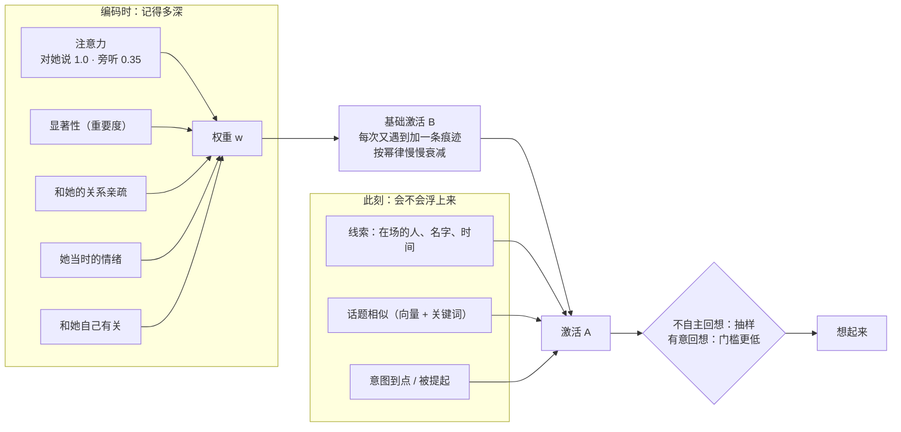
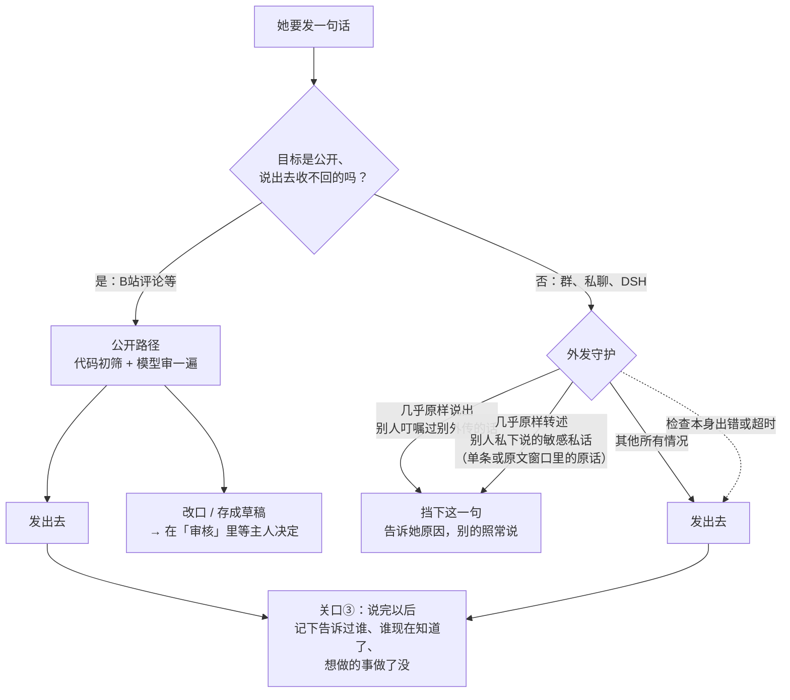
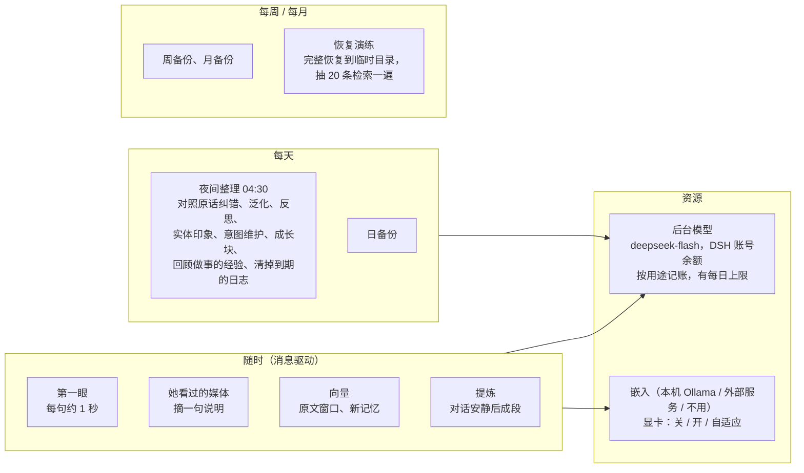
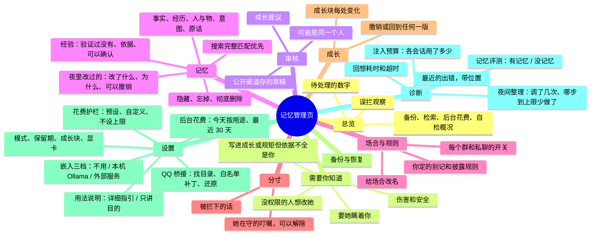

# 图解：如故的记忆是怎么运作的

> 对应版本：D140（2026-11-11）。细节以 [实现/模块与接口.md](实现/模块与接口.md) 为准；这里只画整体链路。数字（时间上限、行数）是现在的默认配置，都可以改。

一句话：**她在任何地方听到、看到、说过的事，都进同一份记忆，并且记得是在哪儿、听谁说的、当时谁在场。** 每次回话前，她按眼前的人和话题想起一部分；说不说、说多少由她自己掂量，代码只在几种明确的情况下挡一句。

目录：

1. [三层结构](#1-三层结构)
2. [记忆里有什么](#2-记忆里有什么)
3. [写入：从一条消息到长期记忆](#3-写入从一条消息到长期记忆)
4. [每一轮：她怎么想起来](#4-每一轮她怎么想起来)
5. [工作记忆：眼前这件事](#5-工作记忆眼前这件事)
6. [想不想得起来](#6-想不想得起来)
7. [说话之前](#7-说话之前)
8. [后台在做什么](#8-后台在做什么)
9. [管理页各页签](#9-管理页各页签)
10. [名词速查](#10-名词速查)

---

## 1. 三层结构

**装上以后（D128）**：配置文件不存在时插件先不管事：不开库、不接入口、不记任何东西，管理页只有「首次设置」。主人勾选「我知道了」（聊天会被记下、原文默认保留 2 年、QQ 小号有封号风险），可选地填称呼、选嵌入、接 QQ 桥接；接了桥接会列出它放行的群，默认全选，取消的群不感知、不注入（D131），之后在「场合与规则」里改。走完才开库开始记。手写配置的照旧直接开。

整个插件分三层：最外面的适配器只负责「翻译」，中间的 DSH 集成层负责「接线」，里面的记忆核心负责「记住、想起、判断」。核心不认识 QQ、B站，也不认识 DSH，`scripts/check-boundaries.mjs` 守着这条边界。



- **适配器只做翻译**：把「谁在哪个场合对谁说了什么、当时谁看得到、话会传到哪」变成通用格式。QQ 适配器读桥接落盘的文件和工具结果；B站的由 B站伙伴插件经 `personaMemory` 服务自己注册进来。
- **集成层接到 DSH 上**：认出一个会话是谁的、每一步往提示词里塞记忆、注册记忆工具、在发言工具执行前问一下核心、定时跑后台任务、提供管理页。
- **核心记住、想起、判断**：一个普通的 Node 库。需要的外部能力（调模型、算向量、记预算、人设）都通过「端口」由集成层提供，换宿主只要重写这一层。

## 2. 记忆里有什么

原话永远在最底层，能直接被搜到；上面几层是后台慢慢提炼出来的「理解」。每一条记忆都带着来源：在哪个场合、谁说的、当时谁在场、她告诉过谁。



- **原话优先**：后台提炼还没做、做错了，原话也找得到。她看过的视频、图片，「她看到的」一句说明写在那条消息的媒体说明里（D116）。
- **事实有两套时间**：「什么时候成立」和「什么时候记下的」分开。「之前乘3，后来改成平方」这种，旧的一条被标成被取代，照样留着。
- **认出是同一个人 ≠ 给他权利**：账号、昵称、别人怎么称呼他，都只是「这是谁」的证据。只有主人的账号有管理权限。
- **她自己的经验**（D124）：做事学到的「规则 + 怎么知道它是对的 + 要避开的坑」，是关于她自己的一条事实，范围是哪个工具、哪个地方、关于谁。主人教的、她试过成了的（工具先没成、换了做法成了，而且不是别人口授的）算**验证过**，她自己琢磨的、别人说的、夜里总结的先标**还没验证**——由代码按证据标，不由她说了算。别人说的只在听到的那个地方用，不挂到任何人身上；你在管理页忘掉的，哪儿都不再用。

## 3. 写入：从一条消息到长期记忆

从上到下越来越慢、越来越深。入库那一步是同步的，不调模型，消息一来就落库；越往下越靠后台和模型，但都不会卡住聊天。



- **同步的入库**：不调模型、不等后台，落库的同时就进全文索引，所以刚说的话马上能被想起。
- **后台的提炼与整理**：对话安静下来、按事件边界成段以后才提炼。对她说的、亲近的人说的、刚发生的排在前面。某一段怎么都提炼不成（模型一直出错、供应商拒绝这段内容），这一段先搁着、隔一阵再试（越试隔得越久，有上限），后面的对话照常提炼；搁着的这段不替它编任何东西，原话照常搜得到，管理页诊断里看得到有几段（D136）。
- **只记以后用得上的**（D123）：原话一直留着、随时搜得到，事实只写以后不翻聊天记录也需要知道的（喜好、关系、身份、计划约定、规矩、答应的事、教训、叮嘱）。中午吃什么、几点醒这类一时的小事只留在原话和经历的叙述里；她自己说自己「能 / 不能做什么」只当「她说过」、把握低，等夜里核对。
- **核验**：没有权限的人说的「设定」「指令」不会变成规则或意图，只记一句「他提过一个要求，没采纳」，同时进「需要你知道」。主人自己转发过来的不算（D118）。

## 4. 每一轮：她怎么想起来

以 QQ 群里有人 @ 她为例。DSH 每一步调用模型之前，插件把这一轮该想起的东西拼成一块「记忆」塞进上下文。整个过程有时间上限，超时就用已经算好的缓存，不让她卡住（D117）。



| 塞进去的东西 | 内容 | 什么时候换 |
|---|---|---|
| 常驻区 | 核心自我和成长块、用法说明（「详细指引」或「只讲目的」，主人在设置里选）、重要的人、现在的心境、近期约定、验证过又常用的几条经验、待审提示 | 只在有真实新消息或压缩之后换，平时冻结不动 |
| 工作记忆 | 眼前这个人刚在别处说的、她回他的，按「段」装（当前这件事完整保留）；她自己开口时换成「她要对谁说」的那几个人 | 每一轮都算，零模型，约几十毫秒 |
| 想起来的 | 五路召回的结果，每条带「谁说的、在哪儿、当着谁」 | 有新线索时 |
| 在场者近况、今天到目前为止 | 在场的人（包括她自己）最近在别处说过、做过的事 | 有新的时 |
| 你做事的经验 | 和这件事对得上的经验（她正在用的工具、新会话第一轮里她有经验的工具、在场的人、这个地方；只靠话题对上的和「想起来的」排在一起），带「（验证过）/（还没验证）」和是谁教的 | 对得上时；新会话第一轮；她用了一个有经验的工具之后 |
| 你想着的 | 到点或被提起的意图，比如「8 点提醒主人」 | 命中时 |

**塞多少跟着花费档位**（D133）：「你想着的」和工作记忆不限；别的层合起来，宽松档每个会话每天最多 4 万字、最近 50 步里最多占上下文增长的 25%，节省档是 8000 字、5%，不设上限档不限。超了当天（或这 50 步里）只给「你想着的」、工作记忆和被直接问到时的回想。管理页的诊断里看得到各会话用了多少。

**谁是「在跟她说话的人」**：只认这一轮新到的、对她说的消息（D115）。她自己主动醒来、没有新消息时，或者定时提醒到点时（D144），算她自己开口：没有人在问她，但她要对这里的人说话，所以工作记忆按「她要对谁说」取（D132）——一对一就是对方；群里是她最近在别处来往过、又在这里的人，提醒对得上对象（到点的意图的对象）而他又在这里时他排在最前。不会把这里最后一个对她说话的人（常常是几个小时前的一句）当成在问她的人。这些人也算在场，回想不沿用上一次算好的旧结果（别处有新的事就重新想）。她用工具读到新消息后，再从那句起认人。DSH 桌面会话只有选了人设聊天预设的才接上记忆（D112）。

## 5. 工作记忆：眼前这件事

这是让她「像同一个人」的关键一层。普通回想是在大量记忆里挑相关的，可能挑不到；工作记忆确定地把「眼前这个人刚刚和她进行的事」整段放进来，不抽样、不等后台（D100–D110）。



- **当前这件事完整保留**：「111 答成 333」那次，平方游戏其实在记忆里，但她自己的回应被提醒挤掉了。现在按「段」装，当前这件事整段保留，提醒压成一行。
- **最新的约定算数**：同一个人新定的规则替换旧的，不分在哪儿说的。靠第一眼认出「这句在改前面那条」，不靠关键词。
- **不设时间窗**：没有「一小时后忘掉」。淡出靠激活慢慢衰减；没了结的事一直留着，了结以后渐渐淡出。

## 6. 想不想得起来

每条记忆有一个「激活值」，决定这一刻会不会浮上来。它和「这件事现在还成不成立」是两条互不相干的曲线：想不起来的事照样是真的，过时的事照样想得起来（只是说成过去时）。

```
A = B（用得多、用得近）+ S（线索扩散：在场的人、提到的名字）+ C（和眼前话题像不像）+ I（开着的意图）− 被取代的惩罚 + 一点随机
```



| 五路召回 | 找什么 |
|---|---|
| 稠密（向量） | 意思相近的事实、情节、原文窗口；本机 Ollama 跑 Qwen3-Embedding，或外部服务（D127）。不用嵌入时这一路走已有的向量找近邻（L3） |
| 词法 | 中文全文检索，名字、梗、原话里的词 |
| 实体扩散 | 从在场的人、被提到的人出发，沿「人—事实—经历」的关系往外找 |
| 时间 | 「昨天」「上周」解析成时间窗 |
| 在场者近况 | 在场的人（包括她自己）最近在别处说过、做过、这里还没出现过的事 |

五路结果合并粗排，再按激活打分、去重、每个人最多 3 条，最后交给分寸和渲染。哪一路出错只丢那一路，其余照常给（D117）。

## 7. 说话之前

「知道」和「说出来」是两回事。D113 以后，非公开的场合基本交给她自己判断，代码只在两种「几乎原样复述」的情况下挡一句；公开渠道（B站评论这类收不回的）保留完整的审视。



- **关口① 想起之后**：进上下文之前只挡底线：隐藏、忘掉的；严格叮嘱里点名不让知道的人在场；第三方的高敏感私事（多敏感看提炼出的和第一眼的哪个高；原话、含原话的原文窗口、情节、事实都算，提炼完了也不放松）。其余都带来源标签进来。
- **关口② 说话之前**：上面这张图。11 月 5–6 日被旧规则误拦的 63 句，用新规则重放全部能发，新拦 0 句。
- **关口③ 说话之后**：她说过的话回流成感知，记下「告诉过谁」，以后知道谁已经知道这件事。她在哪儿对那个人问过、说过意图里的那件事（不管这条意图有没有在这个会话里浮上来过），就算做过了，别的场合不再提起；那个人得在这里——在听的人里，或者以前在这个场合说过话。

## 8. 后台在做什么

聊天以外，插件在后台持续做这些事。全部有预算和时间上限，后台出问题不影响聊天。

要调模型的只有八样：第一眼、看过的媒体、提炼、摘要、夜间整理，和回话前后的第二段评估、改写、外发审视；都走 DSH 的模型通道（`deepseek-flash`，思考关），用的是 DSH 账号余额。向量在本机的 Ollama 上算，不花钱；回想本身不调模型。每样花了多少（次数和 token 是 DSH 报的实数，元按配置的价目估算）在管理页「设置 → 后台花费」，每一项什么时候调、价目和上限见 [花费.md](花费.md)。



夜间整理的每一步一晚最多调几次模型是定好的，总数默认就是它们的和（完整 14 次，节省档只做必要项 6 次）；写日记、改成长块和回顾做事的经验那几次先留着，前面的步骤怎么用都轮得到它们。哪一晚日记没写成（到上限、出错、没跑），下一晚把缺的那几天一起补上（一晚最多 3 天，更早的再下一晚；只补最近 7 天里缺的）。泛化问过、归纳不出来的那组经历记着，成员没变就不再问，让新的组先轮上。哪一步因为上限少做了，管理页「诊断 → 夜间整理」看得到。

夜间整理的维护那一步还会分批清掉到期的日志（D139）：后台任务、注入记录、判定记录、她说过的话的审视记录，默认分别留 30、30、7、365 天（注入记录至少留到夜里按「最近用到多少」往回看得到的天数）。还在用的多旧都不删：会话当前周期的注入记录（外发守护靠它知道她上下文里有什么）、还被注入记录引用的判定、等你处理的挂起草稿、带按轮污点的发言记录、切口还没定下来的提炼任务。「告诉过谁」是记忆，不在其中。清了多少在总览「原文保留期」卡片下面。

身份密钥（DSH 家目录里的 `persona-memory.key`，账号、场合、消息去重都靠它算）丢了或换了，插件不会悄悄换一把新的：库里记着它的指纹，对不上就不打开库，管理页说明原因，聊天照常（D140）。

## 9. 管理页各页签

DSH 设置 → 记忆，只有主人能打开。



## 10. 名词速查

| 名词 | 是什么 |
|---|---|
| 场合 | 一个聊天的地方：某个群、某个私聊、某个 DSH 会话。核心只看它的属性（几个人、封闭还是公开、能不能撤回），不认平台名 |
| 感知 | 原样保存的一次见闻：一条消息、她说的话、她看到的东西。只追加，不修改 |
| 触发者 | 这一轮在跟她说话的人。只认这一轮新到的、对她说的消息；她自己开口的一轮（主动醒来、定时提醒到点）没有触发者，工作记忆按「她要对谁说」取（这里的听众里：一对一是对方，群里是她最近在别处来往过的人） |
| 工作记忆 | 眼前这个人刚和她进行的事，每轮确定地放进来，不抽样 |
| 段 | 工作记忆里按结构切的一组话：开着的事、约定的一串、闲聊 |
| 第一眼 | 每句话入库后约 1 秒的小判断：敏感度、是不是叮嘱、是不是在定或改规则 |
| 提炼 | 后台模型把一段对话整理成情节、事实、意图 |
| 夜间整理 | 每天 04:30：对照原话纠正记错的、泛化、反思、更新对人的印象、处理过期的计划和意图、写日记（没写成的那几天下一晚补）、修改成长块、备份、清掉到期的日志 |
| 对照原话纠错 | 夜间整理的一步：挑几条最可能记错、最常想起的事实（她对自己的认知优先），回到原话和之后的聊天核对，错的改正、撑不住的降低把握。关于她自己的只有你的话能改写；你做过的不动，改过的你可以撤销 |
| 激活 | 一条记忆此刻会不会浮上来的分数，用得多、用得近、和眼前相关就高 |
| 常驻区 / 增量块 | 每轮塞进上下文的两部分：长期不变的自我和重要的人；这一轮新想起的东西 |
| 来源标签 | 每条记忆附带的「私聊时 / 在「群A」当着大家 / 你自己说的 / 他叮嘱过别外传」 |
| 关口①②③ | 想起之后进上下文前的底线 / 发言前的守护 / 说完后记下告诉过谁 |
| 外发守护 | 非公开场合唯一会挡话的地方：几乎原样复述别外传的话或别人私下的敏感私话 |
| 污点 | 这一轮读过来路不明的东西（转发、网页、子代理）。现在只用于：成长不拿它当依据、公开渠道更谨慎 |
| 认领 | 集成层认出一个 DSH 会话属于哪个场合；QQ 会话按桥接认，DSH 会话按人设聊天预设认 |
| 适配器 / 端口 | 适配器把平台翻译成通用格式；端口是核心向外要的能力（调模型、算向量、预算、人设） |
| 成长块 | 她性格里慢慢长出来的部分，需要足够多的经历作依据，可撤销 |
| 经验 | 她自己做事学到的办法：规则 + 怎么知道它是对的 + 要避开的坑。主人教的、她试过成了的算验证过，其余还没验证（别人口授的、夜里总结的、主人的话撑不住的都不算）；对得上的时候想起来，验证过又常用的最多 3 条常驻；夜里回顾反复没成的工具和主人亲口的纠正；忘掉的哪儿都不用 |
| 用法说明的写法 | 告诉她记忆怎么用的那几段话：「详细指引」（默认，规矩写得具体，适合 DeepSeek 这类模型）或「只讲目的」（讲记忆是拿来干什么的，规矩少，适合更强的模型）；在「设置」里切 |
| 首次设置 | 新装时配置文件不存在，插件等主人在管理页走完几步才开库开始记（D128），桥接放行的群默认全选、可以取消（D131）。解决了「装上就多建一个空库」，也让「会记下群聊」先经主人知道 |
| 嵌入三档 | 不用嵌入（走 L3，什么都不用装）、本机 Ollama（自动探测、按硬件推荐、页面上下载模型）、外部服务（填地址模型维度和可选的 Key，Key 单独存文件）（D127） |
| L3 | 没有查询向量时的回想方式：字面、人和事、时间、在场的人，再用已有的向量找近邻。换个说法问同一件事容易想不起来 |
| 记忆评测 | 用真实聊天里的典型情况（改写过）在临时库里回放，比较有记忆和只有这次聊天记录时她拿不拿得到关键的那句；不调模型、不花钱，「诊断」里看结果、可以再跑 |
