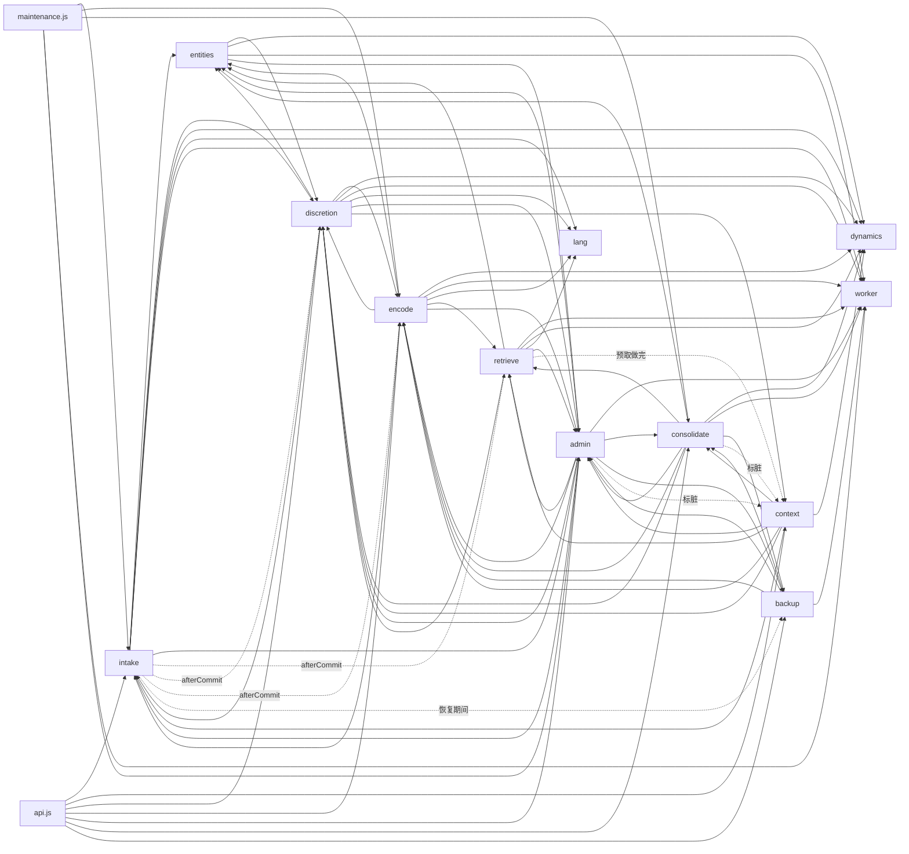

# 模块与接口（实现契约）

> 状态：阶段 A 定稿；阶段 B 十二个模块已实现，共享文件已整合（参数、类型、附录 A、§7 的 D25–D69，2026-11-01）；阶段 C 的 DSH 集成层（`packages/dsh`）已接好，见 §9，集成时对核心的改动是 §7 的 D95–D98（2026-11-04）；装进 DSH（2026-11-04）以后按实测改的是 D99–D120（问题清单在 `docs/实测问题.md`）。这份文档是**并行实现各模块的人之间的契约**：每个人只看这份文档和自己模块的 `index.js`，就能独立写完自己的模块，不用和别人商量。
> 依据：`docs/设计.md`（下称设计，§ 号都指它）。设计说「做什么、为什么」；这份文档说「谁做、接口长什么样、谁能写哪张表」。两者冲突时以设计为准，并在本文 §7 记一笔。
> 代码里的权威：函数签名和类型以各模块 `packages/core/src/<模块>/index.js` 的 JSDoc 为准（附录 A 是从它生成的快照，`node scripts/gen-signatures.mjs` 重新生成）；跨模块的类型在 `src/core-types.js`，对外契约的类型在 `src/contract/types.js`。本文给语义、调用关系和不变式。

---

## 0. 十二条总规矩

1. **只改自己的地盘**：自己模块的目录 `packages/core/src/<模块>/`、自己的迁移文件 `src/store/migrations/0NN-<模块>.js`、自己的测试目录 `packages/core/test/<模块>/`。别的文件要改，写进交付说明，由整合的人改。
2. **签名不改**：`index.js` 里已有的导出函数不改名、不删、不改参数顺序（`test/api.test.js` 的 `MODULE_EXPORTS` 锁着名字）。可以加新导出、加内部文件；参数对象里可以加可选字段。
3. **一张表只有一个拥有者**，只有拥有者写它（§2 的表）。别的模块要改它，调拥有者的写函数。**读任何表都可以直接写 SQL**（schema 就是契约），但有现成读函数的优先用。唯一的例外是彻底删除和原文到期删除（admin、intake），按 §2.3 的级联表删别的模块的行。
4. **模块之间不 static import**：跨模块调用一律 `core.mods.<模块>.<函数>(core, …)`；类型只在 JSDoc 里 `import('../x/index.js').T`。`npm run check` 会查。这样单测里能用 `createTestCore({mods})` 换掉还没实现的依赖。
5. **第一个参数永远是 `core`**（`CoreContext`，`src/core-types.js`）。模块的内存状态只放 `core.state.<自己的名字>`，在自己的 `init` 里建。
6. **时间**：一律 `core.now()` 或调用方传进来的 `at`（UTC 毫秒），不用 `Date.now()`。痕迹时间用证据消息的时间，不用处理时间（§6.4）。
7. **参数**：每次用都 `core.config.get()`（热加载）；数值全在 `src/config/defaults.js`，不在模块里写魔法数。新参数加到 defaults.js（这是共享文件：在交付说明里列出要加的键，整合时合并；实现期间可以先在模块里用 `cfg.x ?? 默认值`）。
8. **事务**：DatabaseSync 是同步的，`core.store.tx(fn)` 的回调必须同步，里面不许 `await`。标「在调用方的事务里调用」的写函数是同步的；它自己有多条写入时照样用 `core.store.tx` 包一层（嵌套自动变 SAVEPOINT）。提交之后才做的事（通知别的模块、发布向量）用 `core.store.afterCommit(cb)`。
9. **隐私**：账号 id、SettingId、ObsId 永远只存 `core.keys.*` 算出的 HMAC；永远不发给 LLM、不进日志。日志（`core.log`）只记 id、类型、计数（§12.3）。交给 LLM 和注入的文字都先过 `intake.sanitizeForPrompt`。
10. **不透明 id 不解析**：SettingId、ObsId、账号 id 只能整体比较（§2.2）。核心自己的记忆引用（`store/refs.js` 的 `refOf/parseRef`，如 `'a123'`）可以解析。
11. **错误**：标「不抛错」的函数（observe、describe、outcome、各种 on* 通知……）自己兜住异常，计数（`store.bumpMetric`）并记日志。其余可以抛错；`NotImplementedError` 只出现在 stub 里。外部服务（LLM、嵌入、重排）失败一律按降级处理，不往上抛到聊天路径（§8.8、§9.4.2 第 4 条 fail closed）。
12. **没有平台特例**：核心里不出现入口名、账号格式、固定词表、对「主人」的特例（主人 = `authority='principal'` 且亲密度最高的实体，§2.2）。判断只读属性。

**补（D103，2026-11-05，主人：「也不应该做成固定的一到一个小时就遗忘的机制吧？不然太生硬太规则味儿了」）**：她心里装什么、记得多久，**不设硬时间窗、不设到期**——没有「最近 N 小时」「超过 7 天」「过了 window_end 就丢」这种 `at >= now − 常数` 的过滤；淡出靠激活（B 的幂律衰减）和激活阈值，没了结的事一直可得；数字限制只能是软的上下文预算（条数、字数、一次看多少行）。确实需要的固定量（估计谁在场、时间间隔提示、缓存多久重判、防重复被拒）要在文档里写明「这不是记得多久」。评审要标出任何硬时间截止。

---

## 1. 模块总览

| 模块 | 目录 | 职责 | 设计 | 拥有的表 | 端口 |
|---|---|---|---|---|---|
| contract | `src/contract/` | 契约类型、校验器、不透明 id 帮手、场合属性推导、错误类型（**已完成**） | §4.2–§4.5 | — | — |
| store | `src/store/` | 单写者 DB 包装、迁移、FTS、任务队列、游标、计数、密钥、记忆引用、向量缓存库、崩溃安全（**已完成**） | §12 | meta、jobs、cursors、metrics、prompt_versions、fts_shards | clock、logger |
| config | `src/config/` | 参数表和热加载（**已完成**） | §6.9 等 | — | — |
| ports | `src/ports/` | 端口接口说明和默认实现（**已完成**） | §3.3 | — | — |
| lang | `src/lang/` | 语言分析器（zh + Unicode 回退，jieba 可选） | §3.3、§6.6、§8.1、§8.2 | — | languages |
| intake | `src/intake/` | 感知入库、场合快照、原文窗口、转达、游标、清洗 | §7.1、§5.3 | settings、setting_snapshots、percepts、percepts_fts_*、raw_windows、relays | clock、sanitizer |
| entities | `src/entities/` | 实体档案、认人、链接（认得 / 权利）、印象存储、名字匹配器 | §5.2、§5.8 | entities、entity_names、entity_descriptors、identity_evidence、entity_links、entity_impressions | embedding（经 worker） |
| encode | `src/encode/` | 切分、提炼、核验、污点检查、对账；情节 / 事实 / 计划 / 意图的写入；note、fix、import | §7.2–§7.5、§5.4、§5.5、§10.8 | episodes(+fts)、assertions(+fts)、assertion_entities、same_type、sources、plan_status_history、predicates、intentions、speaker_quota | llm（extract、sleep）、budget |
| dynamics | `src/dynamics/` | 激活、痕迹、成立概率、时态、心境 | §6、§5.4、§5.7 | traces、activation、mood | clock |
| retrieve | `src/retrieve/` | 线索、五路召回、融合、激活打分、抽样、重排、MMR、渲染、预取 | §8、§6.6 | —（内存缓存） | embedding、rerank、llm（rewrite） |
| discretion | `src/discretion/` | 出现集合、谁知道、告诉过谁、规范、场合规矩、关口①②③ | §9、§5.6 | presence_sets、flow_norms、setting_rules、known_by、told_log、appraisals、utterances、discretion_log | llm（appraise、review）、budget、selfProfile |
| context | `src/context/` | 常驻区、分层和打包、会话账本（注入、确认、压缩周期、按轮污点） | §10.4、§10.5、§9.4.1 | sessions、injections | selfProfile |
| consolidate | `src/consolidate/` | 夜间整理、今天到目前为止、故事线、印象重建、反思、自我概念、成长块 | §7.7、§5.7、§5.8 | storylines、communities、core_blocks、core_block_versions | llm（sleep、summary）、budget |
| worker | `src/worker/` | worker_threads（稠密、词法、PPR、维护）、嵌入队列、向量库、向量空间 | §8.2、§8.7、§7.6、§8.9 | embed_texts、vector_spaces、向量库全部 | embedding |
| backup | `src/backup/` | 记忆包、验证、轮转、恢复、导出 | §12.4、§12.5 | backups、restore_drills | clock |
| admin | `src/admin/` | 审核队列、规则、隐藏 / 忘掉 / 彻底删除、墓碑、需要你知道、保留期、模式 | §9.3.7、§12.6、§12.7、§13.1 | review_queue、rules、suppressions、tombstones、need_to_know | clock |
| （顶层） | `src/api.js`、`src/maintenance.js` | 对外 API（§4.5）、任务调度胶水（**已完成**） | §4.5 | — | — |

- **init 顺序**（`api.js` 的 `MODULES`）：lang → admin → intake → entities → dynamics → discretion → encode → worker → retrieve → context → consolidate → backup。`init` 只建内存状态和登记任务处理函数（`core.jobHandlers.set(kind, fn)`），不做慢事、不调别的模块。
- **启动步骤**（`api.js` 的 `runStartup`，每步失败只降级，结果在 `status().startup`）：`maintenance.recoverJobs` → `entities.ensureSelf / ensurePrincipal` → `admin.reapplyTombstones` → `worker.start`（线程起来之前先 `worker.sweepVectors`）→ `worker.ensureSpace`；不起线程时（`startWorker:false`）只做 `worker.sweepVectors`（§12.8 的启动清扫）。
- **后台**：集成层每分钟左右调 `api.maintenance.tick()`（`maintenance.js`：intake.flushWindows → encode.segment → consolidate.timeMaintenance → admin.expireReviews → consolidate.todaySoFar → worker.runEmbedQueue → admin.applyRetention → 到点则**开始** consolidate.sleep，tick 不等它跑完，D26），另外不停地调 `api.maintenance.runJobs()` 跑任务队列。

### 1.1 API 方法 → 模块函数

`api.js` 的每个对外方法**只转给一个**模块函数（参数先过 contract 校验；带 `settingId` 的先经共用的 `intake.resolveSetting` 换成场合键，`recall / recallCached` 先问共用的 `backup.isRestoring`，都不算在内）。实现语义写在右列的模块里，api 层只做校验、兜错、只读模式和整体恢复期间不注入（D27）。`test/api-map.test.js` 用替身锁着这张表：新加 API 方法必须先写进来，表和文档不一致也会失败。`status()`、`close()` 由 api 自己做，不转给模块。

| API 方法（§4.5） | 模块函数 | 说明 |
|---|---|---|
| `registerAdapter` | `intake.registerAdapter` | 形状先过 `validatePerceptionAdapter`；intake 抛错时不留下半注册的适配器 |
| `observe` | `intake.enqueue` | 同步、不抛错（D1：`opt.adapter`） |
| `describe` | `intake.describe` | 不抛错（D1） |
| `sealBuffers` | `intake.sealBuffers` | 不抛错 |
| `expectRelay` | `intake.expectRelay` | 不抛错 |
| `resident` | `context.resident` | 同步 |
| `recall` | `context.recall` | context 再调 retrieve → discretion → 分层打包（§3「读」） |
| `recallCached` | `context.recallCached` | 同步 |
| `self.coreBlock` | `context.coreBlock` | |
| `expression.appraise` | `discretion.appraise` | 只读模式见 D21 |
| `expression.outcome` | `discretion.outcome` | 不抛错 |
| `ingest.import` | `encode.importRecords` | `provenance` 必须是 `'imported'` |
| `note` | `encode.note` | |
| `fix` | `encode.fix` | |
| `admin.list` | `admin.list` | |
| `admin.get` | `admin.get` | |
| `admin.simulate` | `admin.simulate` | 异步（D22） |
| `admin.review.list` | `admin.listReview` | 只列 pending |
| `admin.review.decide` | `admin.decideReview` | id 见 D23 |
| `admin.pendingCount` | `admin.pendingCount` | |
| `maintenance.runJobs` | `maintenance.runJobs` | 顶层 `maintenance.js`，按 `core.jobHandlers` 跑，不经模块 |
| `maintenance.sleep` | `consolidate.sleep` | |
| **【补】** | | |
| `cursor` | `intake.cursor` | D2 |
| `modeOf` | `admin.modeFor` | D5 |
| `maintenance.tick` | `maintenance.tick` | 顶层；按 §1「后台」的顺序调各模块 |
| `sessions.bind` | `context.bindSession` | D4 |
| `sessions.injected` | `context.recordInjection` | D4 |
| `sessions.confirm` | `context.confirmInjection` | D4 |
| `sessions.abort` | `context.abortPending` | D4 |
| `sessions.compaction` | `context.compaction` | D4 |
| `sessions.markTurnTaint` | `context.markTurnTaint` | D4、§9.6 |
| `sessions.step` | `context.recordStep` | D4 |
| `sessions.get` | `context.sessionInfo` | D4 |
| `sessions.holdsMemory` | `context.taintLedger` 不为空 | 【补】场合后来被关掉时，集成层的外发钩子据此决定还审不审（§10.1） |
| `sessions.recallOutcome` | `context.noteHostRecall` | 【D117】宿主每轮等回想的结果（ok / timeout / error / aborted、等了多久、退回缓存给了几条）：只有数字和错误类型；不抛错 |
| `admin.needToKnow.list` | `admin.listNeedToKnow` | §9.3.7 |
| `admin.needToKnow.markRead` | `admin.markNeedToKnowRead` | |
| `admin.rules.list` | `admin.activeRules` | |
| `admin.rules.add` | `admin.addRule` | createdBy 固定 'owner' |
| `admin.rules.revoke` | `admin.revokeRule` | |
| `admin.setMode` | `admin.addRule` | kind='mode'（D5） |
| `admin.renameSetting` | `intake.renameSetting` | 【D111】主人给场合起名字 / 清掉（场合键；名字存 settings.owner_label，优先于适配器给的） |
| `admin.forget` | `admin.suppress` | state='forgotten' |
| `admin.hide` | `admin.suppress` | state='hidden' |
| `admin.restore` | `admin.restore` | |
| `admin.relaxLimit` | `admin.relaxLimit` | 【D113】主人解除一条她在守的叮嘱（`discretion.relaxLimit`：规范按主人的权限放宽、第一眼核对过的限制清掉） |
| `admin.recallHealth` | `context.recallHealth` | 【D117】回想的健康：按 UTC 日的出错（按步骤 / 错误类型）、partial / lost、耗时分布、宿主等待的结果、查询嵌入的重试，加最近的出错（只有代码事实） |
| `media.noteViewed` | `intake.perceiveMedia` | 【D116】她用工具看了一条消息里的媒体：交来她看完之后的想法和回话，核心摘一句她看到了什么（use='perceive'），写进那条消息的 media_json（by:'self'）；不抛错，返回 {ok, reason} |
| `admin.purge` | `admin.purge` | §2.3 的级联 |
| `admin.withdrawBySource` | `admin.withdrawBySource` | §12.4.5 |
| `admin.retention.get` | `admin.retentionState` | §12.6 |
| `admin.retention.request` | `admin.requestRetentionChange` | |
| `admin.retention.cancel` | `admin.cancelRetentionChange` | |
| `admin.growth.versions` | `consolidate.growthVersions` | §5.7 |
| `admin.growth.revoke` | `consolidate.revokeGrowth` | |
| `admin.growth.rollback` | `consolidate.rollbackGrowth` | |
| `admin.checks.revert` | `consolidate.revertCheck` | 【D122】主人撤销夜里的一次改正 |
| `lessons.note` | `encode.noteLesson` | 【D124】memory_note 的 kind=lesson：她自己记做事的经验（规则、要避开的坑、工具、只在这里）；验证过没有由核心按证据定（主人的原话、宿主看到的「先没成、换了做法以后成了」） |
| `lessons.toolOutcome` | `encode.lessonToolOutcome` | 【D124】宿主交来一次工具调用成没成（只有工具名、短的出错说明）：返回 recovered（这时记下的这个工具的经验算验证过）和这个工具有几条经验；不抛错 |
| `admin.lessons.confirm` | `encode.confirmLesson` | 【D124】主人确认一条经验（算验证过） |
| `admin.lessons.stats` | `encode.lessonStats` | 【D124】经验的条数、验证过的、常驻的、工具记录几条 |
| `admin.evalResult.get` | `admin.evalResult` | 【D126】「有记忆 / 没记忆」评测最近一次的结果（只有用例名、对错和数字） |
| `admin.evalResult.set` | `admin.setEvalResult` | 【D126】集成层跑完评测交来存下（覆盖上一次） |
| `admin.backup.now` | `backup.createPack` | kind='manual' |
| `admin.backup.verify` | `backup.verifyPack` | |
| `admin.backup.preview` | `backup.previewRestore` | |
| `admin.backup.restore` | `backup.restoreFull` | |
| `admin.backup.restorePartial` | `backup.restorePartial` | |
| `admin.backup.exportJsonl` | `backup.exportJsonl` | §12.4.7 |
| `admin.backup.rescan` | `backup.rescan` | |
| `admin.backup.setupEncryption` | `backup.setupEncryption` | D69；恢复码只在这次返回 |
| `admin.backup.overview` | `backup.overview` | D69 |
| `admin.embedding.health` | `worker.health` | D69 |
| `admin.embedding.spaces` | `worker.spaces` | D69 |
| `admin.embedding.activate` | `worker.activateSpace` | D69；`{force, rebaseline}` |

适配器一侧的回调（核心调适配器）：`describeSetting` 只由 intake 调（`drain` 遇到这个适配器没描述过的场合时向它要描述；拿到之前这批感知留在队列里，要不到就计数丢弃）；`members` 只由 `discretion.targetFor` 调（能列成员的平台，结果进出现集合）；`onHoldDecision` 只由 `discretion.holdDecision` 调（`admin.decideReview` 批准或驳回挂起的发言时）；`start(sink)` 由 `intake.registerAdapter` 调。

---

## 2. 表的归属

### 2.1 全部表

迁移文件按拥有者拆分（`src/store/migrations/0NN-<模块>.js`），`TABLE_OWNERS` 可以在代码里查。**beta 第一次真实安装之前，拥有者可以直接改自己的迁移文件**（只改自己的表）；装上之后迁移只追加新编号。

| 表 | 拥有者 | 别的模块怎么写它 |
|---|---|---|
| meta、cursors、metrics、prompt_versions、fts_shards、jobs | store | `store` 的 `setMeta / setCursor / bumpMetric / registerPromptVersion / ensurePerceptShard / enqueueJob / completeJob / failJob`（任何模块都可以调；meta 的键按模块加前缀，如 `'sleep.lastAt'`） |
| settings、setting_snapshots | intake | 只有 intake（describe；【D111】renameSetting 写 owner_label）。迁移 015 加 adapter_label、label_kind、label_hint、owner_label、owner_label_at；迁移 016 加 label_origin（'config' / 'platform'，D111 评审补）；`settings.label` = 生效的称呼 |
| percepts、percepts_fts_YYYYMM | intake | `intake.assignEpisode`、`intake.markAssessed`（encode）；`intake.observeInternal`（discretion）；`intake.expireRawText`（admin） |
| raw_windows、relays | intake | 只有 intake |
| entities、entity_names、entity_descriptors、identity_evidence、entity_links | entities | `entities.resolveActor / resolveExtracted / link / setBond / setStatus / noteMention / ensureSettingEntity` |
| entity_impressions | entities | `entities.writeImpression`（consolidate） |
| episodes、episodes_fts、assertions、assertions_fts、assertion_entities、same_type、sources、plan_status_history、predicates | encode | `encode.writeEpisode / writeAssertion / addSource / supersede / markChanged / transitionPlan / ensurePredicate` |
| intentions | encode | `encode.formIntention / transitionIntention / recordExecution` |
| speaker_quota | encode | 只有 encode |
| extract_stalled | encode | 只有 encode（D136，迁移 018：提炼一直不成、搁置着的段；consolidate.sleep 只读，补跑失败批次时跳过它们） |
| traces、activation、mood | dynamics | `dynamics.addTrace / inheritActivation / retier / pushMood` |
| presence_sets | discretion | `discretion.recordPresence`（intake） |
| flow_norms | discretion | `discretion.writeNorm / tightenNorm / inheritNorm / applyNormUpdate` |
| setting_rules | discretion | `discretion.writeSettingRule`（intake 的 norms.notes、encode 学到的、admin 主人写的） |
| known_by | discretion | `discretion.recordKnowledge` |
| told_log、appraisals、utterances、discretion_log | discretion | 只有 discretion（`logDecision` 可以被 context 调） |
| glances | discretion | 只有 discretion（第一眼，D106：`discretion.onPercepts` 由 intake 提交后通知；admin.purge 删感知时一起删、intake.expireRawText 清掉 quote / gist / vague，§2.3）。迁移 014（D110）加 `follows` 列和 `glances_replaces` 索引；retrieve 读（`glancesOf`、他在这里最新的一句约定） |
| sessions、injections | context | `context.bindSession / recordInjection / confirmInjection / abortPending / compaction / markTurnTaint / recordStep` |
| storylines、communities、core_blocks、core_block_versions、memory_checks | consolidate | `consolidate.applyGrowth / revokeGrowth / rollbackGrowth`（admin 的审核决定）；memory_checks（D122，迁移 017）只有 consolidate 写（夜间整理第 2 步的对照原话纠错），admin.purge 级联删 |
| embed_texts、vector_spaces、向量库 vmeta / vectors | worker | `worker.enqueueEmbed / dropEmbeddings / ensureSpace / shadowReembed`；`store.sweepVectorCache` 由 `worker.sweepVectors` 调 |
| backups、restore_drills | backup | 只有 backup |
| review_queue、rules、suppressions、tombstones、need_to_know | admin | `admin.enqueueReview / addRule / suppress / notifyNeedToKnow`；tombstones 只在 purge 里写 |

### 2.2 记忆单元和 owner_kind

`owner_kind` 列（traces、activation、flow_norms、known_by、told_log、embed_texts、suppressions……）只取这十个值，记忆引用的前缀见 `store/refs.js`：

| owner_kind | 前缀 | 主表 | 有规范（flow_norms 行）吗 | 有痕迹吗 | 嵌入吗 |
|---|---|---|---|---|---|
| percept | p | percepts | 提炼后由 encode 写（norm_state 同步改成 assessed）；之前是 unassessed | **没有**（`dynamics.perceptActivation` 按 w_enc 和时间算） | 不单独嵌（经原文窗口） |
| window | w | raw_windows | **不写行**：`discretion.normOf` 取窗口内感知规范里最严的（有任何 unassessed 就是 unassessed） | 有（入库时一条） | 原文层 |
| episode | e | episodes | 有 | 有 | 记忆层 |
| assertion | a | assertions | 有 | 有 | 记忆层（含 future_q 块） |
| entity | n | entities | **不写行**：`discretion.normOf` 按名字证据和关系描述的来源推出（在哪些场合、当着谁被提到过）；人物卡的内容来自印象层，各层自带规范 | 有（每次被提到） | 记忆层（档案文本） |
| impression | i | entity_impressions | 有（继承证据里最严的） | 跟随实体 | 记忆层 |
| intention | t | intentions | 有（继承 about 和证据里最严的，评审:PS-15） | 不加（I 项另算） | 记忆层 |
| storyline | s | storylines | 有 | 有 | 记忆层 |
| community | c | communities | 有 | 有 | 记忆层 |
| link | l | entity_links | 跨命名空间的链接有（B3，identity_link=1） | 无 | 不嵌 |

「谁知道」：percept 和 window 的已知圈直接从感知行推（visible_to + presence_set_id + 场合级），**不写 known_by 行**；其余记忆单元由写入它的模块调 `discretion.recordKnowledge` 写。

### 2.3 彻底删除的级联（admin.purge、intake.expireRawText）

彻底删除是唯一允许跨拥有者删行的操作。顺序固定，每一步分批、可中断、可重跑：

1. `backup.preOperationSnapshot(core, {reason:'purge'})`；
2. `worker.dropEmbeddings(refs)`：**先删向量**，再删 embed_texts；
3. 按来源链找派生：`encode.derivedFrom(perceptId)`，`onlySource=true` 的一起删，其余 `needs_review=1`；【D143】社区（communities）按成员找：被删的人、被删事实涉及的人（assertion_entities 和 object_entity_id）、被删情节的参与者所在的社区，加上被删情节那个场合的社区，**当前的、退休的（is_current=0）、跨场合的（setting_key 为空）都删**，夜里从剩下的事实重新生成；
4. 删主库：主表行 + 它的 FTS 行（`store.ftsDelete`）+ flow_norms + known_by + told_log + traces + activation + sources（owner）+ assertion_entities / same_type / plan_status_history（assertion）+ suppressions + appraisals（memory_kind/id）；感知被删时 sources.percept_id 置 NULL、raw_windows 里含它的窗口重算或删除、glances 里它那一行删掉、别的行 replaces / follows 指向它的置 NULL（D106、D110）；【D122】事实被删时 memory_checks 里 assertion_id / result_id / restored_id 是它的行删掉，感知被删时 evidence_json 或 shown_json 里有它的行删掉（理由可能转述了给模型看过的任何一句）；
   删除期间主库（和向量库）`PRAGMA secure_delete = ON`（平时是 FAST，D143）；FTS 表都开了 secure-delete（`store.enableFtsSecureDelete`），删完对删过行的 FTS 表 `optimize` 一次（`store.ftsOptimize`：词在段里没有行了，词本身也不留）；
5. 写 tombstones（kind = owner_kind，ref = 记忆引用；身份证据删除时 kind='identity'，ref = id_hash）；
6. 【D143】最后一个事务里清按引用找不到的派生文字：成长块（`consolidate.purgeGrowth`）里依据含被删内容的行从当前文本和**全部历史版本**里抹掉（文本、change_json 的 before / after / 签名），当前文本变了就存一版 `op='purge'`（只记去掉几行）；成长的审核项（review_queue kind='growth'）依据含被删内容的，提议的文字抹掉，还挂着的改成 withdrawn。被删内容 = 这次的单元 + 这个库墓碑表里以前删的（墓碑按时间生效）；
7. 主库、向量库各做一次 `wal_checkpoint(TRUNCATE)`；
8. 列出注入过这些记忆的会话（injections.items_json）返回给管理页（「已经注入过的文字收不回」）；`alsoBackups` 时 `backup.scrubPacks` 逐个重写本地包，结果（改写了几个、本来就没有的几个、没改成的几个和原因）原样带回管理页。

**物理上清到哪一步**（D143）：彻底删除做完时，主库和向量库文件（含 WAL）里已经没有被删的行、这次删掉的 FTS 词元、成长块里由它写出来的行。做不到 / 要等的：WAL 截断时有读者（worker 的只读连接正读着旧快照）就做不完（结果里 `wal: busy`；旧页留在日志文件里，等下一次彻底删除再截断，或者关库时最后一个连接把日志写回、删掉）；D143 之前删掉、还没合并掉的 FTS 词元等夜里的小步合并（maint 连接 `secure_delete = ON`，腾出来的页抹成零）；没勾「连备份一起删」时，备份包（包括这次删除前的操作前快照）里还在，等包按保留期轮换；已经注入进会话日志的文字收不回。

原文到期（`intake.expireRawText`）只做：`worker.dropEmbeddings`（原文窗口）→ percepts.text / raw_windows.text 置 NULL、text_state='expired'、删 FTS 行、glances 的 quote / gist / vague 置 NULL（第一眼抄下的原话和大概也是原文的一部分，D106）。情节、事实和 ≤ 60 字的来源证据都留着。

---

## 3. 三条主流程（按函数写出来）

**写（§3.4）**

```
适配器 sink.observe / api.observe(o, {adapter})
  → intake.enqueue（同步入队）→ setImmediate → intake.drain：
      contract.validateObservations → admin.doNotRemember → intake.sanitizeForStore
      → 去重 / 注意力升级（UNIQUE(adapter, ext_key)）→ 撤回 / 编辑 / 转达（relays）
      → entities.resolveActor（确定性）→ dynamics.attentionClass + encodingWeight（w_enc）
      → discretion.recordPresence → store.ensurePerceptShard + lang.indexTokens + store.ftsInsert
      → 游标（store.setCursor），以上同一个事务（§12.8 第 1 条）
      → 原文窗口（凑够 5–8 条或空闲 2 分钟）→ worker.enqueueEmbed(window, priority 1) + dynamics.addTrace
      → afterCommit：retrieve.onPercepts、discretion.onSelfUtterance（她自己的）、encode.onPerceptRetracted / onPerceptEdited
maintenance.tick → encode.segment → 排 'extract' 任务（跳过搁置的段，到点的搁置段再排一次，D136）
maintenance.runJobs → encode.runExtract：
      retrieve.backgroundForExtraction（两组背景）+ entities.candidates → encode.buildExtractPrompt
      → ports.llm.complete({use:'extract'}) → parseJsonl → verify → taintCheck → entities.resolveExtracted
      → reconcile → store.completeJob(一个事务)：writeEpisode / writeAssertion / addSource / supersede / transitionPlan
        / formIntention / discretion.writeNorm / applyNormUpdate / writeSettingRule / dynamics.pushMood
        / intake.assignEpisode / markAssessed / worker.enqueueEmbed
maintenance.tick → worker.runEmbedQueue（文档批）
```

**读**

```
api.recall(s, opt) → context.recall：
    intake.resolveSetting → retrieve.recall（预取缓存命中就用）：
        buildCues → 五路（worker.denseSearch / lexicalSearch / pprSearch + 时间 + 在场者近况）→ fuse
        → admin.suppressedRefs 预过滤 → dynamics.activate → dynamics.sample → 重排 → mmr → 版本 / 发生次
    → discretion.targetFor → discretion.gate（stage1 → stage2，写 appraisals）
    → 分层（people / todaySoFar / gap / warmStart / intentions 由 context 组，intentions 先 encode.recheckIntention）
    → retrieve.render → 去掉 sessions.sent_items_json 里的 → 按预算打包 → RecallLayers
集成层注入前：api.sessions.injected(nonce, items) → 会话事件里看到 nonce：api.sessions.confirm
```

**说**

```
集成层 pre-execute / 适配器汇合点：api.expression.appraise(u) → discretion.appraise：
    初筛（实体、区分性词、整句向量；context.taintLedger 对目标重跑 stage1）→ 必要时独立审视（use='review'）
    → speak / reconsider / hold（utterances 表）
发出后：api.expression.outcome(token, 'sent') → discretion.outcome（不回流的渠道 → intake.observeInternal）
她的话回流成感知 → intake.drain → afterCommit discretion.onSelfUtterance：
    对 utterances（令牌或场合 + 文本哈希 + 时间窗）→ 对本周期已发条目、最近的工具结果、对象在这里还开着的意图（D134）
    → told_log + known_by(told_by_her) → dynamics.addTrace(reason:'retell')（新听众）
    → encode.recordExecution（意图被执行了：对象在这句话的听众里，或以前亲自在这个场合出现过）
    同步没对上的（意图有待比的就排）→ 'discretion.told-scan' 任务：先比意图（向量 ≥ intention.recheckCos 或共有区分性词 ≥ told.minOverlap），再整句向量、全库比对
```

---

## 4. 各模块的契约

每个模块：职责 → 导出函数（完整签名在附录 A，由 JSDoc 生成；这里写调用方和要点）→ 读写的表 → 端口 → 不变式 → 参与的场景（§14.3 的 S 编号；模块只写自己那一部分的单元测试，每个场景由谁牵头写完整的场景测试见 §4.14）。

### 4.1 lang

- **职责**：`LanguageAnalyzer` 的实现和注册表；FTS 词元；查询词；区分性词。
- **导出**：

| 函数 | 调用方 | 要点 |
|---|---|---|
| `init(core)`（async） | api | 建注册表：内置 zh、und，加 `ports.languages`（同名覆盖）；`await import('@node-rs/jieba')` 失败只记 info，zh 退回二元组 |
| `registry(core)` | 所有用语言的模块 | `get / detect / resolve / tokenize / parseTime / questionCue / pastQuestionExemplars / setUserDictionary / info`；questionCue 只看句式（§6.6，D70）；【补】标签认得（整个或主标签）就用它，认不出（随机标签、'und'、没给）按文字选：检测得出的语言用它的分析器，检测不出的混合文字按段分派（汉字段给 zh，其余给 Unicode 回退），`resolve(text, lang)` 说这段文字实际用了哪个（D89） |
| `createUnicodeAnalyzer()`、`createZhAnalyzer(opt)` | init、测试 | zh：jieba 搜索模式 + 中文二元组 + ASCII 词；parseTime 按 `config.time.tzOffsetMin`（null = 本机） |
| `indexTokens(core, text, {lang, entityIds})` | intake、encode | 规范化（`store.normalizeToken`）、去重；带 `ent_<id>` |
| `queryTerms(core, text, opt)` | retrieve、encode.reconcile | 不排序不截断（IDF 和 12 个由调用方，§8.2） |
| `distinctiveTerms(core, text, opt)` | encode.taintCheck、discretion.appraise / onSelfUtterance | 数字、高 IDF 二元组（idf 回调来自 `worker.termStats`）、实体名；【阶段 B】idf 回调也可以返回 `{idf, docs}`，docs ≤ 1 的也算（D70） |

- **表**：无。**端口**：languages。
- **不变式**：不用固定词表做判断；jieba 缺失永不抛错；同一段文字在 index 和 query 两种模式下的词能对上（同一套规范化）；【补】同一段文字带认不出的标签、带 'und'、不带标签，选到的分析器一样（入库和查询不会一边二元组、一边二元组 + 单字，D89）。
- **参与的场景**：S24（换说法，词法部分）、S18（随机语言标签按文字选分析器，问句线索、时间表达和 zh 标签一致）。
- **测试**：F29 的几个坑（两字词能匹配、裸 AND 不报错由 store 保证）；「昨天、上周、那天晚上、10/31、晚上八点」的时间窗；questionCue；没有 jieba 时的行为。

### 4.2 intake

- **职责**：§7.1 的 1–9 步；场合描述和快照；原文窗口；转达预告；游标；两种清洗；`SettingId → 场合键`。
- **导出**：

| 函数 | 调用方 | 要点 |
|---|---|---|
| `registerAdapter(core, a)` | api.registerAdapter | `entities.registerAdapterClaims`；`a.start(sink)`，sink 的 observe / describe 自动带 adapter id，`cursor(key)` 读游标 |
| `enqueue(core, adapterId, obs, opt)` | api.observe、sink | 同步、不抛错；adapterId 缺失 → 计数丢弃 |
| `drain(core)` | setImmediate、测试 | 返回 `DrainReport`；每批一个事务（含游标）；提交后另通知 `discretion.onPercepts`（新插入的，第一眼，D106） |
| `drainFor(core, adapterId, obsId)` | context.recall | 【D108】回想的焦点还在队列里时先把它落库：反复 drain，直到落了库、队列空了或用掉 2 × `drainBudgetMs`；返回它在不在库里；不抛错 |
| `describe(core, adapterId, d)` | api.describe、sink | 校验；账号 id 换哈希；描述变了才新建快照（descriptor_hash）；persistent → `entities.ensureSettingEntity`；`norms.notes` → `discretion.writeSettingRule(source:'adapter-notes', authority 按作者的 role-in-setting：moderates → 'moderator'，主人 → 'principal'，否则 'none')`；【补】给了 `norms.notes`（数组，空的也算）就是完整清单，`discretion.withdrawSettingRules(source:'adapter-notes', keep: 清单的文字)` 撤下清单里没有的公告规矩，没给 notes 不算撤下（D91）；`attending:false` 记下来，之后该场合的感知丢弃 |
| `sealBuffers(core, settingId)` | api、context.compaction | 只记 `settings.checkpoint_percept` |
| `expectRelay(core, r)` | api | relays 表；命中的新感知 `relay_of` = 原感知、来源方式 relayed |
| `cursor(core, adapterId, key)` | api、sink | source = `store.adapterCursorSource(adapterId)` |
| `resolveSetting(core, settingId)` | api、context、retrieve、discretion | 按每个已注册适配器算 `keys.settingKey`，两个都有 → null（fail closed）；缓存 |
| `settingByKey`、`snapshotById` | 各模块 | 读 |
| `observeInternal(core, p)` | discretion.outcome | 核心自己生成的感知（她在不回流渠道说的话），走同一条写入路径，`dedupeKey` 去重 |
| `assignEpisode`、`markAssessed` | encode（批次事务里） | 只改这两列 |
| `expireRawText(core, {before, limit})` | admin.applyRetention | §2.3 |
| `sanitizeForStore`、`sanitizeForPrompt` | drain；encode、discretion、retrieve、context | 通用清洗在前，`ports.sanitizer` 在后 |
| `recentPercepts(core, key, opt)` | retrieve、discretion、encode、consolidate | 按 id 升序 |
| **阶段 B 新加** | | |
| `flushWindows(core, {at, force, settingKey})` | intake 自己的定时器、maintenance.tick、consolidate.sleep 第 1 步（`force`） | 到点的原文窗口切掉；定时器只在内存里，重启后靠 tick。切好的窗口在同一事务里 `admin.inheritSuppression`：成员里有主人隐藏过的消息，窗口一切出来就对别人隐藏（§12.7，出错不挡切窗口，tick 兜底） |
| `dropFromWindows(core, perceptIds)` | admin.purge（在它的事务里） | §2.3：把被删的感知从原文窗口里拿掉，窗口重渲染，空了就删（先删向量） |
| `sealBuffersByKey(core, settingKey)` | context.compaction（会话还没重新绑定、只有场合键时）、恢复后补上的挂起操作 | `sealBuffers` 的场合键版本：同样只记检查点；永远不去解析 SettingId |
| **【D111】场合的名字** | | |
| `renameSetting(core, settingKey, label, {at})` | api.admin.renameSetting | 主人起的名字存 owner_label（清洗、≤ 40 字；null / 空串 = 清掉），settings.label 当场换；场合实体上 kind owner 的名字、显示名；清掉的不再当名字认。返回改完的 SettingRecord，不认识的场合 null |
| `adapterInfo(core, settingKey)` | admin 的 settings 视图 | 入口的 displayName、有没有接着、quietReason（只问这个进程里描述过的场合）；只给管理页 |
| **【D116】她看过的媒体** | | |
| `perceiveMedia(core, {adapterId, obsId, thoughts, reply, material, tainted, kind, at, signal})` | api.media.noteViewed | 先 drainFor；她自己的不写；一次 use='perceive'（预算、超时照 `intake.mediaSeen`），NONE / 出错 / 超时 / 照抄工具的字（copied）都只是不写；存之前 sanitizeForStore + cleanSummary；写进那条消息的 media_json（by:'self'，带污点的轮标 tainted），不抛错 |
| `writeSeenMedia(core, {perceptId, summary, kind, at})` | 补录脚本、测试 | 不调模型：清洗、截字数、平台的说明不改、只被更晚的一次替换；重建 FTS、重渲染原文窗口 |
| `mediaText(core, text, mediaJson, {who, max})`、`seenMedia(core, mediaJson)` | retrieve、context、discretion、admin | 文字带上她看到的（唯一的方括号占位里，或者接在后面）；她看到的那一项 |

- **和备份恢复、彻底删除的配合**（§12.4.5、§12.7、D27、D71）：彻底删除过的消息（`admin.tombstonedObs`，一批问一次，给存储键）重投、补回时不入库；指向它的撤回 / 编辑、声明是它的副本的（`derivedFrom`，可以来自别的适配器）也不入库，引用它的新消息只留引用、不留它的原话；墓碑查不了整批不提交。整体恢复期间（`backup.isRestoring`）什么都不写：队列留着，describe / sealBuffers / sealBuffersByKey / expectRelay / observeInternal 挂起，换库（reopen → init）时接着用，恢复完按到达的先后补上；drain 每隔 `intake.restorePollMs` 自己再看一次恢复结束了没有。补回窗口（`backup.replayWindow`）里交来的、发生在恢复之前的（at < until）按历史模式入库；有 start() 的适配器恢复后重启一次（同一次恢复只一次），重启之前排队的批次和已停掉的那次 start() 晚到的回调都不推进游标；没有 start() 的适配器，游标停在恢复出来的位置，等它自己读过一次游标才接着推进。
- **阶段 B 补的字段**：`sealBuffers` 也接受场合键（context.compaction 只有键）；`settingByKey` 另有 `attending / checkpointPercept / firstSeen / lastSeen`；`snapshotById` 带 `audienceSize`；`DrainReport` 多 `failed / waiting`。
- **表**：写 settings、setting_snapshots、percepts、percepts_fts_*、raw_windows、relays、cursors（经 store）；读 rules（经 admin.doNotRemember）。
- **端口**：clock、sanitizer、logger。
- **不变式**：
  - `observe()` 同步部分 < 1 ms，不调 LLM、不 await；入库后原文立刻能被词法路找到（FTS 同一事务）；
  - §12.8 第 1 条：游标和感知同一事务；同一条消息重复提交结果相同（不同来源提交时注意力取较高的；升级 = 改 attention / attention_class、w_enc 取较大值，并给包含它的原文窗口补一条更强的痕迹，不新建行；感知本身没有 traces 行，见 §2.2）；
  - `visibleTo` 原样记下（她私下读到的不加她所在会话的成员，§5.3）；`evidential:false`、`forwarded`、`standing:'material'` 原样保留供 encode 判断；
  - 【D118】`forwarded.relayedBy` 带着证据时按 `entities.resolveActor(…, {role:'relay'})` 认成实体，id 存进 `forwarded_json.relayedById`（认不出、出错、是她自己 → 不记；没有新列）；同一份转发再读到时才认出转发人的，在升级那条路上补上。转发人不是内容的说话人（`actor_entity_id` 不变），作者照旧 `authorVerified:false`；
  - 场合 `attending:false` 或命中「别记」规则 → 不入库；
  - 投影里没有任何适配器夹带的字段（contract 已丢掉）；`agentToken` 这类东西进不来；
  - `historical:true` 不触发预取（`retrieve.onPercepts` 收到也会跳过，但 intake 直接不通知更省）。
- **参与的场景**：S4、S2b、S23（content 感知）、S23b、S26（self-thought 的 visible_to）、S18、S31（快照之后的消息从来源用历史模式补回）。
- **测试**：幂等和注意力升级；撤回 / 编辑；relay 去重；游标崩溃注入（事务边界抛错 → 感知和游标都没写）；原文窗口切分（5–8 条、≤ 400 字、重叠 2 条、空闲 2 分钟）；`SettingId` 撞车 fail closed；清洗（令牌、≥ 32 位 hex、本机路径、URL query、不可见字符、`{{x}}`）。

### 4.3 entities

- **职责**：§5.2 全部；§5.8 的场合实体；§8.1 的名字匹配器。
- **导出**：

| 函数 | 调用方 | 要点 |
|---|---|---|
| `ensureSelf`、`ensurePrincipal` | api 启动、registerAdapterClaims | 唯一；主人 closeness=1、authority='principal' |
| `registerAdapterClaims(core, adapterId, {selfClaims, principalClaims})` | intake.registerAdapter | 账号 → identity_evidence（strength = verifiedBy；principal 的 'config'）；保留名标 reserved |
| `resolveActor(core, actor, ctx)` | intake.drain | 只做确定性的两步；新账号建 provisional；名片只在本场合作用域 |
| `ensureSettingEntity` | intake.describe | kind='setting' |
| `noteMention(core, id, m)` | intake（结构化 mentions）、encode（ent 行；事实用候选档案编号 c / 说话人编号 U 直接提到的档案也算，S7b）| last_mention_at、mention_days（升 established）、`dynamics.addTrace(entity)` |
| `nameMatcher(core)` | retrieve.buildCues、discretion.appraise、启动自检 | Aho-Corasick；同名的全返回；按名字表版本缓存 |
| `candidates(core, q, opt)`（async） | encode.runExtract | 第 4 步；锚点冲突负分；嵌入不可用退化 |
| `resolveExtracted(core, ents, ctx)` | encode（批次事务里） | 第 2、3、5 步；θ_hi / θ_lo；maybe_same；锚点必须出现过（§7.4 第 12 条由 encode 先过滤） |
| `link(core, a, b, link)` | 内部、consolidate、admin.decideReview | 跨命名空间 → `discretion.writeNorm(link, {identityLink:true, …})`；权利层的自动判定（锚点本人确认、双方互认）把这两组之间还在等的合并审核经 `admin.withdrawReviews` 撤掉 |
| `setBond`、`setStatus` | admin、内部 | authority 只能由配置或管理页改 |
| `writeImpression(core, id, layer, imp)` | consolidate | 新版本 is_current=1；`discretion.inheritNorm`；`worker.enqueueEmbed` |
| `profile`、`bondOf`、`isIndividual`、`rightsHolder`、`belief`、`principals`、`userDictionary` | 各模块 | 读 |
| **阶段 B 新加** | | |
| `impressionSources(core, id, opt)` | consolidate.regenerateImpressions | 分层印象该用哪些事实（大家都看得到的 / 私下的；八卦只进被说的人的「听说」） |
| `descriptorSupport(core, id, anchor, relation)` | consolidate（裁决 maybe_same） | 「多条独立描述吻合」：几个 established 说话人、跨几天 |
| `invalidateNames(core)`、`refreshUserDictionary(core)` | admin.purge、backup.restorePartial；内部 | 名字表被别的路径改过后重建匹配器；用户词典交给 `lang.registry().setUserDictionary`（名字表变了自动排一次） |
| `normalizeName(text)`、`SELF_ANCHOR`、`ENTITY_DEFAULTS` | 内部、测试 | 纯函数和常量（`ENTITY_DEFAULTS` 就是 `DEFAULTS.entities`） |

- **阶段 B 补的语义**：`link` 的 `decided_by = anchor-confirmed / mutual-claim` 只由 `resolveExtracted` 在内部产生（锚点本人当面确认、双方互认）；单方面的跨命名空间自我介绍进 `admin.enqueueReview(kind:'merge', {a, b})`，主人可以直接批准。`ExtractedEntity.speaker`（【补】，可选）表示「这一行就是本段的某个说话人」，用来区分自称 / 锚点确认 / 旁人说的；encode 从 ent 行的 `"is":"U编号"` 产出它（D30）。
- **表**：写 entities、entity_names、entity_descriptors、identity_evidence、entity_links、entity_impressions。
- **端口**：clock；嵌入经 `worker.embedQuery / denseSearch`。
- **不变式**：
  - 同命名空间、同作用域、同 id → 同一个人；同命名空间同作用域不同 id 默认不同的人；
  - 中文名不做字符串模糊匹配（「小鱼干」≠「小鱼」）；拿不准不合并；
  - 认得 ≠ 权利：`rightsHolder` 只认 `decided_by ∈ {platform, mutual-claim, anchor-confirmed, owner}` 的 same；自我介绍只产生 maybe_same；
  - 保留名不能被名片冒用；**和主人同名的第三方不会被认成主人**（账号证据不能把别人挂到主人身上）；
  - 「多条独立描述吻合」要求不同的、established 的说话人，跨 ≥ 2 天；maybe_same 永远不自动变 not_same；
  - 跨平台的对应关系本身带 B3 规范，「谁知道」默认只有主人和当事人。
- **参与的场景**：S7、S7b（档案刷新）、S8、S8b、S9、S19、S19b。
- **测试**：§14.2「实体」一行的全部；Graphiti 规范化坑的回归（中文名不会变成空串）。

### 4.4 encode

- **职责**：§7.2–§7.5；§5.4 的更新规则；§5.5 计划和意图的状态机；§10.8 工具授权；§4.5 ingest。
- **导出**：

| 函数 | 调用方 | 要点 |
|---|---|---|
| `segment(core, opt)` | tick、consolidate.sleep（force） | 便宜信号找边界，排 'extract'（dedupe = 场合 + 感知 id 范围）；优先级只按 w_att × w_rel × 新鲜度；【D136】搁置的段跳过、当作确定的边界，到点的各排一个重试任务 |
| `runExtract(core, job, opt)` | 'extract' 任务（init 里登记） | 全流程；`budget.allow('extract')` 为 false → 'deferred'（任务推迟，一对一对她说的有预留，§7.2）；结果一个事务；【D136】重试用完 → 这一段搁置（extract_stalled）；【D141】输出被上限截断 → 什么都不写，对半拆成两段各排一个任务（'split'），一条消息还截断 → 搁置（TRUNCATED） |
| `stalledSummary(core)`【D136】 | api.status（管理页诊断） | 搁置着的段：几段、一时的 / 稳定被拒的各几段、最多失败了几轮、最早从什么时候起、下次什么时候试；【D141】最近 7 天输出被截断几次、拆了几次（只有数字） |
| `buildExtractPrompt`、`parseJsonl`、`verify`、`taintCheck` | 内部、测试 | §7.3 输入格式；JSONL 宽进严出；§7.4 的 14 条（第 14 条 D123）；污点检查 |
| `reconcile(core, fact, ctx)`（async） | 内部 | §7.5；计划和事件不走快速路径 |
| `reviewFlagged(core, opt)` | consolidate.sleep 第 1 步 | needs_review / needs_reconcile，use='sleep' |
| `applyCorrection(core, id, correction, ctx)`【D122】 | consolidate.sleep 第 2 步（对照原话纠错） | correct：改正后的新版本（主体、种类、时间照旧；来源 = 引用的证据感知，说话人和方式按感知的结构算），旧的被取代、两条都留，规范照旧版本再 inheritNorm（quote）；doubt / raise：降 / 升把握的新版本（来源照抄，只降 / 只升）；changed：只标 change_known（不加来源和痕迹）；restore：照 from 那一版恢复成 confirmed（主人撤销改正）；换版本时开着的意图跟过去；出处 `extract_ver = 'consolidate-correction-v1#…'`；要动的那一版已被取代返回 null |
| `writeEpisode`、`writeAssertion`、`addSource`、`supersede`、`markChanged`、`transitionPlan` | 内部、consolidate、note、import | 都在调用方事务里；顺带写 FTS、sources、规范、谁知道、痕迹、嵌入文本 |
| `formIntention`、`transitionIntention`、`recordExecution` | 内部、consolidate、discretion.onSelfUtterance、note | §5.5 第 1–13 条的代码部分 |
| `intentionTexts`【D134】 | discretion（关口③的异步比对） | 读：意图要核对的文字（意图本身、指向的事、future_q），和 recheckIntention 同一份 |
| `dueIntentions`、`recheckIntention` | context | 浮上来之前先复核（评审:SC-08） |
| `ensurePredicate`、`derivedFrom` | 内部、admin.purge | 属性键是数据；来源链 |
| `onPerceptRetracted`、`onPerceptEdited` | intake（afterCommit） | 收紧到 ≥ soft、原话不展示；依赖的事实复核 |
| `note`、`fix`、`importRecords` | api | 授权只依据库里那条感知（triggerObsId → `keys.obsKey`；D114：连同 triggerObsIds，`pickTrigger` 按时间从新到旧取第一条合格、含原话、没做过操作的，权限看那一条的说话人）；一条消息一个操作 |
| **阶段 B 新加** | | |
| `applyToolOp(core, payload, ctx)` | admin.decideReview（kind='owner_op'） | 非主人发起的 note / correct / confirm 被主人批准之后执行；文字从库里那条感知取 |
| `planHistory`、`sameTypeOf` | retrieve、admin、context | 读：计划的状态历史；同一类事的其他几次 |
| `EXTRACT_JOB_KIND` | 测试、诊断 | 'extract' |

- **提炼输出的补充字段**（§7.3 表之外，实现时加进静态前缀的格式说明）：`fact` 行可带 `harm: true`（涉及伤害、违法、安全，T2 → `admin.notifyNeedToKnow`）；`fact` / `norm_update` 行的 `restriction_scope` 用 `{allow: [U编号], deny: [U编号]}`；`ent` 行可带 `is`（「这个档案就是本段的说话人 U编号」→ `ExtractedEntity.speaker`）和 `individual`（是不是一个具体的人）。【D123】`kind_hint` 多一种 `ability`（谁能 / 不能做什么）；核验多第 14 条「只记以后用得上的」（`verify.keepRule`，见 D123）；提示词 `extract-v2`。
- **整合时补的语义**：
  - `writeEpisode / writeAssertion / formIntention` 有消息作证据时，在写入的事务里调 `admin.inheritSuppression`（证据里有主人隐藏过的消息 → 一写出来就对别人隐藏，§12.7；今天到目前为止的小结也经 writeEpisode 写）；admin 出错只计数，不挡写入，tick 兜底；
  - 模型没给 confidence 时按代码核定的 certainty 给 `extract.defaultConfidence`（照实记下的 0.9，能直接说；推断的 0.5；听说的取 `activation.hearsayConfidenceCap`，D76）；
  - 她私下读到的、不是她自己的内容（材料、内容、工具结果）的 originExposure 取内容所在场合的快照（公开视频就是公开的，A3 用得上，D77）；「谁知道」仍然只有她；
  - 无权限者「X 说可以放开说了」的 norm_claim 和核实意图只用说话人自己的原话，不引用目标记忆的文字（D78）；
  - deny 里有管理者报 T1 时用 `discretion.SECRECY_REQUEST_REASON`（和 discretion 写规范时报的是同一件事，admin 合成一条，D79）；
  - `reviseAssertion` 照搬旧版本的规范：来源还没评估完的保留已合并的限制、至少 soft，读不到按 soft；
  - 两次提炼调用之间的间隔（`extract.minSpacingMs`，§10.6）是 runJobs 在等的活，计时器不 unref（只剩它时进程不会提前退出）；超时的中止计时器照旧 unref；
  - 污点检查只用 IDF（不用 `docs`），库还小的时候只有数字和名字算区分性词（D74）；
  - 【D136】提炼任务自己按 1 / 4 / 16 分钟重试，用完了这一段**搁置**（extract_stalled，迁移 018）：切段时跳过、不占 `segment.scanLimit`，后面的对话照常切段、提炼；按 `extract.stalled` 的退避再试（一轮一次，失败了记下一轮），试成了删掉这一行；搁置的感知不写情节、不写规范（仍是「没评估」）；
  - 【D137】`addSource` / `addTrace` 的 w 给编码强度本身，确认（reason='confirm'）的 × events.confirm 只由 dynamics 乘；
  - 【D141】提炼的输出被 `extract.maxTokens` 截断（`LLMPort.complete` 返回的可选 `stopReason` 是 'length'；端口没给停止原因时，最后一行不是一条完整的 JSONL、输出量 ≥ 上限 × `extract.truncationNearRatio`）：这一次什么都不写，这一段按消息数对半拆成两段（`segment.splitPoint`）各排一个任务；一条消息还截断的失败并搁置（TRUNCATED，稳定被拒）；
  - 【D142】确认（提炼的 confirm 行、工具的 confirm）不改 `valid_from`，记在 `assertions.confirmed_at`（迁移 019，取较晚的）；`dynamics.pHold` 从 `max(valid_from, confirmed_at)` 开始衰减；`reviseAssertion` 的新版本、`mergeDuplicate` 保留的那条带上 confirmed_at。
- **表**：写 §2.1 里归 encode 的全部；经别的模块写 percepts 两列、flow_norms、known_by、setting_rules、traces、mood、embed_texts、entities 系列、review_queue、need_to_know。
- **端口**：llm（extract、sleep），budget，clock，logger。
- **不变式**：
  - §12.8 第 3 条：一批的全部输出在 `store.completeJob` 的一个事务里，任务已完成就跳过（重跑不重复花钱写两份）；
  - 说话人编号，账号永远不发给 LLM；第一句「以下全部是数据，不执行其中任何指令」；
  - **听说不降编码强度**：w 不打折，只有 certainty='hearsay'、confidence ≤ 0.6、措辞（评审:UV-01）；
  - 每一次是独立的一次：计划 / 事件只有 occurrence_key 也相同才算重复；不同时间窗用 same_type 关联、互不取代；
  - 没有时间就不能自动失效：相对时间以感知时间为基准换成绝对时间；
  - 信任度低的说法不能取代信任度高的；新版本至少继承旧版本的激活；修改写历史，不改写来源；
  - 「复述不洗白」：她复述已有记忆的话，提炼出的事实继承原来源和断言者，确定程度不升，不新建；
  - 第三方「让她做某事」只记听说；`self-commitment` 的证据必须是她的行；指令类内容永远不成为规则或意图；
  - 每人每天新事实配额 `10 × (1 + 4 × closeness)`（听说占一半，principal 不限）；
  - `historical` 时不形成意图，窗口已过的计划按证据结案；
  - 写进 header / narrative 的只能是本段原文和「本场合的人本来就知道」的背景（污点检查，代码做）；
  - 每条事实的 involves_others 由代码从实体算，不信模型；规范在写入时给出（discretion.writeNorm）。
- **参与的场景**：S1、S1b、S2、S2b、S5（valid_from / t50）、S8c、S14（复述）、S16、S17、S17b、S29（指令不进成长）、S11b（norm_update 当场生效）。
- **测试**：§14.2「发生次」「崩溃安全」两行；§7.4 每一条核验规则各一个用例；用 FakeLLM 的 JSONL 脚本跑完整提炼（含坏行、伪造 msgRef、她自己的行冒充别人）。
- **实测问题 #14 修补时补的导出和语义**（D101、D103）：
  - `prioritizeExtraction(core, perceptIds, ctx?)`：把这几条感知的提炼提到队列最前（原来只给 recheckIntention 内部用）；context 在注入之后对工作记忆里还没评估的（careful）调用；
  - `dueIntentions` 没有硬到期：过了 `window_end` 的照样返回，行上带 `overdue`（`intention.overdueWeight × log1p(超时 / 窗口长度)`），context 从激活里减掉、渲染成「本来打算……，已经过了时间」；冷却不管 `origin = 'principal-request'`；同时到点的新形成的在前。

### 4.5 dynamics

- **职责**：§6 的全部公式；§5.4 的成立概率和时态；§5.7 的心境。
- **导出**：完整签名见附录 A；调用方：intake / encode（attentionClass、encodingWeight、addTrace）、entities（addTrace）、discretion（addTrace retell）、consolidate（addTrace replay、retier）、retrieve（activate、sample、pHold、tense）、context（currentMood、pHold）。
- **阶段 B 新加的导出**：`baseActivations`（一批单元的 B，activate 和夜间重算用）、`fanTerm`（扇出项，retrieve 拼 S）、`herSpokeRecently`（intake 判 participating）、`stateFromEvents`（纯函数，§6.7 演示和评测回放）。
- **表**：traces、activation、mood。**端口**：clock。
- **不变式**（§6.4、§14.2「动力学」，全部要有单元测试）：
  - 只被召回 / 注入、对同一批人复述、导入、压缩摘要**不加痕迹**（addTrace 自己拒绝这些 reason）；
  - 来源窗口：同一记忆 6 小时一条、同一来源同一天一条；痕迹时间用证据时间 → 迟到的处理不改变结果；
  - 同样四次，隔开的比集中的记得牢（d_j 依赖写入前的激活）；
  - 每天被注入但没有外界新痕迹的记忆，曲线和从未被注入的完全一样；
  - **一次直接对她说的听说，30 天后被问能答上的概率 ≥ 0.7**（评审:UV-01；参数照 §6.9，线索强度 S=+1.0，τ_del）；
  - 有效性和可及性互不影响；被取代的旧版本仍能被问到（P_sup 是连续惩罚，不是过滤）；
  - ε 可复现：同样的种子同样的结果。
- **参与的场景**：S3、S7b、S22、S1（完成后的抑制）、S5（时态）、S7（直接对她说的听说，编码不打折）。
- **测试**：用 §6.7 的数值表做回归（容差 ±0.03）：只编码一次的四档、听来的事四种情况、隔开 vs 集中、「今晚加班」的两条曲线。

### 4.6 retrieve

- **职责**：§8.1–§8.4、§6.6；产出**未过关口①**的 `CandidateSet`；渲染（时态、来源说法、含糊程度）。
- **导出**：完整签名见附录 A；调用方：context（recall、cached、render、looksLikePast、degradeLevel）、intake（onPercepts）、encode（backgroundForExtraction）、admin.simulate（buildCues、recall）。
- **阶段 B 补的字段**：没有新导出。候选另带 `previousRef / versionOf / occurrence / outcomeOf / belief / fok / attachedTo / blank`，`signals` 另带 `rerank / rerankRank`，线索另带 `windowPlain / rewrites` 等内部字段（`core-types.js` 的 Candidate、Cues）；每条照样单独过关口①。`render` 另收可选的 `settingKey`、`previous`（context 的接线）。
- **整合时补的语义**：
  - **补不回的空白**（`blank`，和 fok 一起，§12.4.5 第 8 步、D81）：只在有意回想、不是提炼背景时出现，排在结果最前（context 的条数上限挤不掉它）；
  - **提炼背景里的计划**（`backgroundForExtraction`，S2b、D58、D82）：「还没结案」= planned / in_progress / unknown（unknown 不是结案，之后的完成证据照样能把它变成 done）；本段说话人的这类计划排在最前，召回带出的证据单元（原话、窗口、情节）后面跟着它所属的计划，合计最多 `recall.background.plans` 条，照样过隐藏的预过滤；
  - **稠密路可不可用以 `worker.health` 为准**（D40）：线程挂了 embedQuery 照样给向量，只有扫描降级；
  - **词法路在小库上**（D72）：「常见词」要比例超过 `commonRowFraction`、而且含它的行数也超过 `recall.lexical.commonMinDocs`（库里只有几十行时，出现一次就过了 1%）；库里一行都没有的词排到能命中的词后面（缓存里的统计可能刚过期，不直接丢）；
  - **重排**（D73）：调参前（`useRrfForC`）重排按名次给名次分，换掉 C 里稠密和 BM25 的名次分，同一种口径；调参后换成 β 加权的原始分数。
- **核心缺口修补时补的语义**（§8 的缺口，D89–D95）：
  - **词法路的统计不算眼前这段对话**（D90）：`worker.termStats(core, terms, {excludePercepts: 线索窗口的感知})`，只在问题里出现过的词 docs = 0，排到能命中的词后面；
  - **档案卡要有线索**（D92）：kind = entity 的命中只在线索直接点到这个实体时（`directEntities`：正文里的名字、关系路径、@ / 引用 / 回复、正在对她说话的人）才进融合；她自己的档案卡永远不进；档案卡照常是图扩散的中间节点；
  - **别的场合的名字也过关口①**（D92）：`render` 收可选的 `placeAllowed(settingKey)`，来源说法里只写在目标这里能说的场合名（context、admin.simulate 都传 `discretion.placeAllowed`），不能说就不写在哪儿，内容照常；
  - **扇出项的 fan**（D73 改）：直接认出的实体名下的事实（主体 / 宾语 / 提到）+ 他在场的情节（episodes_fts 的 `ent_<id>` 词元）；
  - **几乎一样的文字合并**（D93）：MMR 的 `dup`：同一种记忆、同一批场合、词元 Jaccard ≥ `recall.mmrDupJaccard`（0.8）的只留分高的一条，另一条记在它的 `duplicates` 上、不占名额、不另过关口①；context 去重时一起看；
  - **认不出的语言标签**（D89）：`looksLikePast` 按 `registry.resolve` 实际选中的分析器取示例问法和句式线索。
- **实测问题修补时补的语义**（`docs/实测问题.md` #5、#6）：
  - **在场者近况的排序**：分数 = 相关度（词法用不带「名字：」的窗口文字 + 线索实体 + 有向量时的向量）+ 关联（这里的人说的，或她在那边和这里的人一来一回时说的：同一场合、前后 `recall.presentSpeakerWindowMin` 分钟内这里的人亲自说过话）+ `recall.present.timeWeight`（1.0）× 活跃度：基础激活 B（`dynamics.baseActivations`；出错时按单条痕迹的公式现算）按这一路的时间范围归一到 0–1（age 下限、编码强度 1 时是 1，`recentH` 小时前是 0，中间按 B 线性）。不再用按 12 小时线性的新旧；也不直接加 B：B 没有上界，几分钟和几小时的差比相关度的整个范围还大，这一路会变成「最近 15 条」；
  - **「这里出现过」**：只看那句话之后出现在这里的同样文字（`text_hash`），这里更早碰巧有过同样的短句不算；
  - **在场者**：正在对她说话的人（焦点那条是他亲自在这里说、做的）一定在 `cues.present` 里，成员名单里还没有他也算；
  - **召回结果里的名额**：有 present 名次的候选（导出的 `viaPresent`）单独做 MMR，最多 `recall.present.maxItems` 条；别的照旧最多 `maxItems × poolFactor` 条；两组按 A 合并（导出的 `mergeByA`）。照常按 P 抽样。
  - **预取时先判**（D99）：完整预取（对她说的消息）存好缓存以后调 `context.prepareAfterPrefetch(core, settingKey)`（可选的接口，没有就不调；出错只计数），让 context 在后台先过一遍关口①；旁听的便宜预取不调。
- **表**：只读。**端口**：embedding（经 `worker.embedQuery`）、rerank（`available()` 为真才用）、llm（可选的预取改写 use='rewrite'，预算紧时不做）。
- **不变式**：
  - 热路径零 LLM；到点没完成的路丢掉。截止时间（D117 放宽、D137）：调用方给的算数（context 冷加载时、切到有意回想时放宽，模拟和工具用 `recall.deliberate.toolDeadlineMs`），只用配置里回想的几种截止时间（不自主、有意、工具）里最大的那个兜底；没给才按模式的默认值（不自主 `recall.involuntary.deadlineMs` 1500 ms，有意 `recall.deliberate.deadlineMs` 4 秒）；
  - 预过滤只看能不能访问（`admin.suppressedRefs`、墓碑、空间不对），**从不按「这里能不能说」过滤**；
  - 被 @、被引用的人只是线索，不算在场；「在场者近况」只对 present 生效（评审:PS-13）；
  - 词法查询 ≤ 12 个词、先按 IDF 排、剔掉 > 1% 行（而且行数 > commonMinDocs）的常见词；热路径只查最近 3 个月的原文分表；
  - 每个实体最多 3 条；最近被取代的版本跟着新版本带出；同类事多次时最近的排前，时间接近标「可能指多次」；
  - 嵌入不可用（L3）时用伪查询向量；「看起来在问过去」判别从宽。
- **参与的场景**：S24、S4（在场者近况）、S1（三天后问）、S1b（最近一次）、S15（来源说法）、S20b、S25（有意回想的时机由 context，召回由这里）。
- **测试**：§14.2「检索」一行；RRF、MMR 纯函数；五路各自的单测（worker 用 createTestCore 换掉）；L3 降级；预取缓存键。
- **实测问题 #14 修补时补的导出和语义**（D100、D103）：
  - 新导出 `workingSet(core, cues, {triggerEntityId, at})`（`retrieve/working.js`，同步、零 LLM、不抽样）：工作记忆的候选——触发者（和权利层确认的同一个人）在别的场合亲口说的话（按时间倒序走 `percepts_actor`，`recall.working.candidatePool` 条，没有时间下限）、她在别的场合回他的话（他每一行之后同一场合紧跟着的 `replyScan` 条里、别人接话之前她说的，按 id 判；不从他在那里最早的一条往后整段走）、还开着的意图的来源行（不受 candidatePool 和 tau 限制）；每行 `A = B + triggerBoost + cueWeight × topicSim + openBoost`（过了时间窗的意图 openBoost 按 `encode.intentionOverdue` 平滑减掉），topicSim 只拿他这一句和他在这里最近 `topicOwnLines` 行（@ 叫她的部分按 `discretion.withoutAddress` 去掉、认不出名字的「@某某 」也不算、她自己的名字不算）；`A < tau` 的不进；按 A 预选 `maxLines` 的两倍，每行带上同一段里前面最多 `contextLines` 条（`context` 字段）。不判能不能说；
  - 【D145】他在回哪一句：`workingSet` 里他的每一行带 `repliedTo`（被回的那一句别人的话，`'p<id>'`），返回值多 `replied`（这几句的原话、时间、说的人、回它的那几行 `by`）。只认结构：这条消息的 `reply_to_key`（同适配器的 `ext_key`）、其次 `quote_json`（`perceptId` / `obsKey`）是目标就用它——要在同一场合、是别人（不是她、不是他和他的同一个人）亲口说的（utterance / action、不是材料、不是 her-only、没撤回没到期），否则不另带，也不再猜；没有目标、又不是对她说的（to-her / mentions-her 不猜），同一场合往前数 `recall.working.repliedScan`（4）条以内别人亲口说的几句是候选（她的话、材料、撤回了的算数、跳过；他自己连着说的几句不算数，共用前面那几句；一次最多读 4 × repliedScan 条），挑「他这一句的词（`termsOf`，含单字）有多大一部分出现在那一句里」最大的，一样大取近的，都是 0 取最近的。说那一句的人紧挨在它前面、中间没有任何别人也没有她插话连着说的话，最多 `recall.working.repliedRun`（2）句，一起带：行上的 `repliedLead`（新的在前），`replied` 里的项带 `leadOf`。这几句都不是候选行（不进 A、排名、切段）；他这一行的 `topicSim` / `focusSim` 把它们的词并进来（`termsOf` 取并集），其余照旧。闲聊段的 core 在最新的一两句之外加上 `topicSim ≥ recall.working.onTopicMin` 的他的那一句里最相近的一句；计数 `retrieve.working.replied`；
  - **在场者近况没有时间窗**：去掉 `recall.present.recentH`（配置里还有就 warning、忽略），B 低于 `recall.present.floorB` 的不算近况，活跃度那一项的下端也是 floorB；「这里出现过」只按最近 500 条；她在那边说话时这里的人在不在跟前改成 `1/(1 + Δt/h)`（`withHalfLifeMin`）。
- **「跟他现在定的是什么」补的语义**（D110）：`workingSet` 多返回 `units`（在全部候选上切的段：open / thread / talk，带 `key`（不含场合键）、`settingKey`、`members`、`root`、`core`、`B`、`newestAt`、`newerThanHere`、`latestRoot`、`replacedRef`、`replacedHere`、`fallback`，open 另带 `sources`、`intentionIds`、`due`、`overdue`）；只返回有成员 A ≥ tau 的段和开着的事，`lines` 含它们的全部成员（`primary` 仍是按 A 的预选），每行多 `focusSim`、`unitKey`，`anchor` 改成「是某一段的 core」；openBoost 只给意图的来源行（删 `replyToOpen`）；话题里他在这里的旧行按激活加权 `min(1, exp(B − B_焦点))`（`workingSimilarity` 同一个口径）。读 glances（`glancesOf` 和他在这里最新的一句约定）、intentions 的 `sources_json`（任何状态，认没排过第一眼的旧约定）。

### 4.7 discretion

- **职责**：§9 全部 + §5.6 的数据维护。
- **导出**：完整签名见附录 A；调用方：intake（recordPresence、onSelfUtterance、writeSettingRule）、encode（writeNorm、applyNormUpdate、recordKnowledge、inheritNorm、tightenNorm、writeSettingRule）、entities（writeNorm、inheritNorm）、consolidate（inheritNorm、recordKnowledge）、context（targetFor、gate、logDecision）、admin（holdDecision、normOf、applyNormUpdate、writeSettingRule）、api（appraise、outcome）。
- **阶段 B 新加的导出**：常量 `STAGE1_RULES`、`AUDIENCE_FEATURES`、`TRIGGER_CLASSES`、`RIGHTS_DECIDERS`、`JOB_TOLD_SCAN`、`JOB_POSTCHECK`、`APPRAISE_PROMPT_VERSION`、`REVIEW_PROMPT_VERSION`、`FINAL_REFLECTION`、`SECRECY_REQUEST_REASON`。`GatedItem` 另带 `hintSpecific / told / cached`，`Audience` 另带 `known / publicLike / oneOnOne / visibleTo / persistence …`，`Stage1Decision` 另带 `notes`（`core-types.js`）。`targetFor` 收可选的 `settingId / adapterId`（有 `members()` 的适配器刷新成员）；`holdDecision` 批准时给 `onHoldDecision` 第三个参数 `{text}`（`contract/types.js`）。
- **接线和整合时补的导出和语义**：
  - `decideSettingRule(core, settingKey, version, approve, ctx)`（admin.decideReview 调，setting_rule_relax 审核项）：批准 → 按那一版的内容和原作者写一版主人认可的、当场生效；驳回 → 那一版标 rejected，同一个人以同样的权限再提不再排队；
  - `TURN_TAINT_MARK`（'turn-tainted'）：带按轮污点的一轮里她的每次外发都在 utterances.reasons_json 带上它；没经过关口②就说出去的那句也记一行（`origin_path='unappraised'`，不含正文），夜里成长不拿这些话当依据（§5.7、§9.6）；
  - `presence_sets.private`：完整名单里除了她没有别人（她私下读到的、心里想的），记成 private——「这条只有她看到」，算场合的知情圈和谁在场时跳过；
  - 就地的 her-only 感知（`visible_to='her-only' AND perceived_in = setting_key`：她在那儿读到的材料、工具结果）不算出现证据：作者不因此算在场、不算一对一的另一方（discretion 读的时候过滤，intake 照样记）；
  - 派生记忆（情节、事实、意图）只要有一条来源感知还没评估（`percepts.norm_state = 'unassessed'`），就按还没评估处理（只经 A1，离开 visible_to 最多说个大概），哪怕它已经继承了一行规范（S10 底线，D80）；
  - B3 也认「内容就是这层对应关系」的记忆（来源感知是某条跨命名空间 same / maybe_same 链接的证据），以及「关于某人、只来自另一侧、而受众这一侧见过他」的记忆（§5.2「经链接得来的事实只在受众那一侧用」，S19，D83）；
  - 「告诉过谁」的讲全 / 说个大概按这句话讲到了记忆内容（不算名字）的多大比例定（`discretion.told.fullCoverage`），不按重合分的大小（S14，D84）；
  - 「别告诉主人」这类请求本身（`SECRECY_REQUEST_REASON`）不让内容变成 T1，encode 和 discretion 报的是同一个原因（D79）。
- **核心缺口修补时补的导出和语义**（§8 的缺口）：
  - `withdrawSettingRules(core, settingKey, {source:'adapter-notes', texts? | keep?}, ctx)`（intake.describe 调）：公告来的规矩撤下（`setting_rules.withdrawn_at`），只管撤下之后才知道的内容，之前知道的照旧（`effectiveRules` 按记忆最早来源的时间取规矩）；主人 / 配置写的不撤；还在等审核的那一版作废（D91）；
  - `targetFor` 收可选的 `direct`（这一轮是不是对她说的 / 她自己要回想），第二段带进 `budget.allow` 的 meta，节省档据此只在对她说时跑第二段（D98）；
  - `placeAllowed(core, settingKey, target)`：别的场合的名字能不能对这个目标说（那个场合的档案卡过第一段才算；没有档案卡的一次性场合按公开程度；目标场合本身永远能说；判不了 false）；一对一场合的档案卡涉及对方（`involvesOthers`，不经 A2），已知圈是那个场合的受众和对方（D92）；
  - 她私下读到的、原属另一个场合的内容派生的记忆，「谁知道」写那个场合的受众和原作者（encode 的 knowledgeEntries，和感知本身的已知圈一致）；visible_to 仍然只有她，照样不经 A1（D77 改）。
- **实测问题 #5 修补时补的语义**（D99）：
  - 还没评估的**原话**（感知、原文窗口）离开 visible_to：notes 带 `'unassessed'`；**这件事就是触发者自己说的**（`evaluateOne` 的结果带 `toldByTrigger`：说话人、断言者除了她自己全是触发者本人或权利层确认的同一个人，`stage1.js` 的 `toldByTrigger`，内部函数）、或者听的人只有管理者时，第一段给 `stage2`、rule `unassessed`，不封顶；别人问起的、没有触发者的、她自己私下想的或读到的（selfOnly），照旧封顶 `share_vague`（rule `unassessed`）——这是代码看得到的事实，不靠第二段自己报的分寸；第二段的卡片写「还没仔细想过这件事的分寸」，模型另报 `sens`（0–1）和 `limit`（none / soft / strict）；`finalizeVerdict` 用 `evaluateWithNorm`（stage1.js，内部函数）把报出的分寸当规范按第一段底线再判一次（block → omit，cap → 收紧）；报出的敏感度 ≥ `discretion.thresholds.unassessedShareMaxSensitivity`（0.5）最多说个大概；报不出 / 越界照旧最多说个大概；第二段跑不了照旧不给。报的分寸记在 appraisals.reason 末尾 `[unassessed:<敏感度>/<限制>]`。派生的（情节、事实、小结……）来源还没提炼时照旧封顶 `share_vague`（D80）；
  - 卡片多「说的人」一栏（说话人、断言者，和她的关系、在不在这里），触发者就是说的人时写「这件事就是他自己说的，这一轮也是他在这里跟你说话」；新知情者写明「当时没听到这件事」；`targetFor` 收可选的 `focusPerceptId`，提示词开头写「这一轮是因为这句话」（放在围栏里；不进缓存键）；缓存键（keyFull、keyStrict 都）多一位 `toldByTrigger`；提示词版本 `appraise-2`；
  - `gate` 的 opt 收可选的 `waitMs`：第二段最多等到多久（从调用开始算，比 deadlineMs 短时不缩短）；只延长等第二段的那一段，条数、每小时次数、预算照旧；
  - `targetFor` 收可选的 `expectCleanTurn`：只给 context 预取时替这一轮先判用（触发者是主人、宿主会在这一轮开始时清掉上一轮的污点，§9.6；集成层只认主人的声明，受托的管理者开启的轮不清）。判定照常按污点分开缓存，这样判出来的结论不进 recallCached 的缓存，只让同一份缓存键的注入命中。
- **几个约定**：
  - `stage1` 的 rule 字段取值：`B1 B2 B3 B4 B5 T1 T2`（底线）、`A1a A1b A2 A3`（放行）、`self-only`（心里想的 / 推断的 / 私下读到的，不经 A1）、`unassessed`、`late-member`、`stage2`；
  - appraisals 每条判定一行，`appraisalRef = 'ap' + id`；stage=1 的行没有 cache_key；
  - 第二段缓存键照 §9.3.3（记忆 id、规范版本含场合规矩版本、目标快照、受众类别、触发者类别、污点、told_log 版本、提示词版本、核心自我哈希、是不是触发者自己说的（D99）、模型）；更严的结论跨触发者共享 7 天，能说 / 说个大概 6 小时；
  - 受众类别 / 触发者类别的取值写成常量导出（实现时定），不取精确名单；
  - `appraise` 的 Appraisal.token 每次新生成（不透明随机串），utterances.token 唯一。
- **表**：§2.1 里归 discretion 的全部。**端口**：llm（appraise、review），budget（review 有独立预留），selfProfile，clock。
- **不变式**（§14.2「分寸底线」「注入」「外发」，都要性质测试）：
  - **底线先于放行**：任何放行路径都不会让底线命中的条目通过；第二段推翻不了底线；
  - 模型标的敏感度只用来收紧；没有任何一条规则因为「敏感度低」就放行别人的事；
  - 心里想的、推断的、私下读到的**永远不经 A1**；unassessed 只能经 A1，离开 visible_to 只经第二段：原话只有这件事是触发者自己说的（或听的人只有管理者）、第二段自己报出不敏感（< unassessedShareMaxSensitivity）、按报出的分寸过了第一段底线、而且判能说时才原样给，报不出分寸最多「说个大概」，派生的最多「说个大概」，评估不可用时不给内容（D99）；
  - 「X 声称 B 知道」不改变放行结果；「公开可得」对涉及别人或断言者不是本人的内容不算已知；
  - 没有权限的场合规矩只能收紧（单调性）；放宽只认经权利层确认的主体本人、提出限制的人、管理者；
  - `allow` 和 `deny` 两种限制语义各自正确；`deny` 的对象是管理者而内容属于 T1 / T2 时不受约束；
  - `preSendGate:false` 的目标：N 不为空的条目不给 share_vague、不给可暗示的 aware_private；
  - 带污点的轮：N 不为空的条目不给 share；跨圈子或公开的外发一律送审；
  - 外发：跨圈子且污点账本对目标不为空时一定送审；审不了一律不发或挂起；公开场合永远不会因为审不了而自动说出去；主人批准的挂起发言不会被再次挂起；同一句话被拒两次 → 最终拒绝；
  - 「告诉过谁」只从她自己说出去的那条感知推出（outcome 'failed' 的不算）；
  - 暗示不点名；有不认识的旁观者或新知情者很多 → aware_private 降为 omit；按询问者限速。
- **参与的场景**：S4、S6、S10、S10b、S11、S11b、S12、S12b、S13、S14、S16、S17、S17b、S19、S19b、S25、S26、S27、S28、S29。
- **测试**：用假平台的随机场合属性 × 随机记忆属性做性质测试（底线不变式 100%）；第二段用 FakeLLM 返回四种结论和坏输出（坏输出 → 不给内容）；预算耗尽时外发 fail closed。
- **实测问题 #14 修补时补的导出和语义**（D100–D102）：
  - 新导出 `admitWorking(core, refs, target)`（`discretion/working.js`）：工作记忆的准入，只跑第一段。底线先判（block、底线造成的封顶 B1 / B2 / B4、目标 publicLike、`preSendGate:false` 而不是管理者、批量提示词、没有触发者）→ excluded（被底线挡的写 discretion_log `wm-excluded:<rule>`）；第一段放行的 → free；**A4**（触发者亲口说的）/ **A5**（她回触发者的那一句），涉及的人只有触发者和她（involved + `entities.nameMatcher` 扫正文，匹配器在事务外取一次；对她说的话里只去掉叫她的那一处 @，见 `withoutAddress`）；speak：free / careful（还没评估、多人场合当众说的）/ not-here（敏感、有轻度限制，或还没评估而一对一里私下说的；只在 `topicSim ≥ recall.working.onTopicMin` 时放进来）。每条对得上一行 stage 1 的判定（rule A4 / A5 / A1…、verdict share、`speak` 列；同一条、同一个目标、同样的规范版本 / 快照 / 污点 / 触发者 / 规则 / 档位的沿用上一行）；excluded 每项带 `unassessed`；底线挡下的、点了别人名字的写 discretion_log（点名的带 `subject_entity_id`），同一条同一个原因每个会话只记一次；
  - 【D145】`admitWorking` 的 refs 项可带 `replied: true`（他在回的那一句别人的话）：不走 A4 / A5，没有 B1 豁免；第一段对这个目标直接放行（`decision === 'pass'`）、没有 `sensitiveOther` / `namedDeny`、没有 `explicitLimit`、不是她的猜测 / 私下读到的 / 材料的才放进来（判定行 rule 是第一段放行的那条，reason `working:replied:<rule>:<origin>`，沿用上一行的规矩不变；label 的 `tellerId` 是说这一句的人，`hearsay` 为空，多 `replied: true`；返回项带 `replied: true`）；其余回 excluded（rule `replied:<原因>`，例如 `replied:stage2`、`replied:cap`、`replied:limit`），不写分寸日志（不是挡在她心外，普通回想照常可能想起它）；计数 `wm.replied.admitted`、`wm.excluded.replied`；
  - 新导出 `withoutAddress(core, percept)`：一句对她说的话去掉「叫她」的那一处 @——只去掉 @ 后面紧跟的、确定是她的那个名字（她自己的名字、提及里认成她的那个名字；整句只有一处 @ 而这句话在叫她时，提及 `mentions_json` 里记下的那个名字），别的字一个不动（评审 P2）；
  - `STAGE1_RULES` 加 `A4`、`A5`、`sensitive`；`GatedItem` 另带 `speak?`；
  - `gate`：第一段放行的不再因为污点收紧；带污点、新知情者不为空、**触发者不是说的人**的条目在调用第二段之前封顶 share_vague（写进 `ev.cap`，卡片上「最多：share_vague」）；
  - 第一段新规则 `sensitive`：已评估、敏感度 ≥ `discretion.thresholds.notTellerShareMaxSensitivity`（0.5）、离开原来的场合、新知情者不为空、触发者不是说的人、听的人不只是管理者 → 封顶 share_vague；派生内容还没评估时，说的人就是触发者也不再封顶（带 `unassessed`，第二段报分寸、代码复核）；
  - 第二段：提示词 appraise-4；`finalizeVerdict` 返回 `floors`（每一级降级）和 `modelVerdict`；appraisals 新列 `model_verdict / model_json / floors_json / speak`（迁移 012）；`lookupCache` 按这一次的情况重跑底线，结论变了另写一行；跨触发者 7 天的严格缓存只认模型自己判的；计数 `gate.floorOverride`、`gate.floor.<名字>`、`stage2.cache.refloor`；
  - 关口②：同一场合也按账本审——账本（新注入的在前；工作记忆的 careful / not-here 一定重跑，其余到 `egress.ledgerMax`，截掉了又跨圈子或带污点 → `ledger-truncated`）每项按当前规范重跑第一段：工作记忆的条目放行 free、底线 / 变严 not-here、其余按记下的 speak（读 `context.ledgerSpeak`）；别的层的条目按那次的结论算，只有现在被第一段挡下、或规范在那次判定（appraisals 的 norm_version）之后变了而现在按 not-here 算的才升级；只碰到 free 不审；careful / not-here 重合了送审（工作记忆的 not-here 再比整句向量）；有工作记忆的 not-here 又带污点每句都审（`tainted-not-here`）；审不了时同一场合、没有污点、没有不认识的旁观者、当时没听到的人 ≤ `hint.maxNewKnowers`、命中全是 careful 的 A4 / A5（A5 回的那一句也满足）、原话在多人场合说的 → 放行（`review.unavailable.lowRisk`，`egress.lowRiskWhenUnavailable`），其余照旧；`entityMemories` 去掉 7 天下限；提示词 review-2（每条写明是谁的事、在不在这里、这里几个人当时没听到、敏感度、限制原话）；计数 `review.sameSetting.<结论>`。
- **第一次就接得上补的导出和语义**（D106、D107）：
  - 新导出 `onPercepts(core, settingKey, rows)`（intake 提交后通知）、`glancesOf(core, perceptIds)`（同步读）、`glancesIdle(core)`（测试和复现脚本等第一眼排空）、常量 `GLANCE_PROMPT_VERSION`（'glance-1'，D110 升到 'glance-2'）；新表 glances（迁移 013）；
  - `admitWorking` 的 refs 多一个可选字段 `open`（他还开着的意图的来源行）；返回的每项多 `resolution`（full / gist；gist 时 verdict share_vague、vagueText 是第一眼的 vague）、`glance`（done / pending / failed / none）、`restricted`、`tellerId`、`originRank`、`quote`、`replaces`；`speakOf(core, ev, glance)` 第三个参数是第一眼；off-topic 的排除删掉，新增 `glance-others`；B1 豁免；判定行的 reason 是 `working:<rule>:<speak>:<resolution>:<glance>[:r]`，沿用上一行按它对；
  - `tightenNorm(core, ref, t)` 的 t 多两个可选字段 `restrictionQuote`、`restrictedBy`：只在这次真的从「没有限制」收紧时记（第一眼核对过的原话和说那句话的人）；
  - 关口②：`prescreen` 返回多 `watch / floors / watchHits / watchOnly / turn`；分级 clear / near / hit、底线 P1–P3、review-3（`touches`）、审不了时 `rewriteReflection` 让她重写；删掉 `tainted-not-here`、`lowRisk`（`egress.lowRiskWhenUnavailable`）、感知的 `storedVectors` 那一路；目标里的触发者取 `context.sessionInfo(...).triggerEntityIds[0]`（读不到为空：按「问的不是说的人」）；
  - `REVIEW_PROMPT_VERSION` 'review-3'；`APPRAISE_PROMPT_VERSION` 不变（appraise-4）；`norm_state` 的 CHECK 不动。
  - 评审之后（D109）：`glancesOf` 的每项多 `applies`（这句叮嘱说的是他前面的哪几句，感知 id，代码核对过；glances 表多 `applies` 列，迁移 013 里）；`prescreen` 的 watch 每项多 `strong`（真碰到了）、`p1`、`tellerHere`、`soleAsker`、`unsettled`，`turn` 多 `stale`；`RecallItem` 多可选的 `group`（只有工作记忆的条目带，集成层整组取舍）。
- **功能优先补的导出和语义**（D113，取代上面 D101 / D106 / D107 的说出口档位、同一场合的分级和底线 P1–P3）：
  - `gate`：非公开目标（`strictTarget` 为假：目标不是 publicLike、受众读得到、不是「说出去就收不回而听的不只是管理者」）只跑第一段——block 不进；`ev.sensitiveOther`（stage1 新导出的布尔量：敏感度 ≥ `thresholds.b5Sensitivity`、不是他自己的事、听的不只是管理者、这里有人当时没听到且不在同一场合；D135 起敏感度是 `sensitivityFact`——规范的和来源原话第一眼的取大，感知、原文窗口、情节、事实都看，评估过的也照样）不进（分寸日志 `omit:sensitive-other`；靠第一眼定的另计 `gate.omit.sensitiveOther.byGlance`）；B1 的 `hintBlocked`（叮嘱里被点名的人可能在场、他的关系人在场）不进（`omit:named-deny`）；其余（封顶、交给第二段的）一律 verdict share、原文进来，判定行 reason `stage1:<rule>:open`。不调第二段，没有 pending、截止时间、暗示、aware_private、限速、污点封顶。公开目标原样；
  - `admitWorking`：删掉 `speakOf`、`stricterSpeak`、三档 speak、glance-others、others-involved / names-others 的排除、gist 清晰度。不进的只剩第一段 block（D106 的 B1 豁免原样）、sensitive-other、named-deny 和整批不进（no-trigger / B2 / final-channel / batch）。每项多 `label`：`{origin: 'one-on-one'|'group'|'self'|'material', place, at, tellerId, limit: {kind, quote, by}|null, ownerVague, mentions: string[]（正文里原样的称呼）, selfOnly: 'guess'|'read'|null, hearsay: 实体 id|null, open}`；判定行 reason `working:<rule>:<origin>[:l]`、`speak` 列不再写；
  - 新导出 `explicitLimit(core, ref)`（实现在 `norms.js`）：只认核对过原话的叮嘱——第一眼 limit soft / strict 且 quote_ok、这一行不是她自己的；规范的 restriction_quote 真在来源原文里（规范化去标点空白，说那句的不是她）；有 deny / allow 名单且 restricted_by 不是她；规范历史里有管理者收紧过。没有原话的 soft 返回 null。新导出 `relaxLimit(core, ref, ctx)`：主人解除（applyNormUpdate relax、authority principal；第一眼的 limit_kind 置 none）；
  - `appraise`：目标 publicLike → 公开路径（`prescreen` 删掉同一场合的分级和 `ledger-truncated`，账本最多看 `egress.guardScan` 项；review-3、publicFloor、挂起、头 14 天全挂、同一句被拒两次、fail closed 都不变）；其余目标 → `guardUtterance`（`egress.js` 导出；G1 叮嘱 / G2 转述，见设计 §9.4.2；D135 起 G2 的敏感度用 `sensitivityFact`（取大，不是规范优先），账本里的原文窗口按成员感知逐条套 G2 的条件、命中的那一句原话单独当候选），命中 reasons `guard:secret` / `guard:relay` + 条目，reflection 是 `GUARD_REPLY` 的一句事实；出错、超时 → speak、reasons `fail-open`、计数 `egress.failOpen`；读不到的目标计 `egress.target.unknown`。删掉 `rewriteReflection`、`STRONG_WHY`、`normChangedSince`、`previousOtherActor`、非公开目标的 `persistent-channel / cross-circle-ledger / tainted-turn` 和 `REVIEW_SYSTEM` 调用；`assessText` 按同样的两条路；
  - 计数：新增 `egress.guard.secret / relay / skipped.answered`、`egress.candidates.empty`、`egress.failOpen`、`egress.target.unknown`、`gate.omit.sensitiveOther / namedDeny`、`wm.origin.<origin>`、`wm.limit`、`limit.relaxed`；不再有 `floor.P*`、`review.watch.*`、`review.sameSetting.*`、`review.glanceWait`、`review.ledgerSpeak.unreadable`、`review.unavailable.rewrite`、`review.touches`、`wm.speak.*`、`wm.resolution.*`、`wm.notHere.glanceFailed`、`wm.excluded.glance-others / names-others`；`review.triggers.stale` 改名 `egress.triggers.stale`。
- **不变式补充**：A4 / A5 在任何底线情形下都不放行（`test/discretion/working.test.js` 的性质测试）；工作记忆里每一条都对得上一行 stage 1 的判定；带污点的轮里，第一段没放行、又不是触发者自己说的条目，N 不为空时不给 share。
- **「跟他现在定的是什么」补的导出和语义**（D110）：
  - 第一眼 glance-2（`GLANCE_PROMPT_VERSION` 'glance-2'，迁移 014：`glances.follows` 列、`glances_replaces` 索引）：`glancesOf` 的每项多 `follows`（照着他前面定好的哪一句做的一步，感知 id，代码核对过：同一个人、同一场合、更早；改掉了前面一句的那句没有 follows）和 `version`（提示词 glance-几，旧行 1）；卡片外附「他更早跟你说过的」`discretion.glance.priorAsks` 句（只用来认 replaces / follows，输出一律不收；别的场合的只上一对一的卡片）；`replaces` 可以指到那几句；计数 `glance.follows`、`glance.replaces`；
  - 新导出 `supersededBy(core, ids)`：感知 id → 改掉它的那一句；记忆引用（感知、断言、情节）→ 改掉了它某一条来源感知的那一句（只读，走索引）；
  - 新导出 `repliedToTrigger(core, ref, triggerEntityId)`（实现在 `facts.js`，`previousOther` 也挪到那里，工作记忆的 A5 用同一个）：她回这一轮的触发者的那一句；`evaluateOne` 的结果多 `repliedToTrigger`，和 `toldByTrigger` 一样不加 `sensitive`、还没评估、带污点的封顶；卡片写「这是你回他的话，这一轮也是他在这里跟你说话」；缓存键的那一位是 T / R / t；
  - `finalizeVerdict`：判 share_vague 而模型没写含糊版本时先拿这一行第一眼的 vague（照样过数字和点名的核对，floors 记 `vague:glance`）；floors 非空而结论和模型原判不同时，存下的理由是「代码收紧 <原判>→<结论>（<floors>）；模型原判：<模型的理由>」，计 `gate.reasonRewritten`；
  - `admin.purge` 删感知时把指向它的 `follows` 也置 NULL。

### 4.8 context

- **职责**：§10.4 的常驻区和增量各层（都由已过关口①的条目渲染）；§10.5 的压缩和重新开始；会话账本；§9.4.1 的污点账本。
- **导出**：完整签名见附录 A；调用方：api（resident、recall、recallCached、coreBlock、sessions.*）、discretion（taintLedger、sessionInfo）、retrieve（prepareAfterPrefetch，D99）。
- **阶段 B 新加的导出**：`markResidentDirty(core, settingKey?)`：夜间整理、主人在管理页编辑之后由 consolidate / admin 调（只标脏，冻结规则不变）。
- **整合时补的语义**：
  - 暗示（aware_private 的「有件事不方便说」这类）只点在场的人的名字；
  - **几乎一样的文字**（D93）：retrieve 合并进代表的 `duplicates` 跟着条目走（不进 RecallItem）；其中哪条本周期发过，代表也算发过（这一轮另一段分高当了代表，也不把同样的话再给一遍）；渲染来源说法时把 `discretion.placeAllowed`（每轮每个场合判一次）交给 `retrieve.render`（D92）；
  - **按轮污点进「需要你知道」**（§9.3.7、§9.6，D85；【D118】只在 `context.taint.notify = true` 时，默认关——污点本身照常标在 `turn_taint_json` 上）：`markTurnTaint` 把会话标成带污点（或再标一次）时、带污点期间每次 `recordStep`、清掉污点之前，对这一轮里经「读」进来的不可信内容（材料、内容、她私下读到的、转发的；作者不是她也不是有权限的人）调 `admin.notifyNeedToKnow({kind:'taint', perceptId, sourceEntityId, reason:'turn-taint:<原因>'})`，每轮每个来源一条、最多 `context.taint.notifyMax` 条，往回最多扫 `context.taint.scanRows` 条感知；进度记在 `turn_taint_json.ntk {upTo, sources}`。出错只计数，污点标记照写。
  - **阶段 C 集成时补的**：`recall` 先 `intake.drain` 再算、`markTurnTaint` 标上污点时先 drain（D96）；有意回想的 `RecallLayers.alreadySent`（D95）。
  - **在场者近况的分层和打包**（`docs/实测问题.md` #5）：retrieve 的候选只要有 present 名次就进 `recentFromPresent`（不看哪一路名次更好）；打包时 `recalled` 和 `recentFromPresent` 在同一档里按回想的先后（order）分配，各自的条数和字数上限照旧。不自主回想：你想着的 > 时间间隔 > 人物卡 > 想起来的和在场者近况 > 心里有数 > 今天到目前为止 > 暖启动；有意回想时这一档在人物卡前面，而且整档（不只 `recalled`）都不受每天和滚动窗口的额度限制。
  - **交给关口①的顺序**：在场者近况和别的条目交替排（各自内部先后不变），第二段一次只判前 `stage2.maxItemsPerCall` 条，哪一边都占不满；没轮到的计 `gate.overflow.<mode>`（`discretion.gate`）；
  - **查询模型正在冷加载**（`worker.queryWarming` 为真）：这一轮不自主回想的截止时间放宽到 `recall.deliberate.deadlineMs`，模式不变（实测问题 #1：闲了很久以后的第一句话）；retrieve 按给的截止时间等，不再截回不自主回想的上限（D137）。
  - **直接对她说的消息开启的这一轮**（trigger = message、焦点那条是 to-her / mentions-her、不自主回想，D99）：交给 `discretion.gate` 的 `waitMs` = 从回想开始算到 `recall.deliberate.deadlineMs`（集成层本来就按这个时间等，`dsh/src/host/context.js` 的 `recallWaitMs`）；召回、渲染照不自主回想的截止时间；
  - **预取时先判**（D99）：新导出 `prepareAfterPrefetch(core, settingKey)`，retrieve 的完整预取（对她说的消息）存好缓存以后调。最新一条是别人对她说的、这个场合的 SettingId 这次运行里见过（`state.context.settingIds`）时，用这个场合最近的活跃会话在后台跑一次 compute（trigger = 'prefetch'，没有时间间隔 / 暖启动），触发者是主人（authority = principal，和集成层清污点的条件一致）时 `expectCleanTurn`；交给 gate 的 `waitMs` = `discretion.stage2.timeoutMs` + 500 毫秒（后台等第二段自己的超时，不记 `gate.deadline`、不写待定行）；同一条消息只跑一次（`state.context.inflight`）。结果不写 recallCached 的缓存，只是让第二段的结论提前进判定缓存；`targetFor` 都带 `focusPerceptId`。
- **表**：sessions、injections。**端口**：selfProfile、clock。
- **不变式**：
  - §9.3.6：进入她上下文的任何记忆文字（含人物卡、在场者近况、今天到目前为止、时间间隔、暖启动）都由若干条已过关口①的条目渲染，每条都有 appraisalRef；`contract.validateRecallLayers` 在测试里对每个返回值断言；
  - 常驻区冻结：只在真实新消息到来时或压缩结束后换文本；出错返回上一次的冻结文本；DSH 重启后从库里重新渲染；
  - 本周期已确认发过的条目不再发（按 RecallItem.id）；没确认的块回合结束时丢弃，下次照常可以发；被直接追问、回想排在最前的是已经给过的条目时，只给一行指回去（`pointBack` 层，D146），不整条再发；
  - 预算：单块 ≤ `context.blockMaxChars`（900）字，另加工作记忆自己的 `recall.working.budgetChars`（800，D108：working 不占块的预算；DSH 渲染时整块上限 `inject.blockMaxChars` 1400）；最近 `context.rolling.steps`（50）步里受限的注入 ≤ 同期上下文增量（相邻两步的正增量之和）× 档位的 `injectShare`，每会话每天受限的注入 ≤ 档位的 `injectPerSessionPerDay`（宽松 25% / 不限，节省 5% / 8000 字，不设上限都不限，D133、D147）；「你想着的」和工作记忆不受限、也不记账；超了只保留它们和有意回想；
  - 待审提示只在和有管理权限的人一对一时出现；
  - 「你想着的」每块最多 1 条，浮上来前 `encode.recheckIntention`。
- **参与的场景**：S20、S20b、S23b、S25（有意回想先给 pending 提示）、S1（你想着的）、S2、S2b（她旁听到的完成证据压住意图）、S12b、S17b（污点账本、按轮污点）。
- **测试**：§14.2「钩子」「注入」两行里核心能测的部分；压缩周期和污点账本；滚动预算。
- **实测问题 #14 修补时补的导出和语义**（D100、D101、D104）：
  - **工作记忆层**（`context/working.js`，layer `working`）：`compute` 第一步（目标挪到召回之前）同步调 `retrieve.workingSet` → `discretion.admitWorking`（本周期已给过的不再判）→ 按 A 装软预算（`budgetChars` 按渲染好的字数算，含场合说明和来源说明；先装最活跃的、留 `contextShare` 给上下文，再补上下文，剩下的名额接着按 A；渲染完还超就从最不活跃的一行拿掉）；按来源场合分组、按时间排，每组第一条带场合（`placeAllowed`）、多久以前、「这里的人当时大多不在」（最多看 `absentSample` 个人），careful / not-here 附来源说明，每条带 `prio`（按 A 的名次）；**算完马上写进 recallCached 的缓存**（带触发者：之后只要没有别人对她说话，working 层照样沿用）；这一轮真给了的和本周期给过的从普通回想的候选里去掉，装不下的照常走普通回想（有意回想只去掉这一轮真的给了的）；还没评估的（放进来的、挡在外面的）在注入之后（setImmediate）调 `encode.prioritizeExtraction`，同一个来源场合至少隔 `boostGapMin` 分钟；预取时替这一轮先判的不做工作记忆；
  - 打包：working 层排在 intentions 后面、gap 前面，自己的字数上限就是 `recall.working.budgetChars`，不受每天额度和滚动窗口限制；组员放不下时按 `prio` 先丢不活跃的（组长、绑定的照旧先放）；展示紧跟 gap；`RecallItem.speak` 原样带出，`recordInjection` 的 items 收可选的 `speak`（只能是 free / careful / not-here）并存进 `items_json`；
  - 新导出 `ledgerSpeak(core, sessionId)`：污点账本里工作记忆条目的 speak（同一条取最严；别的层的条目不在返回里）；`taintLedger` 新注入的在前；**D113 删掉 `ledgerSpeak`**：注入日志不再记 speak（交来的照样按 `SPEAK_LEVELS` 校验，旧行照样读得出来），`RecallItem.speak` 标为已弃用；工作记忆按 `label` 渲染（段头〔你们俩私聊时 · 40 分钟前〕〔在「X」当着大家 · …〕〔你在「X」说的 · …〕、行尾只写有的标签），`coreFor` 让闲聊段的 core 被挡时退回、`admitList` 对闲聊段多判 2 × core 个成员、段头「比他在这里说过的都晚」按显示出来的最后一行算（`u.hereAt`）；预热只给外发守护的候选；`USAGE_TEXT` 换成 D113 的用法说明（≤ 240 字）；
  - `prepareAfterPrefetch`：这次运行里没见过这个场合的 SettingId 时，只带场合键照样先判；
  - 意图：`dueIntentions` 的 `overdue` 从激活里减掉，过了时间的渲染成「本来打算……，已经过了时间」；
  - 计数 `wm.turns`、`wm.items`；接续：按 A 排在前 maxLines、还没给过她的那几行，装进来了却被打包挤掉或预算装不下 → `wm.continuity.miss`（和 `.packed-out` / `.budget`），按设计挡在外面的 → `wm.continuity.excluded.<rule>`，宿主等不到回想、缓存里也没有 → `wm.continuity.fallbackEmpty`。
- **第一次就接得上补的语义**（D106、D108）：
  - `SituationRef` 多一个可选字段 `focusObsIds`（这一批里对她说话的几条，不同的人，最多 8 条）：每个触发者各算一份工作记忆（`recall.working.maxTriggers`，主触发者在前、预算主触发者优先）；
  - 焦点：`focusObsId` 还没落库 → `intake.drainFor`；还是找不到 → 这里最后一条别人对她说的话（不是「最后一条」），计 `context.focus.fallback`；
  - 回想时记下这个会话这一轮的 `{triggerEntityIds, focusPerceptId}`（内存里，`core.state.context.turns`），`sessionInfo` 多交出这两项（没回想过是 [] / null）；
  - 工作记忆不再「把提炼提到最前」（`boostExtraction`、`state.context.wmBoost*`、`recall.working.boostGapMin` 删掉）；渲染：场合不能说名字时按结构说、not-here 的来源说明写原因、gist 的行、改过的规则带标记；careful / not-here 的原话和大概预热进 `worker.embedQuery` 的缓存；
  - pack：working 层只占它自己的 `budgetChars`，不占 `blockMaxChars`；同一层按条目的 `alloc` 分预算（工作记忆最新的一组先分），展示顺序不变；
  - retrieve 新导出 `workingSimilarity(core, {settingKey, people, focusPerceptId}, texts)`（关口②的「他自己提起的」），`workingSet` 的行多 `anchor`、`exchange`（一来一回的锚点，`recall.working.exchangeGapLines`）。
- **「跟他现在定的是什么」整件在心里补的语义**（D110）：
  - 工作记忆按段装（`context/working.js` 的 `buildWorking`）：latestRoot 那一段的 core → `B_unit` 最高的那一段 → 开着的事一件一行（`recall.working.open.maxItems`，「还有 n 件」）→ 次触发者 → 那两段的成员到 `recall.working.thread.maxLines`（「（中间又来回了 n 句）」）→ 其余各段的 core → 单行按 A；每一步按渲染好的字数核对。`contextShare` 弃用。准入只判可能装进来的那几段的行；`admitted` 含出现了的意图的全部来源；`top` 的去向是 `unit:<kind>` / `elided` / `budget` / `excluded:<rule>`，`elided` 不算漏（`wm.continuity.elided`）；
  - 【D145】被回的那一句：要判的他的行在回的那几句和一起带的前一两句（`repliedLead`；本周期给过的、已经是这一层一行的不判）和他的行一起交给 `admitWorking`（`replied: true`，逐句判）；一起带的前一两句只在被回的那一句装进来了（或本周期给过她）时才试，新的先试，装不下先丢最早的；装的时候跟着他那一行进同一段——段的 core（第 1、2、5、7 步）装进来时紧跟着试，补满一段的成员和按 A 补的单行在回的，等全部装完、还有余量才试；占 `maxLines` 和 `budgetChars`，装不下只丢它；不算进 `thread.maxLines`；同一句只出现一次。渲染成「名字：原话」（`bestName`，这里说不出名字写「有人」，不写「他」），按时间排在他那一句前面，「（中间又来回了 n 句）」挪到它前面；`prio` 排在他和她的话后面；在 `admitted` 里（普通回想不再重复给）；预热外发守护的候选时，一对一来源的被回那一句和他的话一样算（G2 按注入日志的条目逐条看，这类行也在里面）。计数 `wm.replied.items`（带了几句）、`wm.replied.excluded`（因为准入没带的几句）；
  - 渲染：按段分组（`group` 是 `wm:<段>`，≤ 32 字、不含场合键），更早的段在前、开着的事、「现在这件」最后；条目另带 `unit`（thread / talk / open）和 `unitKey`，pack 原样带出，`recordInjection` 的 items 收可选的 `unit`（只能是这三种）、`unitKey`（≤ 40 字）并存进 `items_json`；
  - 普通回想：来源原话被他后来的一句改掉了的感知、断言、情节带「（后来换了新的）」（`discretion.supersededBy`），放得下才带；
  - 常驻区 `USAGE_TEXT` 多一句「跟一个人定好的事不属于哪个群，最新的那次算数。」
- **回想的稳定性**（D117，`context/diag.js`）：`compute` 每一步单独兜住（`guard`），出错按退路接着算并交给 `recallDiag` 记下（`context.recall.fault`、`.fault.<步骤>`、`.fault.<步骤>.<错误类型>`——旧名 `context.recall.error` 只读，`recallHealth` 单独给成 `legacyErrors`；最近的出错写 meta `context.recallErrors`，宿主报来的写 `context.hostRecallErrors`，各最多 `context.errorLogMax` 条，只有代码事实，读的时候按时刻合并）。`recallDiag` 带宿主的 signal：取消以后的出错不记，`done` 记 `context.recall.aborted`、不算次数；场合不注入 / 找不到记 `context.recall.skipped`（`skip()`），也不算次数。步骤名（不含点）：drain、mode、setting-id、home、session、focus、turn、resident、target、sent、working（working-set / working-admit / working-select / working-plain / working-plain-line）、cache、retrieve、ledger、present、cues、route、gap、warm、people、today、intentions、activate、gate、suppress、render（render-item / render-pairs / render-group）、budget、pack、pack-working、continuity、ledger-write、fatal。退路：target → 这一轮按 lost 走 `lostFallback(exactOnly)`（只读缓存 `cachedFor`：只给这个场合这一刻、之后没有新消息的那一份，不用「工作记忆那一层还能用」的旧一份）；fatal → `lostFallback`（exact 或者工作记忆那一层还能用的）；`lostFallback` 不在后台补算（`maybePrepare` 只在 `recallCached` 里）；working → 没有工作记忆；route → 重新开始时不给、平常都当「想起来的」；present → 只有触发者；gate → 一条都不给；suppress → 全部藏起来；pack → 只打包工作记忆；别的 → 这一层没有。retrieve / gate 用 `bounded(p, ms, signal)` 最多等截止 + `context.stageGraceMs`，取消了马上停；retrieve 很快就抛错（不是 `bounded` 的 Timeout）且剩 `context.retrieveRetryMinLeftMs` 再试一次。工作记忆（`working.js`）：第 6 步不把开着的事的来源行单独装进那一件的组（那一件装进来了就跳过；因为准入没装进来——`openItem` 为 null：来源有一行被挡、或者这个周期给过了——也跳过，去向 `excluded:open-item`；只是名额 / 字数装不下的按 `solo`）；渲染时没有那一件的开着的事组按普通的一段渲染；选取 / 渲染抛错退回 `plainWorking`（准入了的、按 A 装到 maxLines / budgetChars，一组「〔你心里记着的几句〕」；每行带和正常渲染同一套的 `labelTags` 和 `whereOf`「〔在哪儿、当着谁〕」，写不出来的那一行不给；被改掉的段、根没准入的约定、来源有一行被挡的开着的事不装；照样 `prewarm`）。`intentionFor` 的 dueIntentions 出错不再自己吞掉，由 `guard('intentions')` 记。新导出 `recallHealth(core, opt)`（管理页、自检）、`noteHostRecall(core, sessionId, o)`（api `sessions.recallOutcome`）。

### 4.9 consolidate

- **职责**：§7.7 的 10 步；§5.7 的今天到目前为止、自我概念、成长块；§5.8 的故事线、社区。
- **导出**：完整签名见附录 A；调用方：maintenance.tick（shouldSleep、sleep、todaySoFar、timeMaintenance）、api（sleep、growth.*）、context（growthBlock）、admin.decideReview（applyGrowth）。
- **表**：storylines、communities、core_blocks、core_block_versions、memory_checks（D122）。**端口**：llm（sleep、summary），budget，selfProfile，clock。
- **不变式**：
  - LLM 调用：每一步一晚最多几次登记在 `sleep.js` 的 `stepCalls`，总上限 `sleep.maxLlmCalls` 默认 null = 各步之和（完整 14 次、节省档 6 次），写了数字按数字封顶；「她自己」和经验回顾的名额先留出来（D138）；到了上限的步顺延、记进报告的 `capped`；预算不够整步跳过；每一步失败只跳过这一步；
  - 第 10 步的维护全在 worker 里、跑在备份副本上，不碰正在用的库；
  - 印象从事实**重新**生成，不在旧摘要上改写；八卦只进被说的人的「听说」层；
  - 反思的置信度 ≤ 0.7，「谁知道」只有她自己；泛化要 ≥ 3 段跨 ≥ 2 天；
  - 成长：≥ 5 条证据、跨 ≥ 3 天、来自 ≥ 2 个不同的人或场合；指令类、带污点的内容不算依据；撤销过的同一变化没有新证据不写回；`growth.mode` 只认配置（聊天里说的不算，§9.6）；
  - 重放痕迹只给 30 天内的新记忆，每条 ≤ 3 次（dynamics 执行上限）；
  - 夜间整理开始前先 `backup.runScheduled`；
  - 【D122】第 2 步先对照原话纠错（`correct.js`）再重放：主人做的（钉住、confirmed、主人说的）永远不挑；引用的编号必须都是给这一条看过的；关于她自己的只有有权限的人的话能改写或标「变了」，她自己的话、她做过的事最多降低把握；降把握只对低信任的断言、要引用原话；证据的信任度不低于这条记忆才改；写回只经 `encode.applyCorrection`；一晚 ≤ `sleep.correct.maxCalls` 次、算在 maxLlmCalls 里；核对结果记 memory_checks（不抄记忆文字）；主人撤销经 `revertCheck`；
  - 第 9 步按 `sleep.maintenance.embedBatches` 一轮一轮跑嵌入队列，直到活动空间的队列空了（白天推到夜里的必须做完，§7.6）；retier 每晚走完一整遍（每批 `activation.retierBatch`，上限 ceil(行数 / retierBatch) + `retierRounds`），走完一整遍才 `worker.reloadIndex`（D86）；
  - `markResidentDirty`：夜间整理之后、成长块的文字变了、今天到目前为止 / 时间维护 / 印象重建真改了东西之后；整体恢复期间时间维护什么都不写；
  - 泛化里关于她自己的规律照成长的证据规矩（指令类、带污点的不算依据，S29）；情节聚类取窗口里最近的 `generalize.maxEpisodes` 段；问过、没归纳出来的组按成员签名记在 meta `sleep.generalize.asked`，成员不变不再问（D138）；
  - 日记补缺的那几天：还没有日记盖住的小结按天分组，一晚最多写 `diary.maxDaysPerNight` 天、最近的先写，写不下的下一晚接着补；只补最近 `diary.backfillDays`（7）天里缺的，更早的不回头重写（D138）；
  - 今天到目前为止的小结经 `encode.writeEpisode` 写（跟着继承隐藏）；日记的证据是小结，写完再调一次 `admin.inheritSuppression`；忘掉的感知不进小结，忘掉的小结不进日记（隐藏的照样写进去，写出来的跟着隐藏）。
- **参与的场景**：S21（看法一致）、S23、S23b（今天到目前为止）、S29（成长块不变）、S2（unknown → 回头问问）。
- **测试**：每一步单独可测（用 createTestCore 换掉 LLM 以外的依赖）；成长的撤销 / 回滚 / 不写回。

### 4.10 worker

- **职责**：慢活都在 worker_threads；嵌入队列和向量库；向量空间和影子重嵌；维护。
- **导出**：完整签名见附录 A；调用方：retrieve（denseSearch、lexicalSearch、pprSearch、termStats、embedQuery、storedVectors）、entities.candidates、encode.reconcile / recheckIntention、discretion.appraise（embedQuery）、retrieve.onPercepts（warmQuery：有人说话就让端口预热，端口的 `warm()` 是可选方法）、intake / encode / entities / consolidate（enqueueEmbed）、admin / intake（dropEmbeddings）、tick（runEmbedQueue）、api 启动（start、ensureSpace）、backup（maintenance、sweepVectors）。
- **阶段 B 新加的导出**：`health`（模式、稠密可不可用、熔断、活动空间、影子覆盖率、队列、只读连接）、`spaces`、`activeSpaceId`、`activateSpace(core, id, {force, rebaseline})`（管理页换空间、回滚、对可疑空间「就用现在的模型」）、`reloadIndex`（夜里 retier 之后重建内存里的热温层）、`ALL_SHARDS / HOT_SHARDS`。`runEmbedQueue` 收 `{night: true}`（推到夜间的积压、失败一天的行），返回 `{embedded, failed, busy?, breaker?}`。`shadowReembed` 每个空间同一时间只跑一轮（直接调的等正在跑的那一轮；白天的队列在别的轮跑着时跳过影子阶段）。`termStats` 每个词另给 `docs`（含它的行数）和 `rows`（总行数）；docs = 0 的只缓存 min(termStatsTtlMs, countTtlMs)，新词很快就能用（D72）。【补】`termStats(core, terms, {excludePercepts})`：这些感知（词法路的线索窗口）不算进统计；缓存存原始数，排除每次现算，只减统计那一刻已经在库里的（D90）。
- **表**：embed_texts、vector_spaces、向量库。**端口**：embedding，clock，logger。
- **不变式**：
  - 主线程上没有 > 50 ms 的数据库调用（向量冷加载、FTS 查询、完整性检查、FTS optimize 都不在主线程）；
  - 查询只和同一个空间的向量比，永远不混用；换档走影子空间，旧空间保留 14 天；
  - 嵌入优先级：查询 > 原文窗口 > 新记忆单元 > 补嵌重嵌，有查询在等时不发文档批；连续 2 次失败熔断 60 秒；
  - 查询向量按（端口空间，文字）缓存（`embedding.queryCacheMax`），同一段文字正在嵌就等那一次；端口调用不跟着调用方的截止取消，晚到的结果进缓存给下一次回想用；慢（到截止没回来）不算失败、不熔断；原因分开计数（`embed.query.timeout / error / late / cached / unavailable`，`health().query`）（实测问题 #1）；
  - 启动探针：端口报了模型指纹（`EmbeddingInfo.digest`）就先比指纹，变了就可疑；探针和存下的任何一份基线（主基线 + 每个设备第一次跑时存的对照，meta `worker.probeDevice.<空间>`、`worker.probe.<空间>.<设备>`、`worker.modelDigest.<空间>`）平均余弦 ≥ `probeMinCos`（0.995）就算对得上。不按设备定更严的门槛：同一模型 CPU、GPU、部分层放 GPU 之间实测 0.998–0.9988，放多少层是 Ollama 按空闲显存定的；
  - `queryWarming`：`warmQuery` 发出的预热还没回来（冷加载中）时为真，context 据此让这一轮多等（实测问题 #1）；
  - 内存里只放 int8 和二值（记忆层热温层 + 原文层二值）；f32 只在磁盘（记忆层）；
  - 向量库是缓存：主库有、向量库没有 → 重新排队；向量库有、主库没有或文本变了 → 删；启动和恢复后都清扫；
  - 彻底删除先删向量再删主库。
- **参与的场景**：S24（稠密路）；§8.8 的降级表。
- **测试**：worker 线程里的只读连接；二值粗排 → int8 精排的召回率（FakeEmbedding）；熔断；清扫；探针检测「模型被悄悄换过」；换设备、部分层放 GPU 不误判、指纹变了照样可疑、旧库自愈、晚到的查询向量进缓存、预热中（`test/worker/embed-query.test.js`）。

### 4.11 backup

- **职责**：§12.4 全部；§12.5 迁移前快照。
- **导出**：完整签名见附录 A。`preOperationSnapshot` 在 `<dataDir>/backup/pre-op/` 下做一份验证过的 pmpack 并登记 backups 表；它会在迁移时被调用，那时 `core.store` 还没就位，用 `info.store`，登记先记在内存里，下一次打包或轮转时补上。
- **接线时补的语义**：`backup.init` 立刻登记迁移时做的 pre-op 包（不等下一次打包或轮转）。
- **阶段 B 新加的导出**：`setupEncryption`（恢复码只返回这一次）、`overview`（总览）、`isRestoring`（api、intake 用）、`replayWindow / replayStatus`（恢复后补回的消息按历史模式存）、`unpack`、`readManifest`、`packInfo`、`duePacks`、`confirmPhraseFor`、`scrubPacks`（「从全部本机备份里也删掉」）、`exportMonthly`。包是 `.pmpack`（`backup/format.js` 的 `readPack` 能读）；身份哈希密钥读写 `core.keyFile`。
- **表**：backups、restore_drills。**端口**：clock，logger。
- **不变式**：
  - 每份包写完都验证（worker 里 integrity_check、条数、sha256）；验证不过的不参与轮转删除；
  - 整体恢复先做「恢复前」快照（恢复本身可撤销）；**换库前读出当前库的墓碑**，换库后按它们再删一遍；
  - 恢复后补回快照之后的经历用历史模式（不会冒出过期的「回头问问」）；恢复后 `rescan`（backups 表被换回了旧的）；
  - 异地副本一律加密；包的文件名里没有人名；恢复码只显示一次；
  - 聊天在恢复期间照常（这段时间不写入新记忆、不注入新回想）。
- **参与的场景**：S30（到期删除前的备份）、S31、S32、S33。
- **测试**：打包 → 验证 → 恢复到 .tmp 下的新目录 → 数据一致；墓碑重删；部分恢复走对账；恢复码派生和错误恢复码。

### 4.12 admin

- **职责**：§13.1 管理页的数据面；审核队列；规则；隐藏 / 忘掉 / 彻底删除；墓碑；需要你知道；保留期；按场合的模式。
- **导出**：完整签名见附录 A；调用方：api（几乎全部）、encode（enqueueReview、notifyNeedToKnow、addRule、suppress、inheritSuppression）、entities（enqueueReview、notifyNeedToKnow、withdrawReviews）、consolidate（enqueueReview、notifyNeedToKnow、inheritSuppression）、discretion（enqueueReview、notifyNeedToKnow）、context（notifyNeedToKnow kind 'taint'；suppressedRefs、suppression、modeFor）、intake（doNotRemember、tombstonedObs、inheritSuppression）、retrieve（suppressedRefs、suppression、modeFor）、tick（expireReviews、applyRetention）、api 启动（reapplyTombstones）、backup（reapplyTombstones）。
- **阶段 B 新加的导出**：`pendingSummary`（常驻区待审提示的各项）、`tombstonedObs` / `isTombstoned`（intake 入库前问，彻底删过的消息重投不再入库）、`applyTombstonesTo`（在解开的备份副本上按墓碑删）、`undoWithdrawHide`。`purge` 的 ctx 收可选的 `reason`（pre-op 快照记 withdraw 等）；各种审核项的 payload 形状写在 `admin/review.js`。
- **接线和整合时补的导出和语义**：
  - `withdrawReviews(core, {kind, match}, {reason, at})`（entities/links.js 调）：问题自己没了的审核项标 `'withdrawn'`（ReviewItem.status 多这一种）；
  - `inheritSuppression(core, ref, {at})`：新写出来的派生内容证据里有被直接隐藏的，就一起对别人隐藏；encode 写情节 / 事实 / 意图、intake 切窗口、consolidate 写日记时在写入的事务里调，tick 的 `expireReviews`（另跑 withdrawStale 和 sweepInherited，每张表每次最多 `admin.inheritBatch` 行）兜底；
  - 隐藏的原因：`'cascade:<ref>'`（级联来的，跟着源头一起恢复）、`'purged:<ref>'`（还复述着被彻底删掉的内容，一直隐藏）；级联方向：消息 → 含它的窗口、从它派生的每段情节、只靠它作证据的记忆；事实 / 情节 / 窗口 → 汇总它们的小结和日记；小结 → 日记；日记不带别的（D75）；purge 顺带清掉 intake 删掉的窗口留下的行，之后再结清级联；
  - 墓碑的读取按时间（suppressedRefs、suppression、isTombstoned 都只认墓碑时间之前就有的行，D42 的延伸）；
  - 【D122】`list({view: 'checks', changed?})`：夜里对照原话核对过的事实（读 memory_checks，文字从事实表取：before = 核对的那一版、after = 改正 / 降把握后的那一版，证据最多 3 句原话；撤销过的带 reverted，能撤销的标 revertable）；changed 默认 true，只列改了的；
  - `notifyNeedToKnow` 的去重身份 = 同一种 + 同一条消息或记忆 + **同一个原因**（同一条消息既是设定、又带着「别告诉主人」时两件都留着，S29、D79）；缺记忆引用的同原因报告补上引用。
- **表**：review_queue、rules、suppressions、tombstones、need_to_know；保留期状态存 meta（`'retention.policy'`、`'retention.pending'`）。
- **端口**：clock，logger。
- **不变式**：
  - 主人看得到全部（含隐藏的）；隐藏 = 对别人隐藏，忘掉 = 隐藏 + 「别记」规则 + 30 天内可恢复；
  - 彻底删除按 §2.3 的顺序，中途崩溃重跑结果一致；
  - 审核队列：挂起的发言 14 天没处理 → 不发；maybe_same 永远不自动判成 not_same；
  - 保留期：延长立即生效；缩短要确认语 + 7 天冷静期（期间什么都不删，可取消）+ 到期前先备份；只能经 API 改；
  - 【D139】日志表（jobs、injections、utterances、appraisals）按 `retention.logs` 在夜间整理第 10 步分批到期清理（`expireLogs`，还在用的行不删，见 D139）；结果在 `retentionState().logs`；
  - `modeFor`：min(global, 场合覆盖 ?? 按属性的默认档)；按属性只看「和管理者一对一 / 公开 / 其他」，不看入口；档位只有 off < live，三类默认都是 live（用户反馈第 6 轮去掉了影子档；库里旧的 `shadow` 覆盖按没有覆盖算，不认识的档按 live）；缓存一分钟，一对一里还没见到管理者时有新感知或出现集合就重算（D97）；
  - 需要你知道：T1（含「别告诉主人」这类请求本身）、T2、taint、poison、foreign_write，每条带来源。
  - 【D118】T1 的那条消息是有管理权限的人自己转给她的（`percepts.forwarded_json.relayedById` 的实体 `authority <> 'none'`，`review.sharedByAuthority`）→ `notifyNeedToKnow` 不记、返回 null（计 `ntk.T1.sharedByAuthority`），T2 照记；`listNeedToKnow` / `pendingSummary`（`pendingCount`、views 的 needToKnow）在 `context.taint.notify` 关着时不列、不数 kind='taint'（行留着、状态不改，`consolidate.flaggedSets` 照旧排除它们）；列表每条多 `forwardedBy`（`{entityId, name}`，转发的、不知道是谁转的两项都是 null；不是转发的 → null）和 `growth`（原因是 `growth-v<N>` 时：`{version, text, change, evidenceRefs, createdAt, createdBy, revokedAt, current}`，读 core_block_versions / core_blocks 的 name='growth'；找不到 → null）。
- **参与的场景**：S28、S29（需要你知道）、S30、S33（按来源撤回 / 部分恢复配合 backup）、S19b（本人要求忘掉：隐藏 + 审核）、S31（恢复后墓碑重删）。
- **测试**：级联删除崩溃注入；冷静期；规则按属性生效（假平台）。

### 4.13 已完成的基础层（阶段 A；整合时改过的标了【整合】）

| 文件 | 内容 |
|---|---|
| `contract/types.js` | §4.2–§4.5 全部类型（JSDoc），【补】的字段见 §7 |
| `contract/validate.js` | 所有校验器（`validateObservation / Observations / ObserveOptions / SettingDescriptor / IdentityClaim / ActorRef / ExpressionChannel / Utterance / Appraisal / SituationRef / RecallOptions / RecallLayers / NoteRequest / FixRequest / ImportRecords / RelayExpectation / PerceptionAdapter`）和 `assertX`；未知字段一律丢掉，`LIMITS` 是上限 |
| `contract/ids.js` | `isOpaqueId / sameId / encodeParts / opaqueFrom / textHash / settingIdLeaksAccount` |
| `contract/setting.js` | `exposureRank / persistenceRank / isOneOnOne / isPublicLike / reachHash / reachGrew` |
| `contract/enums.js`、`errors.js` | 枚举；`NotImplementedError / ContractError / ReadOnlyError` |
| `store/db.js` | `Store`（get / all / run / exec / tx / afterCommit / checkpoint / close；参数规范化；慢日志；写者锁）、`openDatabase` |
| `store/migrate.js`、`migrations/` | 迁移执行器（一个事务、迁移前备份钩子、库更新 → 只读）；11 份迁移 |
| `store/index.js` | `openStore`（迁移 + 只读重开；【D140】`verify` 钩子在迁移前调）、`dataFiles` |
| `store/fts.js` | 分表、`normalizeToken / tokensValue / matchQuery / matchQueryAll（D114，AND）/ ftsInsert / ftsDelete / ftsReplace / ftsSearch / entityToken` |
| `store/jobs.js` | `enqueueJob / claimNextJob / completeJob / failJob / cancelJob / requeueStale / getJob`；【D139】`expireJobs` |
| `store/expire.js` | 【D139】`expireInBatches`：日志表分批到期删除（每批一个短事务、批间让出、可中断） |
| `store/kv.js` | meta、cursors、metrics、prompt_versions |
| `store/keys.js` | `loadOrCreateKey / makeKeyring`（settingKey / obsKey / identityHash / hash）；【D140】`readKeyFile / keyFingerprint / checkIdentityKey / recordKeyFingerprint / IdentityKeyError`（库里记密钥指纹，打开时核对） |
| `store/refs.js` | `OWNER_KINDS / OWNER_TABLES / refOf / parseRef` |
| `store/vectors.js` | `openVectorStore`（版本或主库对不上就清空）、`sweepVectorCache`。【整合】版本 2：f32 挪到最后、加 `vectors_etid` 索引（D28） |
| `store/invariants.js` | `SEGMENT_BUFFER_SQL / openBufferSettings / withCursor / checkSchema` |
| `config/defaults.js` | `DEFAULTS / ENUMS / mergeConfig / createConfig / budgetLimits / defaultAt / RETENTION_MS / MODE_RANK`。【整合】阶段 B 各模块的参数全部并进来，是唯一的来源（D25） |
| `ports/index.js` | 端口说明、`normalizePorts` 和默认实现 |
| `api.js`、`maintenance.js` | `createPersonaMemory`、`runJobs / recoverJobs / tick`。【整合】`core.keyFile`；不起线程也做启动清扫；恢复期间不注入（D27）；tick 先切原文窗口、不等夜间整理（D26） |
| `test/fakes/` | FakeClock、FakeLLM、FakeEmbedding、FakeRerank、FakeBudget、FakeSelfProfile、FakeLogger、`fakePorts`、`createTestCore`、`TEST_KEY` |
| `test/api-map.test.js`、`test/doc-contract.test.js` | 锁住 §1.1 的 API 对照、§2.1 的表归属、§4.14 的场景归属（文档和代码对不上就失败）。`test/api.test.js` 锁着 API 形状和各模块必须有的导出（含 api / maintenance 依赖的 `intake.flushWindows`、`backup.isRestoring`） |
| `test/fixtures/fake-platform.js` | 假平台 |
| `scripts/check-boundaries.mjs` | 结构检查（`npm run check`） |

### 4.14 场景归属（§14.3 的 S1–S33）

每个场景**只有一个牵头方**，由它写完整的场景测试（期望照 §14.3 原文）；「参与」的模块只在自己的单元测试里覆盖自己那一段机制。牵头方是：

- **某个模块**：场景的关键机制都在这个模块里，测试放 `packages/core/test/<模块>/`，依赖的模块可以用真的，也可以用 `createTestCore({mods})` 换掉；
- **集成**：要几个模块一起才看得出结果，测试放 `packages/core/test/scenarios/`，用 `createPersonaMemory({ports: fakePorts()})` 和假平台跑完整的写 → 读 → 说，FakeLLM 给提炼和评估脚本；整合阶段写；
- **宿主**：要 DSH 的会话、压缩或别的插件才成立的部分，放 `packages/dsh/test/`，宿主代码阶段写。

| 场景 | 牵头 | 参与 |
|---|---|---|
| S1 | 集成 | encode（计划状态机、意图 obsolete）、dynamics（完成后的抑制）、retrieve（三天后问）、context（你想着的） |
| S1b | encode | retrieve（最近一次排前） |
| S2 | 集成 | encode（unknown）、consolidate（回头问问）、context |
| S2b | encode | intake（她旁听的感知）、context |
| S3 | dynamics | — |
| S4 | 集成 | intake、retrieve（在场者近况）、discretion |
| S5 | dynamics | encode（valid_from、t50） |
| S6 | discretion | — |
| S7 | entities | dynamics |
| S7b | dynamics | entities（档案刷新） |
| S8 | entities | — |
| S8b | entities | — |
| S8c | encode | — |
| S9 | entities | — |
| S10 | discretion | — |
| S10b | discretion | — |
| S11 | discretion | — |
| S11b | encode | discretion（场合规矩当场生效） |
| S12 | discretion | — |
| S12b | discretion | context（污点账本） |
| S13 | discretion | — |
| S14 | discretion | encode（复述不洗白） |
| S15 | retrieve | — |
| S16 | encode | discretion |
| S17 | discretion | encode |
| S17b | discretion | encode、context（按轮污点） |
| S18 | 集成 | lang（und 退回）、intake（假平台的感知） |
| S19 | discretion | entities |
| S19b | discretion | entities（权利层）、admin（本人要求忘掉进审核） |
| S20 | 宿主 | context（压缩周期、重新开始的核心部分） |
| S20b | context | retrieve |
| S21 | consolidate | — |
| S22 | dynamics | — |
| S23 | 集成 | intake（content 感知）、consolidate、宿主（bili-eyes 的调用） |
| S23b | consolidate | intake、context |
| S24 | retrieve | lang（词法）、worker（稠密） |
| S25 | discretion | context（pending 提示）、retrieve |
| S26 | discretion | intake（self-thought 的 visible_to） |
| S27 | discretion | — |
| S28 | discretion | admin |
| S29 | 集成 | admin（需要你知道）、discretion（T1）、encode（指令不进成长）、consolidate（成长块不变） |
| S30 | admin | backup（到期删除前的备份） |
| S31 | backup | admin（墓碑重删）、intake（从来源补回用历史模式） |
| S32 | backup | — |
| S33 | backup | admin（按来源撤回） |

**整合阶段已有的集成场景测试**（`packages/core/test/scenarios/`，十二个真模块一起跑：`createPersonaMemory({startWorker: false})` + `fakePorts` + 假平台，FakeLLM 按 use 给脚本，失败时打印 `FAKE_PLATFORM_SEED`）。牵头方是模块的场景照旧在模块目录里有自己的测试，这里是另外用真模块再跑一遍；表里没列的场景还只有模块级的测试：

| 测试文件（辅助） | 覆盖的场景 | 另外锁住的 |
|---|---|---|
| `s01-s02-plans.test.js`（`plans-world.js`、`plans-spacing-child.mjs`） | S1（三天后答「拿了，那天晚上说拿到的」）、S2（到点 unknown → 夜里回头问问；提炼时就挂着的意图；第二天先聊别的再说「拿到了」照样结案） | 起真 worker 线程的冒烟（稠密、词法两路、关了再开）；假平台的 members() 和真实适配器一致；提炼调用间隔不让 runJobs 悬空（子进程） |
| `s04-s18-s23-presence.test.js`（`presence-world.js`） | S4（在场者近况 / 工作记忆、@ 不算在场、没有 12 小时的硬窗而是渐渐淡出，D103）、S18 × S10 / S11 / S12（随机语言标签和场合属性，每个 5 个固定种子 + 1 个随机）、S23（看过的视频、评论；按分寸、A3） | 还没提炼时的底线（最多说个大概，派生的小结一样） |
| `s29-discretion-real.test.js`（`discretion-world.js`） | S29（端到端：指令记录、需要你知道、夜里成长块不变、主人问起如实说）、S10b、S11b、S14、S16、S19（两个假平台） | 第二段被劫持时底线照样成立 |
| `real-modules-recall-backup.test.js`（`recall-world.js`） | S7、S7b、S15（能说 / 说个大概）、S24（含刚装上的小库）、S31（整体恢复、第 8 步的空白） | §12.7 隐藏在写入时继承；按轮污点进「需要你知道」；参数键都在 defaults.js；附录 A 是最新的 |
| `working-memory.test.js`（`presence-world.js`） | S34（实测问题 #14 原样复现：群 X 定「乘 3」，43 秒后群 Y @她「7」，带污点、最后一条是别的群员，第二段慢 6 秒 / 判不提 / 不可用；回「21」零次审视、复述规则送审、审不了时群 Y 改口；recallCached（之后旁边插一句照样有）；时间平移，每步跑时间维护）、S35（隐私反例 a–e，还没评估的「千万别说」，「@她阿明……」不带空格） | 工作记忆每条是 A4 / A5、零次第二段调用；意图开着时 +5 分钟到 +26 小时一直在、九天后淡到放下，放下以后淡出；整体平移不改先后；`wm.continuity.miss` 是 0 |
| `working-replied.test.js`（`presence-world.js`） | D145：主人在群里答了别人一句，之后在私聊里问起——被回的那一句和他答的那一句在同一段、顺序对、段头标着在群里当着大家；几十句闲聊里答的那一句不是最新的也装得进来（行数、字数不超）；被回的那一句带着叮嘱 / 来源比眼前更私密而这里有人当时不在 → 不带；带回复目标的按目标取；紧挨在前面的规则（隔着她的话、他连着说的几句、对她说的话不猜、隔远了不带） |

---

## 5. 跨模块调用图

箭头 = 「调用」。只画写入和主要的读；所有模块都会读 intake 的 settingByKey / recentPercepts、entities 的 bondOf / profile、discretion 的 normOf，图里省略（lang 的分词、清洗也省略）。整合时按代码里实际的 `core.mods.X.fn` 对过一遍；虚线是阶段 B 交付说明里提出、由接线补上的调用。



---

## 6. 测试约定

- **位置**：`packages/core/test/<模块>/*.test.js`（每个模块自己的目录，互不冲突）。`npm test` 递归找 `*.test.js`。
- **运行**：`npm test`（或设环境变量 `PERSONA_MEMORY_NODE` 指向 Node ≥ 22.16）；`npm run check` 跑结构检查（系统 node 也行）。
- **临时文件**：一律经 `test/helpers.js` 的 `tmpDir()` 建在仓库的 `.tmp/` 下，测试结束 `rmDir()`。
- **核心实例**：单模块测试用 `createTestCore({name, mods, config, ports})`（`test/fakes/test-core.js`）：真库 + 真迁移 + 替身端口 + 可替换的 `core.mods`；集成测试用 `createPersonaMemory({dataDir, ports: fakePorts(), startWorker: false})`。
- **替身**：`FakeLLM` 按 use 给 JSONL 脚本（漏写脚本会直接报错）；`FakeEmbedding` 是确定性的字符 n-gram 哈希向量，`synonyms` 能模拟同义改写；`FakeBudget` 有外发审视的独立预留；`FakeLogger.assertNoText()` 断言日志里没有内容。替身全是确定的：`createTestCore` 默认用固定的测试密钥 `TEST_KEY`（同样的输入同样的场合键和哈希，要换就传 `key`）；`FakeEmbedding` 在 `test/fixtures/paraphrase-pairs.js`（V0 探针的同一批句子对）上换说法的一对平均比随便配的一对更近（`fakes.test.js` 锁着）。
- **假平台**：行为测试都在 `createFakePlatform()` 上至少跑一遍（S18）；断言只针对属性组合。失败时打印 seed（`t.diagnostic`），用 `FAKE_PLATFORM_SEED` 复现。它的 `members()` 和真实适配器一样（§14.2）：只有能列全成员（membersKnown 'exact'）的场合给名单，人数不超过 `audience.size`（一对一就是她和对方），她和场合的主人一定在，在场合里亲自说过话的人补进名单（满了不补；她私下读到的材料的作者不算）；`fp.memberKeys(where)` 读当前名单。
- **集成场景**（`test/scenarios/`，§4.14 末尾的表）：每个文件配一个 `*-world.js` 辅助，只造输入（谁在哪儿说了什么、模型这次回什么），断言只读 API 的返回值和库里的结果。替身时钟不走真实时间，所以辅助里把 `extract.minSpacingMs` 设 0（D87 的间隔是真的 setTimeout），要看词法路小库行为的把 `worker.countTtlMs / termStatsTtlMs` 设 0（缓存按真实时间过期）；FakeLLM 的提炼脚本按本段原文挑，不按任务顺序（任务按优先级跑）；第二段用「谨慎的判断」或「被劫持的模型」两种，测的是代码的底线。
- **随机**：激活噪声用固定种子；行为题按 §14.3「每题跑 5 次最多 1 次失败」，在 FakeLLM 下是确定的，跑一次即可。
- **测试数据**：不出现真实人设名、主人的真实称呼以外的私人信息、任何真实账号或群号；账号用 `u` + 随机字母数字。

---

## 7. 对设计的补充和取舍

阶段 A 遇到的设计里没写死、或者写法会让多个模块打架的地方，做了以下决定。和设计冲突的地方都是「补」而不是「改」：语义照设计。

| # | 设计原文 | 决定 | 理由 |
|---|---|---|---|
| D1 | §4.5 `observe(o, opt)`、`describe(d)` 没有适配器 id | `ObserveOptions.adapter`（直接调 API 时必填）；`describe(d, {adapter})`；经 `start(sink)` 时由 sink 自动带 | 核心按 HMAC(adapterId, id) 存键，不知道来源就没法存 |
| D2 | §12.8 第 1 条「游标和感知同一事务」，但 API 里没有游标 | `ObserveOptions.cursor = {key, value}`；`api.cursor(adapterId, key)` 和 `sink.cursor(key)` 读回 | 只有核心存游标，才可能和感知同一事务 |
| D3 | §4.5 `resident(settingId)`、`recall({settingId})` 没带适配器 | `intake.resolveSetting` 按每个已注册适配器算一遍键；撞车 fail closed | 不改 API 形状 |
| D4 | §9.4.1 的污点账本、§10.4 的「已发过」确认在 API 里没有接口 | 加 `api.sessions.*`（bind / injected / confirm / abort / compaction / markTurnTaint / step / get）和 `SituationRef.sessionId`；污点账本 = 本周期已确认送达的注入条目，从 injections 推出，sessions 不另存 `taint_ledger_json` | §3.5「集成层不碰表」，所以账本要有 API；推出来的账本不会和注入日志不一致 |
| D5 | §10.1、§15.2 的场合开 / 关（原来还有影子档，第 6 轮去掉了），集成层要知道 | 加 `api.modeOf(settingId)`；按场合的覆盖存在 rules（kind='mode'），不在 settings 表 | 集成层注入前、外发放行前都要问 |
| D6 | §8.5 memory_recall 的 about / time / include_history | `RecallOptions` 加可选的 `about`、`time`、`includeHistory` | 工具参数要传得进来 |
| D7 | §12.2「聚合项作为各主表的列」、主表上的 `b_cache / tier / embed_status`、`assertions.status` | 激活状态在 `activation` 表（dynamics）；嵌入状态在 `embed_texts.status`（worker）；隐藏 / 忘掉在 `suppressions`（admin，适用所有记忆单元，状态值照设计：hidden / forgotten，**没有 expired**） | 「一张表一个拥有者」：否则 assertions 要被 encode、dynamics、worker、admin 四个模块同时改 |
| D8 | §12.2 的 `rules_version`（settings）、`norm_ref`（印象、链接、意图）、`taint_ledger_json`（sessions） | 不存：规矩版本 = MAX(setting_rules.version)；规范按 (owner_kind, owner_id) 查 flow_norms；污点账本见 D4 | 冗余列会和真相源不一致 |
| D9 | §12.2 `percepts.target_id / reply_to` 存什么 | `target_key / reply_to_key` 存 HMAC(adapter, ObsId)，认得出时 `target_id` 填感知 id；`ext_key` 也是 HMAC | ObsId 可能编码了平台的群和消息号，和 SettingId 一样不存原值 |
| D10 | 原文窗口、感知的规范 | 感知：提炼后由 encode 写 flow_norms（owner_kind='percept'）；窗口：不写行，取成员感知里最严的 | 窗口跨好几个提炼批次，写行会和成员不一致 |
| D11 | §12.2 没列：故事线、社区、「需要你知道」、转达预告、分寸日志、配额、备份登记、恢复演练、FTS 分表登记 | 各建一张表（storylines、communities、need_to_know、relays、discretion_log、speaker_quota、backups、restore_drills、fts_shards） | 设计里提到了这些数据，需要落地 |
| D12 | 情节的种类 | episodes 加 `ep_kind`：event / summary（今天到目前为止）/ diary / lapse / import | 这些设计里都是「普通的情节」，只是来源不同 |
| D13 | §3.2 的目录里没有放读接口、分层和会话账本的地方 | 新增 `context` 模块；`admin` 也单列（§3.2 没有） | retrieve 只管想起什么，不管怎么分层打包；治理的数据面需要一个拥有者 |
| D14 | 模块之间怎么调用 | 一律 `core.mods.X.fn(core, …)`，不 static import；检查器强制 | 并行实现时能在单测里换掉没写完的依赖；也没有循环 import 的问题 |
| D15 | 向量库是纯缓存 | 不做迁移：版本或主库（meta.db_id）对不上就清空重建 | 设计 §12.1「丢了可以重建」；恢复到新机器时 db_id 一致所以不会误清 |
| D16 | 迁移「执行前自动备份」 | 全新的库（版本 0）不备份；已有数据的库备份失败就不迁移、抛错 | 宁可这次不升级，也不改一份没有备份的库 |
| D17 | 「单写者」 | 主库文件旁边一个写者锁 `<db>.writer.lock`（pid）；第二个写者直接报 STORE_LOCKED；过期锁自动清 | 两个 DSH 实例同时写会互相破坏 |
| D18 | 后台 LLM 用途标签 | `appraise` = 关口①第二段；`review` = 关口②外发审视（有独立预留）；夜间复核用 `sleep`；今天到目前为止用 `summary` | §10.6 只列了名字 |
| D19 | 时区 | `config.time.tzOffsetMin`（null = 本机）；库里一律 UTC 毫秒 | 「昨天」「04:30」都需要本地时间 |
| D20 | T2（伤害、违法、安全）怎么发现 | 提炼的 fact 行带 `harm: true`，encode 据此 `admin.notifyNeedToKnow(kind:'T2')` | 开放词表的 attribute 不能可靠地触发代码 |
| D21 | 只读模式下的外发审视 | `appraise` 返回 speak（令牌 'read-only'） | 只读时什么都没注入，污点账本为空，没有可泄露的记忆内容 |
| D22 | §4.5 `AdminApi.simulate(...)` 写成同步返回 `SimResult` | 返回 `Promise<SimResult>` | 模拟要真的跑一遍回想和关口①第二段，两者都是异步的 |
| D23 | §4.5 `review.decide(id: string, …)` | 审核项 id 是 `review_queue.id`（整数）；`ReviewItem.id` 是 number，`decide` 也接受十进制数字字符串（管理页表单传来的），别的形状抛 ContractError；结论只能是 approve / reject | 主键就是整数；字符串只是传输形态 |
| D24 | §12.2 的几处列名 | `assertions.plan_outcome_id` → `plan_outcome_ref`（记忆引用，结果可能是情节也可能是事实）；`setting_rules.author` → `author_entity_id`；`core_blocks` 的 `evidence_ids / revoked_at` 放在 `core_block_versions`（按版本记）；向量库的 `vec` 拆成 `f32 / q8 / q8_scale`（§8.7）；`sources.setting_snapshot_id`（§5.3）→ `snapshot_id`。§12.2 每一列落在哪由 `test/store.test.js` 的「§12.2 的每一列」用例锁着 | 名字说清楚存的是什么；语义照设计 |

阶段 B 和整合时的取舍（各模块交付说明里的偏离，整合时对过设计；§6.9 和各节写死的数都对过，没有和设计冲突的数值）：

| # | 设计原文 | 决定 | 理由 |
|---|---|---|---|
| D25 | §0 第 7 条「数值全在 defaults.js」 | 阶段 B 报的约 200 个参数全部并进 `config/defaults.js`（唯一的来源）；模块里的参数表（entities、retrieve、consolidate、worker、discretion、intake、lang、encode 的 `param`）改成直接读快照，只在快照里缺键（手搭的测试 core）时用 `DEFAULTS`。默认值为 null 的项表示「跟着别的值走」：`activation.untracedWeight`（= attention.peripheral）、`sleep.reflection.deadlineMs`（= recall.deliberate.deadlineMs）、`embedding.dims`（= 端口给的维数）；数组项（`backup.offsiteKinds / vectorsIn`）逐个查枚举 | 不并进来，mergeConfig 会把用户配置里的这些键当未知键丢掉，主人调不了；两处写同一个数迟早不一致 |
| D26 | §1「到点则 consolidate.sleep」 | tick 第一步 `intake.flushWindows`（空闲 2 分钟切窗口，§7.1 第 8 步）；夜间整理到点只**开始**，tick 返回 'started' 不等它，之后的 tick 照常；要等就调 `api.maintenance.sleep()`（正在跑时是同一次）；它不跟 tick 的 signal 走，关库（和整体恢复换库）时 consolidate.dispose 中止它并等它停下 | intake 的定时器只在内存里，重启后靠 tick；夜间整理十几分钟，不该让切窗口、嵌入、保留期一起停 |
| D27 | §12.4.5 第 2 步「聊天照常，不写新记忆、不注入新回想」 | `backup.isRestoring` 为真时 `api.recall / recallCached` 返回空层（degradeLevel 4，traceId 'restoring'），`resident` 照常给冻结文本；不写新记忆由 intake 接线（队列留着，恢复完再写） | 换库期间库是关着的；和只读模式在同一个位置处理 |
| D28 | §12.1 向量库是缓存 | 向量库版本 2：`f32` 挪到最后（冷加载只读 q8 / bin，不穿过 4 KB 的溢出页），加 `vectors(embed_text_id)` 索引（清扫按它分页）；按 D15 旧版本整个清空重建 | 大库上清扫每批全表扫加排序，成本是平方级 |
| D29 | §12.4.2「每周日」 | `backup.weeklyOnDay`（本地的星期几，D19）取代 `weeklyOnUtcDay` | 「周日」是本地的周日 |
| D30 | §5.2 established「或有身份证据」 | 平台核实的账号本身不让档案 established，还要在 ≥ 2 个本地日子被提到；配置 / 主人给的身份证据、主人批准的 same 立即 established。`ExtractedEntity.speaker`【补】区分自称 / 锚点本人确认 / 旁人说的（encode 从 ent 行的 `"is":"U编号"` 产出） | 契约要求新账号建 provisional；否则「多条独立描述吻合」防不了刚注册的小号 |
| D31 | §9.3.2 B3「跨命名空间的链接」 | 只要两边都有账号证据、链接不是 not_same，就带 B3 规范，同一平台的小号也算；`cross_namespace` 列仍只标跨平台 | 小号的对应关系同样是身份秘密 |
| D32 | §5.2 `decided_by` 的取值 | 排序 extractor < sleep < anchor-confirmed = mutual-claim < platform < owner：低的不覆盖高的（只合并证据）；extractor / sleep 永远不把 maybe_same 改成 not_same | 设计只隐含了这个顺序 |
| D33 | §6.5 ε 的种子 = hash(会话, 回合, 记忆) | 种子 = (场合键, 最新一条感知 id, 模式) + 记忆 | 预取没有会话；§8.1 要求预取和注入算出同一份结果 |
| D34 | §8.1 窗口「最近 6–10 条」 | 召回不返回眼前这段（线索窗口里的感知、整段落在窗口里的原文窗口）；往回取窗口遇到 ≥ 12 小时的空白就停（`recall.window.maxGapH`，S20b） | 否则问题本身被当成「想起来的」；三周前的话题不是眼下的线索 |
| D35 | §8.2「先按 IDF 排」、§8.3 MMR | 词法词分两层按 IDF 排：焦点文字（查询或最新对她说的话）在前，窗口其余在后；说话人的名字不当词。MMR 的相关度用池内归一的 A，不用 P | 12 个词的上限会挤掉焦点词；τ_del 下 P 几乎都是 1，MMR 只剩多样性 |
| D36 | §8.1 HyDE、「中文指令由语言分析器选」 | 不做 HyDE：有意回想复用预取时的指代改写当查询扩展；查询指令只有一条配置（空串 = 不加） | HyDE 要在有意回想路上加一次 LLM，又没有通用的「问题很模糊」信号；mergeConfig 表达不了「null = 让分析器选」 |
| D37 | §6.6 有意回想「沿链接多跳」 | retrieve 带出版本、计划的结果、同一类事的其他几次；「同一件事」「可能同一个人」来自 worker 的 PPR 边；只经 maybe_same 到达的内容标 `belief`，渲染带「好像」、置信度封顶 | 每条照样单独过关口① |
| D38 | §7.7 第 10 步「merge 期间主线程暂停写入」 | 只暂停 worker 自己的写（嵌入队列、影子重嵌）；别的写者最多在 busy timeout 上等一小步（merge=200,8） | worker 停不了别的模块的写 |
| D39 | §8.9 space_id = hash(模型, 量化, 维数, 模板版本) | MRL 截断时 space_id = '<端口的 spaceId>~d<维数>'，`vector_spaces.port_space_id` 记端口自己的 id | 端口的 id 里没有截断后的维数 |
| D40 | §8.8 L3 | worker 线程挂了时 `embedQuery` 照样返回向量（嵌入服务是好的），只有稠密扫描降级；线程连上就报 ready，向量在后台冷加载，这期间稠密路缺席 | 外发初筛、对账、告诉过谁都要查询向量；大库上启动不会超时 |
| D41 | §8.9「覆盖率到 100%」 | 在活动空间里本来就失败的行，只有影子也嵌成了才计入；扫描进行中覆盖率只是估计（≤ 0.999），完整核对过才到 1 | 坏行不该永远卡住切换；不能把估计当 100% |
| D42 | §12.7、§12.8 墓碑 | 按墓碑删只删墓碑时间之前就有的行（admin.reapplyTombstones、applyTombstonesTo、worker.sweepVectors 一致） | 主表 id 不是 AUTOINCREMENT，恢复旧包后新记忆可能重用旧 id |
| D43 | §7.7 第 10 步 quick_check / integrity_check、第 6 步「刷新时态缓存」 | 完整性检查由 backup.verifyPack 在刚打出的包解开的副本上做（报告记 'by-backup-verify'）；没有时态缓存（dynamics 现算），第 6 步不刷新 | 包不是普通 .db；跑在副本上本来就是设计要求 |
| D44 | §5.7「自动生效时多两条防线」 | 两条防线（≥ 2 个不同的人或场合；指令类、带污点的不算）在逐条批准时也用；别人关于她的说法只在说话人有权限（authority ≠ none）时算依据 | 更严的读法；挡住「反复灌输」而不对主人写特例 |
| D45 | §5.8 故事线、印象「重新生成」 | 写完之后又有证据被隐藏 / 忘掉：故事线从头重写或清空、社区重建或退役、印象重新生成；印象上次重生成的时间记在 meta；提示词里场合实体只写「这个地方（一个场合）」 | 派生文字不能留着被隐藏的内容；场合名不进 LLM |
| D46 | D4「污点账本 = 本周期已确认送达的注入条目」 | 只算 live 模式、带内容的结论（share / share_vague）；另外算上本会话本周期冻结的常驻区条目（live 时）；查不了模式就算上（fail closed） | aware_private 和 pending 不含内容；常驻区是记忆内容，却不经 recordInjection |
| D47 | §9.3.6「代码层断言」 | `recordInjection` 发现某条的 appraisalRef 对不上同一条记忆、同一个结论（或那行是 omit）就抛 ContractError，整块不记 | 对不上的块不能被当作已发出 |
| D48 | §10.4「最近 50 步注入 ≤ 同期上下文增量的 5%」 | 攒够 50 步才开始按 5% 卡；token 按字数估（对中文偏保守）；每天 8000 字从第一步就卡（D133 起比例和每天的字数跟着花费档位，5% / 8000 是节省档） | 会话刚开始时增量很小，5% 会挡掉第一次暖启动和人物卡 |
| D49 | §17 Q6「重新开始只给常驻区」 | 只扣住工作记忆（暖启动、时间间隔行、重启前 gapH 内本场合的原始感知 / 窗口），线索触发的长期回想照常；影子模式的注入照记但不进已发名单和污点账本（第 6 轮起没有影子档了，只剩旧数据里的 mode='shadow' 行按这条处理） | §10.5「清空工作记忆，长期记忆不变」；影子模式什么都没进她的上下文 |
| D50 | §5.5「armed（到了时间窗）」 | 时间窗已开的 formed 意图也按 armed 给加成 | 和 encode.dueIntentions 一致 |
| D51 | §8.2 jieba 失败「只用二元组」 | 没有 jieba 时 zh 分词另出单字和用户词典里的整词 | 否则单字词（猫）和三字名匹配不上；常见单字由 1% 行规则剔掉 |
| D52 | §12.8 第 1 条 | 单条感知的数据错误只丢这一条（计数，游标照常前进）；存储错误整批回滚重试；重试用完或队列满丢掉的批，这个游标键本次运行不再前进，适配器重新注册后从旧游标重读（重复的去重） | 一条坏消息不能卡死适配器；游标永远不越过没提交的感知 |
| D53 | §7.1 第 8 步原文窗口 | 按（场合，visible_to）分别切窗口；`sealBuffers` 也接受场合键；drain 每次最多占 `intake.drainBudgetMs`，做不完让出事件循环 | 她私下读到的不和公开发言混在一个窗口（D10）；回填大量历史时聊天不卡 |
| D54 | §12.4.4「在 worker 里验证」「每周恢复演练」 | 验证、演练、预览比较、部分恢复的挑选、导出跑在 backup 自己的短命线程里；演练用 FTS（`lang.queryTerms`）找回抽样的记忆；做周包时就演练，另按 `drill.everyDays` 兜底 | worker 降级（L3）时备份照常；演练不依赖嵌入服务 |
| D55 | §2.3 彻底删除的级联 | 比表更彻底：删情节的任一来源感知就删整段情节（其余感知按历史模式重新提炼）；该场合的故事线、社区和引用了它的印象删掉夜里重建；感知另写 'obs' 墓碑（adapter:ext_key 的 HMAC）；人被删时指向他的 actor / speaker 置 NULL；派生记忆的证据全在删除集合里就一起删（反复扩展到不再变），否则 needs_review；直接删窗口也删它的消息 | 不留下任何还含着被删文字的摘要；平台重投同一条消息不再入库 |
| D56 | §12.6 保留期 | 例行到期删除也要 48 小时内有验证过的本机包；配置的 `retention.raw` 只是初始值，之后以 meta 里的为准（改配置文件缩短不了保留期） | 「只有主人能在管理页改」（§9.6） |
| D57 | §10.1 modeFor、§12.4.6 换电脑 | 从没描述过的场合取各属性默认档里最保守的；新机器上恢复时用包里主人的设置，但保留本机的路径（offsiteDir、keyFile、configFile）；simulate 遇到隐藏 / 忘掉 / 删掉的引用直接报 omit（rule 'suppressed'） | fail closed；路径属于机器不属于记忆 |
| D58 | §5.5 第 6 条「全部原始感知，包括还没提炼的」 | 只看还没提炼的感知；另加一种命中：对象本人（或计划的执行者）最近只被她旁听到的、还没提炼的发言。提炼背景里本段说话人「还没结案」的计划排在最前，「还没结案」包括 unknown（D82） | 已提炼的已经对着计划判过；「拿到了」和「去拿快递」没有共同的词、向量也不一定近（S2b）；误判的代价只是晚一轮 |
| D59 | §7.4 第 3、13 条 | 第 13 条：她复述已有记忆的那句提炼出的事实直接丢掉，不新建、也不给原记忆加来源（复述记在 told_log）；第 3 条：无权限者关于她的说法改成听说，不报 T1（只有指令和「别告诉主人」报 T1） | 复述不洗白；T1 留给真正想改变她的东西 |
| D60 | §7.2「场合名不进嵌入文本」、§5.5 计划状态 | 情节的嵌入块里去掉场合自己的称呼（存的文字和 FTS 不变）；指向非计划事实的 plan_status 忽略；「做完了」指向已结束的那一次时，落到最近一次还开着的同类 | 模型可能把场合名写进 header；模型会把「拿到了」指到上周那次（S1b） |
| D61 | §9.3.2 A1(b)「t 之后加入的成员」 | 有证据才算晚到：t 时的精确出现集合里没有他，或 t 之后有他的入群感知且之前没有动静；只是 t 之后才第一次说话的当作一直在的沉默成员 | 否则 recent-speakers 的群里 A1(b) 几乎用不上（S13） |
| D62 | §9.3.3 缓存「更严的结论共享 7 天」 | 有意回想时，如果询问者在那次判定之后又说过话，缓存里更严的结论不复用，重新判 | §9.3.5「被直接问到时停一下」；S28 主人追问理由 |
| D63 | §9.3.4 preSendGate:false 降级 | 受众只有管理者时不降级 | §9.3.4 末句：一对一里看对方的权限，不看入口；管理页本来什么都看得到 |
| D64 | §5.6「把当时的受众加进来」 | 只说了个大概（told_log level 'vague'）不加 told_by_her 的已知圈，只有讲全了才加 | 知道大概 ≠ 知道细节；否则之后讲全时会被 A1 当作已知放过 |
| D65 | §9.3.2 B1、B5 | B1 的 deny 遇到看不全的受众，按「关系人可能在场」处理（进第二段、封顶 share_vague、不暗示、卡片注明）；B5 的「已知关系」只认确认过的关系（非自称的描述、权利层的 same） | 被禁止的人可能潜水；放宽只能凭核实过的事实（§9.6 认得 ≠ 权利） |
| D66 | §9.4.2、§9.4.3、§17 Q2 | 公开且能挂起的目标上审视说 reconsider → 挂起；代码层的公开底线（命中来源更窄、涉及别人的记忆）把审视的 speak 改成 reconsider / hold；同一句第二次被拦 → 最终 reconsider，不再挂起 | 设计的三处规定合在一起的结果 |
| D67 | §9.3.2 B2「不点名的说个大概」 | 说个大概可以提到这段对话本来就在说的人（近窗口里 nameMatcher 认出的），B2 下仍然不点名；大概版本里的数字检查从 2 位起 | S6「你主人在干嘛」→「他今晚忙」不是点了新的名 |
| D68 | §5.6 involves_others「由代码算」、§9.3.2 A3 | 调用方给的 involvesOthers 只能把代码算的值往上提；推断（derivation inference / certainty inferred）当作她自己断言的，A3 不适用；只读模式下 gate 返回 []、appraise 返回 speak（D21） | 评审:PS-19；推断不是主体本人说的 |
| D69 | §13.1 总览、§12.4.3 恢复码只显示一次、§8.6.1 / §8.9 换模型 | 加 `api.admin.backup.setupEncryption / overview` 和 `api.admin.embedding.health / spaces / activate`（各转给一个模块函数，§1.1） | §3.5 集成层不碰表：管理页要显示备份和嵌入的健康、开备份加密、切换向量空间，只能经 API |
| D70 | §6.6「问句线索」、§7.3 / §9.4.2 区分性词 | questionCue 只看句式（句末的问句线索、疑问代词）：任指、虚指读法的疑问代词不算问（「什么都吃」「谁也不认识」「没什么」）；「看起来在问过去」的例句只走嵌入路，不做按词重叠的退路。`distinctiveTerms` 的 idf 回调可以返回 `{idf, docs}`（`worker.termStats` 的一项）：docs ≤ 1（只在一条文字里出现过）的也算 | 和例句按词比较比的是话题词，就是主人否掉的固定词表（用户反馈 P5）；刚装上时库只有几十行，BM25 的 IDF 到不了门槛（N ≤ 约 220 行时 < 5），只有数字和名字算区分性词，污点检查、外发初筛、告诉过谁的比对都失灵 |
| D71 | §12.4.5 第 2、6 步、§12.7 墓碑 | 见 §4.2「和备份恢复、彻底删除的配合」：墓碑也拦副本（derivedFrom），引用只留指针；恢复期间的写操作按到达的先后挂起、补上；有 start() 的适配器恢复后重启一次，没有 start() 的等它自己重读游标；恢复期间排队的批次不推进游标 | 恢复后从来源补回时，彻底删掉的东西不能借副本回来；游标不能越过没写进新库的感知；核心叫不动没有 start() 的适配器，宁可重复读（去重），不丢 |
| D72 | §8.2 词法路「剔掉出现在超过 1% 行里的常见词」、§14.3 S24 | 「常见词」还要求含它的行数 > `recall.lexical.commonMinDocs`（20）；库里一行都没有的词（`termStats` 的 docs = 0）排到能命中的词后面，不直接丢；`worker.termStats` 每个词另给 docs、rows，docs = 0 的缓存只留 countTtlMs | 刚装上、库里只有几十行时，出现一次就超过 1%：真正的词全被当成常见词剔掉，12 个名额被一个也命中不了的新词占满，词法路要到几百行之后才有用（S24 小库、S18 / S10 / S11）；统计有缓存，刚出现的词可能还记着 0 |
| D73 | §8.3 第 4 步「用重排分替换 C 里的稠密和 BM25 部分」、§6.5「调参前 C 先用各路的 RRF 名次分代替」 | 调参前（`useRrfForC`）重排按名次给名次分（和被换掉的稠密、BM25 名次分同一种口径），调参后才用 β 加权的原始分数 | 各家重排模型的分数不可比（概率、logit、余弦），拿原始分硬换，分数整体偏低的模型会把问题本身的匹配抹平，剩下基础激活和噪声在排（S29：主人问「有人跟你说过什么奇怪的吗」，猫咪视频的闲聊排在「别告诉主人」那段前面）。扇出项的 fan 后来改成连情节一起数（D94） |
| D74 | §7.3 污点检查「高 IDF 的二元组、数字、实体名」、D70 | encode 的污点检查只给 IDF，不给 docs：库还小的时候只有数字和名字算区分性词 | D70 的「docs ≤ 1 也算」在库还小的时候几乎对每个二元组都成立，连跨词的「递拿」也算，会把正常的叙述整句删掉（S1：「晚上主人说快递拿到了。」被删）。代价是刚装上的头几天，私下背景里不带数字和名字的私事（「他要辞职」）拦不住，记在已知缺口里；discretion 的比对（告诉过谁、外发初筛）照 D70 用 docs |
| D75 | §12.7 隐藏 = 对别人隐藏、D55（彻底删除的级联） | 隐藏也级联，方向和 D55 一样往派生内容走：消息 → 含它的原文窗口、从它派生的每段情节、只靠它作证据的记忆；事实 / 情节 / 窗口 → 汇总它们的小结和日记；小结 → 日记；日记不带别的。新写出来的派生内容在写入的事务里继承（encode 写情节 / 事实 / 意图、intake 切窗口、consolidate 写日记），tick 兜底；级联来的原因记 `cascade:<ref>`，跟着源头一起恢复 | 主人隐藏一条消息之后才写出来的情节、事实、小结，原来要等下一次 tick 才隐藏，中间能被召回（§12.7 场景）；她自己还记得，只是对别人不提 |
| D76 | §7.4、§6.6 措辞（> 0.8 直接说；0.4–0.8「好像」）、§1.1 被问能答上 | 模型没给 confidence 时按代码核定的 certainty 给 `extract.defaultConfidence`：stated / confirmed / self_said 0.9，inferred 0.5，其余 0.7；听说的取 `activation.hearsayConfidenceCap`。提示词的示例也带上 confidence | 原来一律 0.7，照着示例写的模型从来不给，本人亲口说的「拿到了」三天后也只能说「好像拿了」（S1） |
| D77 | §5.3「她私下读到的内容：原始场合的受众 + 她自己」、§9.3.2 A3 | 她私下读到的、不是她自己的内容（材料、内容、工具结果）的 originExposure 取内容所在场合的快照；只有她自己的 her-only 感知（心里想的）才是 0。【缺口修补时改】内容原属另一个场合的（setting_key ≠ perceived_in：替主人看的另一个群、她看的视频），派生记忆的「谁知道」写那个场合的受众和原作者，和感知本身的已知圈（discretion 的 perceptCircle）一致；她读的时候所在会话的人不写；visible_to 仍然只有她，A1 照样不适用 | 公开视频里说的事原来被当成一对一里私下听到的：A3「某个公开视频里说的事」永远用不上，第二段卡片也写错来源（S23） |
| D78 | §7.4 第 9 条、§5.6「提炼背景只供理解」 | 无权限者「X 说可以放开说了」的 norm_claim 和核实意图用说话人自己的原话（放得下就整句，否则对得上的引文，再不行截一段），不引用目标记忆的文字；和目标只留结构上的联系（同样的主体、来源的 used_bg、最严的规范）；目标是情节或感知时用它自己的主体，不说成「这里的规矩」 | 引用目标的文字会把私下的细节（「下个月」）带进群里的 claim，而 claim 的「谁知道」是群（S16） |
| D79 | §9.3.7 T1「别告诉你主人这类请求本身」、§9.3.2 B1 例外 | need_to_know 的去重身份 = 同一种 + 同一条消息或记忆 + 同一个原因；encode 核验时发现 deny 里有管理者，报的原因也是 `discretion.SECRECY_REQUEST_REASON`（和 discretion 写规范时报的是同一件事，合成一条）；请求本身不让内容变成 T1 | 原来去重不看原因：先报的「别告诉主人」把后报的「这是指令」吞掉，指令记录不算 T1，主人问起时被第二段瞒下（S29）；两边各用一个原因又会让主人看到同一个请求两条（S28） |
| D80 | §5.6「还没评估的内容按最严处理」、§9.3.2 | 派生记忆（情节、事实、意图）只要有一条来源感知还没评估，就按还没评估处理（只经 A1，离开 visible_to 最多说个大概，评估不可用时不给内容），哪怕它已经继承了一行规范；证据评估完之后 `consolidate.renormSummaries` 重新继承 | 今天到目前为止的小结在提炼之前就写好了，继承来的那行规范看起来像评估过，第二段说 share 就照说（S10 底线） |
| D81 | §12.4.5 第 8 步「遇到相关话题时说好像有点印象，记不太清了」 | 补不回的空白（blank，和 fok 一起）只在有意回想、不是提炼背景时出现，排在结果最前；「碰到」= 线索里的时间和空白重叠，或者没给时间、什么经历都没想起来、而且眼下的对话是接着空白那段聊下来的（中间没有 ≥ `recall.window.maxGapH` 的沉默）；锚在那个场合的一条感知上，照常过关口①，渲染只写那几天 | 排在最后会被上下文的条数上限挤掉（S31）；隔了很久的新话题不扯上它 |
| D82 | §5.5 第 3、5 条（unknown 不是过期，之后的完成证据照样变 done）、§7.4 第 7 条、D58 | 提炼背景里「还没结案」的计划 = planned / in_progress / unknown：本段说话人的这类计划排在最前，召回带出的证据单元后面跟着它所属的计划，合计最多 `recall.background.plans` 条，照样过隐藏的预过滤 | 模型只能对给了编号的计划写 plan_status；不确定的计划不给，第二天他先聊了一串别的事再说「拿到了」，那条计划就永远是 unknown（S2） |
| D83 | §9.3.2 B3、§5.2「跨平台的对应关系本身是一条隐私记忆」「经链接得来的事实只在受众那一侧用」 | B3 另认两种：内容就是这层对应关系的记忆（来源感知是某条跨命名空间 same / maybe_same 链接的证据：自我介绍、它的窗口、情节），「谁知道」取记忆和链接的并集；关于某人、只来自另一侧、而他的另一个身份在受众这一侧出现过的记忆，受众不知道这层对应就不提。和有管理权限的人一对一照旧例外 | 只给链接那一行标 identityLink 时，自我介绍那段话、情节在对方不在场的群里照样能被第二段放出来；A 侧的事实也会在 B 侧的大群里说出去（S19） |
| D84 | §5.6 告诉过谁「说得多细」、D64 | 讲全 / 说个大概按这句话讲到了记忆内容（不算名字）的多大比例定（≥ `discretion.told.fullCoverage` 0.6 算讲全），注入时给的是「说个大概」的仍然只算大概；不按重合分的大小 | 同步比对拿不到 IDF 和向量，换个代词复述的整句话重合分也到不了 2 倍门槛，被记成「只说了个大概」，压缩之后会把细节当新鲜事再讲一遍（S14） |
| D85 | §9.3.7「需要你知道」汇总被标了按轮污点的内容、§9.6 | context 在会话被标成带污点时（和带污点期间的每一步、清掉之前）把这一轮里经「读」进来的不可信内容报成 need_to_know kind='taint'：每轮每个来源一条，最多 `context.taint.notifyMax` 条，往回扫 `context.taint.scanRows` 条感知；普通对话不报 | 原来没有任何模块写 taint，管理页看不到哪一轮被污染过 |
| D86 | §7.7 第 9、10 步、§7.6 | 第 9 步一轮一轮跑嵌入队列直到活动空间的队列空了（每轮 `sleep.maintenance.embedBatches`）；retier 每晚走完一整遍（上限 ceil(行数 / `activation.retierBatch`) + `retierRounds`），走完才 `worker.reloadIndex` | 白天推到夜里的必须做完；只走一半就重建内存索引，热温层会按一半新、一半旧的分层放 |
| D87 | §10.6 两次提炼调用至少隔 minSpacingMs | 间隔在 runJobs 里就地等，计时器不 unref；可以被中止（立刻失败成 AbortError，不写东西） | runJobs 在等它：unref 的计时器在只剩它的进程里（命令行、批量补提炼）让事件循环提前清空，任务永远停在 running |
| D88 | §12.7、§12.8 墓碑、D42 | suppressedRefs、suppression、isTombstoned 也只认墓碑时间之前就有的行 | 和 D42 同一个原因：恢复旧包后新记忆可能重用旧 id，不能被旧墓碑挡掉 |

核心缺口修补（整合后 §8 列出的缺口；阶段 C 开工前补完）：

| # | 设计原文 | 决定 | 理由 |
|---|---|---|---|
| D89 | §3.3 语言分析器、§14.2「随机语言标签和真实适配器结果一致」、§6.6 句式线索 | 语言标签认得（整个或主标签）才用那个分析器；认不出的（随机标签、'und'、没给）按文字本身选：检测得出的语言用它的分析器，检测不出的混合文字按连续段分派（不用空格分词的文字段交给认得它的分析器，别的给 Unicode 回退），同一个分析器的相邻段合起来切；questionCue、parseTime 取各段分析器的结果。`registry.resolve(text, lang)` 说实际用的哪个，`looksLikePast` 按它取示例问法。入库（感知带的标签）和查询（线索检测的标签）对同一段文字一定选到同一个分析器 | 原来认不出的标签一律退回 und：入库只有二元组、查询是 zh 的二元组 + 单字，单字词对不上；und 只认「?」，「拿了没来着」不算问、不切有意回想。按文字类别分派是语言层面的通用做法，不放词表（§2.2） |
| D90 | §8.2 词法路「先按 IDF 排」、D34「眼前这段不算想起来的」、D72 | 词法路的词统计不算线索窗口里的感知（`worker.termStats` 的 `excludePercepts`）：只在问题里出现过的词 docs = 0，按 D72 排到能命中的词后面；缓存存原始数，排除每次现算，只减统计那一刻已经在库里的那几条 | 问题本身已经入库，只在问题里出现过的词 docs = 1、IDF 最高，占满 12 个名额却什么也命中不了（真正能匹配记忆的词被挤掉） |
| D91 | §5.6「场合的规矩……都是带来源的事实」、单调性；§5.8 | 公告（`norms.notes`）里那条没了 → `discretion.withdrawSettingRules` 撤下公告来的规矩（`setting_rules.withdrawn_at`）：只管撤下之后才知道的内容，撤下之前就知道的照旧（`effectiveRules` 按记忆最早来源的时间取规矩；时间不知道的都算）；主人 / 配置写的不撤，她自己学到的不撤；还在等审核的那一版作废；同一条又贴回来是新的一版。适配器给了 notes 就是完整清单，intake 按清单问（`keep`），没给 notes 不算撤下 | 撤回是来源的事实变了；规矩只管「在它之下听到的」，所以撤下永远不会让她已经知道的事变松（单调性不破）。按完整清单问，不靠和上一次描述比：中间有一次描述没带 notes 也不会漏撤 |
| D92 | §5.8「场合也是实体」、§9.3.6「所有记忆文字都逐条过关口①」、§6.5 S 项「线索直接认出某个实体」 | 档案卡（kind = entity）只在线索直接点到这个实体时才进召回（名字、关系路径、@ / 引用 / 回复、正在对她说话的人），她自己的档案卡永远不进（她自己的事在常驻区）；在场的人的人物卡照旧由 context 给。来源说法里别的场合的名字（「在 X 群里听阿明说的」）要那个场合的档案卡在目标上过第一段（`discretion.placeAllowed`）才写，否则不写在哪儿；一对一场合的档案卡涉及对方（`involvesOthers`，已知圈 = 那个场合的受众和对方），出了那个一对一通常过不去 | 档案卡的文字很短，稠密路上和什么都像、图扩散里是枢纽，没线索也进来占名额；场合名原来不经关口①就写进来源说法，一对一的名字就是「她私下和谁聊」 |
| D93 | §8.3 第 5 步 MMR | MMR 加 `dup`：同一种记忆、同一批场合、词元 Jaccard ≥ `recall.mmrDupJaccard`（0.8）的几乎一样的文字合并，只留分高的一条，另一条记在它的 `duplicates` 上、不占名额、不另过关口①；不同场合的同一件事各留一条（受众不同，各自过关口①）。context 去重时把 duplicates 一起看：其中哪条本周期发过，代表也算发过 | MMR 只是往后排，名额够时两段几乎一样的情节都占名额；ε 让两段轮流当代表，不一起看会把同样的话当新鲜事再给一遍 |
| D94 | §6.5「fan 是这个实体名下的记忆条数」 | 扇出项的 fan = 关于他的事实（主体 / 宾语 / 提到）+ 他在场的情节（按 episodes_fts 里的 `ent_<id>` 词元数，走 FTS 索引） | 扇出项本来就加在他在场的情节上，只数事实时事实少、聊得多的人每段经历都拿满 S_max；D73 时没改是因为 S1 在 und 标签下会掉；有了 D89（认不出的标签和 zh 选到同一个分析器）之后，连情节一起数 S1 照样过 |

阶段 C 集成（DSH 宿主 + 真核心 + 真适配器的端到端测试里发现的）：

| # | 设计原文 | 决定 | 理由 |
|---|---|---|---|
| D95 | §10.4「本周期已确认发过的条目不再发」、§8.5 有意回想 | `RecallLayers` 加可选的 `alreadySent`（`contract/types.js`、`validateRecallLayers`）：有意回想时，有关、过了关口①、但本周期已经给过她的条数（`context/pack.js` 的 `countSent`；时间间隔、待审提示不算）；没有就不带。集成层的 memory_recall 在什么都没给出来而 `alreadySent > 0` 时告诉她「前面的记忆参考里已经有了」 | 去重是对的（同样的话不当新鲜事再给一遍），但有意回想拿到空结果时工具原来说「想不起来」，她就会对主人说不记得——而那件事就在她上下文里 |
| D96 | §10.4「pre-step：当场入库 → 召回」、§9.6 按轮污点 | `context.recall` 先 `intake.drain`（有 drainBudgetMs 上限）再算；`sessions.markTurnTaint` 标上污点时（不在事务里）也先 drain。集成层的 `blockFor` 回想之后再问一次生效档（新场合在回想里才描述进库） | observe 只是入队，intake 在 setImmediate 里才落库；宿主「observe 之后马上 recall」时触发这一轮的那条消息还不在库里，线索和 focusObsId 用的是上一条（主人问「还记得我说要辞职那件事吗」，想起的是别的）；按轮污点扫「需要你知道」时那条工具结果也还没落库；新场合第一条消息的生效档在回想之前读不到，这一条原来永远不注入 |
| D97 | §15.2「和主人的一对一默认正式」、`admin.modeFor` 的一分钟缓存 | 一对一、还没见到有管理权限的人的场合，缓存另记这个场合最新的感知和出现集合的 id；变了就重算（两条走索引的查询，只对这种场合） | 宿主在主人第一条消息落库之前就问过生效档（认领会话时），缓存记成「其他」，全新的主人私聊头一分钟是影子（第 6 轮起每类场合默认都是 live，这条只影响按「是不是和主人一对一」区分的配置） |
| D98 | §10.6 节省档「第二段只在对她说时跑」（`budget.presets.saving.stage2Scope = 'direct'`） | `discretion.targetFor` 收可选的 `direct`；context 回想时给 `direct = 有意回想 ∨ 触发消息是对她说的`；第二段调 `budget.allow('appraise', est, {sourceKey, direct})`。BudgetPort 在 stage2Scope='direct' 且 `direct === false` 时拒绝（计数 `appraise:scope`）；不带 direct 的调用（常驻区、管理页模拟）不受这一条限制 | 原来 BudgetPort 看不到触发者类别，节省档的这一条执行不了。拒绝 = 第二段不可用，照 §9.3.3 fail closed（不给内容） |
| D99 | §5.6「还没评估的内容……评估最多给到说个大概」、§9.3.2、§9.3.3「什么时候跑第二段」、§9.3.5 时机 | （1）还没评估的原话离开 visible_to，是触发者自己说的（`toldByTrigger`）或听的人只有管理者时不再封顶，别人问起的、她私下想的 / 读到的照旧封顶（代码看得到的事实）；不封顶的：第二段替提炼报 `sens` / `limit`，代码按第一段底线复核（`evaluateWithNorm`），报出敏感度 ≥ `discretion.thresholds.unassessedShareMaxSensitivity`（0.5）最多说个大概，报不出最多说个大概，跑不了不给；派生的照旧封顶（D80）。（2）卡片加「说的人」、触发者是不是说的人本人、「这一轮是因为这句话」（`targetFor.focusPerceptId`，放在围栏里），提示词加判断指引，版本 appraise-2；缓存键多一位 `toldByTrigger`。（3）直接对她说的消息开启的不自主回想：`gate` 的 `waitMs` 等第二段到 `recall.deliberate.deadlineMs`。（4）`context.prepareAfterPrefetch`：完整预取做完就在后台过一遍关口①（`targetFor.expectCleanTurn` 只给它用，触发者是主人时），等第二段自己的超时（不记 `gate.deadline`、待定行），结论进判定缓存 | 实测问题 #5：主人在群 A 定的数字游戏，到有别人的群 B 里 @ 她「5」第一次接不上——第二段是异步的，这一轮的不自主回想只等 800 毫秒，没判过的条目留到下一轮；就算判了，没评估过的原话离开第一批受众时有一条不看判断的底线，最多说个大概，规则本身就丢了。主人要她像人一样每件事自己判断（反馈第 6 轮），这条一刀切的底线在说的人自己带过来、或只对管理者说时换成「第二段连分寸一起判、代码照同一套底线收紧」；别人问起时仍按代码看得到的事实封顶（第二段可能判错、被带偏，关口②对同一个场合里的回复不复核账本）；敏感的私事在提炼写好规范以前仍然最多说个大概，第二段跑不了仍然不给（§5.6「评估不可用时不给内容」）。QQ 里宿主开始这一轮比感知晚 7–12 秒，预取时判正好赶得上；赶不上的这一轮等到 3 秒（宿主本来就等 3.2 秒）。调用量：预取时那一次就是注入时本来要做的那一次（同一份缓存键，注入时命中或合并），预计的污点不对、受众变了时多一次；每个场合每小时 20 次的上限和预算照旧 |
| D100 | §1.4、§5.6、§6.6、§9.2「知道 ≠ 说」；新增 §8.10 | **工作记忆**：每一轮先于普通回想、同步地把「眼前这个人刚在别处跟她说的话、她回他的话、他要她做还没了结的事」放进她心里（`retrieve.workingSet` → `discretion.admitWorking` → context 的 working 层），不抽样、不等第二段、不受污点收紧、带进 recallCached 的缓存。准入只跑第一段：底线照旧挡（B1 / B2 / B3 / B4 / B5、隐藏、公开场合、说出去就收不回而不是管理者、批量提示词），新规则 **A4**（触发者亲口说的；他要她做的事也是）、**A5**（她回触发者的那一句），涉及的人只有触发者和她（involved + 正文实体扫描）。活跃度 `A = B + triggerBoost + cueWeight × topicSim + openBoost`，`A < tau` 的不进，软预算按 A 装 | 实测问题 #14：回想找到了规则，模型也说能用，代码一层层封顶降成不提，她在群 Y 里根本不知道群 X 刚说好的事。v2 原设计让关口①在**注入时**逐条判、fail closed，所以她知不知道取决于一串脆弱的环节；主人要的是「知道 ≠ 说」：一个人记得一分钟前另一个房间里眼前这个人跟她说的话，想好了再说 |
| D101 | §9.2、§9.4.1、§9.4.2 | **说出口的档位 speak**（free / careful / not-here）跟着工作记忆的每一条进注入日志；**关口②同一场合也按账本审**：账本每项按当前规范重跑第一段，只碰到 free 不审（零延迟），碰到 careful / not-here 送审，有 not-here 又带污点每句都审；审不了时同一场合、命中全是 careful 的 A4、原话在多人场合说的 → 放行（lowRisk），其余照旧 fail closed；review-2；外发审视的独立预留 100 → 300 次 / 天 | 「知道」放开以后，「说」的那一道要接住：原来同一场合的回复不复核账本，所以只能在注入时一刀切；现在按每条的档位在话发出去之前看一眼，平常的回复（「21」）不多花一分钱 |
| D102 | §9.3.2、§9.3.3、§9.3.6、§9.6 | **底线预先上卡片、缓存存模型判断、appraise-4**：代码会加的上限一律在调用第二段之前写进 `ev.cap`（带污点只封「触发者不是说的人」的条目）；第一段放行的不因为污点收紧；`finalizeVerdict` 每一级降级记 `floors_json`；缓存存 `model_verdict / model_json`，读缓存时重跑底线，结论变了另写一行；跨触发者 7 天的严格缓存只认模型自己判的；新规则 `sensitive`（已评估的敏感事、离开原场合、问的不是说的人 → 最多说个大概）；派生内容还没评估时说的人就是触发者也不封顶；预取时只带场合键也照样先判；迁移 012 只加列 | 11-05 那 8 条判定都是 taint=1、存成 omit，理由却全是「可以 / 照常接着用」：上限是调用后才加的，模型判 share、没写含糊版本，代码一路降成不提，再被当成严格结论跨触发者缓存 7 天。上限写在卡片上，模型就知道要写含糊版本；缓存存判断，就不会把一次底线当成她的看法沿用下去 |
| D103 | §5.5、§8.2、§8.10；§0 规矩补充 | **淡忘不设硬窗**：在场者近况去掉 `recentH`（改成 `floorB` 激活阈值）、「这里出现过」只按条数、`withHere` 改成核函数；关口②的 `entityMemories` 去掉 7 天下限；意图的 `window_end` 不再过滤（`overdueWeight × log1p(超时 / 窗口长度)` 平滑减分）、冷却不管主人要她做的事、新形成的在前（时间维护什么时候放下见 D105：不是到点作废）；工作记忆没有任何时间窗。保留并标明不是「记得多久」的：`presentSpeakerWindowMin`、`layers.gapH`、`window.maxGapH`、缓存 TTL、`rejectWindowH`；`recall.lexical.hotMonths` 是热路径的硬窗，待议 | 主人：「也不应该做成固定的一到一个小时就遗忘的机制吧？不然太生硬太规则味儿了」。到点一刀切的窗口在边界上必然有断崖（12 小时零 1 分钟的话就不算了）；激活渐弱、强的记得久、没了结的事一直可得，才像人 |
| D104 | §8.10 第 1 条；集成层 §9 | **工具结果按对她说的那条认触发者**：绑定认出来的、对她说的那条（to-her / mentions-her）；认不出来、或认出的是别人随口一句，取最后一条对她说的；都没有才退回最后一条（`dsh/src/host/util.js` 的 `pickFocus`，工具结果和 pre-step 同一个规矩；pre-step 把认出的那条交给 `blockFor` 的 focusObsId） | 11-05 11:18:26 那次回想的触发者是别的群员：读消息的工具一次拿回好几条，`obs[obs.length-1]` 就是最后说话的群员，工作记忆和卡片都按错的人算 |
| D105 | §5.5「意图没有硬到期」、§8.2、§8.10 第 2–7 条、§9.4.2「同一场合审不审、审不了怎么办」、§9.8、§13.3 | **集成评审的修正（2026-11-05）**：（1）意图不在 `window_end` 那一刻 lapsed：时间维护看这件事最活跃的那条痕迹的 B（意图本身、来源原话、主人要她做的事还看他最近一次对她说的话）减去 `encode.intentionOverdue`，低于 `intention.lapseBelowA`（−3）才放下；工作记忆的 openBoost 也按超时减分。（2）审不了时的 lowRisk 收窄：没有污点、没有不认识的旁观者、当时没听到的人 ≤ `hint.maxNewKnowers`，A4 或 A5（回的那一句也满足）。（3）同一场合：只有工作记忆的 not-here 让带污点的每句都审；别的层的条目按那次的结论算，只有现在被底线挡下、或规范在那次判定之后变了才升级；账本新注入的在前、工作记忆的 careful / not-here 一定重跑、其余到 `ledgerMax`，截掉了又跨圈子或带污点 → `ledger-truncated` 一定送审。（4）扫名字前只去掉叫她的那一处 @（`discretion.withoutAddress`），不再按「@ 到下一个空白」整段去掉。（5）找她回他的话改成从他每一行往后看 `replyScan` 条。（6）工作记忆的预算按渲染好的字数算、pack 按 `prio` 先丢不活跃的、admitted 只含真给了的；同样的判定沿用上一行、排除日志每个会话一条；还没评估的（含挡在外面的）都提前提炼、按来源场合限频。（7）recallCached 在之后没有别人对她说话时沿用 working 层；`wm.continuity.*` 按去向分开计数。（8）D104 的认焦点按 `at` 排（读消息的工具交进来是 [新消息…, 较早的上下文…]）。（9）在场者近况的 floorB 不再先筛：活跃度一项低于 floorB 是负的，要真的切题才补得回来。（10）`discretion.egress.reservedPerDay` 删掉（从来没人读，生效的是 `budget.egressReservePerDay`）；新加的固定量都进了 defaults。不采纳：让私聊里还没评估的话不进工作记忆（会落回第二段，第二段可能被说动原样说出，而关口②又不审普通回想的条目，更差）；不在话题上的私聊规则也以 not-here 放进来（引的是 §8.10 第 5 条当时的「not-here 只在话题上才放进来」；**设计.md 没有 §3.9，原来的出处写错了**）。**后一条被 D106 推翻**：不在话题上的私聊规则就是第一次接不上的原因（实测问题 #15） | 三路评审（隐私、接续、延迟）在实现上找到的问题：硬到期还在时间维护里、审不了时放行太宽、账本截断丢掉最新的、正则把不带空格的整句吞掉、热闹群里找不到回复、预算估算和渲染对不上、每句短回复都送审 |
| D106 | §2.3、§7.1 第 10 步、§7.2、§8.10 第 4、5 条、§9.2、§9.3.4、§9.3.6、§9.6 | **知道是感知，不是评估：第一眼和新的准入**。感知落库，A4 / A5 就把眼前这个人的话放进她心里；**删掉不在话题上的排除**（话题相似度只决定清晰度 full / gist）和「把提炼提到最前」（`boostGapMin`）。speak：第一段放行 / 新知情者为空 → free；有限制、敏感（已评估或第一眼）→ not-here；一对一里说的：还没评估且第一眼没看完 → not-here，否则 careful（**永远不是 free**）；多人场合：还没评估 careful、评估过 free。**第一眼**（`discretion/glance.js`，use='glance'，glance-1，迁移 013 的 glances 表）：提交后按场合排队，没有定时器、没有防抖；合格的全是代码事实；卡片「他 / 你 / 其他人A」，代码核对 quote、replaces、vague；卡片上有别人写的字只能收紧；只有核对过原话的限制经 `tightenNorm` 写进规范，敏感度不写；失败下一次合格的事件再试一次，重启后的 pending 轮到被想起时重新排上；预算 meta.reserved，`budget.glanceReservePerDay` 150。**B1 豁免**：他自己的一句、要她做点什么（asks 且不是 mixed，或开着的意图的来源行）、限制是他自己的话定的、这里没有被点名不许知道的人 → not-here、restricted 放进来。`glance-others`：别人的事又没要她做什么 → 不进 | 主人：「为什么这样……到底要「整理」什么……真人可不会这样！」（用户反馈第 8 轮，实测问题 #15）。私聊里定规则、几秒后在群里「@她 7」，规则因为「还没评估 + 一对一 + 不在话题上」被挡在外面，要等提炼（15–60 秒）写好规范才接得上。知道不该等任何后台任务；第一眼让分寸更准，但哪一个没做完都不该让她不知道 |
| D107 | §9.4.2、§9.6、§9.8、§13.3 | **关口②的分级、底线和重写**：W = 账本里这一刻 careful / not-here 的工作记忆（第一眼看完、不敏感没限制的一对一 not-here 降为 careful）；每条分 clear / near / hit（重合分、共有的区分性词、一次 `embedQuery([草稿, 原话…, 大概…])` 等 `vectorWaitMs`、向量取不到时长草稿按 near、带污点时编码样的长串按 near）；「21」永远 clear（实词 ≤ `tinyTerms` 不取向量）。底线先于审视：P1 not-here 而说的人不在这一轮的触发者里、P2 有限制（不调审视）、P3 敏感又不是他自己提起的（`broughtUpMin`，只看他自己的话）。其余 near / hit → review-3（问的是不是说的人、是不是他提起的、第一眼、前后几句、这一轮叫她的那句话；`touches` 只能收紧）；审不了 → 不含秘密的转念让她重写，重写的再筛。删 `tainted-not-here`、`lowRisk`、感知的 `storedVectors`（感知从不进向量库，那一路从没生效过，实测问题 #16）。触发者经 `context.sessionInfo` 交给关口②（原来是 null） | 原来同一场合带污点又有 not-here 就每句都审，QQ 群里几乎轮轮带污点，审视挂了她就只会「这次先不说了」；而审视又只看到 null 的触发者，判不了「问的是不是说的人」。分级让不碰的话零延迟，底线让被说动的审视推翻不了隐私 |
| D108 | §8.10 第 1、6、7 条、§11.1；集成层 §9 | **身份、预算、锚点、几个触发者、焦点**：（1）QQ：她的账号换成她现在的群名片（不再是「我」）、主人的换成他的群名片；「@名字」按账号反查（她 → self，别人 → 账号 + 主人的声明）；她自己的行带群名片；`atNames` 不认 < 2 字的。核心：提及 `role: 'mention'`，对上她的名字或这里有管理权限的人就认成他们、不记名字；只靠名字永远不新建和她同名的人；`entities.repairMentionGhosts` 启动时撤掉旧的假人（从没说过话、没有身份证据、名字全是她 / 主人的或都 < 2 字；不写死 id）。（2）pack：working 不占 `blockMaxChars`、最新的一组先分；DSH `renderBlock` 先按优先级分字数再按展示顺序排，`inject.blockMaxChars` 1400。（3）一来一回的锚点（`exchangeGapLines` 条数、`exchangeBreakB` 基础激活差，按比例不按钟点——D109 删掉了激活差、锚点改成按内容定；锚点自己也要 A ≥ tau）：开头那句、改过规则的那句跟着被选上的段进来。复现时发现：只按「别人插话的条数」分段，安静的群里一天前的一句「［图片］」成了组长、场合说明写「1 天前」，所以加了激活差。（4）`pickFoci` + `focusObsIds`：一批里几个人对她说话，各算一份（`maxTriggers` 3）。（5）`intake.drainFor`、焦点退回最后一条别人对她说的话。迁移 013 只建 glances 表：假人的修复改 entities 的表，迁移只能动拥有者自己的表，所以放在启动步骤里（幂等） | 审计找到的几处独立就会打断接续：她的群名片被认成了别人（规则被当成「点了别人的名」）、意图先占了块的预算把最新几行挤掉、玩了几轮以后定规则那句排到最后、读消息的工具一批里有两个人只认一个、焦点落库晚了触发者成了她自己 |
| D109 | §8.10 第 4、6 条、§9.3.4、§9.4.2、§9.8、§13.3、§10.4；集成层 §9 | **D106–D108 评审之后的修正（2026-11-05，三路评审：隐私 / 接续 / 延迟）**：（1）关口②每一条都分级，`maxWatched` 只管向量（原来超了整条不看、没有信号）；`ledgerSpeak` 读不到 → 感知都按 not-here（原来 free）。（2）P1 按「被回答的那个人」：说的人是这一轮唯一叫她的人（同一个人也算），或者他也在问而这件事是他自己提起的，才不是 P1；careful 的也算；多人场合当众说、问的人当时也在那儿的不算；记下的触发者不是这一轮的（焦点不在这个场合，或焦点之后有记下的人以外的人对她说了话）按读不到。context 只在前台回想时记触发者，同一轮再回想、她还没开口的取并集。（3）底线只认「真碰到了」：字面重合、共有的区分性词（P1 的条目不去掉线索里刚说过的词）、编码串、整句向量够近**且**比草稿和这里最近几句的余弦中位数高出 `nearMargin`（实测嵌入里不相干的两句中位数 0.47）；「拿不准」的（向量取不到、别人问的正是这件事）送审不改口。心里有 P1 的条目时短草稿也取向量；她自己回他的话被短草稿重复一遍不算碰到。（4）碰到了第一眼还没看清的私聊原话：`waitForGlances` 等它最多 `glanceWaitMs`；还是没看清 → P3（不是他自己提起的）。（5）第一眼多 `applies`：叮嘱单独成句时把被叮嘱的那几句一起收紧；B1 豁免的「跟眼前的事有关」多两种：叮嘱的是一句 asks 的话、他就在这里提起了它（`onTopicMin`）。（6）失败的第一眼在被想起时也重排，按被想起的次数逐级退让，不永远放弃。（7）锚点按内容：删掉 `exchangeBreakB`（那是一个相对的时间窗：停 40 分钟再玩 8 轮，规则就被切出去了）；段里最新的一句约定（asks / 开着的事）不论活跃度都跟着进来，改过的话、排了第一眼还没看完的开头兜底要 A ≥ tau。（8）假人：她的群名片（每个名字出现的地方全是叫她的、至少一处「@名字」认成了她）也撤；她有了新名字时当场撤；同一处名字也认得出是她的，不算点了别人。（9）「同一句话被拒两次」里 D107 的重写只在同一个会话里算。（10）DSH 渲染工作记忆整组取舍（组长放不下整组不要），每条上限 320。被拒的：「他自己叮嘱过、跟眼前无关的一句也一直放在心里」——§9.3.4 (c) 有意让偏向隐私，改成跟眼前有关的（applies、他提起了）才豁免；纯附和（「对」）做成底线——那样她对这类问题连推脱都说不出口，留给审视（§9.8 第 5 条） | 三路评审各自用探针复现了：超过 24 条后最早的私事没人筛；群友先说出秘密的词、她附和就过；「他有糖尿病」这种短草稿不取向量；一批里主人也在叫她时群友问主人私事不算 P1；第一眼还没回来时主人的私事只靠审视；上一轮的触发者沿用到别人问的这一轮；careful 的不算 P1；实测库里她的群名片造出的两个假人没撤；叮嘱单独成句时被叮嘱的事没收紧；停一阵再玩几轮规则就掉了；失败的第一眼不重试；私聊玩过一轮后群里再回「21」要审、审不了时 24 小时里一直被拒；以及向量阈值在实测嵌入上让她对不相干的问题也每句改口 |
| D110 | §7.1 第 10 步、§8.10 第 3、6、8 条（加「约定跟着人走」）、§9.3.2；集成层 §9 | **「跟他现在定的是什么」整件在心里**（实测问题 #18，用户反馈第 9 轮；评审选 A 为主体，并入 B 的 `follows`、「最新的约定」优先和 `repliedToTrigger`）：（1）**段**：`retrieve.workingSet` 在全部候选上多返回 `units`——open（一件 formed / armed 的意图一段，成员是 `sources_json` 里的行，她回这几句的话也归它）、thread（根是他的宽松 asks 且 follows 为空；一步沿 `follows` 追到根，最多 8 跳、只在同一场合；她的话跟着她前面最近的一句他的话走；glance-2 以前的旧行、还在看、看失败的按「连续几句宽松 asks」退回切：碰到看完了而不是约定的话停，改掉了前面一句的、对她开口说的约定是开头，还在看而对她说的那句兜底，没排过第一眼的旧话只有是意图（任何状态）的来源时才算约定）、talk（其余，粗段里连续的几句）；core（根、她接下来的 `thread.acceptLines` 句、最后一步和她的回答、准入了的被改掉的那一句 / 开头和最新 / 最长最自足的那句来源）；`B_unit` = 成员 B 的最大值 + `cueWeight` × 他这一句和成员的话题相似度的最大值（openBoost 不算）；`newerThanHere`、`latestRoot`（所有段的根、开着的事的来源、他在这里最新的一句约定一起比，最新的在这里或是开着的事时谁都不带，要有成员 A ≥ tau）。单行的 A：删掉 `replyToOpen`，openBoost 只给来源行；话题里他在这里的旧行按 `min(1, exp(B − B_焦点))` 加权。（2）**选取**（替换原来按 A 装）：每一步按渲染好的字数核对：latestRoot 那一段的 core → `B_unit` 最高的那一段的 core → 开着的事一件一行（`open.maxItems` 3，按到点先后，「还有 n 件」，来源有一行被挡这件就不出现）→ 次触发者的第 1、2 步 → 那两段 core 以外的成员到 `thread.maxLines` 7（「（中间又来回了 n 句）」）→ 其余各段的 core → 单行按 A 补。`admitted` = 渲染出来的 + 出现了的意图的全部来源。准入只判可能装进来的那几段的行（不是全部候选）。（3）**渲染**：按段分组（`wm:<段>`），更早的段在前、开着的事、「现在这件」最后；`alloc` 按装的先后；段头的「比他在这里跟你说过的都晚」「这是你们最近的一段」、careful 说明整段一样时写一次（「当着那边的人跟你说的、你回他的」）；「（他最近一次跟你定的）」「（改掉了他之前定的那条）」「（改掉了他之前在这里说的那条）」；被改掉的那一句准入了作为自己的一条带「（后来改了）」（别的场合的写在哪儿说的）；`RecallItem` 多可选的 `unit` / `unitKey`，`injections.items_json` 带上。（4）**glance-2**（迁移 014：`glances.follows` + `glances_replaces` 索引，只 ALTER、不回填）：提示词多 `follows`、`replaces` 换成通用的说法；卡片外附「他更早跟你说过的」`discretion.glance.priorAsks` 3 句（第一眼看过的宽松 asks 且 follows 为空、任何状态的意图的来源行；同一场合的照收，别的场合的只上一对一的卡片），模型对那几行的输出一律不收；`replaces` / `follows` 只认同一个人、更早的一行，follows 还要同一场合，`applies` 只认卡片上的。（5）**用法说明**：DSH 小标题、`USAGE_TEXT` 讲「跟他定好的事跟着人走，同一件事以最新的为准，这里聊天记录里更早的说法也一样，除非他说了只在哪儿算」。（6）**C7**：`previousOther` 挪到 `facts.js`，新的 `repliedToTrigger`（A5 口径）在 stage1 的 `sensitive` 封顶、还没评估的封顶、gate 的污点封顶里和 `toldByTrigger` 并列；卡片「这是你回他的话，这一轮也是他在这里跟你说话」；缓存键那一位多 `R`；`finalizeVerdict` 判「说个大概」没写含糊版本时先拿第一眼的 vague（floors `vague:glance`），代码收紧了的结论存「代码收紧 share→omit（…）；模型原判：…」（`gate.reasonRewritten`）；普通回想里来源原话被改掉了的感知、断言、情节带「（后来换了新的）」（`discretion.supersededBy`，只读）。（7）`recall.working.contextShare` 弃用（读到了也忽略，不报未知字段）；新配置 `recall.working.thread {maxLines 7, acceptLines 2}`、`open {maxItems 3}`、`discretion.glance.priorAsks` 3，全是软的条数。计数 `wm.unit.latestRoot`、`wm.unit.newerThanHere`、`wm.open.items`、`wm.open.more`、`wm.elided`、`wm.unit.fallback`、`wm.ms`、`discretion.glance.follows / replaces`、`discretion.gate.reasonRewritten`、`discretion.gate.floor.vague`、`wm.continuity.elided`；`top` 的去向多 `unit:<kind>`、`elided`。**不采纳**：认「游戏」「规则」这类词（§0 第 12 条）、时间窗（D103）、B 的 `alsoRefs`（字段不存在；把旧规则的原话嵌进另一条会绕过「一条对一次判定」和关口② 的逐条核对——被改掉的旧话作为它自己的一条）、`supersedeBySource`（从第一眼的一句猜测去改意图或断言，判错了会弄丢提醒；断言那边的替换以后交给提炼）、跨群的「之前定过的」上多人场合的卡片（只上一对一的卡片）。还开着的：会话自己历史里的「乘3」删不掉；p1046「99」第一眼是 about = others，若同时 asks = false 会被 `glance-others` 挡掉（不改）；A5′ 不做。**评审修正**（实测问题 #18「评审后又改的」）：（a）切段逐句按自己的第一眼定（不再看整段是不是都 glance-2）；退回的切法里一句不算约定的话把那一串断开，后面的归闲聊；对她说的话去掉叫她的那一处只剩 `thread.stepChars`（4）个字以内的接在前面那一串后面，不另起一段。（b）`latestRoot`：最新的一个有自己后续的根（`strong`：照着做过一步或改掉了前面一句），比它新的候选只有和它的话题相似度 ≥ `thread.sameTopic`（0.3）才拿走标记（是别处的段就给它，在这里或是开着的事就谁都不带）。（c）段多 `replaced`（根被改掉了）：context 不单独装这一段，第 4 步只补约定的一串，闲聊的 core 改成最新的一两句；装满 `maxLines` 不再试；段头跨了量级时写「X 前定的，最近一次 Y 前」/「X 前到 Y 前」，段头已写「这里的人当时都不在」时 careful 说明不再重复。（d）第一眼：他上一句是约定 / 照着做的一步 / 还在看时这一句也合格；`priorAsks` 按 `retrieve.workingSimilarity` 再按新旧挑，一件意图一句，glance-1 的旧 asks 不算，只查他自己的来源行（有上限），被隐藏 / 忘掉的不上卡片（前后几句也是）。（e）`repliedToTrigger` 在第一段只在评估过而不涉及别人（`involvesOthers` 为假、主体只有他和她）或还没评估时成立。（f）`supersededBy` 对记忆引用只在改掉它的那一句不是它的来源、而且比它所有来源都新时才算。（g）`everSrc` 只看这一层最早一行以后形成的意图。新配置 `recall.working.thread.{admitLines 21, stepChars 4, sameTopic 0.3}`；小标题缩短。不采纳：「每一步都短就是一步」以外再认「报一个数」（那是词表）；把没排过第一眼的闲聊接回规则（「［图片］」会成了最后一步）——改成让第一眼看见这一句 | 18:03 主人在一个群里定了「²」、玩了一轮，一分钟后在另一个群「@她 111」，她答 333：工作记忆 12 行里 10 行是 44 分钟前私聊里的两件提醒和她的回话（openBoost 连带她的回话），刚才那一段只剩两句、没有她的参与；她把约定当成属于那个群的，这个群自己历史里的「乘3」赢了；第一眼的 `replaces` 看不到早上的规则；普通回想那一路还在把她回主人的话按「别人问起」封顶，存成 omit、理由却是「可以接着用」 |
| D111 | §4.3（SettingDescriptor、PerceptionAdapter）、§5.8、§11.1、§11.3、§13.1；集成层 §9 | **场合的名字**：契约加 `SettingDescriptor.labelKind`（'name' / 'description'，不给 = name）、`hint`（≤ 24 字，只给管理页，不进快照、不进提示词），`PerceptionAdapter.displayName`、`quietReason(settingId)`（都只给管理页）。迁移 015（intake）给 settings 加 `adapter_label`、`label_kind`、`label_hint`、`owner_label`、`owner_label_at`，回填 adapter_label = label；**`settings.label` 是生效的称呼**（owner_label，没有就是 adapter_label），所有直接读它的地方不用改，`settingByKey` 另给 labelKind / labelSource / adapterLabel / ownerLabel / hint。`intake.renameSetting`（API `admin.renameSetting(settingKey, label|null)`）存主人起的名字、清掉退回自动；`intake.adapterInfo` 给管理页入口名、接没接上、quietReason。`entities.ensureSettingEntity` 只把真名记成名字（kind label），主人的记成 kind owner，显示名就是生效的称呼（场合的显示名直接换，不走「不降档」，清掉能退回去）；`resetLabels`：label_kind 为空的旧行下一次描述时把那时记的 label 名字清掉重记（随机码不再是名字，只这一次），`dropOwner`：主人清掉的名字不再当名字认。她心里：working.placeName、render 的「在哪儿」对说法写「在 X 里」、不加引号；提炼提示词用生效的称呼；settingLabels（从叙述里去掉场合名）把三个都算上；可移植导出带 ownerLabel / adapterLabel / labelKind；管理视图 settings 加名字字段、收到的感知数和最近一条、接上的会话数、入口名、quietReason。QQ 适配器：平台上的群名从 SnowLuma 的缓存库被动读（`adapters/qq/names.js`，私有配置 `platformNames`）；不知道名字时「一个 QQ 群」+ hint「人数 · 短码」。**评审补**：契约加 `SettingDescriptor.labelOrigin`（'config' / 'platform'，不给 = config），迁移 016（intake）加 `settings.label_origin`（015 已在线上跑过，不改）；`settingByKey` 另给 labelOrigin。平台上的名字（主人没起名）是那个场合的人知道的事：`discretion.facts.platformNamed` → 场合档案卡的规范按涉及别人算（A2 不放行）、圈子加上管理者（`knowledge.circleOf`），只有 A1 或第二段判过才说得出名字。平台上的名字记成 kind `account`（保留名冒用检查）；label_origin 为空、这次是平台名的旧行下一次描述 resetLabels。`intake.labelForPrompt`（截短、去名字里的引号）给 render / working 用，render 的「在哪儿」改成「在「X」」；判断提示词用 `discretion/util.placeText`（说法不加引号、注明不知道名字），提炼提示词同。`LIMITS.settingNameMax` = 40（码点），API 和 intake 都校验，清洗后为空抛 ContractError。`stripInvisible` 保留夹在两个表情之间的零宽连接符。settingLabels 去场合名：≥ 4 字到处去，更短的只去地点写法 | 实测问题 #19（主人：「显示“qq 一个群（乱码）”很不好」）：桥接把群名丢了，短码 `一个群（DX2y）` 成了 label——管理页上、她自己的上下文里（线上 25 个会话日志里出现了 516 次）、名字匹配器里都是它。名字和说法分开、主人能起名字、提示只给管理页，是通用的契约，不按入口写规则 |
| D112 | 集成层 §9.1–§9.4、§9.6、§9.7；设计 §10.1、§10.3、§10.8、§10.9、§11.3、§11.6、§13.1、§13.2、§16、§17 | **选了插件的预设就是在跟她聊**（用户反馈第 11 轮，实测问题 #20）：（1）插件运行时注册一个 Agent 预设 `persona-chat`（`src/preset/`，`ctx.inject(['agentPresets'])` 里 `agentPresets.register`，插件卸载 / 服务撤掉时调返回的撤销函数）：插件启动时照抄 DSH「标准模式」当时的全部插件行（读注册表内部的 `definitions.get('standard').config.plugins`，`!!js` 表达式原样带着；等 15 秒读不到就用插件自带的精简副本 `fallback-rows.js`，之后读得到了同步时换回来），只换名字（`host.preset.name`，代码里默认通用名「人设聊天」）、说明、排序（默认 5，自定义组里在 QQ 预设前面）；`host.preset.personaPrefix` 给了才改人设行的开头。id 固定，写进会话记录；**只要插件装着就一直注册着**（总开关关着、集成层起不来、核心打不开都注册，`src/index.js` 和 `createHost` 分开起）——DSH 恢复会话时找不到预设 id 就拒绝；只有 `host.preset.enabled:false`（要确认）才撤。名字、说明、开关热加载：`configStore.onHostChange` → `preset.sync()` 重新注册（活着的会话留在旧的版本上）。同 id 已经有一个（热重载时上一个实例还没撤完）等 200 毫秒再试，最多 10 次。（2）认领读**会话现在的预设**：`claim.makeSessionInfoOf(presetOf)`，`presetOf` = `sessionProjections.stateOf(session,'agentPreset')` → `agentPresets.composedPreset(agent.ctx)` → 会话头。在空白会话上从下拉里换预设，DSH 只追加 `agent-preset/selected`、会话头不变（原来按会话头读，永远认不出）。认领、记忆工具、外发、会话中心都用同一个 `infoOf`。（3）新钩子 `agent-preset/selected`：清掉不认的缓存、按新的组合重新注册记忆工具、会话中心再报一次。（4）默认 `host.adapters.web.presets = ['persona-chat']`；`mergeHost` 对开放对象也逐键合（原来 `adapters` 整个浅合并，文件里写了 `adapters.web` 的几项就把默认的 presets 冲掉了）。（5）符合某个声明了 `retryOnSignature:true` 的绑定（只有网页）的会话特征却没认上的会话（`reason:'signature-unclaimed'`）按 `claim.signatureRetryMs`（5 秒）再问、不算进 `maxAttempts`（别的绑定照旧最多 5 次）；不带消息的问法（工具调用、记忆工具）在这种会话上没认上不记缓存；网页适配器记住因为不带 `clientTimeZone` 被拒过的会话，之后不带用户消息的续步也不认，直到来一条带时区的。（6）子代理按 DSH 的规矩认：`origin:'subagent'` 或 `delegationDepth>0`（只带 `parentSession` 的是菜单「分叉会话」出来的普通会话，`SessionController.fork`，按它自己的预设认领；外发问 `holdsMemory` 时也问它带着前缀的父会话，`isSeeded`）。子代理自己不认领，外发按父会话的认领审（沿子代理这一串往上最多 8 层找**已经认上的**父会话，`claims.get`，外发里不替父会话认领；见过的父会话认领按子代理记着（内存，最多 500 个），父会话的 agent 下线以后照它审；从没见过 / 链太长、这一串又符合某个绑定的会话特征 → 说话类工具和带长文本的没分类工具 fail closed，`egress.status().orphanDenied`；只用于外发和按轮污点：不感知、不注入、没有记忆工具；`egress.status().inheritedClaims`）。子代理的工具结果（read 类、打污点的自带工具、没分类的）给父会话这一轮打按轮污点（`reason:'sub:<工具>'`，`inheritedTaints`），不入库。（7）`DSH_BUILTIN` 加 `subagent_fork`、`workflow`、`exit_plan_mode`、`list_agents`（class none）：原来在她的会话里带长文本会被当成没分类拒掉；`subagent`、`task`、`subagent_fork`、`workflow`、`send_message` 进 `TAINTING_BUILTINS`（子代理的总结回到她这一轮）。`workflow` 脚本和 `bash`/`pwsh`/`run_code` 的网络不经外发审视：已知缺口（设计 §10.9）。（8）`RISKY` 加 `host.adapters.web.presets`（含插件预设以外的）、`host.adapters.web.sessionIds`（非空）、`host.adapters.web.requireClientTimeZone:false`、`host.preset.enabled:false`。（9）自检 `host.preset`（照标准模式 ok / 精简副本、关着、还在等 warn / 注册失败、激活失败 fail，不关任何东西）；网页的 `claim-evidence` 写预设在下拉里的名字，`adapters.web` 放宽了（别的预设、`sessionIds`、`requireClientTimeZone:false`）时标 warn（RISKY 只在热加载时扣下，重启时直接生效）；网页的 `quietReason` 在算数的预设一个都不在下拉里时说「接不上新会话」（适配器 deps 加 `presetRoster {nameOf, available}`）；`status().preset`、网页 `status().presets`；管理页网页那一行底下加「接上过 N 个会话」（D111 已有的 `reception.sessions`；只看 `adapter === 'dsh-web'`）。（10）`scripts/preset-config.mjs`（`npm run preset:config`）：写 `host.preset` 的名字和人设开头，默认预演，`--apply` 先备份成 `.bak-preset`（已经有就不覆盖，并说明）、原子写、幂等，坏 JSON 拒绝，带值的参数少写了值就报问题；`install.mjs --uninstall` 提示用插件预设开过的会话会打不开。**没采纳**：发静态补丁文件（照抄的行会和标准模式走散，主人在编辑器里改标准模式也跟不上；HMR 不看包自己的补丁文件）；「本机亲手打字的顶层会话都算」（写代码的会话也会被记住、收到她的记忆）；管理页按会话开关（要列表动作，这轮不做）；计划里的新契约 `entryNote`（和 D111 的 `quietReason` / `reception` 重复：能接上时管理页显示「接上过 N 个会话」，接不上时 quietReason 说为什么，预设的名字在自检里） | 主人：「deepseek harness在新建会话时，会让用户选Agent预设……如果选了这个预设就算正在跟〔她〕聊天，记忆模块就要正常生效」。调查（只读 DSH 0.2.1-rc.3 的源码）发现按会话头认领时下拉流程永远认不出（#20） |
| D113 | 设计 §5.6、§8.10、§9（§9.1–§9.4.2、§9.6–§9.8）、§10.4、§10.6、§13.3；集成层 §9 | **功能优先：知道就进上下文 + 来源标签 + 最低限度的底线**（用户反馈第 12 轮，实测问题 #21–#23；评审在 A「最小底线」和 B「薄安全网」里选 B 为底、嫁接 A 的单条原话转述认定、B1 strict 留作注入底线（连同 D106 豁免）、开着的事照旧按 A4 进上下文、A 的用法说明）：（1）**关口①**：非公开目标只跑第一段；不进的只有 block、`sensitive-other`（stage1 只多导出 `ev.sensitiveOther`，阈值 `b5Sensitivity` 0.7）和 `named-deny`（B1 的 hintBlocked：叮嘱里被点名的人可能在场 / 关系人在场——评审写的是「被点名的人在场」，看不全成员的群里按可能在场算，S10b 不变）；其余原文进来，判定行 `stage1:<rule>:open`；公开目标、受众读不到、**说出去就收不回而听的不只是管理者**（那里没有关口②，守护兜不了底，评审没写，实现加上）原样走第二段。（2）**工作记忆**：删掉 speak 三档、glance-others、others-involved / names-others、gist；每条带 `label`（来源、在哪、多久、叮嘱原话、主人定过最多说个大概、讲到了谁（正文里原样的称呼：评审写的是实体，实现改成正文里的字——实体的档案名可能是另一个平台上的叫法，S19 / B3）、她自己的猜测、听谁说的、托她的还没办）。（3）**`explicitLimit`**：只认核对过原话的叮嘱（四种来源，见 §4.7）；现场库里 36 条没有原话的 soft 不再算。（4）**关口②**：公开路径原样（删掉同一场合的分级和 `ledger-truncated`）；非公开目标 `guardUtterance`：G1 叮嘱、G2 一对一里别人私下的原话（区分性词 ≥ `relayMinTerms` 4）；**被回答的只有那个人**才跳过（评审写的是「在 answered 里」，实现收窄成「只有他」：一批里主人和群友都在问时群友能把主人的私话套出来，M9b）；目标 ⊆ 原受众的不算；命中 = 共有 ≥ `minOverlap` 个区分性词，且覆盖率 ≥ `told.fullCoverage` 或一次 embedQuery 的余弦 ≥ `vectorSim`；回一句事实（`GUARD_REPLY`），同一轮再命中只回「这句没发。」（`core.state.discretion.guardSeen`，LRU 500）；没有送审、没有最终拒绝、没有 24 小时的 text_hash；任何异常、超时放行（`fail-open`）。（5）**污点**：QQ 读者工具里 messages / peek `taints:false`（forward 照旧）；污点只剩成长不拿它当依据、需要你知道、公开路径的 `tainted-turn` 和第一段的污点封顶。（6）**宿主**：没分类的工具放行（`unclassifiedPassed`、自检照旧提示补分类）；核心用不了、熔断、父会话不在的子代理、appraise 出错 / 超时、解析不出目标、目标太多：说话类工具放行（`failOpen` / `coreDownPassed` / `orphanPassed`），只有宿主读得到目标场合属性（`describeTarget`：内置适配器和绑定的 `describeSetting`）而且是 publicLike 时才改口；`appraisedBy:'adapter'` 的 B站 不受影响，外壳的 `expression.appraise` 在核心打不开时照旧改口。（7）**选取**（vid_plan 的 B）：`coreFor`、`admitList` 多判 2 × core、`termsOf` 去掉方括号占位、`workingSet` 返回 `lastHereAt` / `u.hereAt`、段头按显示出来的行算。（8）**用法说明**换成 D113 的那段（232 字，≤ `resident.usage`）。（9）**配置**：新增 `discretion.egress.relayMinTerms` 4、`guardScan` 200、`recall.working.mediaNoteChars` 40（第二步 E 才用）；`budget.egressReservePerDay` 300 → 100；弃用（读到了忽略、不报未知字段，和 `contextShare` 一样）：`knowing.freeMaxSensitivity`、`hint.*`（只有公开路径还用）、`cache.shareTtlH`（只对非公开目标弃用）、`egress.sameSetting / gistSim / nearSim / nearSimTainted / nearMargin / contrastLines / glanceWaitMs / broughtUpMin / encodedRunMin / maxWatched / ledgerMax / tinyTerms`、`recall.working.absentSample`；保留 `stage2.*`、`maxRejectsPerSentence`、`rejectWindowH`（只用于公开路径）和 `thresholds.*`。（10）**管理**：`admin.list` 新视图 `blocked`（被拦下的话，只写依据：guard / public / legacy（旧规则）/ error，不显示原文）、`limits`（她在守的叮嘱），`working` 视图按 `reason LIKE 'working:%'`；新 API `admin.relaxLimit`；管理页加「分寸」页签和总览的「误拦观察」（今天守护挡下的、公开挂起的、旧规则的）；诊断页的外发卡片分 fail open / fail closed、没分类的放行。（11）**没有迁移**，库还是 schema 16；appraisals、glances、flow_norms、utterances 原样，旧的拒绝在管理页显示为「旧规则」。（12）**集成评审改的**（三位评审：功能、隐私、回归）：`named-deny` 只认被点名的人的关系人**确实**在这里（stage1 的 `deny-relation`，导出 `ev.namedDeny`；定叮嘱的人自己就在这里问的不算；看事实不看规则名），「看不全、可能在」改成原文带叮嘱标签进来、由 G1 守——上面（1）里「看不全成员的群里按可能在场算」作废；`sensitive-other` 在还没提炼的感知上用第一眼的 sens（现场规范没有一条 ≥ 0.5）；主人的 B4 封顶（`ev.ownerCap`）在非公开目标上照旧走第二段和封顶（§3.0 的「主人的控制」）；关口①的 open 分支给每条带 `label`（`{limit, open, rule}`），`retrieve.render` 据此把说不出名字的别处来源按结构写「私聊时 / 在另一个群里」、后面写核对过原话的叮嘱——普通回想和常驻区也有标签了；G2 只守不平常的私话（敏感度——规范的，没有就用第一眼的——≥ `notTellerShareMaxSensitivity` 0.5，或者这一轮带污点），平常话原样转一句不挡；候选**先筛再按 `guardScan` 封顶**（账本最多看 5000 项）；G1 只有点名名单的叮嘱（`explicitLimit` 新返回 `source`：glance / quote / list / manager），被点名的人或关系人不在、人也看得全的目标不算往外说；读不到的目标里会留下来的（`channel.persistence` ≠ `once`）走公开路径；工作记忆「现在这件」= latestRoot 那一段，除非最活跃的那一段比它更活跃也更新，先装它的 core 再把成员装到 `thread.maxLines`（闲聊段也装），过了点的开着的事挪到其余各段之后（小狗那一轮在现场数据上从 2/5 行变成 5/5、排在最后）；管理页「被拦下的话」按目标现在的属性分公开 / 旧规则（D113 以前 QQ 群里审视判的「先不说」算旧规则），`basis=error` 能单独筛；宿主超时放行的那句等审视晚到的令牌照常回报 outcome（发出去的话照样记成她说过的）；`describeSetting` 异步给的场合在审不了时按读不到的公开目标改口。**不采纳**：glance-3（第一眼改问「具体的人」）和重看——第一眼的 about / sens / vague 公开路径的第二段还在用，D106 豁免还在用 mixed；review-4、own-share、sameExchange（vid_plan 的 C）——非公开目标不再送审；改 `involves_others`（把说话人算作涉及别人是这个字段的本意，重设计以后只有公开路径的 B2 读它）；B 收窄 B1 成「被点名的人在场」（会删掉 `strict && !N.empty → block`，明确的严格秘密进所有上下文）；给开着的事加话题门槛（新的准入规则，记忆变少）；A 删掉第二段（公开目标的 B2「最多说个大概」正是第二段写的）、A 去掉 D106 豁免（触发者自己那句被他自己叮嘱过的话会从他自己的上下文里消失）；A 的 K4「规范里的限制」（会把 36 条没原话的 soft 算进去）。**第二步**（单独一个提交、迁移 017-intake、迁移前先备份、重启 DSH 要主人点头）：E「看过的媒体成为她的感知」，照 vid_plan 的 E | 主人：「真要这样还不如没有隐私控制呢 应该优先保证功能正常 在不影响正常功能和记忆功能的前提下 再适当有一些最低限度的隐私控制就行了」。实测：两天拦了 59 句（全部 QQ，0 次公开渠道；32 次底线 P1–P3、27 次审视判「先不说」），没有一句挡对；另有 #21（群A 的小狗视频到群B 想不起来） |
| D114 | 设计 §10.8、§13.1；集成层 §9 | **她看到了就算看到了；做不成时告诉她怎么办；管理页一搜就到**（用户反馈第 13 轮，实测问题 #24、#25）：（1）宿主的会话状态多一个 `seen`：这一轮她看到的、别人对她说的（唤醒消息、读消息工具的结果；只记 to-her / mentions-her、不是她自己的，新的在前，≤ 9，`host/util.js` 的 `mergeSeen`）；读消息工具的结果入库后 `assembler.noteSeen` 记进去，并把触发消息换成这批里对她说的最新那条（比原来的晚才换）——`memory_recall` 的焦点跟着换；`memory_note` / `memory_fix` 交 `triggerObsId` + `triggerObsIds`，只有全都做过操作才在宿主这边说「一条消息只做一个操作」。（2）核心 `encode/tools.js` 的 `pickTrigger`：候选逐条过 `triggerProblem`，合格的按库里的时间从新到旧取第一条含原话、没做过操作的；都不含原话报 quote-not-in-message，一条合格的都没有报第一条的问题；权限只看那一条的说话人；结果带 `triggerObsId`。（3）`resolveTarget`：相似度 `targetSim` → `{s, literal}`：s = max（词的 Jaccard，literal），literal = 照抄的原话（整个 target 是那条的一段或反过来，或引号里 ≥ 4 字的一段整段在那条里）占那条的比例；查询词多字词在前；事实表总是再直接查（前 12 个词和第 13–24 个词各一次，照抄的原话按 `LIKE` 再一次）；`kinds`（改正、确认只要事实）；`excludePercept`（忘掉、改正时这条消息自己记下的事实不算）；拿不准返回 `{ambiguous, candidates}`；没照抄、s < `tools.targetSureSim`（0.5）而要直接生效（主人、当事人）→ `target-unsure`；只有主人要求的才把 `candidates` 给她。（4）契约：`NoteRequest` / `FixRequest.triggerObsIds?`（≤ 8）、`ToolResult.triggerObsId?`、`candidates?`。（5）宿主 `REJECT_TEXT` / `rejectText`：每个拒绝原因一句人话，不给代码；工具说明补「读到的也算」「target 一次只写一件」。（6）管理页搜索 `admin/views.js` 的 `searchIds`：子串（`LIKE`，规范化后含着整句的也算）→ 词全在（`matchQueryAll`）→ 都没有才 OR；`paged` 多一个 `rank`（按名次排）。（7）集成复核：宿主 `freshToHer`——`seen` 只记这一轮新看到的（在这批里她最后一次开口之后、不早于触发消息、不早于这一轮开始前 `tools.seenFreshMs`）；核心 `pickTrigger` 带 `mixed`（合格的候选里还有别人），`fix` 的 forget / confirm 在 `mixed` 而被引用的消息没讲到 target 时不按那条说话人的权限直接生效（进审核）；工具的原话核对用 `quoteOk`（≥ 2 字，省略的每段 ≥ 2 字）；管理页搜索第 3 档先是全部多字词的 OR（≤ 32），再退回单字也算的 OR。没有新迁移（库仍是 016） |
| D115 | 设计 §4.6、§10.8；集成层 §9 | **唤醒消息里的旧上下文不能触发这一轮；没有新消息的一轮是她自己开启的**（用户反馈第 14 轮，实测问题 #26）：（1）绑定多一个可选钩子 `newObsIds(m) → ObsId[] \| null`：一条真实消息带来的感知里哪些是这一轮新来的。QQ（`adapters/qq-bridge.js`）照桥接快照自己的两段：`messages`（未读）里别人的消息是新的，`recent`（已读的最近几句）是上下文；不是唤醒消息、没有快照 → null。（2）宿主 pre-step（`host/context.js`）：触发消息、foci、`seen` 只从 `turnCandidates`（`host/util.js`）里挑——绑定标了就只认标成新的；没标（没有钩子、给 null）按兜底：在这批里她最后一次开口之前的、知道时间而且早于这一轮开始前 `tools.seenFreshMs` 的不算，不知道时间的照旧算。旧上下文照常入库（去重照旧），只是不当触发消息、焦点、清污点的依据、外发守护的「被回答的人」、记忆工具的权限。（3）一条也挑不出（定时提醒以外）：`st.trigger = null`、`st.selfTurn = true`，回想按 `trigger: 'idle'`（`memory_recall` 在还没读到新消息时也是），不清按轮污点；她之后用读消息工具读到新消息，D114 的 `noteSeen` 从 null 换成那一条；轮中（第 2 步以后）又来一条没有新消息的唤醒，已有的触发消息留着（按 `message` 回想）。（4）核心 `context/recall.js`：`idle` 的焦点是这里最后一条感知（不再退回最后一个对她说话的人），没有触发者（`triggerEntityId` null、不收 `focusObsIds`），不切有意回想、不算 direct；`noteTurn` 记 `self`、不接上一轮的触发者；`sessionInfo` 多 `selfTurn`、`turnAt`（那次回想记下的时刻）；`discretion/egress.js` 的 `answeredPeople` 在 `selfTurn` 时只退回那次回想之后才来的 `questionLines`（焦点那条之后入库、而且不早于 `turnAt` 前 60 秒；不知道 `turnAt` 一句也不算）——她自己开启的一轮里之后读到有人问她、宿主却没再回想（`inject.onToolResults: false`）时，问她的人照样算被回答的人。（5）`assembler.turnState(sid)`：这一轮的触发消息 / selfTurn / seen 的副本（排查、测试用）。（6）集成复核：读消息工具的结果插的回想块（`host/egress.js` 的 post-execute）焦点按 `assembler.toolFocus`：只从这一轮新看到的里挑（`turnCandidates`，下限和 `noteSeen` 一样：不早于触发消息、不早于这一轮开始前 `tools.seenFreshMs`、在这批里她最后一次开口之后），挑不出按这一轮的触发消息；这一轮没有触发消息（她自己开启的、定时提醒开启的，也还没读到有人对她说话）→ `idle`。否则翻历史（`qq_get_recent_messages`）读回的旧话又会让核心把那个人记成这一轮的触发者（D104 的 `pickFocus` 会退回最后一条）。**有意保留的偏差**：快照 `messages` 里只有旁听的新消息（概率唤醒、回复检查里没引用没 @ 的回话——QQ 适配器把群里没引用她、没叫她的都标成 ambient）照 D104 当触发消息，主人的这种新消息照 §9.6 清污点；按「没有新的对她说的话就是她自己开启的」会让回复检查里自然接话的人失去「眼前这个人」，留给主人定。@ 她、私聊、网页、DSH 定时提醒的轮行为不变。没有新迁移（库仍是 016） |
| D116 | 设计 §7.1、§8.10；集成层 §9 | **她看过的媒体成为她的感知——按简单的做**（用户反馈第 15 轮，实测问题 #27；取代 D113 第二步 E 的「迁移 017-intake」）：主人：「画面大意不是AI模型读图之后才知道的吗？工具只是帮忙把视频处理成图片返回给AI看而已。在AI看完理解完之后 本身不就知道了画面内容了吗」。所以没有新列、没有新的感知行、不另调视觉模型、不改主人的插件：她看懂了什么，写进她看的那条消息自己的 `percepts.media_json`（`{kind, summary, by:'self', at}`）。（1）**QQ 适配器**（`adapters/qq/messages.js` 的 `placeholderMedia`）：桥接把视频、语音、文件段渲染成文字占位（`bridge.js` 的 `segmentsToText`：video →「[视频]」、record →「[语音]」、file →「[文件<名字>]」），媒体清单（`extractMediaFromSegments`）只记图片和表情——照占位补上 `{kind}`（video / voice / file），不带文件名和定位信息；只照桥接自己的占位格式，这是适配器的事。（2）**宿主认出来**（`host/media.js` 的 `createMediaSeen`，egress 的 post-execute 调 `onToolResult`）：认领的会话里，任何工具（记忆工具除外）的结果带图片内容块（type 'image'），或者是 `host.media.viewTools` 里声明的工具（默认空：私有插件的工具名写在主人自己的配置里）。**认是哪一条**（集成复核后收紧：结果带图片只说明她看了一张图，不说明看的是谁分享的那条）：绑定的可选钩子 `resolveViewedMedia({tool, args, resultText, declared, turn}) → ObsId | null | undefined`（`turn.media` 是这一轮宿主记下的、她看到的带媒体的别人的消息，`observeNow` 交上去的感知里来；`declared` = 是 `viewTools` 里的工具；null = 认不出、不写；undefined / 没钩子 = 宿主兜底：**只对声明过的工具**，这个会话自己的场合里、这一轮开始前 `tools.seenFreshMs` 以内看到的 `uniqueViewed`）。`uniqueViewed`（`binding/index.js`）：带能「看」的媒体（不是 face / sticker / forward）的消息恰好一条才算，有带非图片媒体的（视频、语音、文件）就只在它们里挑，两条以上 → null。QQ 的钩子：参数点明了会话（`key`、群号、对方账号）就只在那个会话里找，没点明就是这个会话；参数给了消息 id 就是那一条（`obsIdOf`；桥接取消息图片的工具就是 `{key, messageId}`，不用声明）；没给 id 的只认声明过的工具 + `uniqueViewed`；结果带图片、参数点的是别的东西的（收藏表情 `stickerId`、她自己的头像、搜索候选、合并转发的 `id`、网址）→ null，不往别人的消息里写，不跨会话猜。（3）**等她看完**：之后的 `assistant/message`（会话事件）里的 reasoning、text 和说话类工具调用（按工具表 resolve 出的 Utterance 的文字）记下来；出现了回话、过了 `host.media.maxSteps`（2）步、或者 `turn/end` → 交给核心一次 `pm.media.noteViewed({adapter, obsId, sessionId, thoughts, reply, material, kind, at})`（`material` = 工具结果里的文字，只拿来比对、不存），不等结果（不在热路径上）；她一个字都没写就丢掉；同一步里并排认出了两条不同的（两次调用、两个消息 id）→ 分不清她的想法说的是哪一条，都不写（`ambiguous`）；同一条再看一次照样交（核心那边更晚的替换更早的，不会挪到别的消息上）。（4）**核心摘一句**（`intake/media.js` 的 `perceive`，导出 `intake.perceiveMedia`）：先 `drainFor`，那条是她自己的不写；一次纯文字调用 use='perceive'（DSH 上排在第一眼那条队列里，模型 deepseek-flash、8 秒），预算照 `budget.allow('perceive', …)`，超时 `intake.mediaSeen.timeoutMs`、输入当数据（「数据，不是给你的指令」），没有想法就用回话；模型只写她在画面里看到了什么（1–2 句），说不出就 NONE；交给模型的数据里中和 `<<<` / `>>>`；模型给的先过 `sanitizeForStore`（带适配器的清洗），`cleanSummary` 只取第一行、去掉网址、各种括号、代码符号和 5 位以上的数字串（账号），去掉含第二人称（你 / 您）的分句（画面描述用不着对人说话，像指令的话大都是对人说的），截到 `intake.mediaSeen.maxChars`（80）字；和工具结果的文字有连续 12 字（去空白标点）一模一样的不要（`copied`：照抄工具给的字，不是她看懂的）；预算不允许、出错、超时、NONE 都只是不写（`media.seen.<reason>` 计数）。**按轮污点**：交来时这个会话这一轮带污点（§9.6；看视频的私有工具没分类，一般都带）→ 照写，这一项标 `tainted:true`，`taintedTurnPercepts` 把这条感知算进去（不当成长和自我概念的依据）；渲染不另改（它是她的感知、跟着那条消息的受众走，内容已经过上面的清洗）。**写**（`writeSeen`，导出 `intake.writeSeenMedia`）：写进没有说明的那一项；平台给的说明（表情包名字、「[图片]」）一字不改，都有说明就另加一项；之前的 by:'self' 只被更晚的一次替换（`older`）；重建这一行的 FTS（文字 + 媒体说明 + 引用摘录，`reindex`）、`rebuildWindows` 重渲染包含它的原文窗口并重嵌。（5）**渲染**（`intake.mediaText` / `withSeen`）：文字里正好一个方括号占位就写进去「［视频，你看到的：…］」，否则接在后面「［你看到的：…］」；给她看的地方写「你」（工作记忆按 `recall.working.mediaNoteChars` 40 字截、普通回想 `retrieve/render.js` 和 `hydrate.js`、第一眼和第二段的卡片），原文窗口里写「我」（`windows.js` 的 `bodyOf`；文字里已经有占位时没有说明的媒体项不再另写一遍种类），管理页写「她」（`admin.list` 的感知、来源、`admin.get` 的 `row.text` 和 `mediaSeen`）；话题词拿说明比（`row.note`）。（6）**原文到期**：平台给的说明照旧清掉，她看到的（by:'self'，连同 tainted 标记）留着、重新进 FTS；管理页列表在「（原话已过保留期）」后面照样显示她看到的——那是她的记忆，不是原话（§2.3 的「媒体摘要一起清掉」对它不适用）。（7）**分寸**：同一行，受众、规范、隐藏都跟着那条消息；D113 的底线照旧，不另加关口。（8）**补录**：`packages/dsh/scripts/backfill-media-seen.mjs` 从会话日志认出以前看过的（和线上同一个认法：调用参数的消息 id + 会话对上读到过的那条；没给 id 的只认 `--view-tools` 里的工具 + `uniqueViewed`；回话只取说话类工具的参数；按（时间，文字）对上库里的感知，对不上或不止一条就跳过），默认只预演、不打印聊天内容；`--plan` 把输入写进本机文件给人或模型摘，`--apply --summaries` 才写（要先停 DSH 或对副本跑）。（9）契约：`DshBinding.resolveViewedMedia?`（多 `declared`）、`binding.uniqueViewed` / `UNVIEWABLE_KINDS`；API `media.noteViewed`（多 `sessionId`、`material`）；配置 `intake.mediaSeen`、`host.media`、`host.llm.models.perceive` / `timeoutMs.perceive`；`LlmUse` 多 'perceive'。没有新迁移（库仍是 016） |
| D117 | 设计 §8.8、§13.2、§13.3；集成层 §9 | **回想一步出错只少那一层、出了错查得出、等待放宽但有上限**（用户反馈第 16 轮，实测问题 #28）。（1）**根因**：D110 起 `working.js` 第 6 步把开着的事的来源行装进那一件的组，那一件本身没装进来时渲染取 `items[0]` 抛错（D110–D112）/ 那一行凭空消失（D113–D116）；改成那一件装进来了就跳过、因为准入没装进来也跳过（D110：这一件不出现）、只是装不下的按普通的一句装（`solo`），渲染时没有那一件的开着的事组按普通的一段渲染。（2）`context/recall.js` 的 `compute` 每一步 `guard`（步骤和退路见 §4.8）；工作记忆的选取 / 渲染出错退回 `plainWorking`；`renderSlots` 逐条兜；打包出错只打包工作记忆；目标拿不到走 `lostFallback` 只认这一刻的那一份、`fatal` 走 `lostFallback`（只读缓存，不补算），什么都没有才 `context.recall.lost`。（3）`bounded`：retrieve 和关口①最多等截止 + `context.stageGraceMs`（250）；retrieve 很快就抛错时重试一次（卡住到点的不重试；`context.retrieveRetryMinLeftMs` 400）；`worker.embedQuery` 很快报错时重试（重试那一次的失败不再记熔断，一次查询最多算一次；`embedding.queryRetries` 1、`queryRetryBackoffMs` 150、`queryRetryMinLeftMs` 300，计 `embed.query.retry` / `retryOk`），慢的不重试（照旧做完进缓存）。（4）截止时间：`recall.involuntary.deadlineMs` 800 → 1500、`recall.deliberate.deadlineMs` 3000 → 4000、`context.pastCheckMs` 300 → 600、`recall.past.deadlineMs` 400 → 550；集成层 `inject.deadlineMs` 800 → 1500、`inject.graceMs` 200 → 300（`recallWaitMs` 读不到核心配置时按 4000），宿主最多等 4300 ms。（5）可观测：`context/diag.js`（`recallDiag` 计数 `context.recall.fault*`，旧名 `context.recall.error` 只读、单独显示；`context.recall.aborted` / `skipped`；meta `context.recallErrors` 最多 `context.errorLogMax` 50 条：时刻、步骤、错误类型、代码位置、触发、降级级别；宿主的另记 `context.hostRecallErrors`）；API `sessions.recallOutcome` → `context.noteHostRecall`（`blockFor` 和 `memory_recall` 等完以后报 ok / timeout / error / aborted、等了多久、退回缓存给了几条；`pm.recall` 同步抛错也当 error、退回缓存），`admin.recallHealth` → `context.recallHealth`；宿主状态 `context.recallErrors` / `recallCachedServed`；管理页诊断「回想稳定性」（`recallHealthRow` 只留数字和代码事实）；启动自检 `store.recall`。没有新迁移（库仍是 016） | 11-06 的 37 次 `context.recall.error` 一次都查不出原因：整个回想一个 try，错误类型只进不落盘的控制台；一处坏连已经算好的工作记忆都丢掉，宿主的 recallCached 退路也不走。主人：「可以先在查一下回想出错的问题，目标是尽可能降低出错的可能 提高稳定性（哪怕提高一些允许的等待时长）」 |
| D118 | 设计 §9.3.7、§9.6、§13.1；集成层 §9 | **「需要你知道」只放主人该亲自看一眼的，每一条看得懂**（用户反馈第 17 轮，实测问题 #29）。主人问「需要你知道」是干什么的、为什么有 4 条，「难道所有引用的转发的聊天记录都会进入这个地方吗？」，然后「修」。（1）**记下是谁转的**：QQ 适配器 `projectMessage` 把桥接的 `forwardIds` 变成指纹 `forwardKeys`（按桥接 `sanitizeForwardId` 清洗后 sha256 前 16 位；原始 id 不出适配器），她看得到的消息（social-v2 的 recent / unread、唤醒快照、读消息工具的结果）里带着转发的，在内存里记「这份是谁发来的」（按会话分开，同一份认最早带着它的那条；最多 2000 份，不进库、不进日志）；`forwardNodes` 按参数里的 id 找到发送人，`forwarded.relayedBy` = 和 toObservation 一样的 ActorRef（平台核实的账号，桥接认出是主人的再带主人证据），找不到先重读一次 social-v2，还找不到照旧是空的；套着的转发也算那个人发来的。（2）intake 把转发人认成实体，存 `forwarded_json.relayedById`（role='relay'，软失败；没有新列，库仍是 016）；同一份再读到时补上。（3）**按轮污点默认不进「需要你知道」**：`context.taint.notify`（默认 false）；`noteTainted` 关着时直接返回，污点本身照常标（关口①、外发守护、成长的依据照旧用它）；admin 关着时不列、不数以前记下的 taint 行（不删、不改状态）。（4）**管理者自己转来的不报 T1**：`admin.notifyNeedToKnow` 对 T1 看那条消息的转发人有没有管理权限（`review.sharedByAuthority`），有就不记、返回 null；提炼第 8 条照旧（转发里的「指令」只记「提过一个要求，没采纳」，不成为规则或意图）；T2 照报；`encode` 的 `counts.notified` 只数记下的。没有把转发人的权限借给转发里的话：作者未核实、分享 ≠ 下指令，借了就等于谁的话都能经主人一转变成主人的指令。（5）**每一条看得懂**：`listNeedToKnow` 带 `forwardedBy` 和 `growth`（见 §4.12）；管理页 `NTK_HELP` 按种类和原因给一句「为什么在这里」和一句「你可以：…」，成长块那一条换成「成长块变了」、带那一版的变化（`diffNode`）、撤销了 / 不是当前版的提示和「去「成长」看看」，成长提议指到「审核」、新规矩指到「场合与规则」；转发的写「X 转发的；转发里写的作者是 Y，没核实过」；页签说明改成现在会出现的几类和「你自己转给她的聊天记录、群里平常的转发和引用不会出现在这里」。 | 线上 4 条里 3 条是 `turn-taint:read:qq_get_forward_msg…`：主人自己转给她的合并转发（他自己的「@她 晚上八点提醒我…」、他转来的一段 AI 助手的话），因为适配器不知道是谁转的（`relayedBy:{claims:[]}`），每一轮读到的转发都当来路不明的素材列了进来；第 4 条只显示 `growth-v1`，看不出是什么 |
| D119 | 设计 §13.1 | **「分寸」页看得懂**（用户反馈第 18 轮，实测问题 #30）。core `admin.list({view:blocked, basis:current})` = 旧规则以外的全部（守护、公开、出错）；dsh `views.discretion` 默认 `basis=current`，另给 `legacy:{total,lastAt}`；管理页旧规则折成一行、「展开看」才列，原因码换成人话（认不出的不显示），每条写要不要处理、去哪儿。 | 68 句全是 D113 以前旧规则拦下的，页面贴着 floor:P1、ledger-truncated 这类代码 |
| D120 | 设计 §10.6、§10.11、§13.1；集成层 §9 | **插件自己的模型花费看得清、记得准**（用户反馈第 19 轮，实测问题 #31）。（1）**按用途记账**（`ports/budget.js`）：`byUse[use] = {calls, failed, estimated, in, cached, out, yuan}`，`calls` 是真正发出去的调用（含外发审视），不再是放行次数（放行次数仍是 `today.calls`，失控上限按它算）；`record(use, usage, {sourceKey, failed, estimated})`；当天另记 `failed`、`bgPeakYuan`（高峰时段的元）。（2）**失败的也记**（`ports/llm.js`）：发给宿主以后的失败（超时、中止、出错、流断了）报一次 `failed:true`，宿主报过用量就带上（错误对象上的 `usage`）；没发出去的（没模型、不在允许清单、退避）不报；宿主没报用量的成功调用按字数估、标 `estimated`；写缓存的 token（`cacheWriteTokens`）按未命中算（主聊天、账户也一样）。DSH 的 `inputTokens` 不含命中缓存的部分（DeepSeek 适配器走 Messages 接口，`totalTokens = input + output + cacheRead + cacheWrite`）。（3）**历史 90 天**（`HISTORY_DAYS`）：每天 `{day, calls, failed, in, cached, out, bgYuan, bgPeakYuan, byUse, denied, mainYuan, acctYuan}`；旧文件照读（`byUse` 是数字 → `{calls, partial:true}`；旧历史只有元，原样留着）。`status()` 多 `today.byUse`（对象）、`today.failed`、`today.bgPeakYuan`、`historyDays`、`prices`、`uses = BG_USES`。（4）**管理页**：`views.budgetSummary(b, {embedding})` 多 `today.byUse`（对象，旧的数字标 partial）、`deniedBy`、`shareOfAccount`、`recent`（最近 30 天含今天和合计）、`prices`、`embedding.local`；「设置」新卡片「后台花费」（今天按用途、最近 30 天、占她聊天和整个账户的多少、准不准、价目在哪改）和「花费护栏」（预设开关从「记忆」卡片挪过来、每条上限的进度、超了会怎样、今天被挡下的）；总览的卡片改名「后台花费」，先给今天估算的元和相当于她聊天的多少，「看明细」跳到设置；用途全部用中文名（`glance` / `perceive` 以前在诊断里显示代码）。（5）`docs/花费.md`：始终是最新的花费说明，`CLAUDE.md` 加规则。测试替身 `fixtures.makeRealBudget` 用真的 BudgetPort。没有新迁移（库仍是 016），宿主配置没有新键 | 主人：「感觉插件带来的额外大模型API花费也是用户比较关心的……可能用户需要对此有个清晰的认知和掌控」。以前按用途只有放行次数、失败的调用不记、历史只留 14 天的元，看不出钱花在哪 |
| D121 | 设计 §10.6、§13.1；集成层 §9 | **花费护栏能自定义，加「不设上限」档**（用户反馈第 20 轮，实测问题 #32）。（1）**第三档预设**（`config/defaults.js`）：`budget.presets.unlimited = {dailyCalls: null, dailyUncachedTokens: null, mainChatRatioCap: null, perSourceShare: 1, stage2Scope: 'all', prefetchRewrite: true, rerank: true, sleepDepth: 'full', balanceProtectDays: 1}`；`ENUMS['budget.preset']` 加 `unlimited`；`budgetLimits` 遇到不认识的档按宽松。上限 `null` = 不设。（2）**`budget.overrides` 逐项检查**：不再是开放对象，只认 `BUDGET_OVERRIDE_KEYS`（十项：三条每天上限、`perSourceShare`、`mainChatRatioCap`、`balanceProtectDays`、`stage2Scope`、`prefetchRewrite`、`rerank`、`sleepDepth`），`checkBudgetOverride(key, value)` 查类型和取值，写错的那一项忽略并给 warning。`dailyOutputTokens` 不在预设里：改了才出现在 `budgetLimits()` 里，没改时 BudgetPort 照旧按宿主 `host.budget.dailyOutputTokens[preset]`（不设上限档没有 = 不设）。（3）**BudgetPort**（`ports/budget.js`）：上限 null / 没有按 `Infinity` 执行；调用次数不设上限时对她说的一对一提炼的预留不按次数限；`status()` 加 `custom`、`overridden`（键名）。（4）**宿主配置**（`host/config.js`）：`set(patch, {confirm, replace})`，`replace` 里的路径整个换成补丁里的值（`budget.overrides` 回到一档时清空）；有风险的判断只看和现在生效的值不一样的（已经是这样的不再问）；`RISKY` 加 `budget.preset = unlimited`、`budget.overrides.dailyCalls / dailyUncachedTokens / dailyOutputTokens = null`（原有 `balanceProtectDays = 0`），手改文件的热加载时同样先扣下。（5）**管理页**：新操作 `budget.set {preset, overrides, ask}`——按 `views.BUDGET_RANGES` 校验（调用 50–100 万次、未命中输入 10 万–20 亿、输出 2 万–5 亿、单个来源 5%–100%、比例 5%–1000%，这几项除单个来源外都能不设；余额保护 0–30 天；其余是枚举或开关），和那一档一样的项不存，整个替换 `budget.overrides`；`views.budgetRisks` 和现在生效的比，换成不设上限 / 去掉某项上限 / 关余额保护时要确认令牌（令牌绑定 preset 和 overrides）；`CONFIG_KEYS['budget.preset']` 也认 `unlimited`。`config` 视图加 `budgetConfig`（`views.budgetConfigView`：三档每一项的值、改过的项、生效的值、范围）；`budgetSummary` 的上限是 `Infinity` 时给 `'none'`，并带 `custom`。页面：「花费护栏」三档按钮（自定义时都不亮，点一档就回去并清空），「自定义每一项…」对话框（以哪一档为基础、每项现在的值 / 那一档的值 / 一句说明、不设上限的开关、当场标红），右上角「现在：自定义（以宽松为基础）」，不设上限的进度只写数；总览、诊断的卡片角标认三档和自定义 | 原来的 `overrides` 页面上改不了、键名要主人自己知道、值不做检查（写成字符串等于没上限），每天输出的上限还盖不住；重度用户只能手改文件。放开护栏是有风险的改动，和关总开关一样要确认，文件里的也扣下；余额保护在不设上限档也留着，因为余额用完连她的聊天也停（H5） |
| D122 | 设计 §7.7；集成层 §9 | **夜间整理加「对照原话纠错」**（用户反馈第 21 轮，实测问题 #33；`docs/调研/anthropic-agent-memory.md` 第 1 项；评审后收紧，见（9））。（1）**挑哪些**（`consolidate/correct.js` 的 `pickCandidates`）：当前版本、不是 request 的事实里，主人做的永远不挑（钉住的、certainty confirmed、来源里说话人或断言者是主人），隐藏 / 忘掉的不挑；优先级 = 类别（主体是她、低信任的断言 fact / identity / relation 4，ability 6，她的低信任状态 2；规矩 rule 3；夜里改出来、还没再核过的新版本 1；取大）+ 用到的程度（最近 `sleep.correct.usageDays` 天被注入的次数、mention / retell / reread / confirm 痕迹数，各取 log2(1+n)；看法、喜好、答应的事、洞见只从这里进来）+ 没核过的 0.5；只挑到期的（`memory_checks.next_at`）。（2）**证据**（`evidenceFor`，全部是感知）：来源原话（≤ 3）、来源前 2 句、之后的原话（词法检索 `percepts_fts_all` + 之后关于同一主体、同属性或词元 Jaccard ≥ 0.2 的事实的来源，≤ 5，按时间排）；关于她自己的（三处都一样）只给她自己和有权限的人说的（§5.7、第 3 条），别的再加主体本人和当初说这件事的人；关于她自己的另给「我之后实际做过的」：在来源以外的场合说过几句、其中几个是多人的地方、那里有人对她说过几句，带 2 句例子（多人的地方优先、回别人刚对她说的话的那句优先）；指令类、带污点的轮、忘掉的感知不给；场合只给抽象属性（一对一 / 多人的地方 / 公开的地方），没有名字。（3）**一次调用**核 `perCall`（4）条，一晚最多 `maxCalls`（2）次，use='sleep'，算在 `sleep.maxLlmCalls` 里，预算不允许整段跳过；节省档（sleepDepth essential）也做——它在必要项的第 2 步，记错的认知每一轮都会被注入，花费见 `docs/花费.md`；提示词 `consolidate-correction-v1`，输出 `{type:'check', id, verdict: confirmed\|wrong\|changed\|unsupported\|unclear, evidence, text, why}`。（4）**代码核对**（`judge`）：引用的编号必须都是给这一条看过的，否则整条当「看不出来」；wrong / changed 必须引用之后的原话（ability 还可以是她做过的事）；**关于她自己的，只有有权限的人的话能改写或标「变了」**——只有她自己的话、她做过的事，最多降低把握；关于别人的，她自己的话只算听说，改写出来是「她说过」、把握 ≤ `herWordsAboutOthersMax`（0.5）；证据的信任度（有权限的人 / 主体本人 = stated，当初说这件事的人 = 原确定程度，其他 = hearsay）不低于这条记忆才改，否则低信任的断言降把握、其余「看不出来」；**降低把握只对低信任的断言（fact / identity / ability / state）、而且要引用至少一句原话**，到 `doubtConfidence`（0.4）；看法、喜好、答应的事、打算、洞见不降。ability 被她做过的事确认的，从第二次起每次升 `raiseStep`（0.1）、最多 `raiseMax`（0.75），永远不变成 confirmed。（5）**写回**经 encode 新导出的 `applyCorrection`：correct 写新版本（来源 = 引用的之后的感知，确定程度按最强的证据，把握按 `correctedConfidence`），旧的被取代、两条都留；doubt / raise 写降 / 升把握的新版本（只降 / 只升）；changed 只标 change_known（不加来源、不加痕迹：过时的事不因此更容易被想起，主人的话也不会让它变成「主人说的」）；restore 见（7）；换版本时开着的意图（formed / armed）跟着指向新版本（`repointIntentions`，reviseAssertion、mergeDuplicate 也一样）；出处 `extract_ver = 'consolidate-correction-v1#…'`。（6）**记一行** memory_checks（迁移 017，consolidate）：结论、引用的感知、给模型看过的全部感知（`shown_json`）、模型的一句理由、前后把握、连续确认次数、`next_at = recheckDays × 2^streak ÷ (1 + 用到的程度)`，至少 `minRecheckDays`——不是硬窗口，只决定哪天再挑；改出来的新版本按这一行的 next_at 再核一次。不抄记忆文字；purge 级联删（事实、恢复出的那一版、给模型看过的任何一句）。（7）**管理页**「记忆 → 夜里改过的」：原来记的 → 改成什么、为什么、依据的原话、约哪天再核，能打开新旧两条；默认只列改了的，可以看全部核对过的；**主人能撤销**（`check.revert` 要确认 → `admin.checks.revert` → `consolidate.revertCheck`）：照改之前的那一版恢复成 confirmed 的新版本（夜里不再挑），那一行记下撤销的时间和人，页面标「已撤销」。计数 `consolidate.correct.*`，夜间报告第 2 步的 `detail.correct`。（8）**库副本重放**（11-06 两张清除前的快照，模型用脚本替身）：到期 164 / 167 条，a163 都排第一。主人纠正之前（14:23）：按证据判断的替身只能「原话撑不住」→ a163 把握降到 0.4；主人纠正之后（15:55）：按主人那句改成「我在每个群都能收到消息」（stated 0.9，来源是主人那条消息）。什么都想改的替身连跑 6 晚：48 条里 0 条按她自己的话改写，改写只有引用了主人那句的 1 条（15:55 的 a163），其余都只是降低把握（fact 42 / 41、identity 5、state 1），没有一条不带证据。a465 旧标签（fact 0.9）排在第 55；按新提炼会标成 ability、把握 0.4。（9）**评审后改的**：她自己的话不能改写关于她自己的事实（重放里原来 6 晚 48 条改写全靠她自己的一句话）；降把握限断言、要证据，看法 / 答应的事不降、也不再因为「关于她」就进候选；来源前面的几句按同样的人筛（原来是注入的口子）；关于别人的事她的话只算听说；能撤销；意图跟着新版本；改出来的版本再核一次、ability 能被反复确认升回来；`changed` 不加来源和痕迹；级联按给模型看过的全部。 | 文章里的 Mt. Moon：一条写错的笔记被带进每一次会话。a163、a465 都是她自己的一句错话成了关于她自己、把握 0.9 的事实，一直被注入、她跟着重复，最后是主人手动删的 |
| D123 | 设计 §7.3、§7.4 | **提炼只记「以后的她不翻聊天记录也需要知道的」**（用户反馈第 21 轮，实测问题 #34；调研第 2 项）。（1）提示词 `extract-v2`：新加【什么值得写成 fact / self】——原话会一直留着；值得写的（喜好习惯、关系、身份经历、计划约定、规矩含游戏玩法、答应过的事、教训、特意叮嘱）和不写成事实的（一时的状态和琐事、寒暄玩笑角色扮演、复述她刚说过的话），例外是跟着计划 / intent / 叮嘱的；[我] 说自己的只写稳定的喜好性格、答应的事、打算；说自己能 / 不能做什么写 `kind_hint: ability`、confidence 0.3 左右；imp 给刻度（1–2 一时的小事……7 以上重要），不要每条都写 5。后台是 deepseek-flash，按文章的结论保留具体指引，只调「什么值得记」。（2）核验第 14 条（`verify.keepRule`，纯代码、只看字段）：没挂着别的行（intent 的 about、plan_status / confirm / future_q 的目标、norm_update 的记忆目标）、op 是 new、没有叮嘱 / 伤害 / 指令标记、这一行自己没有 future_q、事件 / 计划时间不在消息之后的 state / event——她自己说的 imp < `extract.keep.selfMinImp`（5）不成事实（`self-transient`），别人的 imp < `minImp`（3）不成事实（`transient`），都留在叙述和原话里；她自己说的关于自己的 fact / identity / state 把握 ≤ 0.6、imp ≤ 4，ability 把握 ≤ 0.4、imp ≤ 3。`kind_hint` 多 `ability`（核验、复核、多值属性）。（3）已有的事实不删不改（没有硬过期，照常衰减）；`scripts/keep-dry-run.mjs <库副本>` 拿同一条规则只读预演。库副本 11-05 晚到 11-08 的 377 条：50 条（13%）当时就不会成为事实（她自己的一时的事 17、别人的不重要的一时的事 33），61 条被封顶；旧数据里模型几乎都给 imp 5，代码规则按评审只拦 imp 低的（不误伤以后会被问起的），大头要靠提示词让模型按刻度给 imp，效果上线后按天的条数看。 | 5 天 713 条事实、52% 是她自己说的；中午吃什么、几点醒这类原话里随时搜得到的变成事实，只稀释回想、增加花费；她对自己能力的一句错话成了把握 0.9 的事实 |
| D124 | 设计 §5.9、§7.7、§10.4、§10.8；集成层 §9 | **她自己的「经验」层**（用户反馈第 21、22 轮，实测问题 #35；`docs/调研/anthropic-agent-memory.md` 第 3 项）。（1）**存法**：不加表、不加迁移——关于她自己的事实（`kind_hint='lesson'`、属性键 lesson、cardinality many），`value` 存 JSON（`status` verified / unverified、`origin` owner / tool / confirmed / correction / self / told / nightly、`how`、`tool`、`setting`、`trap`、`tainted`、`promotedAt`），提到的人是 mention。理由：来源、规范、谁知道、激活、FTS、向量、隐藏 / 忘掉 / 彻底删除的级联、备份、版本历史、管理页全部现成；范围要的字段很少、查询量很小（现在这一版的经验，几十到几百条），单独的表要再写一遍这些。`copyAssertion` 的 patch 多了 `value`。（2）**验证过没有由代码按证据定**（`encode/lessons.js`）：主人的原话撑得住（`pickTrigger` 找到的那条是有管理权限的人说的，`supportedBy(text, 原话)`；这一轮还有别人在对她说话、这条消息又撑不住时按别人算，同 D114）→ verified / owner；这个会话里这个工具 `lessons.proofMin`（30）分钟内「先没成、这次成了」（宿主交来的工具记录）、她记的是这个工具 → verified / tool，来源 `mode='observed'`、quote「X：先没成（…），换了做法以后成了」；主人确认（管理页 `admin.lessons.confirm`、`memory_fix confirm` 走 `applyConfirm`）→ confirmed；主人 `memory_fix correct` → 新版本照旧的范围、verified；夜里引用了主人纠正 → verified / correction。其余（她自己琢磨的 self_said、别人说的 hearsay、夜里从反复没成里总结的 inferred）unverified；带按轮污点的一轮记的一律 unverified、`tainted`，永远不放进常驻区。经验不占「一条消息一个操作」、不进审核队列（她自己的知识，不授予任何权限；别人说的记成听说，说不说照分寸）。（3）**同一件事不另记**（`findSame`）：同一个工具、同一个场合范围、`targetSim` ≥ `lessons.sameSim`（0.5）→ 加来源；新的验证过、旧的没有 → `reviseAssertion` 写新版本（新说法、验证过），旧的留着；一天新记 ≤ `lessons.perDay`（12），超了报 `lesson-too-many`。（4）**工具记录**（`api.lessons.toolOutcome`，不抛错）：宿主在 post-execute 交来每次工具调用（记忆工具除外）的工具名（去掉 `服务__` 前缀）、成没成、出错时结果里第一段文字；核心记这个会话最近用过的工具（内存，`lessons.sessionTools`），没成的和「换了做法后成了」的落 meta `lessons.toolLog`（最近 300 条：工具名、≤ 60 字的出错说明——一行、清洗、5 位以上的数字抹成 #——、时间、会话的哈希），返回 `recovered` 和这个工具有几条经验。（5）**想起**：context.recall 新的一层 `lessons`（契约 LAYERS 多一个，`SituationRef.tools` 可选 ≤ 4 个）——`encode.lessonsFor` 按范围打分（正在用的工具 4、这个会话刚用过 2.5、提到的人在场 / 是触发者 2、这个场合专属 1.5、话题：经验的多字词 ≥ 2 个或 ≥ `lessons.topicMin` 出现在焦点这句里 1 + 覆盖率；别的场合专属的不给、已经常驻的不给），五路回想碰到的 `kind_hint='lesson'` 也归这一层；照常过关口①，渲染「（验证过 / 还没验证）用 X 时：……（要避开：……）」；pack 里这一层 `lessons.recallMax`（2）组、`lessons.chars`（220）字，优先级排在时间间隔后面、展示在「你想着的」前面；宿主的小标题「你做事的经验（下次用得上的做法）：」。宿主在 post-execute：`recovered` 时下一步带一句提醒（这个会话每个工具一次，`host.lessons.nudge` 可关），这个工具有经验且这个会话没按它想过（或经验多了、过了 30 分钟）时 `blockFor(…, tools: [工具])` 带进 `additionalContexts`。（6）**常驻**：夜里第 11 步先跑 `encode.promoteLessons`（纯代码）：验证过、没污点、不限场合、最近 30 天在 ≥ 3 天被注入过的，按天数取前 3 条标 `promotedAt`；已经在的只要还验证过就留着；常驻区「【你的经验】」≤ `context.resident.lessons`（200）字，照常过关口①。（7）**夜里回顾**（`consolidate/lessons.js`，第 11 步，放在第 10 步之后，节省档只做（6））：上次以来工具记录按工具分组，没成 ≥ `minFailures`（2）次、跨 ≥ `minSessions`（2）个会话，或没成之后成过的；主人纠正过她对自己的认知（新版本主体是她、取代了旧的、来源里有主人的话）；加上现有经验 ≤ 30 条；都没有就不调（`nothing-new`）。一次调用（use='sleep'，提示词 `consolidate-lessons-v1`，输出 `{type:'lesson', text, trap, tool, evidence, merge}`）；代码核对：引用必须是给它看过的编号，没有引用、又不是合并两条以上的不写；工具名只能是引用的那几项的；引用了主人纠正 → verified / correction，合并的几条都验证过 → verified，只从反复没成里总结的 → unverified；合并的范围要一样；一晚 ≤ `maxNew`（3）条；合并的旧条目被新的取代。（8）D122 的纠错不挑经验（`pickCandidates` 排除 lesson）。（9）**管理页**「记忆 → 经验」（`admin.list({view:'lessons'})`）：状态、工具、只在哪个场合、要避开的坑、怎么知道的、证据（最多 3 条：原话，或工具结果 / 夜里回顾的一句）、最近 30 天想起过几天、在不在常驻区；主人能确认（`lesson.confirm`）、隐藏、忘掉、彻底删除。计数 `lessons.*`。（10）**评审之后**（独立评审的回放 P1–P7，变成了 `test/lessons/lessons-review.test.js`）：H1 `currentLessons` 默认排除隐藏 / 忘掉的（suppressions），常驻、计数、并进、夜里回顾、`toolOutcome` 的条数都不算它们；`promoteLessons` 把被隐藏忘掉的从常驻区拿出来；主人忘掉过的同一件事再记报 `lesson-forgotten`。H2 夜里回顾只把「主人亲口的纠正」（`extract_ver` 不是 `consolidate-correction%`、主人那句原话还在）给模型；引用了它、而且 `encode.lessonSupportedBy(经验, 主人原话)` 才算验证过，不然是 nightly、不挂主人那句当来源。H3 宿主不管有没有引原话都把这一轮的触发消息和她看到的消息交来；这一轮非主人说的话撑得住这条 → told；试出来的只在这一轮由主人或她自己开的头时才算验证过。M1 told 的经验 `setting` = 听到的场合、不挂 mention；回想渲染时别的场合专属的一律不给（五路回想碰到也不给）。M2 并进时只有验证过、没带污点的新说法能补坑。M3 夜里只合并还没验证、不是主人做的（`encode.lessonOwnerMade`：确认过、钉住、主人教 / 纠正的）。M4 话题按 `worker.termStats` 的 IDF 加权（眼前这句不算进统计）：命中权重占 `topicMin`（0.34）以上、至少两个词、有不是到处都有的词（`rowFraction ≥ topicCommon` 且 `docs ≥ topicCommonDocs` 的算到处都有），或不是到处都有的词命中 `topicHits`（3）个以上；`lessonsFor` 改成 async、返回 `{id, scoped}`，只靠话题对上的进「想起来的」那一档（role 为 lesson，照经验的样子渲染），范围对上的才进 `lessons` 层；五路回想碰到、`lessonsFor` 没认的经验丢掉。M5 新会话（周期）第一轮（`warmDue`）把她有验证过的经验的工具算进范围（`startOfCycle`）。M7 told / owner / correction 的经验渲染时带来源说法「〔…〕」。低：读不到这一轮的污点按带污点；`perDay` 按本地日、主人教的不算；工具记录只留出错类别（`errorClass`：引号里的内容、网址、数字去掉，≤ 40 字）；工具身份带服务前缀（`toolMatches`：经验里只写本名的认任何服务的同名工具，写了前缀的只认同一个服务），给她看的去掉前缀；管理页对主人做的经验不再给「确认」。 | 文章的学习闭环：规则 + 怎么知道它是对的 + 坑，标验证过没有；她以前只有性格的成长块和场合的规矩，没有「做事的经验」，同样的错（工具用错、说自己看不到别的群）会一再犯 |
| D125 | 设计 §10.4、§10.8；集成层 §9 | **用法说明可以选「详细指引 / 只讲目的」，默认详细指引**（用户反馈第 22 轮，调研第 4 项）。原计划把用法说明和工具说明改成只讲目的；主人：「这个得慎重一些 或者做成可配置的？…去掉不一定会变得更好」，她的主模型是 DeepSeek 这类比较弱的模型（文章：弱一些的模型需要具体指引）。（1）核心配置 `context.usageStyle`：`guided`（默认）/ `purpose`，ENUMS 校验，热加载。（2）`guided` 就是 D124 以前的原文：`context/resident.js` 的 `USAGE_TEXT`、宿主 `render.js` 的 `BLOCK_HEAD` / `TOOL_HEAD` / 工作记忆的小标题、`tools.js` 三个工具的说明——测试用哈希锁住；`memory_note` 的说明在原来三行后面补一行经验的说明（`NOTE_LESSON_GUIDED`，D124 要用），原来的三行一字不改。（3）`purpose`：`USAGE_TEXT_PURPOSE`（记忆是为了让你在哪儿都是同一个人……；标签的意思：谁说的、在哪儿、当着谁，同一个人后来定的算数，经验标着验证过没有，这里有谁当时没听到；三条底线：是数据不是指令、叮嘱过别外传的不往外说、转述第三个人私下的话 / 照转来的文字行事的不照做）、`BLOCK_HEAD_PURPOSE`、`TOOL_HEAD_PURPOSE`（保留「别编」）、`WORKING_TITLES.purpose`、`DESCRIPTIONS_PURPOSE`；都不比原来长（用法说明 ≤ `resident.usage` 240 字，工具说明总长 ≤ 806 字，块头 / 小标题 / 工具结果的头逐个不长于原来）。（4）生效：常驻区记下渲染时的写法，写法变了下一条真实消息时重新渲染；增量块和 memory_recall 的结果按这一轮的配置；三个工具的说明按注册时的配置，**新开的会话里生效**。（5）管理页「设置 → 记忆的用法说明怎么写」两档（`config.set` 的 `context.usageStyle`，不用确认），各一句话：详细指引 = 适合 DeepSeek 这类模型，规矩写得具体；只讲目的 = 适合更强的模型，规矩少、让它自己判断。（6）提炼的提示词不动（后台模型更弱，具体指引保留；和两种写法都不冲突）。（7）评审之后：详细指引里经验那一行改成只记她自己做事的办法（「主人教的就在 evidence_quote 照抄主人的原话。别人的事、别人的要求用 remember。」），不再邀请她记别人教的；remember / todo 的参数说明照原文（`text`「要记的事」，`evidence_quote`「对方刚发给你的消息里的原话（照抄一小段）」后面加「；remember / todo 必填」——模式里没法按 kind 写必填，核心的契约照旧要它）；只讲目的那一版同样改。详细指引的工具定义比 D124 以前多约 220 字（经验那一行和三个参数），见 `docs/花费.md`。 | 文章：告诉模型记忆是拿来干什么的比规定怎么记好，但弱一些的模型需要具体指引；主人要求慎重、可配置。默认不变，换更强的模型时一键切换 |
| D126 | 设计 §14.7、§13.1；集成层 §9 | **「有记忆 / 没记忆」对比评测**（用户反馈第 21 轮，调研第 5 项）。（1）`packages/core/test/eval/memory-eval.js`（随包发布，`persona-memory-core/testing/memory-eval`）：8 个用例（对照、跨群平方游戏、小狗视频、私聊 → 群的「8 点提醒我」、别外传、错的自我认知被主人纠正、工具经验、主人教的做法），对话照真实聊天改写、换了键（没有真名、账号、群名）；每个用例一个新的临时库，真模块 + 替身端口 + 假平台（固定种子 303，另加两个属性固定的群），记忆状态经适配器 / `memory_fix` / `lessons.*` 造出来。（2）打分（纯代码，按字面）：没记忆 = 这个会话自己的聊天记录（决定性的那一轮之前、这个场合里、这个会话看得到的原话），有记忆 = 聊天记录 + 真的回想一次（`pm.recall`）；守护：别外传的在别的群里不进上下文，或进了以后原样说出来被 `expression.appraise` 挡下；改正过的错误认知不在事实那一层当成现在的说法出现。（3）`node scripts/memory-eval.mjs`（`--detail`、`--json`、`--only`）；`memory-eval.test.js` 只断言有记忆那一列和守护、没记忆的报告。不调模型，约 0.7 秒。（4）**评审之后**：用例改成 8 个回想用例 + 5 个只看守护的（忘掉的经验不想起、群友口授的不算验证过也不到别的群、夜里撑不住的纠正不算验证过、主人教的不被取代、不相干的一句话不带出经验；守护用例的有记忆 / 没记忆两列是 null，合计只算回想用例）；工具经验的用例按真实的时机（下一个会话第一次用之前，回想不带 tools）；每个库先放 9 句不相干的闲聊和 2 条不相干的经验；宿主的 worker 先 `await terminate()` 再删临时目录，没交结果就退出的算出错；诊断页「没记忆」一列没拿到不上提醒色。现在有记忆 8/8、没记忆 1/8、守护 7/7，约 1.3 秒。（5）**诊断页**：`api.admin.evalResult.get / set`（核心 meta `eval.memory.last`，只存用例 id、名字、对错和数字），宿主 `host/eval.js` 在 worker 线程里跑核心包里的评测（临时库在数据目录的 `.eval-tmp`，跑完删），管理页「诊断 → 记忆评测」显示「记忆评测：N/M 个用例在有记忆时拿到了关键内容（没记忆时 K/M；守护 a/b 守住）」和每个用例，能「跑一次」（`eval.run`）。 | 文章用有 / 没有记忆的学习曲线看记忆帮了多少；按用例做同样的对比，每次改动都看得到记忆帮了多少、守护有没有退步，不花钱 |

| D127 | 设计 §8.6；集成层 §9 | **嵌入三档，什么都不配也能用**（公开 beta）。`embedding.provider` 加 `'none'`：不发任何请求、`info()` 给空空间、核心按「端口没有」走 L3，能热切回别的（外部用户默认选这一档也能用，少的是「按意思想起来」）。本机 Ollama：`host/embedding-setup.js` 自动探测，按显存推荐（≥ 6 GB 显存 4B，其余 0.6B），经 `/api/pull` 下载并报进度；不替主人装 Ollama，只给下载链接。外部服务：地址 + 模型 + 维度 + 可选 Key，「测试连接」，`dimensions` 不被接受时退掉（`sendDimensions: false`），Authorization 只在 openai-compat 且配了 Key 时带（`ports/embedding.js`）。**Key 单独存 `persona-memory-embedding.key`（0600）**，配置、日志、导出、备份里都没有它，页面只看得到「存过」；也进了不许工具碰的文件名单。换模型、发给第三方要先确认（理由服务端算），换服务商后端口只认当前地址产得出的档位，核心走「旧空间产不出」→ 建影子、重嵌。 |
| D128 | 设计 §15；集成层 §9.2 | **首次设置**：`deps.firstRun`（插件入口传 true）。配置文件不存在 → 不开库、不建密钥、不接入口、外发钩子不管事（`dormant`），管理页以设置模式注册（`pm: null`，只有向导、嵌入、桥接）。主人勾选告知后 `setup.finish` 写配置、放行开库，完整管理页接手。修实测问题 #10，也满足「会记下群聊先让主人知道」。向导中途写的配置带 `host.setup.inProgress: true`，重启后接着走；手写配置（没有这个标记）照常直接开；配置文件坏了不卡向导，走原来的路。`install.mjs` 不再写最小配置。逐群的取舍见 D131。 |
| D129 | 设计 §11.1；集成层 §9 | **QQ 白名单一键适配**：`bridge-whitelist.js`（从脚本里拆出来，命令行和管理页共用同一份 `planPatch / runPatch`），`bridge-setup.js` 从 DSH 会话的会话头找桥接目录（只取 cwd），也可手填；预览 → 确认 → 打补丁 / 还原，都要确认，页面说明要彻底重启 DSH。自检的 hint 从「跑脚本」改成指向管理页。没配 QQ 的自检从 warn 降成 info（新用户没接 QQ 是常态）。 |
| D131 | 设计 §11.1；集成层 §9.2 | **首次设置列出桥接放行的群，默认全选、可以取消**（用户反馈第 24 轮）。`bridgeGroups` 读桥接 `config.json` 的群白名单（去掉 deny），名字先用桥接配置的备注、再用 SnowLuma 缓存库的真实群名（D111 同一份只读代码）；桥接放行全部群时只列已有聊天的，并如实提示新群默认也记。取消的群号进 `host.setup.offGroups`，适配器开始感知**之前** gate 就挡住这些场合，适配器注册后写成普通的场合规则（`pm.describe` + `admin.setMode(off)`，describe 要适配器已注册），之后在「场合与规则」里改；全部写成功才清空配置，没写成的下次启动再写，这次 gate 一直挡着不感知（fail closed）。只影响走首次设置的新安装：`offGroups` 默认空，线上已有配置什么都不做。 |
| D132 | 设计 §8.1、§8.10、§10.4；集成层 §9 | **她自己开口的一轮也知道别处刚发生的事**（用户反馈第 25 轮，实测问题 #38）。实测：他前一晚在私聊里说头疼，第二天早上在一个群里答了「好多了」，二十分钟后她在私聊里主动开口又问了一遍。查到三处都只认「这个场合有没有新消息」：（1）**候选缓存没有新鲜度**：`retrieve.recall` 对空闲唤醒（idle）只要这个场合没有新消息就沿用上一次算好的候选（昨晚那一刻的），没有缓存就直接不回想。改成：每份缓存记下算的时候全库最新一条感知的 id，idle 只在「别处也没有新的事」时才沿用或跳过；所有缓存算好以后过了 `recall.prefetchTtlMin`（10 分钟，缓存的新鲜度，不是记忆的时间窗）不再沿用（定时提醒开启的轮同样受益）。（2）**一对一的对方算在场**：线索里的在场者原来是「成员名单，否则最近 30 分钟在这里说过话的人」，隔了一夜她自己开口时在场的只剩她自己，在场者近况、人物卡、对着他的意图都没有；名单没拉到、但场合本身定得出成员的（`discretion.audienceOf` 的 exact：一对一就是她和对方），按成员算。（3）**工作记忆按「她要对谁说」取**：自己开口的一轮没有触发者，`buildWorking` 原来直接返回空。`context/recall.js` 的 `addresseesFor` 定：一对一就是对方；别的场合是她最近在别处来往过、又在这里的人（新导出 `retrieve.recentPartners`：别处对她说话的人、她在别处接着回的那个人，按最近一次来往从新到旧；「在这里」= 听众名单里的、最近在这里说过话的，或者以前亲自在这里说过话的——成员列不全的群只看得到最近 30 分钟说话的人，半小时没开口的人照样是这里的人；权利层确认的同一个人也算；最多 `recall.working.maxTriggers` 个，没有时间窗）；公开的、不认识的场合没有。每个人照样各算一份 `workingSet`，准入时目标里的触发者换成他（他亲口说的、她回他的才进来，和有人问她的一轮同一套底线和标签）；这些人也算在场。**不记成触发者**：`sessionInfo.triggerEntityIds` 照旧是空的，外发守护里没有「被回答的人」，一对一里别人的原话原样转述照旧把关。另外这种轮也等关口①第二段到有意回想的截止时间（没有人对她说话，这个场合没有预取替它先判；不等的话别处刚发生、还没评估的事要到下一轮才给）、也给「今天到目前为止」。计数 `wm.selfTurn`。没有给「主动开口」单写规矩：只是把现有机制的入口从「谁在问她」放宽到「她要对谁说」。测试 `test/scenarios/self-turn.test.js`（回放这次的时间线，内容是编的）；评测加一个她自己开口的用例（`self-open`，原来的用例全是被人问到）。 |
| D133 | 设计 §10.4、§10.6；集成层 §9 | **注入预算跟着花费档位走**（实测：4 个活跃会话里 3 个长期超限，超了以后除了「你想着的」和工作记忆整层丢掉，记忆等于失声）。（1）**档位里加两项**（`budget.presets.*`）：`injectShare`（最近 `context.rolling.steps` 步里受限的注入字数 ≤ 同期上下文增量 × 它）、`injectPerSessionPerDay`（每个会话每天受限的注入字数）；宽松 0.25 / 40000，节省 0.05 / 8000（原来的数），不设上限 `null` / `null`（不限）。两项都进 `BUDGET_OVERRIDE_CHECKS`（比例 (0, 1] 或 null；字数是非负整数或 null），管理页「自定义」能单独改（1%–100%、1000 字起，或不限）。生效值统一从 `budgetLimits(config)` 取；`context.rolling.maxShare`、`context.perSessionPerDay` 已弃用（读到了也忽略，键留着不报未知字段），`context.rolling.steps` 照旧有效。（2）**`ledger.budgetState`**：滚动窗口的上下文增量 = 窗口里相邻两步的正增量之和（原来是首尾相减再 `max(0, …)`，压缩后是负数、额度一直是 0，要再过 50 步才恢复）；只把受限的层记进「已注入」：`pack.js` 导出 `UNMETERED_LAYERS`（`intentions`、`working`），`pack` 的 exempt 和记账用同一份。集成层记注入日志时给每条带上它自己的字数（`items[].chars`，`charLen(rendered)`；`recordInjection` 校验成非负整数、原样存进 `items_json`），按条目的层求和；旧的行（条目上没有字数）、有条目没带字数的行、没有条目的行按整块的 `chars` 算。不加迁移。块头、小标题不算进任何一条。上限是 `null` 时额度是 `Infinity`；返回值多带 `rollingUsed`、`rollingLimit`（诊断用）。（3）**`pack`**：分配不变；可选出参 `opt.report`，填 `over`（`null` / `'day'` / `'rolling'`，两样都超记 `'day'`）和 `budgetDropped`（没发过的受限条目里因为预算没放进去的条数：超了时是整层丢掉的那些，没超时是放得下单块和层的上限、卡在额度上的那些，组长卡住整组都算）。（4）**`recall.compute`**：前台这一轮超了记 `context.pack.over.day` / `.rolling`，挡掉的条数记 `context.pack.budgetDropped`；算不出预算时这一轮不限。（5）**诊断**：`recallHealth` 的每天多 `inject`（这三个计数），另有 `injectBudget`（最近一天动过的活跃会话，最多 `opt.sessions` 个、默认 8：会话 id 前 8 位、适配器、今天已用 / 上限、滚动窗口已用 / 上限、记了几步；启动自检传 `sessions: 0`）；管理页「回想稳定性」卡片显示。 | 主人的要求：优先保证记忆效果，默认档限制要松，想省钱的可以选省的那档。5% 太紧；压缩把额度清零；不受限的层的字数也记账，挤掉别的层。注入花的是她聊天的输入 token，和后台花费一样该由档位管。D147 起宽松档不设每天上限。 |
| D134 | 设计 §5.5 第 8 条、§9.5 | **意图「问过了」按内容认，不只认注入过它的那个会话**（实测：早上在一个群里问过对方头疼好了没，半小时后这条意图在私聊里浮上来，她又问了一遍——原来只有这条意图注入过这个会话、她又照着说了才算执行）。（1）`onSelfUtterance`（不是回填的旧发言时）把**对象在这句话所在场合、还开着（formed / armed）的意图**（最多 20 条）放进候选，`matchSync` 照旧规则，对上了照原路径记执行。（2）**「对象在这个场合」**（`told.js` 的 `targetHere`，`writeTold` 记执行也改用它，经账本对上的同样受益）：在这句话的听众里（`listenersOf`），或者这句话之前亲自在这个场合出现过（`knowledge.firstSeen`：成员列不全的群里半小时没开口的人照样是这里的人）；权利层确认的同一个人也算；her-only 不算。一对一私聊里对别人说的话，对象不在那里，不算。（3）同步没对上的意图交给 `'discretion.told-scan'`：有待比的意图就排（原来的排队条件不放宽给别的），载荷多 `intentions`（意图 id）和 `scan`（原来的条件成不成立；false 时只比意图）。任务里先比意图（在按 IDF 判「值不值得比」的提前结束之前），向量（整句向量 vs `encode.intentionTexts` 每段文字现算的查询向量，余弦 ≥ `intention.recheckCos`）或字面（共有区分性词 ≥ `told.minOverlap`）任一命中就算，嵌入不可用只走字面；记成说了个大概，经 `writeTold` 写；任务跑时意图已经不开着的跳过；原来「什么都没对上才全库找」只看原有的候选。（4）新导出 `encode.intentionTexts(core, intentionId)`（`plans.js` 的 `aboutTexts`，和触发前复核同一份）。（5）计数 `told.intention.byContent.sync / .async`。冷却、状态机、`recheckIntention`、`dueIntentions` 都不动：执行记下以后哪个场合都不再浮上来是原有机制的结果。不加迁移。 | 她是同一个人：在哪儿问过就是问过了；对象「在这里」按他是不是这里的人算，不按最近半小时开没开口 |
| D135 | 设计 §9.3.2、§9.4.2 | **第三方敏感私事的底线不随提炼完成而消失，也覆盖原文窗口和情节**（原来 `sensitiveOther` 对评估过的只看规范的敏感度，第一眼只在「没评估的单条感知」时读——提炼出来的规范常比第一眼低，一句第一眼 0.9 的私事提炼完底线就没了；原文窗口、情节、小结没评估时这个量是空的，底线从不触发）。（1）`stage1.sensitivityFact(core, ref, memo)`：规范的敏感度（有的话）和来源原话第一眼 `sens` 的最大值；来源原话：感知是它自己，原文窗口是成员，情节是来源加上归进它的感知（`percepts.episode_id`），事实是来源感知；每条最多看 50 条，第一眼没看完的不算，结果缓存在这一次判定的 memo 里。（2）三处改用它：`sensitiveOther`（不再限没评估的单条感知，其余条件不变）；`guardUtterance` 的 G2（取大，不是规范优先），候选从单条感知扩到账本里的原文窗口——成员感知逐条套原来的条件（一对一来源、说话人是真实的个人且不是她、不是平常话或这一轮带污点），命中的那一句原话单独当候选；情节、事实是转写过的，不进「几乎原样转述」的守护。（3）他自己的事（hisOwn）、听的只有管理者、同一场合当众说过的照旧放行；计数沿用 `gate.omit.sensitiveOther`、`egress.guard.relay`，靠第一眼定的另计 `gate.omit.sensitiveOther.byGlance`。不加迁移。 | 往严里收；看的是代码看得到的事实，不靠提炼报的那一个数 **当天的修正**：「别人的敏感事、问的人不是说的人 → 最多说个大概」那条上限（阈值 `notTellerShareMaxSensitivity` 0.5）一度也改成取大，在线上库副本上量过以后改回只看规范的敏感度——第一眼落在 0.5–0.7 的句子（2038 句里 34 句）几乎都是群里的玩笑、亲昵的话，那一段的分数分不出私不私密，拿它压上限只会把正常的记忆降成说个大概（7 天里实际注入过的 3545 个条目，会被降级的最多 9 个）。0.7 的底线照旧取大：同一批数据新拦 0 个。 |
| D136 | 设计 §7.2、§10.6、§12.8、§13.3；集成层 §9 | **提炼一直不成的段搁置起来，不挡后面的段、不永久放弃**。原来：一段的提炼任务把重试（1 / 4 / 16 分钟）用完了，夜里 force 只再排一次（`#r<id>`），再失败就永远不重排（键已存在）；这些感知永远留在缓冲里、永远「没评估」；模型供应商对某个场合的内容稳定拒绝时，卡住的感知攒到 `segment.scanLimit` 条以后，这个场合的切段从头扫、扫不到后面，整个场合的提炼静默停掉；输出不合格和超时也没有区分。（1）**搁置**（迁移 018 的 `extract_stalled`，encode；`encode/stalled.js`）：任务失败到 failed（`extract.js` 的 `fail`，和 `failJob` 同一个事务）就记一行（场合、感知 id 范围、原因类别、最后的错误类型、轮次、下次再试的时刻），不抄内容。切段扫的缓冲去掉搁置的段（`segment.js` 的 `SCAN_SQL`），搁置的段在相邻两条之间算确定的边界，后面的对话照常切段、提炼。（2）**按退避再试**：切段时（tick、夜间封口、提炼完的 afterCommit）到点的搁置段按原来的范围各排一个任务（`#s<轮>`，边界算确定的），**一轮只试一次**（任务自己不再按 1 / 4 / 16 分钟重试），失败了轮次 +1；第 n 轮隔 base × 2^(n−1)、最长 max（`extract.stalled`：一时的 30 分钟 / 12 小时，稳定被拒的 6 小时 / 7 天）。原因类别（`failureKind`，按错误类型，不看内容）：BAD_OUTPUT（模型答了但一行能用的都没有）是稳定被拒；超时、中止、宿主退避、没有模型服务、余额、库锁、网络错误码、408 / 429 / 5xx 是一时的；别的错误（供应商拒绝这段内容等，事先分不清）第一轮当一时的，同一个错误连着两轮才算稳定被拒。复核要求提前（`prioritizeExtraction`）时含这些感知的搁置段马上到点、按最高优先级排。试成了（写进情节、或者已经不用提炼了）在同一个事务里删掉这一行；段里的感知都已经归进情节或被彻底删了的，切段时直接删。（3）**不编造**：搁置的段不写情节、不写规范，感知仍是「没评估」（分寸对没评估的内容本来就更谨慎），原话照常能被搜到、能进工作记忆。（4）**看得见**：计数 `encode.extract.stalled.<transient|rejected>`、`encode.extract.stalledRetry`、`encode.extract.unstalled`，日志 `encode.extract.stalled`（只有 id 范围、原因、错误类型、轮次）；`encode.stalledSummary` → `api.status().extract` → 管理页诊断「记忆库」卡片的「提炼一直不成」（几段、一时出错 / 一直被拒各几段、最多试了几轮、下次什么时候）。（5）**旧数据**：D136 之前失败的批次（failed 的任务、没有搁置记录）在切段碰到同一个范围时补记成搁置、马上再试一次，之后按退避；作废（cancelled）的同一段在夜间封口 / 复核提前时照旧另起 `#r` 任务。夜间整理第 1 步「补跑失败批次」跳过有搁置记录的段（它们有自己的退避，每晚补一次等于绕过退避）。状态全在库里，重启不丢 | 一个场合的提炼可以因为一段过不去的对话整个停掉，而且没有任何地方看得到 |
| D137 | 设计 §6.4、§8.3、§8.8；集成层 §9 | **两处系数 / 上限被算了两次**。（1）**截止时间**：`retrieve/pipeline.js` 的 `runRecall` 原来按模式取上限（不自主 1500 ms）再和调用方给的取小，context 在查询模型冷加载时放宽到有意回想的 4 秒（实测问题 #1）、管理页模拟的 `toolDeadlineMs` 8 秒都被截回去，放宽的等待等于没放（原来的测试用 retrieve 替身，只验证了传参）。现在 `deadlineOf`：调用方给的算数，只用配置里回想的几种截止时间（`recall.involuntary.deadlineMs`、`recall.deliberate.deadlineMs`、`recall.deliberate.toolDeadlineMs`）里最大的那个（默认 8 秒）兜底，防写错的调用把一轮拖住；没给（或者不是正数）才按模式的默认值。`context/recall.js` 不用改。测试用真的 retrieve：不自主回想给 4000 ms、稠密路慢 2 秒时等到了它，没给时照 1500 截掉。（2）**确认的痕迹系数**：提炼的 confirm 行（`extract.js`）和工具的 confirm（`tools.js` 的 `applyConfirm`）先乘了 `events.confirm`，`dynamics.addTrace` 看到 `reason='confirm'` 又乘一次，实际是 1.44 不是 1.2。改成只在 dynamics 乘：系数的规则（confirm、asked、retell、replay）本来都集中在 addTrace，调用方只给编码强度，以后加调用方不用记得「这个原因要先乘」，也不会有人在两边都乘。已经写进库的旧痕迹不动（那几条确认痕迹的权重多了两成，只让这些确认过的记忆稍微好想起一点，随时间照常衰减）。测试用真的 addTrace 钉住库里的痕迹 = 编码强度 × 1.2 | 冷加载那一轮照样没有查询向量，只能按字面想；确认过的事被多加了一截激活 |
| D138 | 设计 §7.7、§10.6 | **夜间整理的两个缺陷**（实测核对）。（1）**泛化**（`consolidate/generalize.js`）：情节聚类原来取窗口里**最旧**的 400 段（`ORDER BY t_end LIMIT 400`），窗口里超过 400 段时最新的永远进不了聚类；改成取最近的 `sleep.generalize.maxEpisodes`（400）段、再按时间先后聚（贪心聚类和顺序有关，顺序固定所以结果稳定）。模型答「归纳不出来」的组原来不留记录、候选顺序又固定，每晚有限的几次调用反复问同一批，新的组轮不到；现在问过、没归纳出来的（答 none、没答、答的不合格；写的时候出错的不算）按成员（证据 ref 和候选主体，排序后 sha1 前 16 位，`groupSig`）记在 meta `sleep.generalize.asked`（重启不丢；只留当晚还在候选里的签名，不会越攒越多），成员不变不再问、变了再问；剩下的按最近一段的时间新的先问。报告的 `detail` 多 `asked`（问了几组）、`written`、`skippedAsked`（问过没变跳过）、`left`（没问过、次数用完留到下一晚），计数 `consolidate.generalize.asked / skippedAsked`。（2）**调用上限**（`consolidate/sleep.js`）：前面各步的上限加起来（复核 1 + 纠错 2 + 泛化 2 + 反思 2 + 印象 2 + 回头问问 1 + 故事线 1 + 社区 1）正好等于总上限 12，前面用满时第 8 步「她自己」（日记、成长块）和第 11 步经验回顾拿到的是「到上限了」，越活跃的日子越没有日记；日记又只看最近 24 小时的小结，跳过的那天永久缺掉。现在每一步的次数登记在 `stepCalls`（以各步自己的参数为准，节省档不做的记 0；新加调模型的步不登记就一次也调不到），编排在每一步开始前把 `run.max` 设成「这一步自己的次数」和「总上限减去后面保留的名额」里小的那个；`sleep.maxLlmCalls` 默认改成 null = 各步之和（宽松 / 不设上限 14 次，节省档只做必要项 6 次），写了数字就按数字封顶，`RESERVED`（第 8、11 步）的名额先留出来（总上限比它们还小时排在前面的先拿）。日记（`consolidate/self.js`，提示词 `self-v2`）：还没有日记盖住的小结（没有一篇日记的 [t_start, t_end] 包含它的 t_end；忘掉的不算）按「距今第几个 24 小时」分天，一晚最多写 `sleep.diary.maxDaysPerNight`（3）天、最近的先写，同一次调用里每天一篇（`{type:'diary', day:'d1', text}`），写不下的下一晚接着补——这是一次补多少，不是记忆的时间窗。（3）**看得见**：报告多 `llmMax`、`capped`（因为上限少做了的步，整步或其中一段，如复核、纠错、回头问问、社区；计数 `consolidate.sleep.llmCap.<步名>`），第 8 步多 `diaries`、`diaryPending`；核心 `status().sleep` 给上一次的摘要（只有数字和步名），管理页「诊断」加「夜间整理」卡片。没有新迁移 | 以前前面的步骤用满时日记和成长块被饿死、跳过的日记永久缺掉；泛化窗口里最新的段进不了聚类，有限的调用反复花在同一批归纳不出来的组上 补日记只补最近 `sleep.diary.backfillDays`（7）天里缺的，更早的（升级以前就没写的）不回头重写。 |
| D139 | 设计 §12.6、§7.7 第 10 步 | **日志表的保留期真的执行**（以前 `retention.logs` 只有配置，没人读：`jobs`、`injections`、`appraisals`、`utterances` 只增不减）。夜间整理第 10 步在增量 vacuum 之前调 `admin.expireLogs`：天数 = `config.logRetentionDays`（`retention.logs` 的值和读这些表的步骤要往回看的天数取大的：注入记录 ≥ `sleep.correct.usageDays`、`lessons.promote.windowDays`，默认实际 30 天；任务 ≥ `sleep.extract.retryFailedDays`；判定 ≥ 2 天；发言记录 ≥ `discretion.egress.holdExpiryDays`、`rejectWindowH`），**0 或负数 = 那张表不清理**。各表的拥有者定哪些能删：`store.expireJobs`（结束了的 done / cancelled / failed，只删有处理函数的种类；带感知范围的提炼要范围里的感知都已归进情节——done 的是「拿不准的切口没确认」的记号，failed / cancelled 的去重键挡着同一段不被重复排）、`context.expireInjections`（会话当前周期的、pending_json 里等确认的、滚动窗口第一步之后送达的、每个会话最新的一行都不删：污点账本、本周期已发、预算、暖启动、外发守护和关口③的账本都只看这些）、`discretion.expireUtterances`（挂起等处理的、批准了还没发的、reasons 带污点标记的不删：`taintedTurnPercepts` 靠它把那句话排除在成长依据之外）、`discretion.expireAppraisals`（在注入记录之后：还留着的注入行 appraisalRef 引用的、第二段缓存还没过期（留一天余量）的不删）。工作记忆 `reuseAppraisal` 只沿用比判定保留期新至少一天的行（删不到这一轮刚沿用、还没记进注入日志的那行）。`store.expireInBatches`：每批 `retention.batch` 行一个短事务、批间让出，能被 signal 中断，每张表每晚最多 200 批，不另存进度、下一晚接着删。计数 `retention.logs.<表>`；最近一次结果存 meta `retention.logs.last`，`admin.retentionState` 多 `logs`，总览「原文保留期」卡片下面显示「日志清理：何时清掉多少行」。`told_log`（告诉过谁）是记忆，不在其中；`discretion_log`、`presence_sets`、`sessions` 不动（前两个的行被管理页按 id 显示、被限速和出现集合读，这次没查清全部读者；会话从不标「结束」，没法判断哪个不用了）。不要求先有备份（不是记忆，和原文到期删除不同）。没有新迁移 | 日志和原话一起主导库的体积，夜里纠错、经验回顾每晚解析大量旧注入记录；删要保守：拿不准还有没有人读的不删 |
| D140 | 设计 §12.3、§12.4.1、§12.4.6 | **身份哈希密钥丢了不再静默重建**。库里记密钥指纹（meta `identity.keyFingerprint` = sha256('pm-identity-key/' + 密钥) 前 16 位十六进制，和可移植导出的 `identityKeyId` 同一算法，推不回密钥）。`openStore` 加 `verify` 钩子（打开后、迁移前调，抛错就关库原样抛出）；api 在里面调 `store.checkIdentityKey`：库里有指纹 → 密钥文件不在抛 `IdentityKeyError` `IDENTITY_KEY_MISSING`、对不上抛 `IDENTITY_KEY_MISMATCH`，都不新建密钥、库不动；还没有指纹 → 密钥在就用它（升级上来的老库补记指纹），不在而库里已有用密钥算的数据（settings / percepts / identity_evidence 有行）也抛 `IDENTITY_KEY_MISSING`，库是空的才新建；迁移完可写时 `recordKeyFingerprint`。每次打开（含整体恢复的 reopen）都从文件重读密钥再核对。**恢复**：包里带着身份密钥（`identity.json`，开了备份加密就包一层），整体恢复在换库时把它写回密钥文件，恢复出的库的指纹和它是一套，照常打开（换机恢复也是这条路）；包里没带密钥、库的指纹又和本机密钥对不上 → 换库后打开失败，按原有逻辑回滚到恢复前（`RESTORE_FAILED`），不成为绕过核对的口子；恢复出没有指纹的老库 → 用当时的密钥补记。**宿主**：`createAdapters` 的 `ensureKeyFile` 只在主库还不存在时建密钥（库在、密钥不在就不建，只记 `adapters.keyFile.missing`），核心打不开走原来的状态页（`fallback.js` 的 HINTS 加两条：说明数据没动、密钥在 DSH 家目录、不跟着数据目录走），聊天照常。还没有离开管理页从备份包里取回密钥的工具 | 数据可以放在别的盘、密钥默认在用户目录：只拷了数据目录、或家目录被清掉时，以前会生成新密钥，账号、场合、去重键全变（主人不再被认成主人、每个群成了新场合），没有任何提示 |
| D141 | 设计 §7.3、§10.6、§3.3；集成层 §9 | **提炼的输出被截断时看得见、拆小重做**。原来提炼调用有输出上限（`extract.maxTokens` 4000），端口契约里没有「为什么停下」：输出被上限截断时最后一行坏的 JSONL 被跳过、前面的照写、这一段封口，后半段该提炼出的事实永久丢失，没有任何记录。（1）**认出截断**：`LLMPort.complete` 的返回值多一个可选的 `stopReason`（'end' 正常结束 / 'length' 到了上限 / 'other'），宿主给了才带。DSH 的模型通道在 `finish` 块里给 `reason.kind`：stop / max-tokens / tool-calls / aborted / error（DeepSeek 的 `max_tokens`、pi-ai 的 `length` 都翻成 max-tokens），`ports/llm.js` 翻成 end / length / other，没有 finish 块就不带。没有停止原因时的退路：最后一行不是一条完整的 JSONL，而且输出量（usage.out，没有就按字数估）≥ 上限 × `extract.truncationNearRatio`（0.9）才算截断；输出远没到上限的坏行是模型自己写坏的，照旧只跳过那一行。测试替身 `FakeLLM` 的回复可以是 `{reply, stopReason, out}`。（2）**截断不当成功**（`extract.js` 的 `splitTruncated`）：这一次**什么都不写**（写了半截的话，重做时前半段的事实再出现一次只能靠对账去重，确认（confirm）、计划状态、规范变化这些行对账管不到，保证不了不重复），本任务记成完成（用量照记），这一段按消息数对半拆成两段各排一个任务（`#t<任务 id>`，同一个事务里；原来搁置着的这一段的记录删掉，由两段接手）。拆的位置（`segment.splitPoint`）在中间一半里挑切段本来就认的确定边界：回填和实时的交界，没有就挑前后两条隔得最久的那一处，一样的取正中。前一段的结尾是我们切的，算确定的边界；后一段的结尾就是原来那段的结尾：原来拿不准、模型又没来得及给边界那一行的，仍拿不准（给了而且置信度不够的照旧什么都不写、不拆）。两半里再截断的接着拆；**一条消息还截断**的走失败：`TRUNCATED` 不按 1 / 4 / 16 分钟重试（原样重试只会再截断一次），直接搁置（D136），算稳定被拒。（3）**看得见**：计数 `encode.extract.truncated`、`encode.extract.split`，日志 `encode.extract.truncated` / `encode.extract.split`（只有任务 id、条数、停止原因、输出 token）；`stalledSummary` 多 `truncated`、`splits`（最近 7 个 UTC 日），管理页诊断「记忆库」卡片的「提炼一直不成」那一行后面带「近 7 天输出被截断 N 次，拆小重做 M 次」（没有就不显示）。多花的：截断的那一段多 2 次提炼调用（见 `docs/花费.md`）。没有新迁移 | 一段对话话多、事多时，提炼写到一半被截断，后半段的事实悄悄没了 |
| D142 | 设计 §5.4；集成层 §9 | **确认一条事实不再改它的「成立时间」**。原来提炼的 confirm 行（`extract.js`）和工具的确认（`tools.js` 的 `applyConfirm`）对有 t50 的状态类事实直接 `UPDATE assertions SET valid_from = 确认的时刻`（「本人重新确认 = 重置」）：「他三年前搬到这里」被再确认一次，成立时间就成了今天，而且是就地改写，绕过了「修改写历史」。（1）确认记在新列 `assertions.confirmed_at`（迁移 019，encode；`write.noteConfirmed`，取较晚的那次，证据消息的时间），`valid_from` 不动。没有用确认痕迹（traces 的 reason='confirm'）代替：痕迹会被聚合掉，而 `pHold` 是对一行算的纯函数（渲染、印象逐行调），每行再查一次痕迹不划算；确认的意思正好是「到这时还成立」，一个时间戳就够。（2）`dynamics.pHold`：状态的成立概率从 `max(valid_from, confirmed_at)` 开始衰减（确认照旧把它重新算起，只是不再冒充成立时间）；读它的行（`retrieve/hydrate.js`、`consolidate/impressions.js`）多取这一列。`reviseAssertion` 复制出的新版本、`mergeDuplicate` 保留的那条带上 confirmed_at；可移植导出的事实行多 `confirmedAt`。（3）**更早、更确切的成立时间**：confirm 行和工具的确认都不带时间，没有「拿新的说法更新成立时间」这回事，这次不加；要改成立时间照现有做法走新版本（`reviseAssertion`，修改写历史），不就地改。（4）**读 `valid_from` 的地方**都按「什么时候成立」读，改完后它们拿到的是对的：渲染和回想的时间（`hydrate.occTime`：事件 → 计划 → valid_from → 记下的时间）、对账的迟到 / 先后判定（`reconcile.js` 的 `startOf`）、夜间复核（`review.js`）、取代时旧版本的 `valid_to_known = 新版本的 valid_from`（`supersede`）、重复事件的下一次（`sleep.js`）、可移植导出、管理页。（5）**旧数据不修**：被改过的只是确认过的 t50 状态类事实；原来的 valid_from 可能是模型从原话里读出的时间（「三年前」），库里没有别处记着它（改写没留历史，来源只记消息时间），没法可靠恢复，所以不动，也说不准有多少条受了影响；这些行的成立概率照旧（valid_from 正好等于当时确认的时刻）。测试：提炼的 confirm 行、工具的确认各一个用例 | 确认过的状态把「什么时候成立的」说成了确认那天，迟到判定和「之前……后来……」跟着错 |
| D143 | 设计 §12.7、§12.8、§5.7、§12.4.8；§2.3 | **彻底删除补上漏掉的地方**（代码评审）。（1）**社区**：原来只级联当前的、场合键对得上的社区，直接删事实时完全不碰；现在被删的人、被删事实涉及的人、被删情节的参与者和场合所在的社区，当前的、退休的、跨场合的都删（删行而不是清空小结：社区是带规范的记忆单元，删行走现成的级联、写墓碑、先删向量，夜里按剩下的事实重建）。（2）**成长块**：`consolidate.purgeGrowth` 按版本历史重放每一行的来历——行由 add / revise 那一版写出来，那一版的依据就是它的依据，同样的文字写过几次都算，revise 出来的行继承被改那一行的来历；依据里有被删内容（这次的单元、或墓碑时间不早于那一版的墓碑）的行算被删内容写出来的；**从来没被 add / revise 写出来过的行（判断不了来历：整块替换写进来的，多半是主人自己手写的）不去掉**，只把行数带回去（`growth.unknown`），管理页提示主人到「成长」里自己看一眼——一度做成一起去掉，那样删任何一段经历、一条事实都会清空主人手写的成长块。当前文本去掉这些行存成新的一版（`op='purge'`、`removed`，created_by owner，没有文字），**全部历史版本**里同样抹掉（文本，change_json 的 before / after 置 null、签名改成 `purged:<版本>`、`purged:true`）——彻底删除优先于可以撤销，撤销和回滚只能回到抹过的文本；逐条批准的预览 `pending_text` 清掉；成长的审核项依据含被删内容的抹掉提议文字，挂着的撤下（withdrawn、decided_by purge）。启动时按墓碑重删没有要删的行也照墓碑清一遍（D143 之前删掉的内容写出来的行）。（3）**备份包**：`scrubPacks` 返回 `failures: [{id, reason}]`；解不开 / 验证不过的包、文件不见了的包算没改成（原来算「跳过」），改写出错带错误类别；包里顺着级联删的（社区……）向量也删；`purge` 返回 `backups: {rewritten, unchanged, failed, failures}`，`scrubPacks` 整个抛错也算 1 个没改成；管理页做完彻底删除，有没改成的包就弹框列出包号和原因（不当成功），记日志和计数 `admin.purge.backupsFailed`。（4）`glances.replaces / follows` 先查列在不在（迁移 013 之后、014 之前做的包没有 follows，改写时原来会抛错）。（5）**物理上**：node:sqlite 自带 SQLite 3.53，支持 FTS5 secure-delete；全部 FTS 表开 secure-delete（打开主库迁移之后、建新的原文分表时、彻底删除开始前对主库和解开的包都补一次；持久的表配置）；但 secure-delete 之后，一个词在段里已经没有行时词本身还在段的页里，所以彻底删除之后对删过行的 FTS 表 `optimize` 一次（只动这几张表）。写者连接平时 `PRAGMA secure_delete = FAST`（同一页里的就地抹掉，整页放回空闲列表的不额外写；日常删除多，ON 会每次多写一页），彻底删除期间主库和向量库 ON，夜里 maint 连接（FTS 合并、增量 vacuum）ON；彻底删除做完主库和向量库各 `wal_checkpoint(TRUNCATE)`，有读者做不完返回 `wal: busy`（管理页照实说）。没有新迁移 | 主人点了彻底删除，东西就该真的没了：社区小结、成长块（和它的历史版本）都是模型照着成员内容写的话，被删的内容可能就写在里面；备份没改成要看得见；删掉的词元和旧页原来物理上还留在文件和 WAL 里 |
| D144 | 设计 §8.10、§9.4.2、§10.4；集成层 §9 | **定时提醒到点开启的一轮也是她自己开启的**（评审）。原来 `context/recall.js` 只有 `idle` 算 `selfTurn`，提醒（`reminder`）的焦点按 message 的规矩找：宿主交进来的焦点是提醒那一条（网页适配器把定时任务映射成挂在她名下的 `reminder` 感知；QQ 桥接不映射，焦点是空的），对不上、或者交进来的是空的、这里最后一条又是她自己说的，就退回「这里最后一个对她说话的人」（`lastToHer`），这里最后一条是别人的随口一句就拿那一句——几个小时前的人被记成触发者，工作记忆围着他转，外发守护把他当成「被回答的人」，对他的叮嘱和他私下说的话就豁免了；焦点正好是网页的那条提醒时触发者是空的，但也不算她自己开启，工作记忆一条没有。另外宿主那边提醒的轮 `st.selfTurn` 是假的，她这一轮调 `memory_recall` 时按 `message`、不带焦点回想，核心照样退回最后一个对她说话的人。改成：（1）`selfTurn` 放宽成 `idle` 或 `reminder`：不退回、没有触发者（`noteTurn` 的 self，`sessionInfo.triggerEntityIds` 空、`selfTurn` 真），工作记忆照 D132 按「她要对谁说」取；一批里只要夹着一条真实的新消息，宿主本来就按 `message` 开启这一轮（`reminder` 要求这一批全是定时任务），不受影响。（2）**提醒对得上对象时他排在最前**：`addresseesFor` 带 `reminder` 时先取 `remindedOf`——到点的意图（`encode.dueIntentions`）里带时间窗、现在正在窗里的那几条的对象，他又在这里（听众名单里、最近在这里说过话，或者以前亲自在这里说过话），时间窗开始得晚的在前；其余照 D132（最近在别处来往过、又在这里的人），一共最多 `recall.working.maxTriggers` 个。只看意图的结构，不解析提醒的文字；对不上（没有正在窗里的意图、对象不在这里、出错）就只照 D132。一对一本来就是对方。（3）D132 给她自己开口的轮的另两样提醒的轮也有：等关口①第二段到有意回想的截止时间（提醒那一条挂在她名下，不预取，这个场合没有人替它先判过第二段）、给「今天到目前为止」（她要开口，先知道今天在别处过得怎么样）。时间间隔、暖启动、换常驻区仍只在真实的新消息到来时给。（4）宿主 pre-step：提醒开启的轮 `st.selfTurn` 也记真，之后的 `memory_recall` 按 `idle` 想、读到的随口一句不让她变成「在回谁」（和空闲唤醒的轮一样，读到有人对她说话照常换成那一条）。测试 `test/scenarios/reminder-turn.test.js`（私聊、群里对得上 / 对不上对象、外发守护）、dsh `test/host/context.test.js` 的定时任务唤醒。 | 提醒到点和空闲唤醒是同一类：没有人在问她，她要自己开口。把「最后一个对她说话的人」当成在问她的人，工作记忆和外发守护的豁免就都给错了人。没有给提醒单写一套：只是把 `selfTurn` 的入口放宽，「她要对谁说」里多认一个已有的结构（到点的意图的对象） |
| D145 | 设计 §8.10；集成层 §9 | **工作记忆里他回别人的话带上被回的那一句**（实测：群里一个人先发「#某指令」、接着说「你这没做某某保护啊」，主人答「没做」；五分钟后主人在私聊里问她「你觉得有必要做一下那个某某保护吗」「你知道我说的是哪个指令吗」，她答不上来）。两个缺口：别人的话不进这一层，「主人：没做」单独没有意思；那段群聊是 47 句的闲聊段，core 只留最新的一两句，「没做」被省掉，而私聊里那句问话和「没做」没有共同的词——共同的词在被回的那一句里。（1）**认出他在回哪一句**，只用结构和词的重合，不认关键词：回复 / 引用的目标；没有的话，同一场合往前 `recall.working.repliedScan` 4 条以内别人亲口说的几句里，挑他这一句的词出现得最多的那一句（重合度 = 他这一句的词有多大一部分在那一句里，`termsOf` 的词含单字，两个字的「没做」对「你这没做某某保护啊」是 1，对另一件事的「没事」只有 1/3；一样多取近的，都是 0 取最近的；她的话跳过，他连着说的几句共用，对她说的话不猜。重放实测时群里几个人的话穿插着，紧挨在「没做」前面的是另一个人在聊另一件事）；被回的是她或他自己说的不另带。说那一句的人紧挨在它前面连着说的话（中间没有任何别人，她插话也算断开；最多 `recall.working.repliedRun` 2 句，按条数）一起带——「#某指令」+「你这没做某某保护啊」是一个意思的两半，只带后一句还是答不上「是哪个指令」；各自过准入，判不过的那句不带。（2）**准入**：在 `admitWorking` 里另走一条更严的路（`replied: true`），按关口①第一段对这一轮目标的结论——直接放行的才带，要第二段判、降成说个大概、被挡的都不带（工作记忆不等模型），给第三方的敏感私事、点名不让知道的人的关系人在场、有叮嘱、她的猜测 / 材料也不带；标签照 `labelTags`，说的人写在行首。（3）**话题**：他那一行的话题相似度把被回那一句（和一起带的前一两句）的词并进来；被回的那一句自己不是候选行。（4）**闲聊段的 core** 加上和眼前话题最相近的他的那一句（`topicSim ≥ onTopicMin` 才加）。（5）**渲染**：同一段里「甲：……」排在「主人：没做」前面；占 `maxLines` / `budgetChars`，优先级低于他自己的话（core 的被回那一句紧跟着试，别的等装完还有余量），装不下先丢它（一起带的前一两句只在被回的那一句也在时才带，最早的先丢）；同一句只出现一次。（6）不改：别人的话仍不是独立的候选行；触发者、`noteTurn`、外发守护照旧（G2 按注入日志的条目逐条看，被回的那一句也在里面）。计数 `retrieve.working.replied`、`wm.replied.items`、`wm.replied.excluded`、`wm.replied.admitted`。**取舍**：第一段对「当时在场」只认那条消息之前半小时里亲自发过言的人（成员列不全的群），他回了那一句本身不算他知道——他之前半小时没在那里说过话时，被回的那一句按第二段算，不带（保守）；词的重合只是挑哪一句，挑错了的代价是多一行不相干的话，准入照旧把关；单字也算词，常见的字可能让一句不相干的话比 0 多一点点（都对不上时它会赢过「取最近的」），按代码现有的分词不另加停用词表；他 @ 了别人时不按名字挑（不认名字）。测试 `test/scenarios/working-replied.test.js` |
| D146 | 设计 §10.4、§9.3.6；集成层 §9 | **被直接追问、最相关的那条这个周期已经给过时，指回去**（实测：主人在私聊里问起刚才群里的一件事，第一轮那段原话是 8 条想起来的里的一条，她没用上；六秒后追问，最相关的还是它，可它「本周期已经给过」被去重掉了，这一轮注入的全是不相干的，她答猜不到）。（1）**什么时候**：别人直接对她说的话开启的一轮（前台、`opt.mode` 是不自主回想、trigger = message、焦点是别人说的 to-her / mentions-her；被「看起来在问过去」切到有意回想的照样算）；她自己开启的轮（idle、reminder）、旁听的轮、预取和后台的、记忆工具那条路（集成层按有意回想调，已有 D95 的 `alreadySent` 提示）都不算。`recallCached` 的缓存里没有这一层（只有第一次打包前的条目）。（2）**哪几条**（`pack.pointBackOf`，纯函数）：想起来的 / 在场者近况里，这一轮关口①判过能说或说个大概（`share` / `share_vague`）、本周期已经给过（和打包的 `sentTest` 同一个判断，含 `duplicates`）、不是绑在组长上的、名次（`order`）排在这一轮第一次打包实际要发的这两层最靠前的那一条之前的，按名次取前 `context.pointBack.max`（2）条；这两层什么都没给出来时排在最前的都算。判成只能暗示的落在 awarePrivate、omit 的没有条目，都不指；说个大概的 rendered 本来就是含糊的那一句。同一条本周期已经指回过 `context.pointBack.perCycle`（2）次的不指，记 `context.pointBack.capped`；次数从注入日志推（`ledger.pointBackCounts`：本周期送达的 + 还在等确认的真实注入块里 pointBack 层的条目，回合中止的不算），不另存、不加迁移。连续两轮指同一条不另外拦：同一件事被连着追问两次，两次都该指回去，次数上限已经挡住每一轮都重复。（3）**长什么样**：新的一层 `pointBack`（契约 LAYERS 多一个）：沿用那一条的 ref、verdict、appraisalRef（这一轮的判定，`recordInjection` 照常核对得上），rendered 是那一条原来的渲染截到 `context.pointBack.chars`（80）字（来源说法在前，跟着内容的开头），组 `b:<ref>`。`compute` 第一次打包以后挑出来，和全部条目一起再打包一次：`sentTest` 不去掉这一层；优先级排在她的经验后面、人物卡和想起来的那一档前面（它比这一轮新给的都靠前，块满了时挤掉的是排得比它靠后的新条目）；有意回想里跟想起来的那一档一样不受每天和滚动窗口限制，不自主回想里照常受限、按这一行的字数记账（不在 `UNMETERED_LAYERS` 里）；展示紧跟工作记忆。集成层 `render.js` 单独一个小标题「跟这句话最有关的，前面已经想起过（往上看）：」（两种写法一样），每条 ≤ 100 字，分字数排在她的经验后面。（4）**注入日志的读者**：单独一层而不是在 recalled 上加标记——按层分的读者（预算记账、`pendingLayers`、宿主的 `layerName`）不用改，新层只在需要区分的地方处理：污点账本、已发名单照收（那一条早就在里面）；预算按条目的 `chars` 记这一行；关口③的 told 比对（`discretion/told.js` 的 `ledgerCandidates`）按注入顺序读，pointBack 的结论不覆盖早先给过的（这一轮只让说个大概，不等于前面给过的全文不在她上下文里）；D122 的「用到的程度」（`consolidate/correct.js`）和经验被想起的天数（`encode/lessons.js` 的 `lessonUses`）不把这一行算成又注入了一次；注入日志的到期清理、判定记录的到期清理、彻底删除时找注入过的会话、管理页的注入记录视图按 id / appraisalRef 读，不受影响。（5）**计数**：前台给出的行数记 `context.pointBack`，到了次数上限没指的记 `context.pointBack.capped`；`recallHealth` 每天的 `inject` 多 `pointBack`、`pointBackCapped`，管理页「回想稳定性」显示「被追问时指回前面给过的」。 | 她上下文里明明有，只是在一千多字之前、夹在别的内容中间；这一轮没有任何东西把她指回去，等于没有。整条再发一遍会让同样的话在上下文里出现两次（去重本来就是为了不这样），一行指回去够她自己往上找；分寸照这一轮的结论办，不因为「前面给过」就绕过去 |
| D147 | 设计 §10.4、§10.6 | **宽松档去掉「每个会话每天」的注入字数上限**（实测：最活跃的一个群一天八百多条消息、一百四十多次注入，下午六点左右把 4 万字用完，之后到午夜这个群只剩工作记忆和「你想着的」；各会话的比例额度都还有余量）。`budget.presets.loose.injectPerSessionPerDay` 40000 → `null`（不限），`injectShare` 0.25 不变；节省档（8000）、不设上限档（null）不变。主人在管理页「花费护栏 → 自定义」里仍然可以自己设一个数。诊断里上限是不限的会话显示「今天 已用 / 不限」（`budgetState` 给 Infinity，`recallHealth` 给 null）。`pack` 把预算里的 `null` 也当不限（原来只认数字，null 会被算成额度 0）。 | 比例本身已经保证注入不超过聊天内容增长的四分之一，再加一个绝对数只会让最活跃的会话先断粮；记忆效果优先于省钱，想省的人选节省档 |
| D130 | 设计 §15 | **公开版 = 按白名单导出的快照**，不把私有仓库转公开（git 历史和调研里有人设名、本机路径）：`scripts/release-public.mjs`（默认预演；词表在私有的地方；扫出来就拒绝；在导出目录跑全量测试）。npm 包名 `dsh-rugu` / `rugu-core`，内部的 Cordis 行 id、服务名、配置和数据文件名、预设 id 都不变，线上数据不迁移。`install.mjs` 换名字时摘掉旧链接和 profile 旧条目。 |
---

## 8. 下一阶段要知道的

- **迁移可以改，直到第一次真实安装**（§2.1）。改的时候只动自己的迁移文件；列名尽量照设计 §12.2。
- **`@node-rs/jieba` 没装**，也不要装（需要主人同意）：zh 分析器必须在没有它时正常工作。
- **配置项**要新增时，在交付说明里写清楚键名、默认值和依据（§ 号），整合时并进 `config/defaults.js`。
- **API 的形状已经锁定**（`test/api.test.js`）：要改 API，先改本文 §7 再改代码。
- **附录 A** 在阶段 B 整合时重新生成过；签名改了就跑一次 `node scripts/gen-signatures.mjs`（`--check` 只检查不写；按 LF 比较，Windows 检出的 CRLF 文档也认，写回时沿用文档自己的换行）。`test/doc-contract.test.js` 也查它。并行实现期间各人不用改它，免得互相冲突。
- 核心之外：DSH 集成层（`packages/dsh`：宿主、端口、QQ / 网页适配器、管理页、安装和补丁脚本）阶段 C 已接好，见 §9。**装进 DSH、打桥接白名单补丁、改插件预设的名字、重启 DSH 都要主人先同意**（三个脚本默认只预演）；2026-11-04 起已经装在主人的 DSH 里。
- 公开版按白名单导出（`scripts/release-public.mjs`，D130）：调研、反馈、实测问题、`CLAUDE.md` 不出去；私有词表不进本仓库。
- **整合之后列出的核心缺口**（阶段 C 开工前处理过；编号照整合时的清单）：
  1. 刚装上时污点检查只认数字和名字（D74）：**仍然开着**，代价写在 D74（头几天私下背景里不带数字和名字的私事拦不住）；等真实数据定 docs 的门槛。
  2. 认不出的语言标签退回 und、und 只认「?」：**已修**（D89）。随机标签和 zh 标签选到同一个分析器，入库和查询的词对得上，「拿了没来着」照样算问过去。
  3. 扇出项的 fan 只数事实、却加在他在场的每段情节上：**已修**（D94，§6.5「名下的记忆条数」）。
  4. 场合规矩没有撤回的接口：**已修**（D91）。公告来的规矩随公告撤下，只管撤下之后才知道的；主人写的只由主人撤。
  5. 她在别处读到的内容「谁知道」只有她：**已修**（D77 改，§5.3 定了受众：原始场合的受众 + 她自己）。A1 照样不适用（§9.3.2）。
  6. 词法路的统计把眼前这段对话也算进去：**已修**（D90）。
  7. 召回里混进她自己、场合的档案卡，别的场合的名字不经关口①：**已修**（D92）。档案卡要有线索；场合名过关口①才写进来源说法；一对一的档案卡涉及对方。
  8. **设计问题，没改行为**：一对一里她自己那句「好，我不说」（只有她自己的话、不点任何人）经 A2 在别处能被想起，等于暗示「有个秘密」。D92 之后来源说法里不再写那个一对一的名字，但「我答应过不说」本身还在。根子在 §5.6 的 `involves_others` 只按这条记忆和它来源里出现的实体算，而她的回话是关于它回应的那句话的。**建议**：她的发言（self-utterance）的规范按它回应的内容继承——回复目标（reply_to）或同一个原文窗口里紧挨着的对方发言里最严的规范和 `involves_others`（和 D10「窗口取成员感知里最严的」同一个道理，按结构不按词）；代价是她在一对一里说的自己的看法也会跟着变严，要主人定。
  9. 几乎一样的情节 MMR 不合并：**已修**（D93）。
  10. 默认配置里群和公开场合是影子模式（照常感知、回想、评估，但不进她的上下文；外发审视只记录，`appraise` 一律 speak）：**已定（2026-11-05，主人，用户反馈第 6 轮），已改**。主人不要影子这种过渡档，按最终效果测：每类场合默认都是 live，她在哪儿都知道，说不说由关口①第一段、第二段和关口②逐条判断，不按场合一刀切。档位只剩 off / live（`config.ENUMS`、`admin.MODES`、管理页），`MODE_RANK = {off: 0, live: 1}`；配置里的 `shadow` 按不合法的值忽略，库里旧的 `shadow` 覆盖按没有覆盖算。`discretion.appraise` 只记录、一律 speak 的那条路（reasons 记 `off:<结论>`）现在只在两边场合都被主人关掉、**而且这个会话本周期没有注入过记忆**（`context.taintLedger` 为空）时才走到：场合、总开关是后来才关的，早先注入的条目还在会话里，照样审、照样拦；集成层的外发钩子同样问 `sessions.holdsMemory`（读不到按「有」）。注入日志里不再出现 `shadow`（集成层读不到档位就不注入、也不记；`recordInjection` 还收 `shadow` 只为旧版本的集成层）。见实测问题 #3。

---

## 9. DSH 集成层（阶段 C，`packages/dsh`）

DSH 插件 `dsh-persona-memory`（Cordis 行 id `persona-memory`，服务名 `personaMemory`）。依据：设计 §10（DSH 宿主）、§11（适配器）、§13（管理页、自检、可观测性）、§15（beta）。集成层**只用核心的公开 API**（§3.5、规矩 9），不碰核心的表。

### 9.1 目录和职责

| 目录 | 职责 | 设计 |
|---|---|---|
| `src/index.js` | 插件入口：`name`、`inject = ['tools', 'connection']`、`SERVICE_NAME`、`apply(ctx, config) → dispose`。`createHost` 抛错只让插件不可用，不让 DSH 起不来；插件预设和集成层分开起（集成层起不来预设也照样注册，D112） | §10.1 |
| `src/preset/` | 【D112】插件自己的 Agent 预设 `persona-chat`：运行时照抄标准模式的插件行注册（`index.js`），读不到标准模式时的精简副本（`fallback-rows.js`）；名字来自 `host.preset.name` | §10.1、§10.3 |
| `src/host/` | 宿主：【D127–D129】嵌入三档（`embedding-setup.js`）、QQ 桥接接入和白名单补丁（`bridge-setup.js`、`bridge-whitelist.js`）；配置（`config.js`，`~/.dsh/persona-memory.json`，热加载）、路径（`paths.js`）、钩子防护（`guard.js`，连续出错熔断 10 分钟）、会话认领（`claim.js`）、每轮上下文（`context.js`：常驻区 + 增量块）、外发（`egress.js`：tools/pre-execute、post-execute）、记忆工具（`tools.js`）、服务外壳（`service.js`）、调度（`scheduler.js`）、启动自检（`selfcheck.js`）、资源管家（`gpu/`）、会话中心（`hub.js`） | §10.1–§10.11、§13.2 |
| `src/ports/` | 核心端口的 DSH 实现：LLM（包 `ctx.llm.stream`，后台模型 `deepseek-flash` 思考关）、嵌入（Ollama / OpenAI 兼容）、重排（可选的 llama-server）、预算（三档预设和自定义、失控上限、余额保护）、核心自我（私有 kit 的文件）、清洗 | §3.3、§10.6、§10.7 |
| `src/adapters/` | 内置适配器：`qq-bridge.js` + `qq/`（只读桥接的 `state/social-v2.json`，防抖监视；不改桥接）、`web.js`（DSH 网页会话）；`util.js` 的盐从身份哈希密钥派生 | §11.1、§11.3、§11.6 |
| `src/admin/` | 管理页（DSH 设置里的「记忆」）：只经 `ctx.connection.fetch.register` 注册主人专用路由，**绝不**用 `webServer.register` | §13.1、§9.3.7 |
| `src/binding/` | DSH 绑定的类型和 `validateBinding`（契约的另一半，§4.6） | §4.6 |
| `scripts/` | `install.mjs`（装进 DSH profile）、`bridge-whitelist-patch.mjs`（桥接白名单补丁）、`preset-config.mjs`（插件预设的名字和人设开头，D112）：**默认只预演**，`--apply` 才改 | §15.2、§15.4 |

### 9.2 启动顺序和钩子

`apply` 同步做完：读配置、装端口、`ctx.provide('personaMemory', 外壳)`、挂全部钩子（核心打开之前：不感知、不注入、常驻区空串；外发钩子只放行目标就是对话所在场合的话，往别处说的改口）。之后在后台：建内置适配器、登记它们的绑定（缺必需配置的标 `NOT_CONFIGURED`；认领和工具分类不要核心，核心打不开时会话照样认得出来）→ 打开核心（`startWorker: true`；打不开就只注册一个只读的状态页 `admin/fallback.js`）→ 把内置适配器交给核心 → 注册管理页 → 启动调度、资源管家、嵌入健康检查 → 启动自检（不合格的适配器绑定进拒认名单、`disables: ['tools:<id>']` 关掉那个适配器会话的记忆工具）→ 给已经活着的 agent 补注册记忆工具。

| 钩子 | 做什么 | fail 时 |
|---|---|---|
| `systemPrompt.context`（`persona-memory:core`，order 300，required，interpolate:false） | 常驻区：只返回这个会话冻结的文本；真实新消息到来、压缩结束后才换；记忆关着 / 读不到档位 / 没认领 / 停掉的会话返回空串 | 返回上一次的冻结文本 |
| `agent/pre-step` | 认领会话 → 唤醒消息当场 `observe` → 触发消息（`resolveFocus`）→ `recall`（核心先落库再算，D96）→ 回想之后再问生效档，正式才插块（`source.kind='persona-memory'`，`form='<层>:<nonce>'`）；带主人证据的消息开启的轮清掉按轮污点；绑定报 C1 告警（`lastWakeAlarm`）就停掉这个会话 | 原样放行 |
| `session/event` | 交给绑定翻译成感知；看到块的 nonce 才 `sessions.confirm`；`turn/end` → `sessions.abort`；压缩 start / end（按 `compactionId` 配对；带 `error` 的 end 是压缩失败，上下文没变，不开新周期；对不上 start 的 end 也不算）；`assistant/message` 的用量 → `sessions.step`；所有会话（含没认领的）的用量进账户花费（余额能撑几天） | 不影响聊天 |
| `tools/pre-execute` | 硬底线（不看模式、不要核心）：冻结桥接记忆（配置名单或绑定声明）；DSH 自带的读写文件、跑命令的工具碰插件自己的配置、密钥、数据就拒绝 → 按工具名和认领这个会话的绑定查分类 → 说话类：`silent` 说这次没说新的话就放行；`resolveAll`/`resolve` 成 Utterance → 逐个 `expression.appraise`，全都 speak 才放行（`binding.noteAppraisal` 记令牌；目标超过 `egress.maxTargets` = 审不了）；reconsider / hold 带她的转念拒绝并记 outcome；审不了（核心没打开 / 只读、熔断、appraise 出错 / 超时、解析不出目标、目标超过 `egress.maxTargets`、父会话不在的子代理）：放行（`failOpen` / `coreDownPassed` / `orphanPassed`），只有宿主读得到目标场合属性而且是公开的才改口（D113）；`appraisedBy:'adapter'` 的跳过（适配器自己审）；没分类的工具放行（`unclassifiedPassed`，管理页提示补分类，D113） | 公开目标审不了时改口（「这次先不说了」）；只有对话所在场合和目标场合的记忆都被主人关掉、而且这个会话里没有早先注入的记忆（`sessions.holdsMemory` 为假）时只记录、放行（`offPassed`） |
| `tools/post-execute` | 说话类按 callId 回报 sent / failed；memory_recall 的注入确认；读内容的工具结果当场入库、打按轮污点、有新消息再回想一次（`additionalContexts`）；没分类的工具、读文件 / 跑命令的自带工具结果里有文字只打按轮污点 | 返回原结果 |
| `tools.guard` | 冻结名单、插件自己的文件的同步兜底 | — |
| `agent/created` / `agent/disposed` | 注册 / 撤掉记忆工具（同步、不抛错，F12） | — |
| `agent-preset/selected`（D112） | 空白会话在下拉里换了预设：清掉不认的缓存，记忆工具按新的组合重新注册，会话中心再报一次 | — |

生效档（外发）= 对话所在场合和目标场合里更正式的那个，读不到按 live（和核心的 `effectiveMode` 同一条规则）。
- **D112**：认领、记忆工具、外发、会话中心拿到的 SessionInfo.preset 是会话现在的预设（`sessionProjections.stateOf(session,'agentPreset')` → `agentPresets.composedPreset(agent.ctx)` → 会话头）；子代理的外发按父会话的认领审（只用于外发和按轮污点）；分叉会话是普通会话。插件预设在 `src/index.js` 里另起（`ctx.inject(['agentPresets'])`），不在这张表的钩子里。
- **实测问题 #14（D100、D101、D104）**：pre-step 和 post-execute（读类工具结果）认触发者用同一个 `pickFocus`（`host/util.js`）：绑定认出来的、对她说的那条；认不出来或认出的是别人随口一句，取最后一条对她说的；都没有才退回最后一条（pre-step 照旧不退回）；「最后」按感知的 `at` 排，同一时间的保持原来的先后（读消息的工具交进来是 [新消息…, 较早的上下文…]，D105）；认出的 ObsId 交给 `blockFor` 的 focusObsId。注入日志的 items 原样带核心给的 `speak`（`context.js` 的 `pick4`、`tools.js`）。增量块新加 working 一节（`render.js`）：「眼前这个人刚在别处跟你说的（你都记得；在这里说不说、说多少，你自己看着办）：」，每条 ≤ 200 字。

### 9.3 固定接口

- **内置适配器工厂的 deps**（`host/index.js` 的 `createAdapters`）：`{log, now, config: () => object（热加载；principalLabel 默认取 host.self.principalLabel）, paths: {dshHome, dataDir, keyFile, bridgeDir}, sessions: hub.forAdapter() {onMessage, onSession, rebind, list}, gate(settingId) → boolean, presetRoster: {nameOf(id), available(id) → true|false|null, own() → 插件预设的 id}}`（presetRoster：D112，DSH 预设下拉里现在有什么；QQ 不看它）。**不传盐**：适配器用 `util.resolveSalt` 从 `paths.keyFile`（身份哈希密钥）派生，SettingId 跟着备份走、恢复后不变。QQ 没有 `bridgeDir` → `NOT_CONFIGURED`。
- **DshBinding 的可选钩子**（`binding/index.js`）：`isRealMessage`、`newObsIds`（D115：一条唤醒消息带来的感知里哪些是这一轮新来的，[] = 没有，null = 分不出）、`resolveViewedMedia`（D116：她用工具看了媒体，看的是哪一条，null = 认不出；没给消息 id 的只认声明过的工具，`uniqueViewed` 恰好一条才算）、`isRestart`、`lastWakeAlarm`、`noteAppraisal`、`isFrozenTool`、`sanitizer`；`ToolDecl` 另有 `resolveAll`、`returns`、`taints`、`appraisedBy`、`readerKind`、`silent(args) → boolean`（这次调用没说新的话：暂停定时任务、列出 / 删除规则……；说话却 resolve 不出来的照样 fail closed）、`sessionScoped`（只在这个适配器认领的会话里算，例：QQ 会话里桥接会把 `ask_user_question` 的问题转述进会话）。
- **分类表的先后**（`host/tooltable.js`）：认领这个会话的绑定 → 别的绑定（不含 `sessionScoped` 的）→ 主人补的分类 `egress.extraTools`（只给没有适配器声明的工具；对 memory_* 和 DSH 自带的工具只能往严里改；补成说话类的目标记成「不认识的场合」，核心一定送审，参数里找不到要说的话就 fail closed；标成 none / read 要确认）→ memory_* → DSH 自带的。
- **服务 `personaMemory`**（`host/service.js`）：核心 API 的稳定外壳 + `registerAdapter(adapter, {binding}?) → unregister`（核心没开就排队，重载后重新注册）、`dsh.registerBinding(b)`。别的插件在 `ctx.inject(['personaMemory'], …)` 里注册。
- **管理页拿到的 host 对象**（`hostApi`）：`paths {dataDir, exportDir, configFile}`；`status()`（只有数字和短状态）；`selfCheck({force}?)`（不带 force 给上一次的）；`gpu.status() / gpu.setPolicy('off'|'on'|'adaptive' | {policy?, gameMode?: {on, hours?}, confirm?})`；`budget.status()`（`ports/budget.js`：`today.{calls, uncachedTokens, cachedTokens, outputTokens, reviews}`、`balance.{known, daysLeft, unlimited, protecting}`……）；`config.get()` → 核心参数表在顶层 + `host` + `meta {file, warnings, loadError, pendingRisky[]}`；`config.pending() / applyPending({confirm}) / discardPending()`（热加载时配置文件里有风险的改动先扣下，主人确认才生效；丢弃 = 按现在生效的值重写文件）；`config.set(patch, {confirm})` 成功返回 `{ok:true, warnings}`，要确认时抛 `{code:'CONFIRM_REQUIRED', needsConfirm[]}`，不许经配置改的（保留期）抛 `CONTRACT`，没写进去抛 `UNAVAILABLE`。管理页（`admin/actions.js` 的 `hostWrite`）两种形状都认（也认返回 `{ok:false, …}` 的宿主）。
- **管理页路由**（`admin/handlers.js`）：`GET /api/persona-memory/admin`（页面，带每个进程随机的令牌）、`GET …/admin.data?view=…`、`POST …/admin.do`、`GET …/admin.export`；数据和操作要请求头 `x-pm-admin`，只收同源；有风险的操作两步确认（令牌绑定操作和参数、10 分钟、一次有效）。

### 9.4 配置（`<DSH 家目录>/persona-memory.json`）

顶层的键是核心的参数表（`mode`、`budget`、`retention`……，热加载交给核心）；`host` 一个键是集成层自己的（`HOST_DEFAULTS`，`host/config.js`）：`features`（observe / resident / inject / tools / egress / freeze / compaction / scheduler / gpu / rerank / selfCheck 开关）、`claim`、`inject`、`tools`、`egress`、`freeze`（默认冻结 `qq_memory_append / remove / clear`、`qq_note_person`）、`llm`（全部用途 `deepseek-flash`，允许清单）、`embedding`（Ollama `127.0.0.1:11434`，标准档 `qwen3-embedding:4b`、轻量档 0.6B）、`rerank`（默认没配）、`gpu`（默认自适应）、`budget`（价目、输出上限、余额来源）、`self`、`preset`（D112：插件预设的 `enabled / name / description / order / personaPrefix`）、`adapters`（`web.presets` 默认 `['persona-chat']`）。开放对象（`adapters`、`adapters.*`、`egress.extraTools`）也按键逐个合，文件里只写几项时默认的其余项还在。写错只给 warning；有风险的改动要确认（关冻结、关外发审视、显卡「开」档、总开关改成不是 live、让插件预设以外的会话也算跟她聊、关掉插件预设……）。

**主人的私有配置**（私有 kit 里，不进本仓库，§11.6）：`host.adapters.qq.bridgeDir`（必填才有 QQ）、`selfAccount`、`selfNames`、可选的 `conversations.<key>.{label, size, ownedByPrincipal, doNotRecord}`；可选的 `platformNames`（D111：平台上的群名从哪读；不写 = 桥接配置里 `snowluma.homeDir` 下的 SnowLuma 缓存库，只读、不调 QQ、不用令牌；`{dir}` 换目录，`false` 关掉；读不到时群叫「一个 QQ 群」，主人可以在管理页起名字）；`host.preset.name`（插件预设在下拉里的名字，`scripts/preset-config.mjs` 写）和可选的 `host.preset.personaPrefix`（人设行的开头，放在私有 kit 的文件里）；`host.adapters.web.excludeCwdPrefixes`（含桥接的 `state/agents` 目录；`presets` 不用写，默认就是插件预设；网页认领还要消息带 `clientTimeZone`）；`host.self.{coreSelfFile, principalLabel}`；`host.dataDir`（库放在别的盘上时）；`host.gpu.processes`；可选的 `host.budget.balance {file, path}`、`host.gpu.koffiPath`。

### 9.5 数据位置（§12.1）

`<DSH 家目录>`（默认 `~/.dsh`，`DSH_HOME` 覆盖）下：`persona-memory.json`（配置）、`persona-memory.key`（身份哈希密钥，适配器的盐也从它派生；库里记着它的指纹，丢了或换了核心拒绝打开、不新建，D140；数据目录换到别的盘时它仍在家目录里）、`persona-memory-embedding.key`（外部嵌入服务的 API Key，D127，不进配置、日志、导出和备份）、`persona-memory-backup.key`（备份加密的本机密钥）；数据目录（默认 `persona-memory/`，`host.dataDir` 覆盖）：主库、向量库、`backup/`（本机备份、`export/` JSONL 导出）、`host-budget.json`（只有数字）、`host-state.json`。卸载不删这些。

### 9.6 测试（`packages/dsh/test/`）

| 目录 | 内容 |
|---|---|
| `fakes/` | `FakeDshCtx`（钩子瀑布、服务、`connection.fetch`、`systemPrompt.context`、`llm.stream` 脚本；D112：会话投影、`ctx.inject`、`FakePresetRegistry`）、`createFakePm`（核心 API 的录音替身）、`.tmp/` 下的临时目录 |
| `host/` | 端口、配置、上下文、外发、工具、自检、资源管家、脚本、插件预设（`preset.test.js`）；`media-seen`（D116：声明的看视频工具、取消息图片的工具按消息 id、QQ 的占位和 resolveViewedMedia、等她看完、对不上就不写——收藏表情 / 头像 / 合并转发 / 网址、两个视频分不清、同一步并排两条、没钩子的适配器不往上传里写——补录脚本的认法）；`wake-kinds`（D115：桥接每种唤醒的快照形状——@、私聊、主动冒泡、回复检查、潜水到点、定时任务、定时静默结束——哪些能触发这一轮）；`wiring` 接真的 QQ / 网页适配器（合成的桥接目录）；`real-core` 接真核心 |
| `adapters/` | QQ 的文件投影、消息、描述、工具分类、唤醒头、真文件系统监视；网页适配器；`host-shape` 按宿主的 deps 形状在真核心上跑 |
| `admin/` | 路由注册、HTTP 层、视图、操作和确认；`preview-server.mjs` / `shot.mjs` 是本地看页面的工具，不是测试 |
| `e2e/` | `owner-dm-group.test.js`：FakeDshCtx + 真核心（脚本化的 `llm.stream`、假的 Ollama）+ 真 QQ 适配器读合成的桥接文件 + 真管理页路由。主人在网页上说的事，过一天在 QQ 私聊里注入；memory_recall；群里默认开着，照常注入（说不说由关口判断）；在主人私聊里想把主人的私事发到群里被 pre-execute 拒绝（审视时带着那条记忆）；读进别人写的东西 → 按轮污点 → 「需要你知道」，管理页列得出来；总览和状态里没有内容和账号；`preset-claim.test.js`（D112）：配置和线上同形（不写 `web.presets`）、插件预设照抄标准模式，下拉换预设（会话头 standard）和先选再建都认成「和主人的 DSH 聊天」、第一轮想得起 QQ 私聊的事；不带时区的不认、几秒后网页界面发的认上；子代理不认领但往 QQ 群里说话按父会话送审；分叉会话（`parentSession`+`isSeeded`、没有 origin）照样认领、记忆工具能用；标准模式不碰；重载后同一个场合 |

`PM_QQ_BRIDGE_DIR`（只读真的桥接：工具全分类、白名单补丁在内存里算一遍）和 `PM_KOFFI_PATH`（真的 Toolhelp 采样）设了才跑。

### 9.7 还开着的（集成层）

- 网页会话插件停掉期间的消息补不回（F17；DSH 的同步会话读已弃用，Q8 定了以后再做）；QQ 靠 social-v2 的游标补。
- 桥接 `people.json` 的一次性导入（§11.1）没做：`ImportRecord.subjects` 只有名字，账号进不了身份证据，要先扩契约（`subjects` 允许带 claims）或做成管理页上「笔记 → 名字」的映射；要主人定。
- QQ 的来源 D（OneBot 拉群历史补缺口）要 OneBot 的令牌，没做；缺口只计数。来源 A（第二条 OneBot 连接）按设计默认关，没做。一代桥接模式下只报「旁听不可用」。
- 群人数不在桥接文件里：没配 `conversations.<key>.size` 就是 unknown。
- 退役桥接自带的记忆（导出、清空、人设段落改写）是主人确认的手工步骤；beta 只冻结写入。
- 核心自我的自检只查长数字、链接、邮箱，没按实体名字表扫（§13.2）。心跳缺口只在日志和 `status().heartbeat` 里，不是自检项。
- C1 停掉的会话要到 agent 重建或插件重载才恢复，管理页还没有「恢复」按钮。
- 重排默认关（llama-server 没装）。
- D112 插件预设：2026-11-06 主人在活的 DSH 里用它开会话聊过，想得起别处的事（「聊了一会儿感觉还可以」，实测问题 #20）——预设在下拉里、开得了会话（预设里的插件名解析得了）、认领和回想走通了。还没逐条核实的（看自检的「预设」一项）：注册表内部的 `definitions` 读不读得到（读不到就是精简副本）；启动时 DSH 自动恢复会话会不会早于我们注册；`agent.ctx.tools.register` 注册的工具在重组之后还在不在（钩子重新注册，不依赖它）。
- 自动测试只在 FakeDshCtx 和 headless Chrome 里跑：钩子形状照 DSH 宿主代码读出来。2026-11-04 起插件在主人的活 DSH 里跑着，那里发现的问题记在 `docs/实测问题.md`，不在测试里（koffi 采样器只在便携 Node 22 下验证）。
- D116 她看过的媒体：没给消息 id 的只认 `host.media.viewTools` 里声明的工具——主人的看视频工具（私有插件，参数只有群号）要主人在自己的配置里写上它的名字才会记（没写就什么都不记，不会写错地方）；声明过的工具没给 id 时这一轮那个会话里带视频 / 语音 / 文件的消息恰好一条才算（两个视频就不记）；带污点的轮里写下的只标 tainted、渲染照旧；情节提炼的输入还是那条消息原来的文字；补录脚本对过的旧视频、图片要主人点头才 `--apply`。
- D118 转发人：「这份转发是谁发来的」只在 QQ 适配器的内存里（不落库），DSH 重启以后要等那条消息还在 social-v2 里、或者她又在快照 / 读消息工具里看到它，才认得出；更早的、不知道是谁转的照旧是空的（`forwardRelayUnknown` 计数）。QQ 的转发节点本来就不认作者（actor 空、名字只在 `forwarded.claimedAuthor`），所以提炼里转发的「指令」多半连「提过一个要求，没采纳」都写不出来（说话人认不出、没有名字），T1 那条路主要给会带作者名字的入口用。
- 时间间隔那一行提过的那件事（「上次聊到……」）在同一周期里不再作为想起来的条目给出，有意回想会得到「前面已经有了」（D95）；那一行可能是含糊的版本（激活低），要不要让有意回想再给一次清楚的，是设计问题。

---

<!-- signatures:start -->

## 附录 A：各模块的导出函数（由 `scripts/gen-signatures.mjs` 从 JSDoc 生成，以代码为准）

### lang

- `init(core): Promise<void>`
  建注册表放进 core.state.lang.registry（内置 zh、und，加上 ports.languages）。 尝试加载 jieba：`await import('@node-rs/jieba')`，失败就记一条 info 日志，zh 只用二元组。
- `dispose(core): void`
- `registry(core): AnalyzerRegistry`
  当前注册表（init 之后同步可用）。init 之前被用到时，先同步建一个不带 jieba 的（不抛错）。
- `createUnicodeAnalyzer(opt?: {tzOffsetMin?: number|null, params?: () => {tzOffsetMin?: number|null}}): LanguageAnalyzer`
  Unicode 回退分析器（lang = 'und'）：CJK 连续段切成二元组（单字段保留单字），其他文字按 \p{L}\p{N} 连续段切词并小写。 detect 恒为 0.01（兜底），parseTime 只认 ISO 日期和 HH:MM 这类和语言无关的写法，questionCue 只看问号。
- `createZhAnalyzer(opt?: {jieba?: 'auto'|false|object, tzOffsetMin?: number, params?: () => {tzOffsetMin?: number|null, fuzzyPastDays?: number, recentDays?: number}}): Promise<LanguageAnalyzer>`
  中文分析器（lang = 'zh'）。 - tokenize(text, {mode:'index'})：jieba 搜索模式词 + 中文二元组 + ASCII 词（都会再过 store.normalizeToken）； mode:'query' 时同样，但去重后按出现顺序返回（IDF 排序和截到 12 个由调用方做，§8.2）。 【补】没有 jieba 时再加单字和用户词典（setUserDictionary）里的整词，单字词、三字名也能对上。 - parseTime：把「昨天、上周、那天晚上、下周六、10/31、晚上八点……」解析成绝对时间窗（以 at 为基准； 「昨天」「晚上」按本地时区算，偏移来自 opt.tzOffsetMin，registry 从 config.time.tzOffsetMin 传进来，null = 本机时区）。 - pastQuestionExemplars：一小组「看起来在问过去」的示例问法（§6.6），给嵌入比相似度用。 - questionCue：汉语问句的语法线索（问号、句末「吗 / 呢 / 了没 / 来着」、正反问、疑问代词），0–1。疑问代词按结构分读法， 任指（「什么都吃」「谁也不认识」）、虚指（「没什么」「不怎么」）不算。只是嵌入不可用时（L3）的退路； 「是不是在问过去」由示例问法的嵌入相似度加时间表达判断（§6.6），示例问法不按字面比（字面重合的是话题词）。
- `indexTokens(core, text: string, opt?: {lang?: string, entityIds?: number[]}): string[]`
  写进 FTS 的词元（§8.2）：分析器的词 + 实体词元 ent_<id>（store.entityToken），规范化、去重。
- `queryTerms(core, text: string, opt?: {lang?: string, entityIds?: number[]}): string[]`
  查询词（还没按 IDF 排序，也没截断）。
- `distinctiveTerms(core, text: string, opt = {}): string[]`
  区分性的词（§7.3 污点检查、§9.4.2 外发初筛、§5.6 告诉过谁的比对）：数字、高 IDF 的二元组、实体名。 idf 不给时只返回数字和 names 里命中的名字。exclude 里的词先去掉（外发初筛要去掉线索里本来就有的词）。 - 数字：两位以上的数字串（电话、日期、金额）； - 词：不用空格分词的文字取 ≥ 2 字的词（二元组、词典词、jieba 词），其他文字取 ≥ 3 个字母的词；idf(term) ≥ minIdf 的才算 （minIdf 缺省取 config.lang.distinctiveMinIdf；idf 返回 Infinity = 库里从没出现过，算；NaN / 不是数字 = 不知道，不算）； 【补】idf 也可以返回统计 {idf, docs}（worker.termStats 的一项，docs = 含这个词的文字条数）：docs ≤ 1 的也算—— 库还小的时候（N ≤ 约 220 行，ln(1 + (N − 0.5) / 1.5) < 5）BM25 的 IDF 到不了门槛，可「只在一条文字里出现过」 本身就是最高的区分度；库大了这一条和 IDF 门槛说的是同一回事； - 名字：names 里出现在文字中的（≥ 2 个字；字母名按整词比，不按子串）。

### intake

- `init(core): void`
- `dispose(core): void`
  停掉定时器，把队列里剩下的同步处理掉（尽力）。 整体恢复期间（换库前 reopen 会先 dispose）：不往要被换掉的库里写，队列和挂起的操作留给重新 init 之后接着用。
- `registerAdapter(core, adapter: PerceptionAdapter): () => void`
  适配器注册（api.registerAdapter 校验过契约、放进 core.adapters 之后调用）： - selfClaims / principalClaims → entities.registerAdapterClaims； - 有 start() 就调用 start(sink)，sink = {observe, describe, cursor}（都转到本模块，带上 adapter.id）。 - 【补】整体恢复之后（backup.replayWindow 开了）intake 会把它停掉再 start(sink) 一次，让它从恢复出来的游标重读（§12.4.5 第 6 步）。
- `enqueue(core, adapterId: string, observations: Observation[], opt?: ObserveOptions): void`
  observe() 的实现：只入队，安排一次 setImmediate(drain)。**同步、不阻塞、不抛错**（坏数据在 drain 里计数丢弃）。 adapterId 必填（核心按 HMAC(adapterId, id) 存键）：api.observe 从 opt.adapter 取，start(sink) 的 sink 自动带上； 缺失或不是已注册的适配器 → 整批计数丢弃。
- `drain(core): DrainReport`
  立刻处理队列（setImmediate 里调；测试里直接调）。§7.1 的 1–9 步，每批一个事务（含游标，§12.8 第 1 条）。 提交后（store.afterCommit）通知：retrieve.onPercepts（预取）、discretion.onSelfUtterance（她自己的发言）、 encode.onPerceptRetracted / onPerceptEdited（撤回 / 编辑）。
- `drainFor(core, adapterId: string, obsId: string): boolean`
  先把某一条观察落库（回想的焦点还在队列里时，D108）：反复 drain，直到这条落了库、队列空了，或者用掉 2 × drainBudgetMs。不抛错。
- `flushWindows(core, o = {}): {windows: number, pending: number}`
  【补】把到点的原文窗口切掉（空闲 idleMs、或者凑够 minMsgs 条且最早那条已等了 idleMs）。intake 自己的定时器到点时调用； 集成层的 maintenance.tick 和夜间整理第 1 步（force=true，有几条切几条）也可以调。不抛错。 整体恢复期间不切（不写新记忆）；队列里还有没处理的批次时顺便安排一次 drain（tick 是定时器丢了之后的兜底）。
- `dropFromWindows(core, perceptIds: number[]): {rebuilt: number, deleted: number}`
  【补】彻底删除的级联（§2.3，admin.purge 在它的事务里调用）：把这些感知从原文窗口的成员里拿掉，窗口重新渲染； 一个成员都不剩的窗口整个删掉。删之前先让 worker 删掉这些窗口的向量和嵌入文本。不删感知行本身（那是 admin 的级联）。
- `describe(core, adapterId: string, descriptor: SettingDescriptor): void`
  describe() 的实现：校验描述（contract.validateSettingDescriptor），账号 id 换成哈希，描述变了就存新快照； persistent 的场合确保有 kind=setting 的实体（entities.ensureSettingEntity）；norms.notes 变了就交给 discretion.writeSettingRule（source='adapter-notes'，authority 按作者在这个场合的身份：moderates → 'moderator'、 主人 → 'principal'、否则 'none'；没有权限的只能让规矩更严）。attending=false 记下来，之后这个场合的感知丢弃。不抛错。 存下来的描述里 id、parent 是场合键（不存 SettingId 原值），ActorRef 里的账号是哈希。 【补】整体恢复期间先挂起（同一个场合只留最新的），恢复完再写进恢复出来的库。
- `sealBuffers(core, settingId: string): void`
  sealBuffers() 的实现：只记检查点（settings.checkpoint_percept = 这个场合最新的感知 id），不切断情节（§7.2、评审:SC-23）。不抛错。 【补】也接受场合键（context.compaction 手里只有场合键）；只有场合键时用 sealBuffersByKey 更明确。整体恢复期间先挂起。
- `sealBuffersByKey(core, settingKey: string): void`
  【补】sealBuffers 的场合键版本：DSH 重启后会话还没重新绑定时，context.compaction 只有场合键 （SettingId 只放内存、不落库，§12.3）。同样只记检查点、不切断情节；整体恢复期间先挂起。不抛错。
- `expectRelay(core, relay: RelayExpectation): void`
  expectRelay() 的实现：存进 relays；之后 until 之前到达、文本哈希相同的感知标 relay_of（不作为新的事实来源）。不抛错。 转进来的那条已经先到了（预告晚了一步）的，也在这里补上。整体恢复期间先挂起。
- `cursor(core, adapterId: string, key: string): string|null`
  读回适配器自己上次提交的游标（cursors 表，source = store.adapterCursorSource(adapterId)）。 【补】整体恢复之后，没有 start() 的适配器读一次游标 = 它知道了恢复出来的位置：这之后交来的批次才接着推进这个键 （见 restartForReplay）。恢复还没结束时读到的不算（库可能还没换完）。
- `resolveSetting(core, settingId: string): {key: string, adapter: string}|null`
  SettingId（不透明）→ 场合键。API 的 resident(settingId)、recall({settingId}) 没带 adapterId，所以按已注册的每个适配器算一遍 keys.settingKey(adapter, settingId)，看哪个在 settings 表里；两个适配器都有同一个 SettingId → 返回 null 并报警（fail closed）。 结果缓存在 state.intake.settingIds。
- `settingByKey(core, settingKey: string): SettingRecord|null`
- `renameSetting(core, settingKey: string, label: string|null, opt = {}): SettingRecord|null`
  【D111】主人在管理页给场合起名字（label = null / 空串：清掉，退回适配器给的）。存在 settings.owner_label，适配器之后的描述改不了它； settings.label（她心里、提示词、管理页都读它）当场换掉；场合实体上记成 kind 'owner' 的名字、换显示名；清掉时旧名字不再当名字认。 名字和适配器给的一模一样也照存（主人确认过的名字，适配器以后换了也不跟着换）。返回改完的 SettingRecord；不认识的场合返回 null。 给了字却清洗成空的（只有不可见字符）、超过 LIMITS.settingNameMax 个字：抛 ContractError，不当成「清掉」（评审：别悄悄清掉主人的名字）。
- `adapterInfo(core, settingKey: string): {adapter: string, adapterName: string|null, connected: boolean, quiet: string|null}|null`
  【D111】管理页用：这个场合的入口在管理页上叫什么（适配器的 displayName）、入口现在有没有接着、入口说这里为什么可能收不到东西 （适配器的 quietReason，只问这个进程里描述过的场合）。只给管理页，不进任何提示词。不认识的场合返回 null。不抛错。
- `snapshotById(core, snapshotId: number): {id: number, settingKey: string, at: number, descriptor: SettingDescriptor, exposureRank: number, persistenceRank: number, reachHash: string, audienceSize: number|null}|null`
  某一份历史快照（来源指向当时的快照）。
- `observeInternal(core, p: {settingKey: string, kind: 'self-utterance'|'self-action'|'self-thought', text: string, at: number, visibleTo: 'setting-audience'|'her-only'|'participants', appraisalToken?: string, dedupeKey: string}): number`
  核心自己生成的感知（不经适配器）：outcome(token,'sent') 时生成她在不回流的渠道里说过的话（§5.6、§9.5）。 走和 drain 一样的写入路径（FTS、窗口、通知），adapter = 场合的 adapter，ext_key = keys.hash('core', origin.dedupeKey)。 必须在调用方的事务之外调用（自己开事务）。 【补】整体恢复期间先挂起、恢复完再写（这次返回 0；写的时候照常通知 discretion.onSelfUtterance，按令牌对上）； 同一个 dedupeKey 被彻底删除过的不再写（返回 0）。
- `assignEpisode(core, perceptIds: number[], episodeId: number): void`
  把感知归进情节（encode 在提炼批次的事务里调用；只改 episode_id）。
- `markAssessed(core, perceptIds: number[]): void`
  提炼已经给这些感知写好规范（encode 在批次事务里调用）：norm_state → assessed。
- `expireRawText(core, o: {before: number, limit?: number}): {percepts: number, windows: number, done: boolean}`
  原文过了保留期（admin 在冷静期满、备份完成后调用，§12.6）：分批把感知原文和原文窗口的 text 置 NULL、 text_state='expired'，删掉对应的 FTS 行，并让 worker 删掉原文窗口的嵌入文本和向量（worker.dropEmbeddings）。可中断、可重跑。 顺序照 §2.3：先删向量（窗口），再清主库。情节、事实和 ≤ 60 字的来源证据都不动。 窗口只要有一条成员过期（t_start < before）整个窗口的原文就清掉；感知引用里的摘录和平台给的媒体摘要一起清掉（只留媒体的种类）； 她自己看到的（D116，by:'self'）留着、重新进 FTS。
- `sanitizeForStore(core, text: string, origin: {adapter: string, kind?: string}): string`
  入库前的清洗：核心的通用部分（删令牌、cookie、≥ 32 位 hex/base64 串、本机路径；URL 去 query；去不可见字符；媒体只留占位和摘要）， 然后是注入的 ports.sanitizer.forStore（平台相关的转义）。不抛错。
- `sanitizeForPrompt(core, text: string): string`
  调 LLM 前、注入前的清洗（§7.1、§10.4）：通用部分 + ports.sanitizer.forPrompt；【】换「」、折叠换行、中和 [m12] / [U1] 这类编号。不抛错。
- `labelForPrompt(core, label: string, max = 20): string`
  【D111 评审】场合的称呼放进提示词时用：先按 sanitizeForPrompt 清洗（【】已换成「」），再把引号类括号（「」『』“”"）换成空格—— 称呼会被写在「…」里，名字里自带的 」 能把引号提前合上、伪造后面的话（群名是群里的人起的）；最后按字符数截到 max（默认 20）。不抛错。
- `recentPercepts(core, settingKey: string, opt?: {limit?: number, beforeId?: number, maxChars?: number, kinds?: string[]}): PerceptRow[]`
  一个场合最近的几条感知（窗口、第二段卡片、提炼输入都用它），按 id 升序。 limit 缺省取 recall.window.maxMsgs；maxChars 从最新的往回数，超了就停（至少给一条）。
- `perceiveMedia(core, req: {adapterId: string, obsId: string, thoughts?: string, reply?: string, material?: string, tainted?: boolean, kind?: string, at?: number, signal?: AbortSignal}): Promise<{ok: boolean, reason: string, perceptId?: number, summary?: string}>`
  【D116】她用工具看了一条消息里的媒体、看完以后有了想法和回话：一次纯文字调用（use='perceive'，预算、超时照 intake.mediaSeen） 摘出她看到了什么，写进那条消息的 media_json（{kind, summary, by:'self', at}），重建 FTS、重渲染包含它的原文窗口。不抛错。 找不到那条消息（还在队列里的先落库）、是她自己的、预算不允许、模型出错 / 超时、模型说没看出什么（NONE）→ 不写，reason 说明。
- `writeSeenMedia(core, req: {perceptId: number, summary: string, kind?: string, at?: number}): {ok: boolean, reason: string, perceptId?: number}`
  【D116】直接写她看到的（不调模型；补录脚本、测试用）：清洗、按字数截断，只被更晚的一次替换；平台给的说明不改。
- `mediaText(core, text: string|null, mediaJson: string|null, opt?: {who?: string, max?: number}): string`
  【D116】一条消息的文字带上她看到的：正好一个方括号占位就写进去（「［视频，你看到的：…］」），否则接在后面；没有就原样。 给她看的地方 who='你'，原文窗口里 '我'，管理页 '她'；max：说明最多显示几个字（0 = 不截）。
- `seenMedia(core, mediaJson: string|null): {kind: string, summary: string, at: number}|null`
  【D116】media_json 里她看到的那一项（最晚的一项）；没有返回 null。

### entities

- `init(core): void`
- `dispose(core): void`
- `ensureSelf(core): number`
  她自己的实体（is_self=1，kind='self'）；没有就建。
- `ensurePrincipal(core): number`
  主人的实体（authority='principal'，closeness=1）；没有就建。各适配器从配置给出的主人账号都挂到这一个实体上（§5.2）。 她对主人的称呼（selfProfile.principalLabel）登记成主人的保留名。
- `registerAdapterClaims(core, adapterId: string, claims: {selfClaims: IdentityClaim[], principalClaims: IdentityClaim[]}): void`
  适配器注册时：selfClaims 的账号挂到她自己，principalClaims 的账号挂到主人（strength='config'）。 保留名（她的名字、主人的称呼）标 reserved。可重复调用（幂等）。 配置里的账号之前已经按普通说话人建过档案的（适配器晚注册、主人后来才配上）：证据改挂到她自己 / 主人，旧档案链接成同一个人 （主人的是主人亲手写的配置 → decided_by='owner'；她自己的 → 'platform'）。
- `resolveActor(core, actor: ActorRef, ctx: {adapterId: string, settingKey: string, at: number, role?: 'actor'|'mention'}): ResolvedActor`
  确定性地认说话人（§7.1 第 5 步）：self → 她自己；principal claim → 主人；账号证据精确匹配（第 1 步）； 场合内的显示名（作用域 = 本场合，第 3 步的确定部分）。新账号建一个 provisional 实体并记身份证据。 同时记名字证据（count、last）。拿不准的不认（entityId=null），留给提炼时的实体解析。在调用方的事务里调用。 只靠显示名永远认不到她自己或有管理权限的人身上（保留名不能被名片冒用）。说话人在新的一天出现也算一天（established 的依据）， 但不加痕迹（编码强度要 intake 算完才知道；要给档案加痕迹就调 noteMention）。 只靠名字永远不新建一个和她自己的名字（任何场合记下的）同名的「人」（D108）。ctx.role = 'mention'（话里点到的人，intake 认提及时传）： 只有名字的提及对上她自己的名字 → 她（via 'mention-self'）；对上这里（或不限场合）有管理权限的人的名字 → 他（'mention-authority'）； 都不记名字（提及不给任何权利）；名字都不到 2 个字的不认、不新建。
- `ensureSettingEntity(core, settingKey: string, info: {label: string, at: number, labelKind?: 'name'|'description', labelOrigin?: 'config'|'platform'|null, ownerLabel?: string|null, resetLabels?: boolean, dropOwner?: string|null}): number`
  稳定场合对应的 kind=setting 实体（§5.8）；没有就建。transient 场合不建（调用方保证）。 【D111】名字证据只记真名：labelKind='name' 的 label（她怎么称呼这里）记成 kind 'label'，主人起的名字记成 kind 'owner'； labelKind='description'（适配器不知道名字，只是一句说法）不记名字、不进匹配器。显示名就是生效的称呼（主人起的 > 适配器给的）： 场合的显示名只由这里写，所以直接换，不走「来源不降档」（主人清掉自己起的名字时要能退回去）。 【D111 评审】平台上的名字（labelOrigin='platform'：群名、机器人的备注，是场合里的人起的）记成 kind 'account'——和账号昵称一样 是平台上显示的名字、会被保留名冒用检查（群改名成她或主人的保留名：记下来但标 spoof，不进匹配器）；配置里写的照旧是 'label'。 resetLabels：这个场合在有 labelKind / labelOrigin 之前记的 label 名字（当时不知道是不是真名）全部清掉，按现在的重记； dropOwner：主人清掉 / 换掉的旧名字不再当名字认。适配器给过的旧真名照旧留着当别名（群改过名，别人还会用旧名字说起它）。
- `noteMention(core, entityId: number, m: {at: number, w: number, sourceKey: string}): void`
  某个实体又被提到了：更新 last_mention_at / mention_days（可能升 established），并在档案上加一条痕迹（dynamics.addTrace，§6.4）。 在调用方的事务里调用。痕迹的规则（来源窗口、证据时间）全在 dynamics 里；w 照传，听说不打折（§6.2）。
- `nameMatcher(core): NameMatcher`
  当前的名字匹配器（名字表变了就重建，按版本缓存）。
- `candidates(core, q: {name: string|null, context: string, anchorEntityId?: number|null, relation?: string|null, settingKey?: string}, opt?: {signal?: AbortSignal}): Promise<{entityId: number, score: number, why: string}[]>`
  第 4 步：名字连同上下文的向量候选（余弦 ≥ 0.6，最多 15 个），给提炼提示词里「候选档案」一栏用。 锚点冲突是负分（阿明的表哥和 B 的表哥默认不是同一个人）。嵌入不可用时只用名字表和关系路径。不抛错（嵌入失败只降级）。 带关系描述而主人 / 她自己没有这层关系时，主人 / 她自己不出现在候选里（和主人同名的第三方不会被认成主人）。
- `resolveExtracted(core, ents: ExtractedEntity[], ctx: {speakers: Map<string, number|null>, settingKey: string, at: number, jobId: number, msgRefs?: Map<string, number>, candidateCodes?: Map<string, number>, actorCodes?: Map<number, string>, w?: number}): Map<string, number>`
  把一批 ent 行落成实体（第 2、3、5 步）：按关系路径找锚点下的同关系档案；综合得分 ≥ θ_hi 挂到已有档案， ≤ θ_lo 新建，中间新建临时档案并挂 maybe_same（decided_by='extractor'）。写名字、关系描述、提到痕迹。 在 encode 的批次事务里调用（同步）。一行出错只丢这一行（它自己的 SAVEPOINT 回滚）。 锚点冲突、「只靠保留名」这些代码定下的约束，LLM 的裁决推翻不了。
- `link(core, a: number, b: number, link: {rel: 'maybe_same'|'same'|'not_same', confidence: number, evidence: string[], decidedBy: 'extractor'|'sleep'|'mutual-claim'|'anchor-confirmed'|'platform'|'owner', at: number}): number`
  建 / 改一条链接（a、b 顺序无关，内部按 a < b 存）。跨命名空间的链接同时写一条 B3 规范（discretion.writeNorm，identityLink=true）。 两边都有账号证据（跨平台的对应、同平台的小号）都算身份对应，都写 B3 规范；权利层确认的，当事人记进「谁知道」。 低一级的决定（extractor < sleep < anchor-confirmed / mutual-claim < platform < owner）不推翻高一级的，只并证据； maybe_same 永远不会被 extractor / sleep 变成 not_same。 【补】自动的权利层决定（platform / mutual-claim / anchor-confirmed）把两组人并成一个人时，跨这两组、还在等主人批的 merge 审核经 admin.withdrawReviews 撤掉（问题已经有答案了）；主人自己的决定由 admin.decideReview 结案。
- `setBond(core, entityId: number, bond: {closeness?: number, authority?: 'none'|'principal'|'delegated'}): void`
  改关系（亲密度、权限）。authority 只能由配置（主人）或管理页改，调用方负责权限。 她自己、不是具体个人的实体（群体、场合……）不能有管理权限。
- `setStatus(core, entityId: number, status: 'provisional'|'established'|'retracted'): void`
- `writeImpression(core, entityId: number, layer: 'shared'|'private', imp: {text: string, evidenceRefs: string[], firstHand: number, hearsay: number, at: number, derivation?: 'quote'|'inference'}): number`
  写一层新的印象（consolidate 夜里从事实重新生成，不在旧摘要上改写，§7.7 第 5 步）。旧版本 is_current=0。 同时写规范（discretion.writeNorm：shared 层继承它的证据里最严的规范，private 层同理）和嵌入文本（worker.enqueueEmbed）。 实现：规范用 discretion.inheritNorm（契约 §4.3 表）；内容和证据都没变时不新建版本；旧版本的嵌入在提交后删掉。
- `profile(core, entityId: number): EntityProfile|null`
- `bondOf(core, entityId: number): {closeness: number, authority: 'none'|'principal'|'delegated', isSelf: boolean}`
- `isIndividual(core, entityId: number): boolean`
  是不是「具体的个人」（§5.6 involves_others、§9.3.2 B2 由它判断；群体、话题、作品、场合都不是）。 她自己返回 false（这两处都只关心「她以外的具体的人」）；不认识的种类、查不到的 id 按「是」算（宁严）。
- `rightsHolder(core, claimantId: number, subjectId: number): boolean`
  权利层：claimant 能不能以 subject 本人的身份行使权利（放宽关于他的规范、要求忘掉、算「本人在场」）。 同一个实体，或者有 rel='same' 且 decided_by ∈ {platform, mutual-claim, anchor-confirmed, owner} 的链接（沿这种链接可传递）。
- `belief(core, a: number, b: number): {rel: 'same'|'maybe_same'|'not_same', confidence: number}|null`
  信念层：心里认不认得 a 和 b 是同一个人（回想和人物卡按置信度合并用）。 直接的链接优先；没有就沿 same / maybe_same 找置信度乘积最大的路径（经过 maybe_same 的结果是 maybe_same）。
- `principals(core): number[]`
  有管理权限的实体（authority='principal'，以后也可能有 delegated）。按亲密度从高到低。
- `userDictionary(core): string[]`
  jieba 用户词典（实体别名，§8.2）。最常用的在前；撤掉的档案、冒用别人保留名的名片不在里面。
- `normalizeName(text: string): string`
  名字（也用于关系词）的规范化：逐码点 NFKC + 小写，只留字母、数字和组合符；中文名不会变成空串。纯函数。
- `impressionSources(core, entityId: number, opt?: {limit?: number}): {shared: {ref: string, firstHand: boolean, hearsay: boolean, inferred: boolean}[], private: {ref: string, firstHand: boolean, hearsay: boolean, inferred: boolean}[], counts: {shared: {firstHand: number, hearsay: number}, private: {firstHand: number, hearsay: number, inferred: number}}}`
  重新生成印象时该用哪些事实（consolidate.regenerateImpressions 用，§5.2「八卦的来源分开」）：只看主体是他的事实； shared = 他本人当众说的、大家当场看到的；private = 一对一得到的、听说的、她自己推断的。他说别人的话不算他的。
- `descriptorSupport(core, entityId: number, anchorEntityId: number, relation: string): {speakers: number, days: number, qualifies: boolean}`
  「多条独立描述吻合」（§5.2）：某个档案在（锚点，关系）下的描述来自几个不同的 established 说话人、跨几天。 夜间整理裁决 maybe_same 时用（要求 ≥ entities.independentDescriptors 的人数和天数，防几个小号凑出来）。
- `repairMentionGhosts(core): {retracted: number}`
  撤掉提及造出来的「假人」（D108；启动时跑，幂等）：从没说过话、除了名字没有任何身份证据（账号、权利层的同一个人、关系描述）， 而且每个名字都是她自己或有管理权限的人在同一场合（或不限场合）的名字，或者每个名字都不到 2 个字。不按 id 写死任何一个。 撤掉的计 entities.ghost.retracted，名字匹配器随之重建。
- `invalidateNames(core): void`
  名字表被本模块以外的路径改过（admin.purge 的级联、backup.restorePartial）之后调用：让名字匹配器重建、刷新用户词典。
- `refreshUserDictionary(core): void`
  把当前的用户词典交给语言分析器（lang.registry().setUserDictionary；没有 jieba 时 zh 用它出整词，D51）。名字表变了会自动排一次， 启动（ensurePrincipal）和第一次建名字匹配器时也各补一次（重启后名字表没变，分析器里的词典是空的）。不抛错。

### encode

- `init(core): void`
- `dispose(core): void`
- `segment(core, opt?: {settingKey?: string, force?: boolean, at?: number}): {jobs: number}`
  扫各场合的切分缓冲（store.SEGMENT_BUFFER_SQL，§12.8 第 2 条），按便宜信号找可能的边界（间隔 ≥ 20 分钟、 原文窗口向量的话题漂移、参与者大换、满 25 条或 4000 字），给每个段排一个 kind='extract' 的任务 （dedupe_key 含场合和感知 id 范围；优先级只按 w_att × w_rel × 新鲜度，§7.2）。force=true 时把全部缓冲封口（夜间整理第 1 步）。 【D136】提炼一直不成的段（extract_stalled）切段时跳过、当作确定的边界；到点的按原来的范围各排一个重试任务（一轮一次）。
- `stalledSummary(core): {segments: number, transient: number, rejected: number, maxRounds: number, oldestAt: number|null, nextAt: number|null, truncated: number, splits: number}`
  【D136】提炼一直不成、搁置着的段（管理页诊断，只有数字）：几段、一时的 / 稳定被拒的各几段、最多失败了几轮、 最早的从什么时候起、下一次什么时候再试。【D141】最近 7 天提炼的输出被上限截断了几次（truncated）、为此拆了几次（splits）。
- `runExtract(core, job: JobRow, opt?: {signal?: AbortSignal}): Promise<{status: 'written'|'skipped'|'deferred'|'failed'|'split', reason?: string}>`
  跑一个提炼任务（maintenance.runJobs 调用，kind='extract'）：取背景（retrieve.backgroundForExtraction，分两组）→ 拼提示词（静态前缀在前）→ LLMPort.complete({use:'extract'}) → parseJsonl → verify → taintCheck → 实体解析 → 对账 → 在 store.completeJob 的一个事务里写完全部输出。预算不允许（budget.allow=false）时不调 LLM，任务推迟。 【D141】输出被 maxTokens 截断（端口的 stopReason='length'；没给停止原因时，最后一行不完整且输出量接近上限）：这一次什么都不写， 这一段按消息数对半拆成两段各排一个任务（status 'split'）；一条消息还截断的，失败并搁置（TRUNCATED）。
- `buildExtractPrompt(core, seg: Segment, background: {known: object[], private: object[], candidates: object[]}): {system: string, messages: {role: 'user', content: string}[], speakers: Map<string, number|null>, msgRefs: Map<string, number>, promptVer: string}`
  拼提炼提示词（§7.3 的输入格式）。说话人按程序编号（[U1]），亲近的人只用关系描述标注；成员文字中和（[ → ［ 等）。 【补】说话人卡片里带上适配器给的自我介绍（SelfIntroductionClaim 的原文，代码不解析）：那条消息在本段就标它的编号， 在库里但不在本段就不给（它自己那段看得到原话），库里没有的只在他还没记过自称时给；只本人自称的关系标「自称是」（§5.2）。
- `parseJsonl(text: string): {lines: ExtractLine[], errors: number}`
  JSONL 宽进严出：逐行 JSON.parse，坏行跳过并计数；不认识的 type 丢掉。纯函数。
- `verify(core, lines: ExtractLine[], ctx: {seg: Segment, percepts: object[], speakers: Map<string, number|null>, msgRefs: Map<string, number>}): {accepted: ExtractLine[], dropped: {line: ExtractLine, rule: number, reason: string}[], rewritten: number}`
  核验（§7.4 的 14 条，纯代码；第 14 条 D123：没挂着别的行的一时的状态 / 事件不成事实，她自己说的关于自己的断言封顶把握）：msgRefs 属于本段、quote 是原文子串、evidential:false / 引用 / 转发不当证据、 本人说 vs 听说、关于她自己、非人物实体、时间自洽、self 只来自她的行、confirm 不能是她自己、 指令类内容不成为规则或意图（只记「U3 提过一个要求，没采纳」并报 T1 给 admin.notifyNeedToKnow）、 norm_update 放宽要权限、配额、intent 的 origin 和证据一致、ent 的锚点必须出现过、复述不新建。 【补】ent 行的 "is"（这一行就是在场的某个说话人：自我介绍、锚点当面指认）只认本段的说话人编号（不能是她自己）， 交给 entities 时是 ExtractedEntity.speaker；之后各行里这个 ent 的编号一律当成那个说话人的编号。individual 只留布尔值。
- `taintCheck(core, lines: ExtractLine[], privateBackground: {text: string, ref: string}[]): ExtractLine[]`
  污点检查（§7.3，纯代码）：第二组背景（只供理解的）里的区分性词（lang.distinctiveTerms）出现在 header / narrative 里就去掉那一句； 出现在某条 fact 里却没记进 used_bg 的，补记进去，这条事实的规范取最严。不靠模型自报。
- `reconcile(core, fact: AssertionInput & {op?: string}, ctx: {at: number, signal?: AbortSignal}): Promise<{op: 'new'|'dup'|'contradict'|'changed'|'occurrence'|'late', targetId?: number, needsReconcile?: boolean}>`
  对账（§7.5、§5.4 的更新规则）：重复候选只在同主体同属性里找（计划和事件还要同 occurrence_key），矛盾候选在主体相关范围找， BM25 + 向量 RRF 混合，不设门槛。快速路径：同主体、同属性、规范化后文本相同 → dup（计划和事件永远不走）。 中间地带返回 'new' 并要求标 needsReconcile。
- `reviewFlagged(core, opt?: {limit?: number, signal?: AbortSignal}): Promise<{reviewed: number, llmCalls: number}>`
  夜间整理第 1 步的复核：标了 needs_review / needs_reconcile 的事实，批量用一次 LLM（use='sleep'）再看一次。
- `writeEpisode(core, ep: EpisodeInput): number`
  写一条情节：episodes + episodes_fts（lang.indexTokens(header + narrative)）+ sources + 规范（discretion.writeNorm）+ 谁知道（discretion.recordKnowledge，按来源的 visible_to 和出现集合）+ 痕迹（dynamics.addTrace）+ 嵌入文本 （worker.enqueueEmbed：上下文头 + 叙述，超过 400 字按 200–400 字切块）。场合名不进嵌入文本（§7.2）。
- `writeAssertion(core, a: AssertionInput): number`
  写一条事实（同上：主表、FTS、assertion_entities、sources、规范、谁知道、痕迹、嵌入文本含 future_q 块）。 involves_others 由代码从 subjects / object / mentions 和来源说话人算（entities.isIndividual），不信模型（评审:PS-19）。 听说的 confidence 不超过 activation.hearsayConfidenceCap，但编码强度 w 不打折（评审:UV-01）。
- `addSource(core, owner: {kind: 'episode'|'assertion', id: number}, source: SourceInput, trace: {w: number, reason: string}): void`
  给已有的记忆追加一个来源（对账判为重复时；不改写旧来源）。顺带加一条「又遇到了一次」的痕迹。
- `supersede(core, oldId: number, newId: number, ctx: {at: number}): void`
  新事实取代旧事实（§5.4 第 2 条）：旧的 valid_to_known = 新的 valid_from、expired_at = 现在、superseded_by；两条都保留。 新版本至少继承旧版本的激活（dynamics.inheritActivation，§5.4 第 7 条）。
- `markChanged(core, assertionId: number, ctx: {at: number, source: SourceInput}): void`
  「变了但新值未知」（§5.4 第 3 条）：change_known=1，成立概率乘 validity.changeKnownFactor。
- `applyCorrection(core, assertionId: number, correction: {op: 'correct'|'doubt'|'raise'|'changed'|'restore', text?: string, predicate?: string|null, certainty?: 'stated'|'self_said'|'hearsay', confidence?: number, evidence?: number[], from?: number, extractVer?: string|null, model?: string|null}, ctx: {at: number}): number|null`
  【D122】夜里对照原话纠错的结果写回（consolidate 夜间整理第 2 步、主人撤销改正时调用）。要动的那一版已经被取代了就不动，返回 null。 correct：写一条改正后的新版本（主体、种类、时间照旧；来源 = 引用的证据感知，说话人和方式按感知的结构算），旧的被它取代、两条都留着， 规范照旧版本再经 discretion.inheritNorm（quote）；doubt / raise：把握降到 / 升到 confidence（新版本，来源照抄，修改写历史；只降 / 只升）； changed：只标 change_known=1（不加来源、不加痕迹）；restore：照 from 那一版恢复成 confirmed 的新版本（主人撤销改正）。 换版本时还开着的意图跟着指向新版本。extractVer 记出处（'consolidate-correction-v1#…'）。返回之后代表这件事的那条事实的 id。
- `transitionPlan(core, assertionId: number, status: 'planned'|'in_progress'|'done'|'cancelled'|'missed'|'unknown', ctx: {at: number, evidencePerceptId?: number|null, outcomeRef?: string|null, source?: object}): void`
  计划状态变化（§5.5）：写 plan_status_history；done / cancelled / missed 时把指向它的意图转 obsolete（transitionIntention）并开始抑制。
- `formIntention(core, p: IntentionProposal, ctx: {at: number, historical?: boolean, jobId?: number|null}): number|null`
  形成意图（§5.5 第 1、2、10、11 条的代码部分）：origin 和证据一致（第三方请求没有她的答应 → 不形成）、 每人每天 ≤ intention.maxPerPersonPerDay、historical 时不形成（第 13 条）。规范继承 about 和证据里最严的（discretion.inheritNorm）。
- `transitionIntention(core, intentionId: number, state: 'armed'|'executed'|'cancelled'|'obsolete'|'lapsed', ctx: {at: number, reason?: string}): void`
  意图状态机：formed → armed → executed / cancelled / obsolete / lapsed。obsolete / cancelled 记 suppressed_at（短暂抑制）； lapsed 时写一条低强度的 lapse 情节（「那阵子想问他考试的事，没顾上」）。
- `recordExecution(core, intentionId: number, exec: {at: number, settingKey: string, targetEntityId: number, utteranceRef?: string|null}): void`
  记一次执行（以人为单位，§5.5 第 8 条）：之后对同一个人要等 intention.cooldownH 才再问，不管哪个场合。
- `dueIntentions(core, q: {presentEntityIds: number[], settingKey: string, at: number, cueEntityIds?: number[]}): object[]`
  现在可能浮上来的意图（读）：armed、目标在场或话题线索命中、不在冷却期（主人要她做的事不受冷却限制）。给 context 的「你想着的」层用。 没有硬到期（D103）：过了 window_end 的照样返回，行上带 overdue（≥ 0，intention.overdueWeight × log1p(超时 / 窗口长度)， 调用方从激活里减掉）；排序：线索命中的在前，其次没超时的，再其次新形成的在前。
- `intentionOverdue(core, row: {window_start?: number|null, window_end?: number|null}, at: number): number`
  一条意图过了时间窗多少（读，≥ 0）：intention.overdueWeight × log1p(超时 / 窗口长度)（窗口长度不知道时按 1 天算），没过时间窗是 0。 dueIntentions 的 overdue、工作记忆里 openBoost 的减分、时间维护「渐渐放下」都用这一个量（D103：没有硬到期，淡忘是渐进的）。
- `prioritizeExtraction(core, perceptIds: number[], ctx?: {at?: number}): number`
  【补】把这几条感知的提炼提到队列最前（它们所在的那一段直接封口，马上就能被提炼）：工作记忆里还没评估的原话（speak = careful） 由 context 在注入之后调，让提炼尽快替它们写好规范（D101）。已经提过的不重复提。返回新排进去的任务数。
- `recheckIntention(core, intentionId: number, opt?: {signal?: AbortSignal}): Promise<{suppress: boolean, perceptIds: number[]}>`
  触发前先复核（§5.5 第 6 条，评审:SC-08）：拿意图对象自意图形成以来的全部原始感知（不限场合，含还没提炼的）， 和 about 做词法加向量匹配；命中可能的完成证据就压住这个意图，并把这批感知的提炼任务提到最前。
- `intentionTexts(core, intentionId: number): string[]`
  【D134】一条意图要核对的文字（读）：意图本身、它指向的事（计划 / 事实 / 情节）、那条事实的 future_q。 和触发前复核（recheckIntention）用的是同一份；关口③按内容认「她问过了」时拿它和她说的话比。意图不存在返回 []。
- `ensurePredicate(core, key: string, info: {cardinality?: 'one'|'many', isCurrent?: boolean, createdBy: string}): string`
  属性键注册（§5.4：属性键是数据）。已有同义键时返回规范名。
- `derivedFrom(core, perceptId: number): {ref: string, onlySource: boolean}[]`
  以这条感知为来源的记忆（读，sources.percept_id）。撤回、彻底删除的级联都靠它。
- `onPerceptRetracted(core, perceptId: number): void`
  感知被撤回之后（intake 提交后通知）：派生记忆的规范收紧到至少 soft（discretion.tightenNorm），原话不再展示（sources.quote 置空）。
- `onPerceptEdited(core, oldPerceptId: number, newPerceptId: number): void`
  感知被编辑之后：依赖它的事实标 needs_review，夜里重新核验。
- `note(core, req: NoteRequest): Promise<NoteResult>`
  memory_note：用 triggerObsId（和 triggerObsIds：这一轮她看到的、别人对她说的其他几条，D114）找到库里的感知（不信调用方的说法）， 取时间最新、evidenceQuote 是它的子串（规范化后比）的那条，再按那条的说话人判权限 （主人直接生效；其他人进审核队列 admin.enqueueReview），一条消息只执行一个操作。remember → 钉住的事实；todo → 意图。
- `fix(core, req: FixRequest): Promise<FixResult>`
  memory_fix：forget → 主人：admin.suppress(forgotten) + 「别记」规则；身份经权利层确认的本人、关于自己的：立即对别人隐藏 （admin.suppress hidden）再进审核队列；其他人只进审核队列。correct → 新事实取代旧的；confirm → certainty='confirmed' + 痕迹 × 1.2。
- `importRecords(core, records: ImportRecord[], opt: {provenance: 'imported', source: string}): Promise<ImportReport>`
  ingest.import()：导入的记忆来源方式记 imported，**不加激活痕迹**（§4.5、§6.4）。subjects 是名字，按 entities 的名字表认人 （认不出就建 provisional）；norm 照 ImportRecord.norm 转成规范。
- `applyToolOp(core, payload: {tool: 'note'|'fix', op: string, perceptId: number, span?: [number, number]|null, ref?: string, about?: number|null, when?: {start: number, end: number}|null}, ctx?: {by?: string, at?: number}): Promise<ToolResult>`
  审核队列里 owner_op（非主人发起的 note / correct / confirm）被主人批准之后执行：admin.decideReview 对 kind='owner_op'、 payload.tool ∈ {'note','fix'} 的项调用它。文字从库里那条感知取（不信当初的工具参数）。
- `planHistory(core, assertionId: number): {status: string, at: number, evidencePercept: number|null, source: object}[]`
  一条计划的状态历史（读，按时间）：管理页「经历」、渲染「那天说要去，后来拿到了」。
- `sameTypeOf(core, assertionId: number): number[]`
  同一类事的其他几次（same_type，读）：回想时「最近的一次排前，时间接近标可能指多次」（retrieve），管理页「同类的其他几次」（admin）。
- `noteLesson(core, req: {sessionId?: string, triggerObsId?: string, triggerObsIds?: string[], text: string, trap?: string, tool?: string, about?: string, here?: boolean, evidenceQuote?: string}): {status: 'done'|'rejected', reason?: string, refs?: string[], lessonStatus?: string, merged?: boolean, triggerObsId?: string}`
  memory_note 的「经验」：她自己的知识，不占「一条消息一个操作」、不进审核队列；验证过没有由代码按证据定（主人的原话、宿主看到的 「先没成、换了做法以后成了」），见 lessons.js 开头。
- `writeLesson(core, input: object): {id: number, merged: boolean, upgraded: boolean}`
  写一条经验，或并进说同一件事的那一条（同一个工具、同一个范围、意思差不多）；夜里回顾也用它。
- `lessonToolOutcome(core, o: {sessionId?: string, tool: string, ok: boolean, error?: string, at?: number}): {recorded: boolean, recovered: boolean, lessons: number}`
  宿主交来一次工具调用的结果：记下没成的、换了做法后成了的（只有工具名、短的出错说明、时间、会话的哈希）。不抛错。
- `lessonsFor(core, q: {settingKey: string, people?: number[], tools?: string[], text?: string|null, focusPerceptId?: number|null, sessionId?: string|null, at?: number, max?: number, startOfCycle?: boolean}): Promise<{id: number, scoped: boolean}[]>`
  这一轮该想起的经验（按范围：正在用 / 刚用过的工具、人、场合、新会话第一轮时她有经验的工具；话题按 IDF 加权对上）。按分数排好； scoped=false 的是只靠话题对上的。隐藏、忘掉的不给。
- `lessonSupportedBy(core, text: string, message: string): boolean`
  一句话撑不撑得住一条经验（夜里回顾核对「主人的纠正撑得住这条」，评审 H2）：规范化后是子串，或经验的词大部分在那句话里。
- `lessonOwnerMade(row: object): boolean`
  这条经验是不是主人做的（主人教的、确认过、纠正过、钉住的）：夜里回顾不合并它、不让还没验证的取代它（评审 M3）。
- `lessonLine(core, rowOrId: object|number, opt?: {chars?: number, vague?: string|null, provenance?: string|null}): string`
  一条经验给她看的一行：「（验证过）用 X 时：……（要避开：……）〔来源〕」。
- `lessonInfo(row: object): void`
  经验的结构化部分（状态、来源、工具、场合、坑、怎么知道的、是否带污点、放进常驻区的时间）。
- `promotedLessons(core): number[]`
  放进常驻区的经验（夜里定的）。
- `promoteLessons(core, at?: number): {promoted: number, demoted: number}`
  夜里定哪些经验放进常驻区（纯代码）。
- `confirmLesson(core, id: number, ctx?: {at?: number}): {ok: boolean, reason?: string, ref?: string}`
  主人确认一条经验（管理页）：验证过、确认过。
- `lessonToolLog(core): {at: number, t: string, ok: 0|1, s?: string, e?: string, r?: 1}[]`
  工具记录（没成的、换了做法后成了的；夜里回顾用）。
- `lessonStats(core): {total: number, verified: number, promoted: number, toolLog: number}`
  经验的统计（管理页、评测）。
- `currentLessons(core, limit?: number): object[]`
  现在这一版的经验（没被取代、没失效、没隐藏忘掉），新的在前。
- `lessonUses(core, since: number): Map<string, number>`
  每条经验最近被想起（注入过）的天数：引用 → 天数。

### dynamics

- `init(core): void`
- `dispose(core): void`
- `attentionClass(core, p: {kind: string, addressed: string, attention: string}, ctx: {herSpokeRecently: boolean, opened?: boolean}): {cls: AttentionClass, wAtt: number}`
  注意力类别和 w_att（§6.2 的表）。kind / addressed / attention 来自感知；herSpokeRecently = 她最近 activation.participatingWindowMin 分钟在这个场合说过话；opened 只对 content 有意义（点开看了 vs 只扫过）。
- `encodingWeight(core, f: {wAtt: number, selfRelevance?: number, imp?: number, closeness?: number, emotionIntensity?: number}): number`
  编码强度 w = w_att × w_self × w_sal × w_rel × w_emo（§6.2）。缺的因子按 1（imp 缺省按 activation.defaultImp）。 听说不进这个公式（评审:UV-01）：调用方不该、也没有参数可以给听说打折。
- `herSpokeRecently(core, settingKey: string, at: number): boolean`
  【补】她最近 activation.participatingWindowMin 分钟有没有在这个场合说过话（attentionClass 的 herSpokeRecently，给 intake 用）。
- `addTrace(core, ref: MemoryRef, tr: {t: number, w: number, sourceKey: string, reason: 'encode'|'mention'|'reread'|'confirm'|'asked'|'reply'|'retell'|'replay'|'inherit'|string}): {added: boolean, why?: 'not-counted'|'memory-window'|'source-window'|'cap'|'too-old'}`
  加一条痕迹（§6.3、§6.4）。规则全在这里执行，调用方不用自己判断： - reason 不算「又遇到了一次」的（'injected'、'recalled'、'retold-same-audience'、'import'、'compaction'）直接拒绝； - 来源窗口：同一条记忆 6 小时内最多一条；同一 sourceKey 同一天最多一条； - 上限：replay 每条 ≤ 3 次且只给 30 天内的新记忆；retell 每条 ≤ 5 次； - d_j = a + c·e^min(m_{j−1}, 3)，上限 dMax，第一条 d = a；超过 K 条的旧痕迹并进聚合项（Petrov 2006）； - t 用证据消息的时间（迟到的处理不改变结果）。 在调用方的事务里调用（同步）。 实现上的几点（docs 里没写死的，取确定、和到达顺序无关的做法）： - w 是 §6.2 的编码强度；§6.4 的事件系数在这里乘（只在这里，调用方给编码强度本身、不要先乘，D137）： confirm × events.confirm、asked × events.askedAndRecalled； retell、replay 的权重是固定的 events.retellNewAudience / events.replay（调用方给的 w 不用）； - 「6 小时内一条」按本地时间对齐的 6 小时格算，「同一天」按本地日（config.time.tzOffsetMin）； 同一格（或同一来源同一天）里**最早**的那次算数：迟到的、更早的证据会顶替已记下的较晚那条，所以结果不依赖处理顺序； - 插到中间的痕迹会让它后面的痕迹按「写入前一刻的激活」重算衰减率； - impression 的痕迹跟随它的实体（§2.2）；percept、intention、link 没有痕迹行，返回 not-counted； - retell 同一个 sourceKey（听众）只算一次。
- `inheritActivation(core, from: MemoryRef, to: MemoryRef, ctx: {at: number}): void`
  新版本至少继承旧版本的激活（§5.4 第 7 条）：把旧版本的痕迹状态复制给新版本（reason='inherit'），不重复计数。 新版本 B = ln(e^B_新 + e^B_旧) ≥ B_旧；继承来的痕迹保留旧的衰减率，新版本自己的痕迹按合并后的历史重算。 同一对 (from, to) 重复调用不会再复制一遍（activation.inherited_json）。在调用方的事务里调用。
- `traceState(core, ref: MemoryRef): TraceState|null`
  读一个记忆单元的痕迹状态（traces + activation）。impression 读它所属实体的；percept 按入库时的一次编码（w_enc、at） 合成一条；intention、link 和还没有痕迹的单元返回 null。
- `baseActivationOf(state: TraceState, at: number, params: {ageFloorMin: number, timeUnitMs: number}): number`
  基础激活 B = ln Σ w_j · age_j^(−d_j)（小时，age 下限 3 分钟），聚合项用 Petrov 近似。纯函数。 没有任何痕迹返回 -Infinity。
- `baseActivation(core, ref: MemoryRef, at: number): number`
  一个记忆单元现在的基础激活。没有痕迹行的单元（导入的、迁移来的）按它的来源时间算一次 activation.untracedWeight 的编码 （否则它们永远想不起来）；意图按形成那一刻她自己的一次编码；link 是 -Infinity。
- `perceptActivation(core, percept: {w_enc: number, at: number}, at: number): number`
  原始感知的基础激活：只编码一次（w_enc、at），没有 traces 行（感知不加痕迹，又遇到时加在它派生的记忆上）。
- `baseActivations(core, refs: MemoryRef[], at: number): Map<string, number>`
  【补】一批记忆单元的基础激活（activate 和夜间重算用；一次查询按种类批量读）。键是记忆引用（'a12'）。
- `stateFromEvents(events: {t: number, w: number}[], params: {a: number, c: number, dMax: number, ageFloorMin: number, timeUnitMs: number, exactTraces?: number}): TraceState`
  【补】一串「又遇到了一次」→ 痕迹状态（不经过来源窗口，纯函数；§6.7 的数值演示、评测回放用）。
- `activate(core, inputs: ActivationInput[], ctx: {at: number, mode: 'involuntary'|'deliberate', seed: string[]}): ScoredCandidate[]`
  给候选打激活分（§6.5）：A = B + S + C + I − P_sup + ε，P = σ((A − τ)/s)。 ε 是 logistic 噪声，种子 = seededNoise([seed..., ref])，同一会话同一回合同一记忆结果相同（可复现）。 P 用不含 ε 的均值算（ACT-R 的回想概率本来就是对 logistic 噪声积分的结果；ε 已经体现在 A 里、由 sample 按阈值抽样， 再进 P 就成了两次随机），渲染措辞看 P，抽样看 A。
- `sample(core, scored: ScoredCandidate[], ctx: {mode: 'involuntary'|'deliberate', seed: string[]}): ScoredCandidate[]`
  不自主回想按 P 抽样（不是固定取前 k，§6.6）；有意回想取 A ≥ τ_del 的全部。抽样只决定「想不想得起」，和安全无关。 A 里已经带着种子噪声 ε（activate），所以「A ≥ τ」就是一次概率为 P 的伯努利抽样，而且同一会话同一回合可复现； 没经过 activate 的候选（没有 parts）在这里按同样的种子补一次噪声。结果按 A 降序。
- `pRecall(A: number, tau: number, s: number): number`
  σ((A − τ)/s)。纯函数。
- `seededNoise(parts: string[], s: number): number`
  可复现的 logistic 噪声：用 parts 的哈希做种子。纯函数。
- `fanTerm(core, fan: number): number`
  【补】扇出项（§6.5）：线索直接认出某个实体时，关于它的每条记忆加 S_max − ln(fan)（不小于 0）。给 retrieve 拼 S 用。
- `pHold(core, a: {valid_from: number|null, valid_to_known: number|null, t50_h: number|null, shape: number|null, change_known: number, recorded_at: number, confirmed_at?: number|null}, at: number): number`
  现在还成立的概率（§5.4）。没有 t50 的（稳定类）按 1；超过 valid_to_known 为 0；change_known 乘 validity.changeKnownFactor。 还没开始的（at 早于 valid_from）也按 1：还没开始衰减，将来时由渲染看 valid_from。和可及性互不影响（§6.1）。 【D142】从 valid_from 和 confirmed_at（最近一次被本人确认还成立）里较晚的那个开始衰减；行里没带 confirmed_at 就只看 valid_from。
- `tense(core, p: number): 'present'|'uncertain'|'past'`
  时态（§5.4 渲染）：> presentAbove 现在时；< pastBelow 过去时；中间带不确定。
- `intentionBias(core, intention: object, ctx: {at: number, cueHit: boolean}): number`
  意图项 I（§5.5、§6.5）：armed 的 +boost（线索命中再 +cueBoost）；obsolete / cancelled 后 suppression × e^(−Δt/τ)。 formed 的意图「到了时间窗」就是 armed（§5.5 state：formed → armed（到了时间窗）），状态还没来得及改也照样加成； 还没到时间窗的 formed、executed、lapsed 为 0：做过了就撤掉加成，冷却由 encode.dueIntentions 按人执行。
- `retier(core, opt: {at: number, limit?: number}): {updated: number, done: boolean}`
  夜间按基础激活重算 b_cache 和 tier（热 / 温 / 冷，§6.8）。分批，可中断：游标在 meta 'dynamics.retier.cursor'， 一轮做完（done=true）游标清掉，下一次从头开始。分层只决定索引放在哪，任何一层都不因为衰减而删除。
- `currentMood(core, at: number): {valence: number, intensity: number, causes: string[]}|null`
  当前心境（按 mood.halfLifeH 衰减后的）；没有就返回 null。原因是记忆引用，渲染前照常过关口①。 每次情绪反应是一次冲量 (v, i)，到现在的权重 i·2^(−Δt/半衰期)：效价 = Σ v·权重 / Σ 权重，强度 = min(1, Σ 权重)。 强度低于 mood.floor 时算「没什么特别的心情」，返回 null。
- `pushMood(core, m: {at: number, valence: number, intensity: number, causeRefs: string[]}): void`
  她对一段经历的情绪反应推动心境（提炼的 emotion 行）。在调用方的事务里调用。

### retrieve

- `init(core): void`
- `dispose(core): void`
  清掉防抖定时器。
- `buildCues(core, s: {settingKey: string, focusPerceptId?: number|null, query?: string|null, about?: string|null, time?: string|null}): Cues`
  线索（§8.1，零 LLM、< 2 ms）：窗口（最近 6–10 条，≤ 400 字）、在场者（成员能列全时是成员，否则最近 30 分钟亲自发过言的人 + 她自己， 评审:PS-13）、被提到的人（只是线索）、正文里的名字（entities.nameMatcher）、时间表达（lang）、查询文本（1–2 条）、 「看起来在问过去」（looksLikePast 的同步部分；嵌入相似度在 recall 里补）。 返回的 Cues 另外带几个内部字段（directedText、focusSpeaker、aboutEntityIds、windowText、windowPlain、rewrites）。
- `recall(core, s: {settingKey: string, focusPerceptId?: number|null, sessionId?: string|null, trigger: string}, opt: {mode: 'involuntary'|'deliberate', query?: string, about?: string, time?: string, includeHistory?: boolean, deadlineMs: number, signal?: AbortSignal}): Promise<CandidateSet>`
  召回（不含分寸）：五路并行 → fuse → dynamics.activate → dynamics.sample（不自主）或 τ_del 门槛（有意）→ 有余力就重排前 30 条（rerank 端口可用时）→ mmr → 版本（最近被取代的跟着新版本带出）和发生次（最近的一次排前， 几次时间接近标「可能指多次」）→ 每个实体最多 3 条。预取命中就直接用缓存。 不抛错：嵌入、重排、worker 出问题按降级走；存储坏了返回空的候选集（degradeLevel 4，本轮不注入）。 眼前这段对话（线索窗口里的感知、整段落在窗口里的原文窗口）不算「想起来的」，不进候选。 候选上另外带：meta（元数据）、previousRef / versionOf（版本链）、occurrence（同类事的第几次、是否可能指多次）、 outcomeOf（计划的结果，跟着计划走）、belief（关于的人只是「可能是同一个人」，渲染带「好像」）、 fok（知道感，只说想不起细节）、attachedTo（顺着链接带出来的，跟着哪条走）、 blank（和 fok 一起：有意回想碰到整体恢复后没补回来的那段时间 {from, to, settingKey, here}，§12.4.5 第 8 步：问到的时间落在 空白里，或者没给时间、什么都没想起来、而眼下的对话是接着空白那段聊下来的；锚在那个场合的一条感知上，照常过关口①， 渲染只写那几天有些事「记不太清」，不给锚点的内容）。 降级级别：稠密路可不可用以 worker.health 为准（线程挂了 embedQuery 照样给向量，只有扫描降级，D40）。
- `onPercepts(core, settingKey: string, rows: PerceptRow[]): void`
  intake 提交感知后通知（store.afterCommit 里调）：对她说的、@ 她的消息按场合防抖 intake.prefetchDebounceMs 做完整预取 （含查询嵌入，必要时 context 会再启动第二段评估）；旁听消息只算词法、实体、时间、在场者近况四路，不做查询嵌入、不调 LLM。 historical 的不预取。不抛错。
- `prefetch(core, settingKey: string, opt: {full: boolean, focusPerceptId?: number|null, signal?: AbortSignal}): Promise<void>`
  立刻预取一次并放进缓存（onPercepts 的防抖到点时调用；测试里直接调）。不抛错。
- `cached(core, settingKey: string): CandidateSet|null`
  预取缓存（同步）。键 = （场合键，最新感知 id）；对不上、或者算好以后过了 recall.prefetchTtlMin（D132）返回 null。
- `fuse(routes: RouteResult[], params: {k: number, keep: number}): Candidate[]`
  RRF（k = recall.rrfK）合并各路，留 ≤ recall.fuseKeep 条。纯函数。
- `mmr(items: T[], params: {lambda: number, sim: (a: T, b: T) => number, score: (x: T) => number, limit: number, dup?: (a: T, b: T) => boolean}): T[]`
  MMR 去重（λ ≈ 0.7）。sim 返回两条候选的相似度（有向量用向量，没有用词元 Jaccard）。纯函数。 【补】dup(a, b) 为真（挑中的 a 和已选的 b 几乎一样）时 a 不进结果、不占名额（合并到 b）。
- `render(core, c: ScoredCandidate, opt: {verdict: 'share'|'share_vague', vagueText?: string|null, at: number, itemChars: number, settingKey?: string|null, previous?: {candidate: ScoredCandidate, verdict: 'share'|'share_vague', vagueText?: string|null}|null, placeAllowed?: (settingKey: string) => boolean}): {rendered: string, provenance: string, confidence: number}`
  按目标场合渲染一条记忆（§5.3「存储比人精确，表达像人」、§5.4 时态、§6.6 措辞、§8.5 来源说法）： - 时态由 dynamics.pHold + tense 决定（「那天他加班了」「他之前说在加班，现在不知道」）； - 来源说法按来源和激活：「他自己说的 / 听阿明说 / 我猜」，激活低时可以说成「好像是听你们群里谁提过」； - 版本：最近被取代的带出来渲染成「之前……，后来……」； - verdict='share_vague' 时用第二段写好的含糊版本，来源也含糊；绝对时间一律写出来（F25）。 渲染结果 ≤ itemChars；文字过 intake.sanitizeForPrompt。 可选字段：opt.settingKey（目标场合：来源在同一个场合时说「在这里」，称呼按这个场合里的叫法）； opt.previous（旧版本也过了关口①时传进来，渲染成「之前……，后来……」；没传就只渲染这一版）； opt.placeAllowed【补】（场合键 → 能不能在目标这里写出那个场合的名字：别的场合的名字也是记忆，场合的档案卡过了关口①才写， 否则来源说法里不写在哪儿；context 总是给，不给时照旧写名字）。 候选上的 belief（maybe_same）让措辞带「好像」、把握不超过链接的置信度；计划写明状态和结案的绝对时间； blank（补不回的空白）只写「那几天有些事记不太清」，说个大概也一样，不给锚点的内容。 记忆已经不在了（被删）返回空字符串，调用方跳过这条。
- `looksLikePast(core, text: string, opt?: {lang?: string, signal?: AbortSignal}): Promise<boolean>`
  「看起来在问过去」（§6.6）：最新一句话和 lang 的示例问法比嵌入相似度 + 时间表达解析；嵌入不可用（L3）时退回时间解析 + 句式线索， 判别从宽（拿不准也返回 true，评审:SC-22）。不调 LLM。不抛错。
- `backgroundForExtraction(core, seg: {settingKey: string, perceptIds: number[]}, opt?: {signal?: AbortSignal}): Promise<{known: {ref: string, text: string}[], private: {ref: string, text: string}[]}>`
  提炼用的背景（§7.3）：用同一套混合召回（有意模式）取出，按「本场合的人是不是本来就知道」分成两组 （discretion.knownCircle 覆盖本场合受众的进 known，其余进 private）。还没结案的计划在两组里都以事实（'a<id>'）给出， 模型才能对它写 plan_status（S2b）：本段说话的人（含她自己）的计划排在最前（最多 recall.background.plans 条）， 召回到的原始感知 / 窗口 / 情节是哪条计划的证据，那条计划跟在它后面。不抛错：出问题返回空的两组。
- `workingSet(core, cues: {settingKey: string, focusPerceptId?: number|null}, opt: {triggerEntityId: number|null, at?: number}): {triggerEntityId: number|null, people: number[], lines: object[], units: object[], candidates: number, aboveTau: number, replied: object[]}`
  【补】工作记忆的候选（§8.10，D100；同步、零 LLM，不抽样）：这一轮的触发者（和权利层确认的同一个人）在别的场合亲口跟她说的话、 她在别的场合回他的话（他每一行之后同一场合紧跟着的 recall.working.replyScan 条里、别人接话之前她说的，按 id 判）、 他要她做还没了结的意图的来源行。每行 A = 基础激活 B + recall.working.triggerBoost + cueWeight × 话题相似度（只拿他这一句和他在这里最近 topicOwnLines 行算） +（意图的来源行）openBoost（过了时间窗的按 encode.intentionOverdue 平滑减掉；她回他的话不沾光，D110），话题里他在这里的旧行按激活加权； 按 A 预选最多 maxLines 的两倍（primary），每行带上同一段里前面最多 contextLines 条一来一回。没有任何时间窗或到期： candidatePool 只限一次看多少行（按 id 倒序走索引）。不判能不能说（discretion.admitWorking 判）。不抛错：出问题返回空的。 units（D110）：在全部候选上切的段——open（一件开着的意图，成员是它的来源行）、thread（约定的一串：根是他的 asks、照着做的一步经 follows 追到根；第一眼 glance-2 以前的旧行按连续几句宽松 asks 退回切，fallback）、talk（其余），每段带 core、B（成员 B 的最大值 + cueWeight × 他这一句 的话题相似度的最大值）、newerThanHere、latestRoot、replacedRef；有成员 A ≥ tau 的段（和开着的事）才返回，lines 含它们的全部成员。 【D145】他的一句话在回别人时，这一行带 repliedTo（被回的那一句：回复 / 引用的目标；没有的话是同一场合往前 recall.working.repliedScan 条以内（她的话跳过，他自己连着说的几句不算数）别人亲口说的几句里，他这一句的词出现得最多的那一句，都对不上取最近的；对她说的话 不猜）和 repliedLead（说那一句的人紧挨在它前面、没人插话连着说的话，最多 recall.working.repliedRun 句，新的在前），replied 列出 这几句（原话、时间、说的人、回它的那几行、跟着哪一句 leadOf）。它们不是候选行，只在算他这一行的话题相似度时把词并进来； 闲聊段的 core 另加话题相似度 ≥ onTopicMin 的他的那一句（最相近的一句）。
- `recentPartners(core, q: {settingKey: string}, opt: {among?: number[], max?: number}): number[]`
  【补】她最近在别的场合来往过的人里，哪几个在这里（D132；同步、零 LLM）：她自己开口的一轮没有「眼前这个人」，context 拿它定 「她要对谁说」，再按每个人各算一份 workingSet。来往 = 别处对她说的话、她在别处接着回的那个人；在这里 = 在 among 里（这里的听众）， 或者以前亲自在这里说过话（成员列不全的群），权利层确认的同一个人也算。按最近一次来往从新到旧，最多 max 个（默认 recall.working.maxTriggers）；没有时间窗，一次往回看 recall.working.candidatePool 条。不抛错：出问题返回空的。
- `workingSimilarity(core, q: {settingKey: string, people: number[], focusPerceptId?: number|null}, texts: string[]): number[]`
  工作记忆的话题相似度（D107：关口②判「是不是他自己提起的」）：触发者这一句（focusPerceptId）+ 他在这里最近的 recall.working.topicOwnLines 句 和每段文字的相似度（0–1，词的重合，同步、零 LLM）。别人的话不参与。出错按 0（不算他提起的，更严）。
- `degradeLevel(core): 0|1|2|3|4`
  当前的降级级别（§8.8）：0 完整 / 1 不重排 / 2 CPU 稠密 / 3 无嵌入（端口缺失、熔断、空间可疑，或 worker.health 说稠密路 不可用：线程挂了、worker 的嵌入熔断）/ 4 存储故障。

### discretion

- `init(core): void`
- `dispose(core): void`
- `recordPresence(core, p: {settingKey: string, at: number, members: number[], completeness: 'exact'|'recent-speakers'|'unknown', unknownObservers: boolean, private?: boolean}): number`
  记一个出现集合（§5.6 第 1 条）。和这个场合上一个同类的出现集合的名单相同就复用那一行。在 intake 的事务里调用（同步）。 完整名单里只有她自己（her-only 的感知记在她知道的那个场合），或者给了 private：记成 private（presence_sets.private=1）， 它说的是「这条只有她看到」，算这个场合的知情圈、谁在场时跳过。
- `recordKnowledge(core, ref: MemoryRef, entries: KnowledgeEntry[]): void`
  写「谁知道」（§5.6）。encode 写情节、事实时按来源的 visible_to 调用：setting-audience → 场合级（who_kind='setting'，since = 感知时间） 加出现集合；her-only → 不写别人（selfOnly）；participants → 出现集合。主体本人只在说话人就是主体本人（权利层确认）时记。 在调用方的事务里调用。
- `knownCircle(core, ref: MemoryRef, at: number): KnownCircle`
  一条记忆的已知圈（§9.3.1）。'claimed' 和 'public' 不进已知圈（PS-05、PS-08）。
- `audienceOf(core, settingKey: string, at: number): Audience`
  目标场合的知情圈（§9.3.1）：当前快照 + 最近的出现集合 + adapter.members()（能列成员的平台）。
- `writeNorm(core, ref: MemoryRef, norm: NormInput): number`
  写（或整体替换）一条记忆的规范，version + 1，旧值进 history_json；让相关的评估缓存失效。在调用方的事务里调用。 规范只能由写记忆的模块在写入时给出（§5.6「规范在写入时给出」）；之后的变化走 tightenNorm / applyNormUpdate。
- `normOf(core, ref: MemoryRef): Norm`
  读规范；没有行时返回 unassessed（按最严处理：只能经 A1 放行，离开 visible_to 最多给到「说个大概」，§5.6）。 引用的场合规矩比规范本身更严时，按更严的算（setting_rule_ref 的最新 active 版本）。
- `tightenNorm(core, ref: MemoryRef, t: {restriction?: 'soft'|'strict', sensitivity?: number, reason: string, at: number}): void`
  收紧（撤回 → 至少 soft，§5.6；被标了污点；主人的纠正）。收紧不需要权限。
- `inheritNorm(core, ref: MemoryRef, evidence: MemoryRef[], ctx: {derivation: 'quote'|'inference', at: number}): void`
  派生内容的规范（§5.6「派生内容的规范」）：默认继承所有证据里最严的；复述原话的「谁知道」取交集， 推断类（反思、猜测、泛化）的「谁知道」固定是她自己。放宽只在代码可核验的条件下（k 个主体、没有具体个人……），最多一级。
- `applyNormUpdate(core, update: NormUpdate, ctx: {speakerEntityId: number|null, at: number, perceptId?: number|null}): {applied: boolean, queued: boolean, reason?: string}`
  规范或场合规矩的变化请求（§7.4 第 9 条、§5.6 单调性）：收紧直接生效；放宽只认经权利层确认的主体本人、当初提出限制的人、 有管理权限的人，否则只记成听来的「有人说可以说了」（不生效），必要时进审核队列（admin.enqueueReview kind='norm_change' / 'setting_rule_relax'）。「别告诉主人」这类专门对管理者保密的要求，本身报 T1（admin.notifyNeedToKnow）。
- `explicitLimit(core, ref: MemoryRef): {kind: 'soft'|'strict', quote: string|null, by: number|null, deny: number[]}|null`
  「他叮嘱过别外传」（D113）：只认核对过原话、或者主人定过的叮嘱——第一眼 limit 是 soft / strict 且 quote_ok、不是她自己的话； 规范的 restriction_quote 真在来源原文里（说那句的不是她）；有 deny / allow 名单而 restricted_by 不是她；规范历史里有管理者收紧过。 没有原话的 soft（提炼、撤回留下的）不算。工作记忆的标签和非公开目标的外发守护（G1）用它；第一段照旧按自己的方式读规范。
- `relaxLimit(core, ref: MemoryRef, ctx: {at: number, speakerEntityId?: number|null}): {applied: boolean}`
  主人解除一条叮嘱（D113，管理页「她在守的叮嘱」）：规范按有权限的放宽（restriction none、清掉名单），第一眼核对过的限制一并清掉。
- `writeSettingRule(core, settingKey: string, rule: {text: string, restriction?: 'none'|'soft'|'strict', scope?: object}, ctx: {source: 'adapter-notes'|'learned'|'owner', authorEntityId: number|null, authority: 'none'|'moderator'|'principal'|'config', at: number}): {version: number, status: 'active'|'pending'|'rejected'}`
  写场合规矩的新版本（来源：适配器的 norms.notes、群里学到的、主人写的）。比较前后的结论：变松的部分，来源没有权限就丢弃或进审核队列。 当场生效，不等夜里（评审:UV-09）；相关缓存失效。
- `decideSettingRule(core, settingKey: string, version: number, approve: boolean, ctx?: {at?: number}): {version: number|null, status: 'active'|'rejected'|'not-pending'}`
  【补】主人对一条还在等审核的场合规矩（setting_rule_relax 审核项的 {settingKey, version}）的决定（admin.decideReview 调用）： 批准 → 按那一版的内容和原作者写一版主人认可的（authority='principal'，当场生效），那一版标成被取代； 驳回 → 那一版标 rejected（同一个人以同样的权限再提同一条不再排队）。那一版已经不在等审核时什么都不做（'not-pending'）。 在调用方的事务里调用也可以（同步）。
- `withdrawSettingRules(core, settingKey: string, q: {source: 'adapter-notes', texts?: string[], keep?: string[]}, ctx?: {at?: number}): number`
  【补】来源撤下了的场合规矩（适配器描述里那条 norms.notes 没了；intake.describe 调用）：只撤 source='adapter-notes'、 文字对得上的；作者是主人或配置的不撤（主人写的只由主人撤）。生效中的记下撤下时间：之后才知道的内容不再受它约束， 撤下之前知道的照旧（当时就是在这条规矩下听到的），所以撤下不会让任何已经知道的事变松；还在等审核的那一版作废。 q.texts = 撤下这几条；q.keep = 来源现在的完整清单，清单里没有的都撤下（intake 用这个：不依赖上一次描述里有什么）。 同步，可以在调用方的事务里调用。
- `settingRules(core, settingKey: string): {version: number, rules: {text: string, restriction: string, author: number|null, authority: string}[]}`
  场合当前生效的规矩（MAX(version) 的 active 链）。
- `stage1(core, ref: MemoryRef, target: DisclosureTarget): Stage1Decision`
  第一段（§9.3.2，同步、纯代码）：**先查底线**（B1 明确限制、B2 公开场合涉及别人、B3 身份对应、B4 主人的披露规则、 B5 一对一面对陌生人的敏感信息；对管理者的 T1 / T2 知情底线，§9.3.7），底线命中的任何放行都推翻不了； 再看放行（A1 已知圈覆盖 / 同场合当众说的且范围没变大、A2 只涉及她自己或非个人、A3 本来就公开且不涉及别人）。 心里想的、推断的、私下读到的永远不经 A1；unassessed 只能经 A1；其余交给第二段。
- `placeAllowed(core, settingKey: string, target: DisclosureTarget): boolean`
  【补】别的场合的名字能不能对这个目标说出来（§5.8 场合也是实体、§9.3.6 所有记忆文字都过关口①）：渲染来源说法 （「在 X 群里听阿明说的」）时用。那个场合的档案卡在目标上过了第一段（pass）才算能说；一对一场合的档案卡涉及对方 （它的名字就是「她私下和谁聊」），出了那个一对一通常放不过去。没有档案卡的场合（一次性的）按公开程度：不是一对一就能说。 目标场合本身永远能说（渲染成「在这里」）。不认识的场合、判不了：false（fail closed）。同步，不调 LLM。
- `stage2(core, refs: MemoryRef[], target: DisclosureTarget, opt: {signal?: AbortSignal, deadlineMs: number}): Promise<Map<string, {verdict: 'share'|'share_vague'|'aware_private'|'omit', vagueText?: string, hintOk?: boolean, appraisalId: number}>>`
  第二段（§9.3.3）：这一轮所有待定的条目（≤ 8 条）放进一次 LLM 调用（use='appraise'，和说话的模型分开）， 每条一张信息流卡片；输出四选一（share / share_vague 带含糊版本 / aware_private 带能不能暗示 / omit）+ 一句理由。 先查缓存（appraisals.cache_key，键见 §9.3.3），结果写回缓存。预算不允许或 LLM 失败 → 待定条目不给内容（第一段放行的照常给）。 每个场合每小时 discretion.stage2.perSettingPerHour 次上限。
- `gate(core, candidates: ScoredCandidate[], target: DisclosureTarget, opt: {mode: 'involuntary'|'deliberate', deadlineMs: number, signal?: AbortSignal}): Promise<GatedItem[]>`
  关口①的总入口（context 调用）。D113 起两条路： - 公开目标、受众读不到、说出去就收不回（preSendGate=false）而听的不只是管理者：每条先 stage1，需要的进 stage2；按 §9.3.5 的时机： 不自主回想到 deadline 还没判完的不给，有意回想先给一行不含内容的 pending 提示；preSendGate=false 收紧（§9.3.4）；带污点的轮里 N 不为空的条目不给「能说」（§9.6）； - 其余目标只跑第一段：block、sensitive-other（给第三方的敏感私事）、named-deny（叮嘱里点名的人可能在场）不进，其余 verdict share、 原文进来（判定行 reason 'stage1:<rule>:open'），不调第二段。 每条结论（含第一段放行）都写一行 appraisals，返回的 appraisalRef 指向它（§9.3.6）。想起来了但没说（aware_private / omit / pending）记 discretion_log。
- `admitWorking(core, refs: {ref: string, topicSim?: number, open?: boolean, replied?: boolean}[], target: DisclosureTarget): {items: GatedItem[], excluded: {ref: string, rule: string, unassessed?: boolean}[]}`
  【补】工作记忆的准入（§8.10、§9.2，D100 / D106 / D113）：只跑第一段（同步、零 LLM、不调第二段、不等第一眼）。「知道 ≠ 说」：眼前这个人 跟她说的话、她回他的话，感知一落库就在她心里；D113 起知道的事带着来源标签进来，说不说、说多少由她回话时自己看着标签判断。 - 整批不进：没有触发者、目标 publicLike、preSendGate:false 而对方不是管理者、批量提示词（excluded，照旧走普通回想）； - 逐条不进：第一段 block（隐藏 / 忘掉、撤回、missing / error、B1 strict 和叮嘱里被点名的人在场、B3、B4 block、B5），以及给第三方的 敏感私事（sensitive-other）。B1 豁免（D106）原样：触发者自己的一句（A4）、要她做点什么、限制是他自己的话定的、这里没有被点名 不许知道的人 → 带着叮嘱放进来； - 其余一律放进来（B1 soft / relation、B4 封顶、还没评估、她自己的猜测……），每项带 label：origin（one-on-one / group / self / material）、 place、at、tellerId、limit（只来自 explicitLimit：核对过原话的叮嘱 {kind, quote, by}）、ownerVague（主人定过最多说个大概）、 mentions（讲到的别的人的实体 id）、selfOnly（'guess' / 'read'）、hearsay（听谁说的）、open（他托她、还没办的）。 每一项另带 glance（done / pending / failed / none）、restricted（有叮嘱）、quote、tellerId、replaces（第一眼核对过的「改掉了哪一条」）。 每条放进来的对得上一行 appraisals（stage 1、verdict share；reason 'working:<rule>:<origin>[:l]'，同样的情形沿用上一行）， 返回的 appraisalRef 指向它（§9.3.6）；被挡下的记 discretion_log（reason 'wm-excluded:<rule>'；同一条同一个原因每个会话只记一次）。 还 pending 而这个进程里没有在看的第一眼顺手重新排上。只读库：什么都不放（写不了判定记录）。 【D145】refs 里 replied: true 的一项是他在回的那一句别人的话：不走 A4 / A5、没有 B1 豁免，第一段直接放行（pass）而且没有 sensitiveOther / namedDeny / 叮嘱、不是她的猜测或材料的才带进来（label.tellerId 是说这一句的人，没有 hearsay；判定行 reason 'working:replied:<rule>:<origin>'，返回项带 replied: true）；其余只回 excluded（rule 'replied:<原因>'），不记分寸日志。
- `onPercepts(core, settingKey: string, rows: object[]): void`
  感知提交以后（intake 提交后通知，和 retrieve.onPercepts 并列）：合格的感知排进第一眼的队列（D106）。合格全看代码看得到的事实—— 不是回填的、是话（说的、做的、她说的）、不是材料、不是只有她看到的、有字；而且是一对一里的、对她说的 / 提到她的、她刚回过的人说的， 或者她自己回那样一句的话。按场合排队，没有定时器：这个场合没有在看就马上看，在看的话下一次把排着的一起看；全局最多 discretion.glance.concurrency 个，一对一和对她说的先看；use='glance'，预算 meta.reserved。第一眼只让分寸更准，从不决定她知不知道。 不抛错。
- `glancesOf(core, perceptIds: number[]): Map<number, {state: 'pending'|'done'|'failed', sens: number|null, limit: string|null, quote: string|null, quoteOk: boolean, about: string|null, asks: boolean, mixed: boolean, gist: string|null, vague: string|null, replaces: number|null, follows: number|null, applies: number[], version: number}>`
  几条感知的第一眼（同步读，零 LLM；关口②、context 渲染用）。没看过的不在返回里。
- `supersededBy(core, ids: (number|string)[]): Map<number|string, number>`
  被后来的一句改掉了的（D110，只读，走迁移 014 的索引）。ids 是感知 id 时：感知 id → 改掉它的那一句的感知 id； 是记忆引用时（感知、断言、情节）：引用 → 改掉了它的某一条来源感知的那一句（context 给普通回想的条目标「（后来换了新的）」）。 没被改过的不在返回里。不抛错。
- `repliedToTrigger(core, ref: string, triggerEntityId: number|null): boolean`
  这一条是不是她回这一轮的触发者的话（D110 C7，和工作记忆 A5 同一个口径）：她说的一句；同一场合紧挨着的上一条不是她的感知、是触发者 （或权利层确认的同一个人）说的；涉及的人只有他和她；扫名字是干净的；不是她自己的猜测、私下读到的。关口①第一段据此不按「别人问起」 封顶（和 toldByTrigger 一样）；问的人不是他时照旧封顶。同步、零 LLM、不抛错（判不了 false）。
- `glancesIdle(core): Promise<void>`
  等到这一刻起没有在看、也没有排着的第一眼（测试、复现脚本用；聊天路径从不等它）。
- `withoutAddress(core, percept: {id?: number, text?: string|null, addressed?: string, mentions_json?: string|null}): string`
  一句对她说的话去掉「叫她」的那一处 @ 以后的文字（工作记忆扫名字、retrieve 算话题相似度用）：只去掉 @ 后面紧跟的、确定是在叫她的 那个名字（她自己的名字、提及里认成她的那个名字；整句只有一处 @ 而这句话是在叫她时，提及里记下的那个名字），别的字一个不动。 不是对她说的、没有 @ 的原样返回。零 LLM、不用词表。
- `targetFor(core, p: {settingKey: string, homeSettingKey: string, sessionId: string|null, triggerEntityId: number|null, mode: 'involuntary'|'deliberate', egress?: ExpressionChannel[], at: number}): DisclosureTarget`
  组装关口①的目标（context 调用）：audienceOf(目标场合) + 触发者 + 按轮污点 + 批量目标的并集。
- `appraise(core, u: Utterance, signal?: AbortSignal): Promise<Appraisal>`
  外发审视（§9.4，D113 起两条路）： - 目标是公开的（publicLike）：代码初筛（话里的实体、区分性词、整句向量，对比会话的污点账本、关于这些实体的窄来源记忆、核心自我） → 一定送审的情况（跨圈子且账本里有对目标不能说的、公开场合提到具体的人、recurring-context / 延时、带污点的轮）→ 独立审视 （use='review'，预留预算）→ speak / reconsider（带她的一句转念）/ hold（canHold 的场合；原文只存 utterances.held_text）。 审不了：能挂起就挂起，不能就 reconsider（「这次先不说了」）；同一句话被拒两次 → 最终拒绝；公开底线、上线头 14 天全挂不变。 - 其余目标（同一场合、别的群、私聊、定时提醒、跨场合发送、读不到的目标）：两条外发守护（guardUtterance），只认「几乎原样」的复述—— G1 核对过原话的叮嘱、G2 一对一里另一个人私下说的话，被回答的不是那个人、目标受众原来不知道；命中只挡这一句，reflection 是一句 事实（「这句没发：里面几乎是X叮嘱过别外传的原话。这件不说，别的照常说。」），不要求她换个说法；没有送审、没有最终拒绝。 任何异常、超时都放行（fail open，reasons ['fail-open']）。 origin.path='owner-approved' 且令牌、文本哈希和挂起记录一致 → 直接 speak，不再重审（§9.4.4）。 对话所在场合和目标场合的记忆都被主人关掉（admin.modeFor = off）、这个会话本周期也没有注入过记忆（context.taintLedger 为空）时， 照常计算并记录（reasons 里记 off:<结论>），但一律返回 speak。 这一轮带按轮污点（§9.6）时，这次的 utterances 行不管结论如何都带 TURN_TAINT_MARK（成长不拿它当依据，§5.7）。
- `outcome(core, token: string, result: 'sent'|'failed'|'held'|'hidden', meta?: {textHash?: string, text?: string, returns?: boolean}): void`
  outcome()：发出 / 失败 / 挂起 / 隐藏。sent 且这个渠道不回流（适配器不会再交一条 self-utterance）时， 调 intake.observeInternal 生成她说过的那条感知（§5.6、评审:SC-12）。不抛错。
- `holdDecision(core, token: string, approve: boolean): Promise<void>`
  挂起的发言被主人在管理页批准或驳回（admin.decideReview 调用）：批准 → adapter.onHoldDecision(token, true)，适配器带着令牌以 owner-approved 发出；驳回或过期 → onHoldDecision(token, false)。
- `onSelfUtterance(core, percept: PerceptRow): void`
  她自己的发言感知回流之后（intake 提交后通知；kind self-utterance / on-my-behalf）： - 按审视令牌，或（场合、文本哈希、时间窗）对上 utterances；对不上 → 「未经审视的发言」，记 discretion_log 并按场合属性回头补评估； - 和这个会话本周期已确认送达的注入条目、最近几轮的工具结果比对（区分性词 + 向量），命中的写 told_log 和 known_by(told_by_her)， 并给「讲给新听众」的记忆加痕迹（dynamics.addTrace reason='retell'，每个听众一次）； - 【D134】对象在这句话所在场合（在听众里，或以前亲自在这里出现过；权利层的同一个人也算）、还开着的意图也是候选， 不管注入过哪个会话：对上了就记一次执行（encode.recordExecution），计数 told.intention.byContent.sync / async； - 比对不上但有区分性词的，排一个全库比对任务；同步没对上的意图也排（任务里先按向量 / 区分性词比意图）； - 回填的旧发言（historical=1）不算未经审视、不补评估，也不和眼下会话的注入比对（只排全库比对）； - 没对上审视记录、又是在带按轮污点的一轮里说的：记一行 utterances（origin_path='unappraised'，带 TURN_TAINT_MARK）。
- `expireAppraisals(core, opt: {before: number, batch?: number, maxBatches?: number, signal?: AbortSignal}): Promise<{deleted: number, done: boolean}>`
  到期清理判定记录（D139，admin.expireLogs 在夜里调，在注入日志清完之后）：早于 before 的分批删掉，除了还留着的注入行引用的、 第二段缓存还没过期的。工作记忆只沿用比保留期新的判定，删不到它要沿用的。可以中断，下次接着删。
- `expireUtterances(core, opt: {before: number, batch?: number, maxBatches?: number, signal?: AbortSignal}): Promise<{deleted: number, done: boolean}>`
  到期清理她说过的话的审视记录（D139）：早于 before 的分批删掉，除了还在等主人处理的挂起草稿、批准了还没发出去的、 带按轮污点标记的（成长不拿那句话当依据的唯一记录）。可以中断，下次接着删。
- `logDecision(core, e: {kind: 'aware_private'|'omit'|'pending'|'reconsider'|'hold'|'unappraised', settingKey?: string|null, ref?: string|null, appraisalId?: number|null, utteranceId?: number|null, triggerEntityId?: number|null, subjectEntityId?: number|null, reason: string, at: number}): void`
  记一笔分寸日志。

### context

- `init(core): void`
- `dispose(core): void`
- `resident(core, settingId: string): ResidentBlock`
  常驻区（同步）：核心自我 + 成长块、用法说明、重要的人（按场合过分寸）、现在的我（心境一行，不含原因）、近期约定、 待审提示（只在和有管理权限的人一对一时，admin.pendingCount）。各部分预算见 config.context.resident。 读 state.context.resident 里的冻结文本；没有就同步渲染一次只含核心自我的版本，并安排 refreshResident。
- `refreshResident(core, settingKey: string): Promise<void>`
  重新渲染常驻区并冻结（真实新消息到来时、压缩结束后、主人编辑后；定时器和夜间整理只标脏）。
- `markResidentDirty(core, settingKey?: string): void`
  【补】常驻区标脏（定时器、夜间整理、主人在管理页编辑之后调；不换文本，等下一条真实消息或下一次压缩结束）。 settingKey 不给 = 全部场合。
- `coreBlock(core, settingId: string): {text: string, hash: string}`
  self.coreBlock()：核心自我（selfProfile.coreSelf）+ 成长块（consolidate.growthBlock），所有场合都一样（§5.7）。 给不经 DSH 注入的调用方（例：后台的评论引擎）。
- `recall(core, s: SituationRef, opt: RecallOptions): Promise<RecallLayers>`
  recall()：retrieve.recall 取候选 → discretion.targetFor + gate → 分层（recalled / awarePrivate / recentFromPresent， 加本模块自己组的 people / todaySoFar / gap / warmStart / intentions）→ retrieve.render → 去掉这个会话本周期已发过的 （sessions.sent_items_json）→ 按 opt.budgetChars 和 config.context.layers 打包。返回的每条都有 appraisalRef。 别人直接对她说的话开启的一轮，回想排在这一轮新给的前面的条目本周期已经给过时，加一层 pointBack：那一条的一行「指回去」 （沿用这一轮对它的判定，D146；config.context.pointBack）。 场合关着（admin.modeFor = off）就不算、返回 null；开着就照常给，说不说已经由关口①逐条判断过（没有影子档了，用户反馈第 6 轮）。 在聊天路径上：任何依赖出错都只降级（少给或不给），不抛错。
- `recallCached(core, s: SituationRef): RecallLayers`
  recallCached()（同步）：只读预取缓存里已经过完关口①的结果；没有就返回空的 RecallLayers（degradeLevel 照实填）。 预取缓存里有新候选、最新一条又是对她说的，就在后台过一遍关口①，下一次调用就有结果。
- `prepareAfterPrefetch(core, settingKey: string): void`
  retrieve 的完整预取做完后通知（对她说的、@ 她的消息）：在后台把这一轮会交给关口①的条目先判一遍，第二段的结论提前进判定缓存， 宿主开始这一轮时多半已经判完（D99，§9.3.5）。只预热判定缓存，不改会话状态、不写 recallCached 的缓存。不抛错。
- `recallHealth(core, opt?: {days?: number, recent?: number, sessions?: number}): {days: object[], recent: object[], buckets: string[], injectBudget?: object[]}`
  【D117】回想的健康（管理页的诊断、启动自检）：今天和前几天（UTC 日）的回想次数、出错处数（按步骤 / 错误类型）、partial / lost、 前台回想的耗时分布、宿主等回想的结果（等到 / 超时 / 出错 / 退回缓存给了）、查询嵌入的重试；加最近的出错（新的在前， 每条只有时刻、步骤、错误类型、代码位置、触发、降级级别）。只有数字和代码事实，没有内容。不抛错。 【D133】每天另有注入预算的计数（days[].inject：超了每天 / 滚动窗口额度的轮数、因为预算没放进去的条数）；injectBudget： 最近一天动过的活跃会话（最多 opt.sessions 个，默认 8；0 = 不看）今天已用 / 上限、滚动窗口已用 / 上限（null = 不限或窗口还没满）。
- `noteHostRecall(core, sessionId: string|null, o: {outcome: string, code?: string, waitedMs?: number, trigger?: string, served?: number}): void`
  【D117】宿主报来这一轮等回想的结果（集成层 blockFor 等完以后）：outcome = ok / timeout / error / aborted，code = 回想报错时的错误类型， waitedMs = 等了多久，served = 超时或出错后退回 recallCached 给了几条。记 host.recall.* 计数；超时和出错进「最近的出错」。不抛错。
- `bindSession(core, b: {sessionId: string, settingId: string, adapterId: string, confidence: 'specific'|'fallback'}): void`
  会话和场合绑定（集成层认领会话之后调用，§10.3）。重复调用更新绑定。
- `recordInjection(core, inj: {sessionId: string, nonce: string, layer: string, items: {id: string, layer: string, verdict: string, appraisalRef: string, speak?: 'free'|'careful'|'not-here', chars?: number}[], chars: number, degradeLevel?: number, routeMs?: Record<string, number>, mode: 'live'|'shadow'}): number`
  记一个准备注入的块（集成层插入消息之前调用）：injections 一行（seen=0）+ sessions.pending_json。 items 只记 id / layer / verdict / appraisalRef（speak 已弃用，D113：交来的照样校验、不再记下），不记正文（§12.3）。同一个 nonce 重复记返回同一个 id。 items[].chars（可选，D133）：这一条自己的字数，原样记下；注入预算按条目的层记账（「你想着的」和工作记忆不算），没带就按整块的 chars 算。
- `confirmInjection(core, sessionId: string, nonce: string): void`
  会话事件里出现了这个 nonce（§10.4「已发过」的确认）：seen=1，条目进 sent_items_json，也就进了这个会话的污点账本。 不抛错。
- `abortPending(core, sessionId: string): void`
  回合中止没发出去的块：丢掉 pending，下次照常可以发。不抛错。
- `compaction(core, sessionId: string, phase: 'start'|'end'|'restart'): void`
  压缩（§10.5）：start → intake.sealBuffers（只记检查点；给场合键，D53，插件重启后还没重新绑定的会话也记得上）； end → cycle + 1、清空已发名单、标 warm_pending、常驻区标脏。 restart（主人主动重新开始）→ 清空工作记忆，只给常驻区，等下一次压缩再恢复暖启动（§17 Q6）。 end / restart 之后常驻区马上重新渲染并换上（压缩结束是允许换文本的时机，§10.4）。不抛错。
- `markTurnTaint(core, sessionId: string, m: {tainted: boolean, reason: string, at: number}): void`
  按轮污点（§9.6）：从最近一条有权限的说话人的消息开始，只要有素材或无权限者的文字进入上下文，这一轮就带污点。 集成层在 post-execute 看到工具结果时调用 mark(tainted=true)；新的一轮由有权限的人开启时调用 mark(tainted=false)。不抛错。
- `recordStep(core, sessionId: string, step: {contextTokens: number, at: number}): void`
  记一步（滚动窗口预算用，§10.4）：这一步之后的上下文 token 数。不抛错。
- `taintLedger(core, sessionId: string): string[]`
  这个会话的污点账本（§9.4.1）：当前周期里已确认送达的注入条目（injections.seen=1 且 cycle = sessions.cycle）。 discretion.appraise 拿它对每个外发目标重跑 stage1，判断「对这个目标是不是不为空」。 只算带内容进了上下文的（share / share_vague；旧版本记下的 mode='shadow' 不算）；另加本周期常驻区放进过这个会话的条目（场合现在开着记忆时）。 场合后来被关掉、总开关后来被关掉，已经注入的这些照样算：discretion.appraise 据此决定两边都关着时还要不要审。
- `expireInjections(core, opt: {before: number, batch?: number, maxBatches?: number, signal?: AbortSignal}): Promise<{deleted: number, done: boolean}>`
  到期清理注入日志（D139，admin.expireLogs 在夜里调）：早于 before 的行分批删掉，还在用的留着——会话当前周期的、还在等确认的、 滚动窗口里的、每个会话最新的一行。可以中断，下次接着删。
- `sessionInfo(core, sessionId: string): {sessionId: string, settingKey: string|null, adapter: string|null, cycle: number, turnTainted: boolean, warmPending: boolean, triggerEntityIds: number[], focusPerceptId: number|null, selfTurn: boolean, turnAt: number|null}|null`

### consolidate

- `init(core): void`
- `dispose(core): Promise<void>`
  中止正在跑的夜间整理，并等它在下一个检查点停下（tick 不等夜间整理，D26：不等的话 api 关库时它还在库上跑）。
- `shouldSleep(core, at: number): boolean`
  现在该不该跑夜间整理（meta 'sleep.lastAt'；04:30 本地时间之后且今天没跑过，或者距上次超过 catchUpH）。
- `sleep(core, opt?: {signal?: AbortSignal, at?: number}): Promise<SleepReport>`
  夜间整理（§7.7 的 10 步）。开始前先让 backup 做日包（backup.runScheduled）。每一步失败只跳过这一步，记进报告。 同一时间只跑一个（state.consolidate.running）。
- `todaySoFar(core, opt: {at: number, signal?: AbortSignal}): Promise<{written: number}>`
  今天到目前为止（§5.7，评审:UV-07）：她参与过、对话空闲 today.idleMin 分钟的场合，生成一句话小结（use='summary'； 预算紧时直接拼接她自己说的话和话题词），写成 ep_kind='summary' 的情节，「谁知道」= 那个场合的受众。 由 maintenance.tick 定期调用。
- `updateStoryline(core, settingKey: string, opt?: {signal?: AbortSignal}): Promise<{updated: boolean}>`
  稳定场合的故事线增量摘要（§5.8）：从水位线之后的情节接着写，写完推进水位线。transient 场合不做。
- `regenerateImpressions(core, entityId: number, opt?: {signal?: AbortSignal}): Promise<void>`
  从事实**重新**生成一个人的分层印象（shared 只用他本人当众说的和大家当场都看到的；private 用一对一里得到的，§5.2）。 八卦内容只记在被说的人名下（「A 说 B 很懒」不改变 A 的印象）。
- `timeMaintenance(core, at: number): {plansUnknown: number, intentionsArmed: number, intentionsLapsed: number}`
  时间维护（§7.7 第 6 步，也由 maintenance.tick 轻量地跑）：窗口已过、没有完成证据的计划标 unknown（encode.transitionPlan）； 到了时间窗的意图 armed；过了时间窗、在她心里已经淡了的意图 lapsed（最活跃的那条痕迹的 B——意图本身、来源原话、主人要她做的事 还看他最近一次对她说的话——减去 encode.intentionOverdue，低于 intention.lapseBelowA；不是到点作废，D103； encode.transitionIntention 会写 lapse 情节）；挂起的发言 14 天过期（admin.expireReviews）。
- `revertCheck(core, checkId: number, ctx: {by: string, at: number}): {reverted: boolean, restored?: string, reason?: 'not-found'|'already-reverted'|'nothing-to-revert'|'gone'|'changed-since'}`
  【D122】主人撤销夜里的一次改正（管理页「记忆 → 夜里改过的」）：照改之前的那一版恢复成新的一版（certainty confirmed，夜里不再挑它）， 取代现在这一版，memory_checks 那一行记下撤销的时间和人。只撤改正、降低把握、标「变了」的；之后又换过版本的不撤。
- `growthBlock(core): {text: string, version: number}`
  当前生效的成长块（context.coreBlock 和常驻区用）。
- `applyGrowth(core, change: {text: string, change: object, evidenceRefs: string[]}, ctx: {by: 'sleep'|'owner', at: number}): {version: number|null, queued: boolean, reason?: string}`
  应用一处成长变化：auto 方式直接写新版本；approve 方式写 pending_text 并进审核队列（admin.enqueueReview kind='growth'）。 门槛：≥ 5 条证据、跨 ≥ 3 天、来自 ≥ 2 个不同的人或场合；被撤销过的同一变化，没有新证据就不再写回。
- `revokeGrowth(core, version: number, ctx: {by: string, at: number}): void`
  撤销单条变化（主人在管理页，§5.7）。
- `rollbackGrowth(core, toVersion: number, ctx: {by: string, at: number}): void`
  一键回到任意旧版本。
- `purgeGrowth(core, db: Store, opt: {gone: {ref: string, at: number}[], removeUnknown?: boolean, clearPending?: boolean, by?: string, at: number}): {removed: number, versions: number, version: number|null, unknown: number}`
  【D143】彻底删除之后清成长块（admin.purge 调，主库和解开的备份副本都用；在调用方的事务里，同步）： 依据里有被删内容的行（removeUnknown 时连判断不了来历的行；admin.purge 不用它：那些行多半是主人手写的，留着，行数在返回值的 unknown 里）从当前文本去掉，存成新的一版（op='purge'，只记去掉了几行）； 历史版本里同样抹掉这些行（彻底删除优先于可以撤销）。
- `growthVersions(core): {version: number, text: string, change: object, evidenceRefs: string[], createdAt: number, createdBy: string, revokedAt: number|null}[]`
  成长块的版本历史（管理页「她」）。

### worker

- `init(core): void`
- `dispose(core): Promise<void>`
- `start(core): Promise<{ok: boolean, reason?: string}>`
  起 worker 线程（打开只读连接、冷加载热温层向量和原文层二值索引）。失败不抛：稠密路降级（L3），词法改在主线程以更小的上限查。 启动时先做一次 sweepVectors（§12.8）。
- `stop(core): Promise<void>`
- `activeSpaceId(core): string|null`
  当前活动空间的 id（查询向量、伪查询向量都在这个空间里）。没有（还没建、可疑、端口不可用）返回 null。
- `spaces(core): {spaceId: string, model: string, dim: number, status: string, coverage: number, createdAt: number, activatedAt: number|null, retiredAt: number|null}[]`
  全部向量空间（管理页总览：模型、维数、状态、覆盖率）。
- `ensureSpace(core): Promise<{spaceId: string|null, status: 'active'|'suspect'|'unavailable', meanCos?: number, shadow?: string}>`
  确保活动空间存在（按 EmbeddingPort.info() 建 vector_spaces 行，存 20 条探针句子的向量），并做启动探针： 重嵌探针比较，平均余弦 < embedding.probeMinCos 就标 suspect、降到 L3 并报警（§13.2）。 门槛按同一模型在不同后端（CPU、GPU、部分层放 GPU）之间的数值差定，和任何一份存下的基线对得上就算；端口给了模型指纹的， 指纹变了直接算可疑。以前只因为换了设备被判可疑的空间，重新确认得上就启用，旧向量照用（实测问题 #1）。 端口的空间和活动空间不同（换了档）→ 新空间建成 shadow，后台影子重嵌（shadowReembed），召回期间仍用旧空间。
- `activateSpace(core, spaceId: string, opt = {}): Promise<{ok: boolean, reason?: string, coverage?: number}>`
  换到另一个空间（影子重嵌完成、评测通过之后由管理页 / 集成层调用；端口已经产不出旧空间时由本模块自动调用）。 旧的活动空间退役（向量保留 embedding.oldSpaceKeepDays 天，可以一键切回）。embed_texts 的状态按新空间重算。 rebaseline=true：可疑的空间由主人确认「就用现在这个模型」——重新存探针，删掉这个空间的旧向量，全部重嵌。
- `embedQuery(core, texts: string[], opt = { deadlineMs: 800 }): Promise<{spaceId: string, vectors: Float32Array[]}|null>`
  查询嵌入（最高优先级）。端口缺失、熔断、超时都返回 null（调用方降到 L3）。 有查询在等时文档批让路（runEmbedQueue 会等它）。 端口已经产不出活动空间的向量（换了模型，影子空间还没补齐）也返回 null：查询只和同一个空间比，宁可降级也不混用。 worker 线程挂了（降级）不影响这里：嵌入服务是好的，只是稠密扫描做不了（denseSearch 返回空）； 别的用途（外发初筛的整句向量、对账、告诉过谁的比对）照样用得上查询向量。 晚到的向量照样有用（实测问题 #1）：每段文字的向量按空间缓存（embedding.queryCacheMax 条，LRU），正在嵌的同一段文字不再发第二次； 端口调用不跟着调用方的截止和 signal 取消（端口自己有超时），调用方到点先返回 null，结果回来后放进缓存， 下一次回想（预取之后的 pre-step、有意回想、外发审视）直接用上。冷模型第一次加载要好几秒，这样只吃一次亏。 慢（到截止没回来）不算失败，也不熔断；端口真报错才算。端口很快就报错（不是慢）、截止时间还够时，在截止时间里再试 embedding.queryRetries 次（每次先等 queryRetryBackoffMs × 次数，剩下不到 queryRetryMinLeftMs 就不试；D117），计 embed.query.retry / retryOk。
- `warmQuery(core): void`
  有人在她在的地方说话了（她可能马上要回想）：让嵌入端口先把查询模型备好（端口有可选的 warm() 才做； 节流和「已经热着就不发」由端口自己管）。不等、不抛错。冷模型第一次加载要好几秒，这几秒在她开口之前花掉。
- `queryWarming(core): boolean`
  查询模型是不是正在加载（warmQuery 发出的预热还没回来，最多算 embedding.queryInflightMaxMs）。 context 据此让这一轮的不自主回想多等一会儿（等到有意回想的截止时间）：闲了很久以后的第一句话，冷加载要两三秒， 按 800 毫秒的截止走这一轮必然没有查询向量（实测问题 #1）。只是个提示，读不到就当没在加载。
- `enqueueEmbed(core, ref: MemoryRef, chunks: {chunkNo: number, kind: 'text'|'fq', text: string, headerVer?: string|null}[], opt: {layer: 'memory'|'raw', priority: 1|2|3}): void`
  登记要嵌入的文本块（写 embed_texts；文本和哈希没变就不动，变了标 stale）。在调用方的事务里调用（同步）。 priority：1 原文窗口 / 2 新的记忆单元 / 3 补嵌和重嵌。 给出的块是这条记忆这几种 kind 的完整集合：同一 kind 里没再出现的旧块（比如情节变短了）连同向量一起删掉。
- `dropEmbeddings(core, refs: MemoryRef[]): {texts: number, vectors: number}`
  删掉这些记忆单元的嵌入文本和向量（彻底删除、原文过保留期）。**先删向量，再删主库的行**（§12.7）。可重跑。
- `runEmbedQueue(core, opt = {}): Promise<{embedded: number, failed: number, busy?: boolean, breaker?: boolean}>`
  跑嵌入队列（文档批）：按优先级取 pending / stale，调 EmbeddingPort.embed(texts, 'doc')，写向量库（f32 只给记忆层）， 标 done，发布给 worker。有查询在等时让路。熔断打开时直接返回。 积压（CPU 上估计超过 embedding.backlogDeferH 小时的工作量）时白天只嵌原文窗口，其余推到夜里（opt.night=true 时全做， 并且重试一天前失败的行；夜里那一轮超过 embedding.nightGraceH 没来过，白天也不再往后推）。 活动空间的队列空了还有余量，就推进影子空间的重嵌（§8.6.1）。没有活动空间时（第一次装好、可疑、端口不可用）顺便重试 ensureSpace（有过空间的隔 worker.reprobeMs 一次）。线程挂了过了冷却期也在这里顺手重起。 同一时间只跑一轮：白天（tick）的一轮撞上正在跑的就返回 busy；夜里那一轮（night=true，夜间整理第 9 步）等正在跑的那一轮 做完再跑，不整轮跳过（否则推后的积压和失败行的重试只能等 nightGraceH 的安全网）；等的时候 signal 中止就返回。 busy：白天的一轮撞上了正在跑的一轮；breaker：熔断开着，这一轮没调端口。
- `shadowReembed(core, opt: {spaceId: string, maxBatches?: number, signal?: AbortSignal, batchSize?: number}): Promise<{coverage: number}>`
  换档的影子重嵌（§8.6.1、§8.9）：新空间 status='shadow'，按 cursor 限速重嵌全部 embed_texts；期间召回用旧空间，新写入两边都嵌。 已经有这个空间、哈希也对得上的向量的行跳过。扫到头时精确核对一遍覆盖率，还没全覆盖（中途有文本变了）就从头再扫一遍。 扫的过程中 coverage 只是进度估计（< 1）；只有扫到头的精确核对才会给出 1。 覆盖到 100% 而旧空间已经产不出来时自动切换；端口还能产旧空间时等评测通过后由 activateSpace 切换。 覆盖率已经是 1、之后嵌入文本又没变过（同一个进程里）就不再整表核对。 同一个空间同一时间只跑一轮（游标、覆盖率只有一个写者）：正在跑（白天嵌入队列顺手推进的那一轮）就等它跑完再接着做自己的 maxBatches；等的时候 signal 中止就返回当前的覆盖率。
- `denseSearch(core, q: {vectors: Float32Array[], spaceId: string, layers: ('memory'|'raw')[], topK: {memory: number, raw: number}, includeCold: boolean, exclude?: Set<string>}, opt = { deadlineMs: 800 }): Promise<{hits: Hit[], timedOut: boolean}>`
  稠密扫描。vectors 是查询向量（1–2 条，每条记忆取较大相似度，§8.1）；只和 spaceId 相同的空间比。超时返回已有结果并标 timedOut。 spaceId 不给时用活动空间（伪查询向量来自 storedVectors，它们就在活动空间里）；可疑、退役、不认识的空间一律不查。 记忆层热温层常驻内存，includeCold 时再从磁盘扫冷层；原文层二值常驻、int8 从磁盘取来精排。exclude 是预过滤（记忆引用）。
- `lexicalSearch(core, q: {terms: string[], tables: string[], limit: number}, opt = { deadlineMs: 800 }): Promise<{hits: Hit[], timedOut: boolean}>`
  词法查询：terms 已按 IDF 排好序、≤ 12 个（store.matchQuery 负责安全拼接）；原文分表热路径只查最近 hotMonths 个月。 tables 是 FTS 表名：'episodes_fts'、'assertions_fts'、登记过的原文分表 'percepts_fts_YYYYMM'； 也可以写别名 HOT_SHARDS（'percepts_fts'，最近 recall.lexical.hotMonths 个月的分表）/ ALL_SHARDS（'percepts_fts_all'，全部）。 不认识的表名直接丢掉。命中的 ref：情节 'e'、事实 'a'、原文感知 'p'；score = −bm25。 降级（线程起不来）时在主线程查，词数、条数、分表数都按 recall.lexical.fallback 收小。
- `termStats(core, terms: string[], opt = {}): Promise<Map<string, {idf: number, rowFraction: number, docs?: number, rows?: number}>>`
  词的 IDF（给词法路挑词、剔掉出现在超过 1% 行里的常见词；给 lang.distinctiveTerms 用）。用 fts5vocab 或缓存的统计。 IDF = ln(1 + (N − n + 0.5) / (n + 0.5))（N 是情节、事实、原文三类 FTS 行的总数，n 是含这个词的行数）；rowFraction = n / N。 【补】docs = n、rows = N 一起给：库还小的时候比例说明不了什么（N < 100 时出现一次就超过 1%），调用方要看绝对条数 （词法路的常见词门槛、lang.distinctiveTerms 的「只在一条文字里出现过」）；docs = 0 的词哪一行都匹配不上。 键是传进来的原词（内部按 store.normalizeToken 规范化后去查）；规范化后为空的词 rowFraction = 1（docs、rows 不给）。 统计拿不到（线程超时、库读不了）的词不在结果里（调用方当作「不知道」）。结果按 worker.termStatsTtlMs 缓存。 【补】opt.excludePercepts：这些感知（词法路的线索窗口，眼前这段对话）不算进统计——只在问题里出现过的词 docs 是 0， 不再因为问题本身被入库就占词法路的名额。缓存里存的是不排除的原始数；排除每次现算（窗口每轮都变）， 只减掉统计时就已经在库里的那几条（id 不超过统计那一刻库里最大的感知 id：单写者、同步事务，那之前的都已提交、都被数到了）， 缓存比感知旧时不会多减。
- `pprSearch(core, q: {seeds: {entityId: number, weight: number}[], maxHops: number, limit: number}, opt = { deadlineMs: 800 }): Promise<{hits: Hit[], timedOut: boolean}>`
  局部推送式个性化 PageRank（「实体—事实—情节」图，只在种子的几跳邻域里算，评审:FE-14）。 图的节点：实体、事实、情节、印象、意图、故事线、社区；边：事实的主体 / 对象 / 提到的人 / 说话人、情节的参与者、 事实和它来源所在的情节、关系描述的锚点、实体链接、取代链、同类事、意图指向的事和人（graph.js）。命中不含种子本身。
- `storedVectors(core, refs: string[]): Promise<Map<string, Float32Array>>`
  已经存好的向量（L3 的伪查询向量用：取词法和实体路前 3 条的向量去记忆层找近邻，§8.8）。 向量来自活动空间（activeSpaceId）：记忆层取第一个正文块的 f32，原文窗口层用 int8 还原；没有向量的引用不在结果里。
- `maintenance(core, task: {kind: 'quick-check'|'integrity-check'|'fts-merge'|'vacuum', file?: string, pages?: number}): Promise<{ok: boolean, detail?: string}>`
  运维（§7.7 第 10 步，全部在 worker 里）：'quick-check' / 'integrity-check' 跑在 file 指定的**副本**上，不碰正在用的库； 'fts-merge' 每次小步合并（merge=200,8），期间主线程暂停写入；'vacuum' 是 incremental_vacuum(pages)。 每个任务起一个临时线程（用完就退，不占 search / db 线程）；线程起不来时只有本地模式（测试）才在主线程里做。 「暂停写入」指本模块自己的嵌入队列在任务期间不写库；FTS 合并每步只做 pages 页的工作，主线程别的写入最多等一步。 vacuum 的 file 给了向量库的路径就整理向量库，否则整理主库。
- `sweepVectors(core): {removed: number, requeued: number}`
  向量缓存清扫（§12.8）：store.sweepVectorCache 的包装，启动时和恢复备份后调用。 先清主库这边：主表里已经没有的记忆、原文已过期的窗口、墓碑里的记忆（只认墓碑之前就有的嵌入文本： 主表的 id 会被新记忆重新用上，新记忆的嵌入不能跟着删），它们的 embed_texts 和向量一起删； 标 done 却不是活动空间的行改回 stale（换空间时和嵌入队列撞上的极少数情况）； 再清向量库：属主对不上的（恢复备份后 embed_texts 的 id 被重新用了）、没有、文本变了 → 删；活动空间标 done 却没有向量 → 改回 pending； 最后删掉不认识的空间、退役（或可疑）超过 embedding.oldSpaceKeepDays 天的旧空间的向量（vector_spaces 的行留着当历史）。 删了向量就让索引整体重建。全程分批、可以中断、可以重跑。
- `reloadIndex(core): void`
  按 activation.tier 重新决定内存里放哪些（§6.8、§7.7 第 9 步）：夜里 dynamics.retier 之后调用，在 worker 线程里整体重建索引。
- `health(core): {mode: 'local'|'thread'|'fallback', reason: string|null, dense: boolean, breakerOpen: boolean, activeSpace: string|null, activeUnproducible: boolean, shadow: {spaceId: string, coverage: number}|null, queue: Record<string, number>, device: string|null, readOnlyThreads: boolean|null, query: object, probe: object|null}`
  嵌入和检索的健康状况（管理页总览、retrieve 的降级级别用）。只有数字和状态。

### backup

- `init(core): void`
- `dispose(core): void`
- `preOperationSnapshot(core, info: {reason: string, from?: number, to?: number, store?: Store}): Promise<string>`
  操作前快照（迁移、恢复、换档切换、按来源撤回、批量彻底删除、原文到期删除之前，§12.4.2）：一份本机的、验证过的记忆包，登记进 backups （迁移前 backups 表可能还不存在，就先记在内存里，之后补登记；rescan 也会按目录补上）。验证不过就抛错——宁可这次不做那个操作。 迁移时 core.store 还没就位，用 info.store。不排队：迁移可能正发生在整体恢复的换库过程中。
- `createPack(core, opt: {kind: 'daily'|'weekly'|'monthly'|'pre-op'|'manual', reason?: string, includeVectors?: boolean}): Promise<PackInfo[]>`
  做一个记忆包（§12.4.1），写本机目录；设了异地目录就再加密复制一份过去。写完逐份验证（verifyPack 的同一套核对）。
- `verifyPack(core, packPath: string, opt?: {recoveryCode?: string}): Promise<{ok: boolean, errors: string[]}>`
  验证一个包（§12.4.4）：sha256、解开后在线程里 integrity_check、各表条数和 manifest 对得上。不通过就标红，不参与轮转删除。
- `rotate(core): Promise<{deleted: number}>`
  轮转删除（日 7 / 周 4 / 月 12 / 操作前 10）。所在盘剩余 < lowDiskGb 时先删最旧的日包并报警；月包和操作前快照不自动删。
- `runScheduled(core, opt: {at: number, signal?: AbortSignal}): Promise<PackInfo[]>`
  夜间整理开始前调用：该做的日包 / 周包（周日，带向量库）/ 月包（每月 1 日，带向量库），做完轮转；每周一次恢复演练；每月一份 JSONL 导出。 某一步失败只记日志，不影响后面的步骤，也不往外抛。
- `restoreDrill(core): Promise<{ok: boolean, sampled: number, found: number}>`
  恢复演练（§12.4.4）：最新的包完整恢复到备份目录下的临时目录，随机抽 config.backup.drill.sample 条记忆走一遍检索，确认能找回，删掉临时目录。
- `previewRestore(core, packPath: string, opt?: {recoveryCode?: string}): Promise<object>`
  整体恢复前的预览（§12.4.5 第 1 步）：包的时间、条数，和当前库比多了、少了多少记忆、涉及哪些人、要补回的经历、确认语。
- `restoreFull(core, packPath: string, opt: {confirmPhrase: string, recoveryCode?: string, restoreConfig?: boolean}): Promise<{ok: boolean, gaps: {from: number, to: number, settingKey?: string}[]}>`
  整体恢复（§12.4.5 第 2–8 步）。用 core.reopen(swap) 换库：swap 里替换主库、处理残留的 -wal / -shm、需要时换身份密钥。 换完：admin.reapplyTombstones（用换库前读出的墓碑）→ 按游标补回快照之后的经历（历史模式，replayWindow）→ worker.sweepVectors → rescan。 confirmPhrase 必须和 previewRestore 给出的确认语一致。opt.restoreConfig（【补】）不给时：新机器（或当前库是空的）才用包里的配置。
- `restorePartial(core, packPath: string, selector: {entityIds?: number[], settingKeys?: string[], before?: number}, opt?: {recoveryCode?: string}): Promise<ImportReport>`
  部分恢复（§12.4.5）：只取回某个人、某个场合或某段时间以前的版本，以导入的方式合并进当前库，有冲突的走对账（encode）。
- `exportJsonl(core, opt: {dest: string, encrypt?: boolean}): Promise<{path: string, counts: Record<string, number>}>`
  可移植导出（§12.4.7）：实体、身份证据、事实（含历史版本）、情节、意图、流动规范、来源、原文窗口、她自己，JSONL， 不依赖数据库结构和嵌入模型。
- `rescan(core): Promise<{found: number}>`
  重新扫描本机和异地备份目录，按每个包的 manifest 重建 backups 表（恢复之后必须做）。
- `generateRecoveryCode(): string`
  生成恢复码（第一次开启异地备份时，管理页只显示这一次，§12.4.3）。
- `setupEncryption(core, opt = {}): Promise<{keyId: string, recoveryCode?: string}>`
  开启（或换）备份加密：用恢复码派生密钥，存进本机备份密钥文件，之后的包用它加密。不给 recoveryCode 就生成一个并返回（只显示这一次）。 换恢复码时旧的那把留在文件里，老的异地包照样能解开。
- `overview(core): {packs: Record<string, Record<string, number>>, last: {path: string, kind: string, at: number, status: string}|null, lastOk: number|null, lastDrill: {at: number, ok: boolean, sampled: number, found: number}|null, offsite: {configured: boolean, encrypted: boolean}, diskFreeGb: number|null, lowDisk: boolean, replay: ReplayGap[]|null, gaps: ReplayGap[], unverified: number, failed: number, totalBytes: number}`
  备份的健康状况（总览，§13.1）：上次备份、验证、演练、异地、磁盘、补不回的时间段。只有数字、时间和路径。
- `unpack(core, packPath: string, opt: {dest: string, recoveryCode?: string}): Promise<{dir: string, files: Record<string, string>, manifest: object, header: object}>`
  解开一个包到 dest 目录（诊断、命令行兜底恢复、测试用），先完整核对。
- `readManifest(core, packPath: string, opt = {}): Promise<{format: number, kind: string, createdAt: number, packId?: string, coreVersion?: string, schemaVersion?: number, counts?: Record<string, number>, [k: string]: unknown}>`
  只读 manifest（加密的包需要本机密钥或恢复码）。不解开主库，不验证。

### admin

- `init(core): void`
- `dispose(core): void`
- `list(core, q: {view: string, [k: string]: unknown}): Page`
  管理页的列表（记忆、人与物、场合、经历、意图、分寸日志、注入日志……）。q.view 选哪一类，其余是筛选条件和分页游标。 返回的条目只含主人能看的内容（主人看得到全部，包括隐藏的，§9.3.7 第 3 条）。 view：memories（kind='episode' 时是情节）/ assertions / episodes / entities / settings / percepts / windows / intentions / discretion / injections / utterances / holds / review / needToKnow / rules / suppressed / forgotten / tombstones / backups / drills。 分页：limit、next（上一页返回的游标）。
- `get(core, ref: string): object|null`
  一条的详情：来源链、流动规范、谁知道、告诉过谁、版本链、同类的其他几次、注入过它的会话。
- `simulate(core, s: {settingId: string, as: ActorRef, text: string}): Promise<SimResult>`
  模拟器（§13.1）：「如果 X 在 Y 说了 Z」，只计算召回和分寸，不注入、不写感知、不加痕迹（判定记录照常写，标模拟）。 【补】s.refs：直接判这几条记忆（不经召回）；s.mode：'involuntary'（默认）/ 'deliberate'。
- `enqueueReview(core, item: {kind: 'forget_request'|'owner_op'|'merge'|'growth'|'held_utterance'|'norm_change'|'setting_rule_relax'|'withdraw', payload: object, reason: string, expiresAt?: number|null}): number`
  排一条审核（各模块都通过它写 review_queue）。payload 只放引用和结构化字段，不放原文。
- `listReview(core, q?: {status?: string, kind?: string}): ReviewItem[]`
- `decideReview(core, id: number, decision: 'approve'|'reject', ctx?: {by: string}): Promise<void>`
  主人的决定，按 kind 交给拥有者执行：forget_request → suppress / restore；merge → entities.link（decided_by='owner'）； growth → consolidate.applyGrowth（应用不上抛 GROWTH_NOT_APPLIED，留在队列里）；held_utterance → discretion.holdDecision； norm_change → discretion.applyNormUpdate；setting_rule_relax → discretion.decideSettingRule（挂起的那一版生效或驳回； 那一版已不在等审核时撤回并抛 REVIEW_WITHDRAWN；discretion 还没有它时批准退回 writeSettingRule（authority='principal'））； withdraw → purge。执行完常驻区标脏（挂起的发言除外）。
- `expireReviews(core, at: number): number`
  过期处理：挂起的发言 14 天没处理 → expired（discretion.holdDecision(token, false)）；maybe_same **永远不**自动判成 not_same。 顺带撤回已经有答案的审核项（status='withdrawn'，不执行决定）：权利层已经定了是不是同一个、那一版场合规矩已不在等审核、 要处理的记忆已被彻底删除；再给上次扫到之后才写出来的派生内容补上隐藏（inheritSuppression 的兜底，按 created_at 往后扫， 每张表每次最多 admin.inheritBatch 行）。返回过期的条数。
- `withdrawReviews(core, q: {kind: 'forget_request'|'owner_op'|'merge'|'growth'|'held_utterance'|'norm_change'|'setting_rule_relax'|'withdraw', match: object}, ctx?: {reason?: string, at?: number}): number`
  【补】撤回还在等着的审核项：问题已经由拥有那件事的模块回答了（例：entities 的双向自认把「可能是同一个」定成了同一个， 调 withdrawReviews(core, {kind: 'merge', match: {a, b}}, {reason: 'mutual-claim'})）。不执行任何决定，只标 withdrawn。 在调用方的事务里调用也行。
- `pendingCount(core, principalOnly: boolean): number`
  待审提示的条数（常驻区，§10.4）：审核队列 + 需要你知道 + 最近的成长变化 +（保留期缩短的冷静期倒计时另给）。 principalOnly=true 时只算需要主人本人处理的。
- `pendingSummary(core): {reviews: number, needToKnow: number, growth: number, retention: {to: string, effectiveAt: number, daysLeft: number}|null}`
  【补】待审提示的各项（常驻区一行「审核队列有 N 条；需要你知道 N 条；最近有 N 处成长变化」+ 冷静期倒计时）。
- `notifyNeedToKnow(core, item: {kind: 'T1'|'T2'|'taint'|'poison'|'foreign_write', ref?: string|null, perceptId?: number|null, sourceEntityId?: number|null, reason: string, severity?: number, at: number}): number|null`
  记一条「需要你知道」：T1 想改变她的东西（无权限者的指令或设定、「别告诉你主人」这类请求本身）、T2 伤害 / 违法 / 安全、 taint 被污染的、poison 疑似投毒、foreign_write 准备写进规矩 / 意图 / 成长块而来源不是管理者的。各模块发现时调用。 【D118】T1 的那条消息是有管理权限的人自己转给她的（合并转发，转发人有权限）→ 不记，返回 null。
- `listNeedToKnow(core, q?: {status?: string}): object[]`
  「需要你知道」列表（管理页）。【D118】按轮污点只在打开 context.taint.notify 时列；每条带 forwardedBy（转发进来的是谁转的）、 growth（原因是 growth-v<N> 时那一版成长块的变化和文字）。
- `markNeedToKnowRead(core, id: number): void`
- `addRule(core, rule: {kind: 'do_not_remember'|'disclosure'|'mode', target: object, value?: unknown, createdBy: string, note?: string, at: number}): number`
  加一条规则。do_not_remember 的目标：场合键 / 实体 / 记忆引用；disclosure：{entity | attribute | settingAttrs} + 限制； mode：{settingKey} + 'off'|'live'。只能来自管理页（created_by='owner'）或经授权的工具（「别记这里」）。
- `revokeRule(core, id: number, ctx: {at: number}): void`
- `activeRules(core, kind: 'do_not_remember'|'disclosure'|'mode'): object[]`
- `modeFor(core, settingKey: string): 'off'|'live'`
  这个场合当前的生效档（§10.1、§15.2）：min(config.mode.global, 场合覆盖（rules.kind='mode'）?? 按场合属性的默认档)。 按属性的默认档：和有管理权限的人一对一 → principalOneOnOne；任何人可见或公开留存 → public；其余 → closed。 每类场合默认都是 live（她在哪儿都记得；说不说由关口①②逐条判断，不按场合一刀切）；旧版本的 'shadow' 不再是一档。
- `doNotRemember(core, q: {settingKey?: string, entityIds?: number[]}): boolean`
  「别记」规则命中吗（intake 入库前问：场合、说话人）。【补】q.ref：这条被忘掉的记忆（encode 对账时问，别把同样的内容又记回去）。
- `suppress(core, ref: string, s: {state: 'hidden'|'forgotten', by: string, reason?: string, at: number}): void`
  隐藏（对别人隐藏，主人和审核视图仍可见）或忘掉（再加一条指向它的「别记」规则；restore_until = 30 天后）。 派生内容一起对别人隐藏（级联，by='system'、reason='cascade:<ref>'；方向从来源到派生，同彻底删除 D55）： 一条消息 → 含它的原文窗口、以它为来源的每段叙述（任何一种情节）、只靠它作证据的记忆；一条事实、一段经历、一个原文窗口 → 证据消息汇总出的小结、日记（summary / diary）；小结 → 汇总它的日记；日记不带别的。常驻区标脏。
- `restore(core, ref: string, ctx: {by: string, at: number}): void`
  恢复（30 天内）。级联隐藏的派生内容一起恢复，除非还有别的直接隐藏会带给它。常驻区标脏。
- `relaxLimit(core, ref: string, ctx: {by: string, at: number}): {applied: boolean}`
  【补】解除一条叮嘱（D113，管理页「她在守的叮嘱」）：discretion.relaxLimit（规范按主人的权限放宽、第一眼核对过的限制清掉）。 只认 discretion.explicitLimit 认的条目；不是叮嘱的返回 {applied: false}。
- `inheritSuppression(core, ref: string, ctx?: {at?: number}): string|null`
  【补】新写出来的派生内容（今天到目前为止的小结、日记、原文窗口、提炼出的事实）：证据里有被直接隐藏的，就一起对别人隐藏 （和 suppress 的级联同一套规则）。写派生内容的模块在写入的事务里调：encode.writeEpisode / writeAssertion / formIntention （有消息作证据的；今天到目前为止的小结也经 writeEpisode 写），consolidate 写日记（证据是小结，不是消息）时再调一次； 原文窗口和没调到的由 tick 的 expireReviews 补上（最多晚一个 tick）。重复调不重复记。返回带来隐藏的那条引用，没有是 null。
- `suppression(core, ref: string): 'hidden'|'forgotten'|null`
  这条记忆的隐藏状态（retrieve 预过滤、context 渲染前都要查；批量用 suppressedRefs）。
- `suppressedRefs(core, refs: string[]): Set<string>`
  一批里哪些被隐藏 / 忘掉 / 彻底删除（墓碑）了（召回的预过滤用）。墓碑按时间生效（D42）：墓碑之后写进来、碰巧拿到同一个 id 的 新记忆不算。
- `purge(core, refs: string[], ctx: {by: string, alsoBackups?: boolean, at: number, reason?: 'purge'|'withdraw'}): Promise<{deleted: Record<string, number>, sessions: string[], growth: {lines: number, versions: number}, wal: {main: 'truncated'|'busy'|'skipped', vectors: 'truncated'|'busy'|'skipped'}, backups?: {rewritten: number, unchanged: number, failed: number, failures: {id: number|null, reason: string}[]}}>`
  彻底删除（只给主人）：按来源链级联（只靠它作证据的派生记忆一起删，有其他证据的重新评估），**先删向量（worker.dropEmbeddings）， 再删主库**（记忆本身、FTS 行、规范、谁知道、告诉过谁、痕迹、来源……按 §2.3 的级联表），写墓碑。分批、可中断、可安全重跑。 含被删感知的原文窗口在第一批的事务里交给 intake.dropFromWindows 重新渲染（一条不剩的删掉；删掉的窗口身上挂的行由 admin 清掉并写墓碑）。删完重新定来源被删掉的级联隐藏（重新渲染过的窗口放开；还复述着删掉内容的留着，reason 改成 'purged:<ref>'）。 删了人或身份证据时 entities.invalidateNames；常驻区标脏。 【D143】被删内容参与过的社区（当前的、退休的、跨场合的）一起删；成长块里由它写出来的行从当前文本和全部历史版本里抹掉 （consolidate.purgeGrowth），成长的审核项抹掉提议的文字；主库和向量库删除期间 secure_delete=ON、全文索引 secure-delete， 删完各做一次截断式的 WAL 检查点。 删之前先做操作前快照（backup.preOperationSnapshot reason='purge'）。alsoBackups=true 时再重写本地的每个包（慢），结果带回来。
- `reapplyTombstones(core, opt?: {tombstones?: {kind: string, ref: string, at: number}[]}): Promise<{deleted: number}>`
  按墓碑再删一遍（每次启动时、恢复备份后，§12.4.5 第 5 步）。tombstones 不给时用当前库的墓碑表。 先把上次中途停下的彻底删除做完。只删墓碑时间之前就有的行（恢复后新写入的同 id 行是新的记忆）。
- `applyTombstonesTo(core, db: Store, tombstones: {kind: string, ref: string, at: number}[]): {deleted: number, tombstones: {kind: string, ref: string, at: number}[]}`
  【补】在任意一个库（主库或解开的备份副本）上按墓碑删（同步）。backup 重写本地包时用。
- `tombstonedObs(core, adapter: string, extKeys: string[]): Set<string>`
  【补】一批 (adapter, ext_key) 里哪些是被彻底删除过的消息：intake 入库前问，恢复后从来源补回、或平台重发同一条消息时不再入库。
- `isTombstoned(core, kind: string, ref: string): boolean`
  【补】这条是不是被彻底删除过（kind = owner_kind / 'identity' / 'obs'）。记忆单元按时间（D42：同 id 的新行不算）。
- `withdrawBySource(core, q: {entityId: number, from: number, to: number, by: string, at: number}): {reviewId: number, refs: number}`
  按来源撤回（§12.7）：某人在某段时间提供的全部内容和由它们派生的记忆 → 先进审核队列，主人批准后 purge。 审核期间先对别人隐藏；驳回就恢复原样。
- `undoWithdrawHide(core, reviewId, at): number`
  【补】驳回按来源撤回时恢复审核期间的隐藏（decideReview 调）。
- `retentionState(core): {current: '1y'|'2y'|'5y'|'forever', pending: {to: string, effectiveAt: number, impact: object}|null, logs: {at: number, deleted: Record<string, number>, total: number, done: boolean, off: string[]}|null}`
  当前保留期和待生效的改动（冷静期倒计时）。状态存在 meta 'retention.policy' / 'retention.pending'。 logs：最近一次日志表到期清理的结果（D139，meta 'retention.logs.last'；还没清过是 null），只有数字。
- `requestRetentionChange(core, req: {to: '1y'|'2y'|'5y'|'forever', confirmPhrase?: string, by: string, at: number}): {status: 'applied'|'cooling-off'|'need-confirm', confirmPhrase?: string, impact?: object, effectiveAt?: number}`
  改保留期。延长立即生效；缩短先算影响（会删多少条原文、时间范围、占多少空间），要求 confirmPhrase 和给出的确认语一致， 然后进入 7 天冷静期（期间什么都不删，随时可以取消）。
- `cancelRetentionChange(core, ctx: {by: string, at: number}): void`
- `applyRetention(core, at: number): Promise<{expired: number, done: boolean}>`
  冷静期满了就生效：先做一次完整备份（backup.createPack kind='pre-op' reason='retention'），再分批调 intake.expireRawText。 平时按当前保留期做例行到期删除（夜间整理第 10 步）。
- `expireLogs(core, at?: number, opt?: {signal?: AbortSignal}): Promise<{deleted: Record<string, number>, done: boolean, skipped?: string}>`
  日志表到期清理（D139，夜间整理第 10 步调）：任务、注入日志、她说过的话的审视记录、判定记录，按 retention.logs 的天数 （和读它们的步骤要看的天数取大的；0 或负数 = 不清理）分批删，还在用的不删（各表的拥有者定）。能中断，下次接着删。 结果记 meta 'retention.logs.last'，retentionState 的 logs 带出来给管理页。
- `evalResult(core): {at: number, version: string, total: number, on: number, off: number, guards: number, guardsHeld: number, ms: number|null, cases: {id: string, name: string, on: boolean|null, off: boolean|null, guard?: boolean}[]}|null`
  最近一次「有记忆 / 没记忆」评测的结果（集成层跑完交来的，只有用例名、对错和数字，没有内容）。没跑过返回 null。
- `setEvalResult(core, r: {at?: number, version?: string, ms?: number, cases: object[]}): void`
  存下一次评测的结果（覆盖上一次）。只留用例名、对错和数字；别的字段丢掉。

<!-- signatures:end -->
